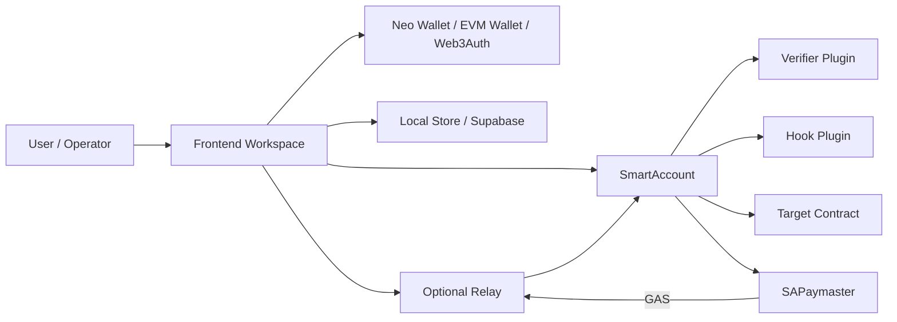
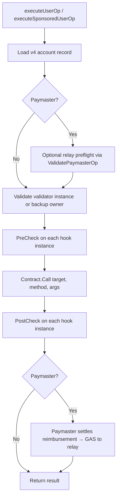
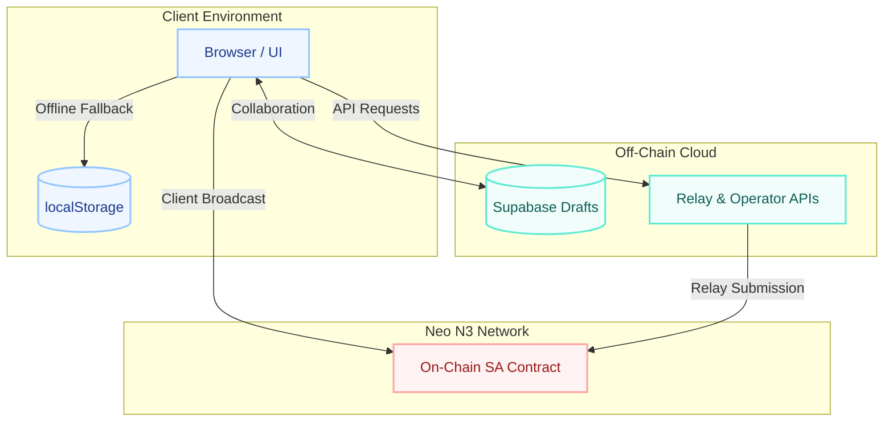
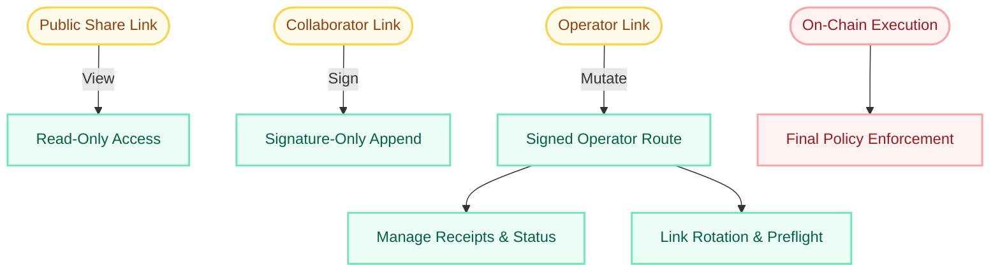
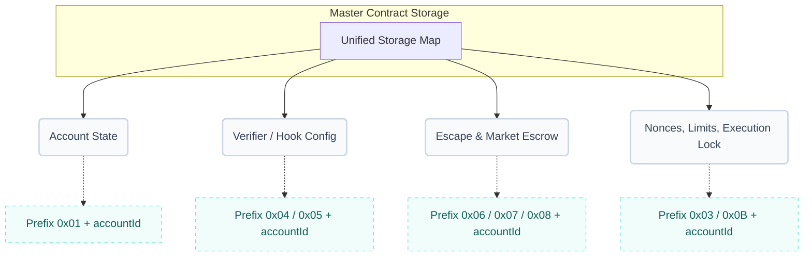
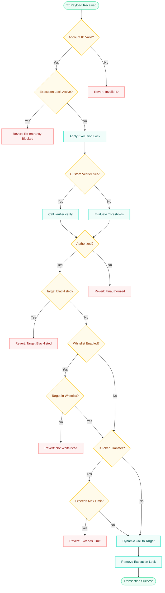
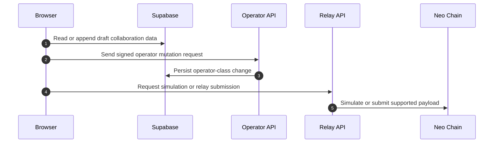
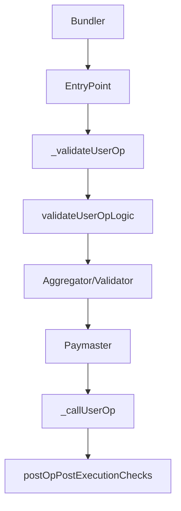
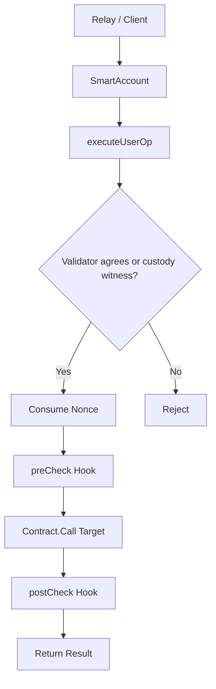
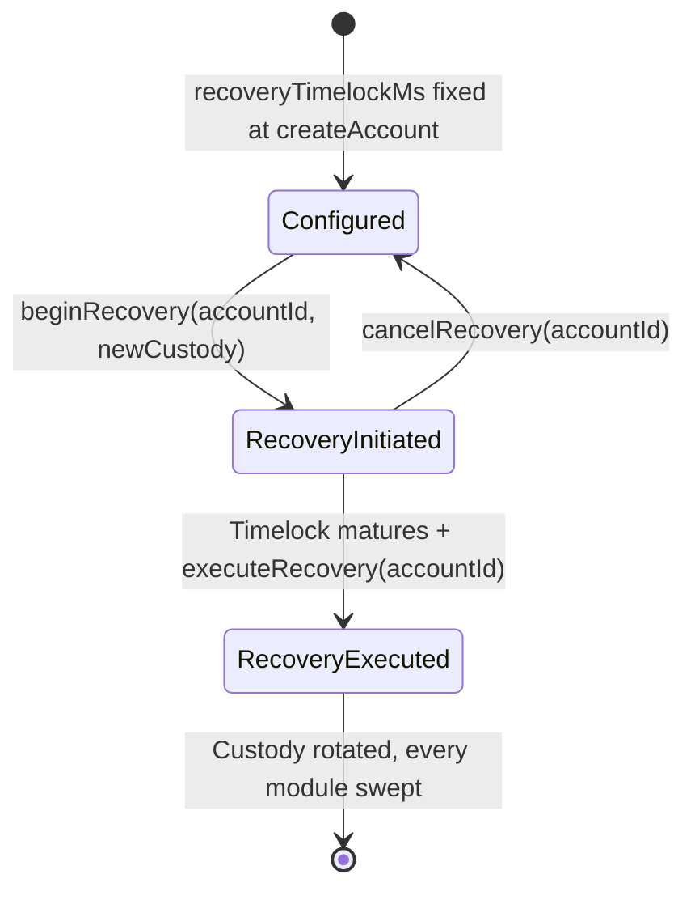

# SmartAccount Architecture

This book is the architecture reference for architects and system readers. It
merges the former topics architecture, NATIVE_SYSTEM_ARCHITECTURE, ORGANIZATION,
SA-SYSTEM-STATUS, DATA_FLOW and ETHEREUM_AA_COMPARISON into one place for
readers. The user guide lives in `docs/GUIDE.md`, the developer SDK reference in
`docs/SDK.md`, and the security model in `docs/SECURITY.md`.

## Contents

1. [Neo N3 Smart Account architecture](#neo-n3-smart-account-architecture)
2. [Native system architecture](#native-system-architecture)
3. [Repository organization](#repository-organization)
4. [System status and capability boundaries](#system-status-and-capability-boundaries)
5. [Data flow and storage](#data-flow-and-storage)
6. [Ethereum AA comparison](#ethereum-aa-comparison)

## Neo N3 Smart Account architecture

The active `main` branch is a **policy-gated** v4 architecture: a native-only minimal `SmartAccount` core plus validator and hook module instances installed through configuration intents.

### 1. Component Map



### 2. Account Model

The v4 account model is `accountId`-first.

- Each account is keyed by a deterministic 20-byte `accountId`.
- The public Neo address is derived locally from `verify(accountId)` plus the master contract hash.
- On-chain state stores:
  - `verifier`
  - `hook`
  - `backupOwner`
  - `escapeTimelock`
  - `escapeTriggeredAt`
  - nonce channels

The core wallet no longer depends on admin/manager/dome state as the main authorization surface.

### 3. Verification Pipeline

```mermaid
flowchart TD
  Start[Tx reaches Neo node] --> Verify[Node triggers verify(accountId)]
  Verify --> Context[Core checks active verification context]
  Context --> Allowed{Expected target?}
  Allowed -- No --> Reject1[Reject unexpected witness use]
  Allowed -- Yes --> Execute[executeUserOp(accountId, op)]
  Execute --> Auth{Verifier plugin passes or backup owner witness passes?}
  Auth -- No --> Reject2[Reject unauthorized operation]
  Auth -- Yes --> Nonce[Consume nonce + deadline]
  Nonce --> Hooks[Run hooks around execution]
  Hooks --> Return[Return result]
```

### 4. Application Execution Pipeline



The v4 core is intentionally small: authorization is delegated to validator module instances, policy to hook instances, and the core owns the nonce channels, configuration intents, threshold policies, `hookOrder`, recovery state and execution context.

### 5. Authorization Modes

- Backup-owner native witness
- Web3Auth / EIP-712 validator
- TeeKey / P256 / SessionKey / DelegatedIdentity / MultiSig validator instances
- Core-owned threshold policies over validator instances
- Hook instances in `hookOrder`, plus the built-in recovery and message paths

### 6. Contract File Map

| File | Responsibility |
| --- | --- |
| `contracts/native/SmartAccount/SmartAccount.cs` | v4 account control record, `verify`, `executeUserOp`, nonce channels, callback-free recovery, module configuration intents |
| `contracts/plugins/validators/Web3AuthValidator.cs` | EIP-712 `UserOperation` verification |
| `contracts/plugins/validators/TeeKeyValidator.cs` | TEE-signed authorization |
| `contracts/plugins/validators/P256Validator.cs` | Passkey / P-256 authorization |
| `contracts/plugins/validators/SessionKeyValidator.cs` | Short-lived delegated keys, one credential set per instance |
| `contracts/plugins/validators/MultiSigValidator.cs` | Threshold member validation; the core owns the policy |
| `contracts/plugins/validators/ZKEmailVerifier.cs` | Disabled email-authorization template; `onInstall` refuses |
| `contracts/plugins/validators/DelegatedIdentityValidator.cs` | Delegated (zkLogin) identity authorization |
| `contracts/plugins/validators/SubscriptionValidator.cs` | Bounded recurring charges; the core nonce is the only sequence |
| `contracts/plugins/hooks/*.cs` | Optional policies such as daily limits, token restrictions, and credential gating |

### 7. Module Lifecycle

Every module change travels the configuration-intent path and emits the generic module events:

- **install**: `proposeConfiguration` -> 24 h -> `confirmConfiguration` installs a validator or hook instance and emits `ModuleInstanceInstalled`
- **configure**: re-configuring an installed instance emits `ModuleInstanceConfigured` through the same intent path
- **remove**: an intent action or a recovery sweep removes the instance and emits `ModuleInstanceRemoved`
- **cancel / expire**: `cancelConfiguration` emits `ConfigurationIntentCancelled`; an intent whose window closes emits `ConfigurationIntentExpired`
- **policy**: `HookOrderSet` and `ThresholdPolicySet` record the ordered hook chain and the core threshold policy

The reused `ModuleInstalled` / `ModuleUpdateInitiated` / `ModuleUpdateConfirmed` / `ModuleRemoved` /
`ModuleUpdateCancelled` feed keeps older indexers working.

### 8. Recovery Model

v4 recovery is explicit and callback-free:

1. `beginRecovery(accountId, newCustody)` records a pending custody rotation that matures after the account's `recoveryTimelockMs` (7-90 days, fixed at creation).
2. `cancelRecovery(accountId)` deletes the pending record; only one can exist and its timer never restarts.
3. `executeRecovery(accountId)` is permissionless after maturity: it sweeps every module row and advances the authority epoch without calling any validator, hook, Market or Oracle.
4. `getRecoveryStatus(accountId)` reads the pending record back as `[exists, initiatedAt, matureAt, authorityEpochAtInit, newCustody]`.

This keeps recovery auditable and removes the old-plugin liveness dependency.

### 9. Paymaster (Sponsored Transactions)

The `SAPaymaster` contract enables trustless gasless execution on Neo N3:

1. **Deposit:** Sponsors send GAS to the Paymaster via NEP-17 transfer.
2. **Policy:** Sponsors call `setPolicy(accountId, targetContract, method, maxPerOp, dailyBudget, totalBudget, validUntil)`. Use `accountId = Zero` for a global policy sponsoring any account.
3. **Execution:** Relay calls `executeSponsoredUserOp(accountId, op, paymaster, sponsor, reimbursementAmount)` on the SA core.
4. **Settlement:** Core validates policy, executes the UserOp, then calls `paymaster.settleReimbursement()` to atomically deduct from the sponsor deposit and transfer GAS to the relay.

For a fee-bearing transaction the settled reimbursement is
`min(reimbursementAmount, transaction.SystemFee + transaction.NetworkFee)`. `maxPerOp`
limits this settlement, not the full transaction fee; a larger fee can still pass if
its requested reimbursement fits the policy. Daily and total budgets count settlements
under the resolved policy scope, including the shared scope of a global policy.
A policy violation faults the complete call. Zero-fee RPC estimation instead uses
the requested reimbursement as its conservative cap, so standard fee estimation
remains available; relays should retain a system-fee margin.

The Paymaster never authorizes execution — it only funds the relay after the verifier and hooks have already approved the operation.

### 10. Security Invariants

1. `verify(accountId)` is only valid inside the expected `executeUserOp` context.
2. Nonces are consumed by the core wallet, not verifier plugins.
3. Verifier plugins do not bypass hook or target-contract policy.
4. Backup-owner recovery is timelocked.
5. New integrations target `executeUserOp`; the V1/V2 wrappers `executeUnified` and `executeUnifiedByAddress` were removed and are absent from every deployed manifest and every contract source, so a transaction naming them fails in its verify phase.
6. Paymaster settlement only succeeds when called by the authorized SA core contract.
7. Paymaster deposit deduction happens before the GAS transfer to the relay (checks-effects-interactions).

## Native system architecture

This chapter describes the native implementation of the parallel
[smart-account paths](#system-status-and-capability-boundaries). The deployed-contract
implementation is the near-term NeoOS delivery priority. The native path is
`SmartAccount`, a protocol service with a
small, explicit authorization boundary. The [ABI 2 profile](proposals/SMARTACCOUNT-NATIVE-PROFILE-DRAFT.md)
defines the wire contract. The [SDK](SDK.md) and [workspace](GUIDE.md)
consume that contract; neither can grant authority the native contract rejects.
The profile remains a draft until the Neo proposal and activation process is
complete. The custom `SmartAccount` public build and its private `PLATFORM` build are separate
runtime profiles with separate account identities and artifacts. Native
implementation progress does not retire or suspend deployed-contract development.

The [account workspace](GUIDE.md) covers setup, backups,
the authority and timing matrix, and recovery decisions.

### Account identity and authority

An account has a stable account ID and a derived verification-script address.
The address holds assets without deploying one wallet contract per user. Custody
and recovery addresses are authorities, not the account's identity. Changing
custody does not change the funding address or reset operation nonces.

| Role | Authority |
| --- | --- |
| Custody | Direct witness authorization when no verifier is installed; account administration according to the native lifecycle |
| Recovery | Timelocked custody recovery and the profile's emergency controls |
| Verifier | Authorization of the exact operation; bound to an admitted module and its current configuration |
| Hook | Policy checks before and after target execution |
| Fee payer | Signs and pays for the complete transaction, including fees and expiry |
| RPC, SDK, UI | Discovery, construction, simulation and submission; no independent authority |

Recovery advances an authority epoch and the configuration nonce, replaces
custody, detaches the verifier and hook, and clears enrolled dependencies and
pending configuration. It does not invoke the old modules. Account identity,
operation nonces and frozen status remain intact. Unfreezing retains its required
authorities; recovery does not silently enable a frozen account.

The recovery authority is also the guardian for emergency freeze. Choose an
accepted Neo wallet authority controlled independently from custody, and keep
both wallet backups. A guardian can freeze an Active account without custody;
unfreezing requires custody and the configured guardian. Recovery retains that
guardian. If its key is lost while the account is Frozen, this profile provides
no custody-only override or guardian replacement while Frozen. While Active and
without pending custody recovery, custody can propose a guardian replacement;
it takes 24 hours to mature.

Freeze takes effect when its transaction executes and clears **all pending
intents**, including custody recovery and module-policy calls. For emergency
containment followed by recovery, freeze first, confirm the resulting state,
then start a new recovery proposal. Proposing recovery alone does not freeze the
account. A successful counter-advancing transition also invalidates pending
configuration, so every subsequent action must reload current state.

Custody authorizes proposals to replace the verifier, hook or recovery address.
After 24 hours, anyone may pay to activate the current mature intent through
`activateVerifier`, `activateHook` or `activateRecoveryAddress`; no custody or
guardian signature is required at activation. The account must still be Active
with no pending custody recovery. Module replacement still checks code pins and
old-module cleanup. In contrast, applying a delayed module-policy call requires
custody again and the identical stored method and arguments. Custody may cancel
that call for its selected verifier or hook role while it remains pending.
Account-only activation/recovery calls act on pending state at execution. The
SDK's policy cancellation uses a complete transaction script that reads and
serializes the selected pending call, asserts equality with reviewed bytes, and
only then invokes the unchanged native cancellation entrypoint. It faults on
changed or missing content without cancelling a replacement. Exact-script
signing is required; ordinary wallet invoke cannot express this guard. An
identical-byte re-proposal can still match, because the protocol has no unique
proposal-instance counter. See the [transaction guards](GUIDE.md) chapter of the user guide book.
Coordinate custody devices and inspect confirmed state after execution.

Supported native modules address storage by account ID and authority epoch.
Reinstalling the same module after recovery starts with empty policy state.
Normal module replacement still performs checked cleanup. The independent
recovery path handles broken or unavailable old modules.

### Execution and revocation

1. Discover the native contract on the explicitly selected network and verify
   its identity, ABI version, profile digest and activation.
2. Read current account state and the selected operation nonce channel. Build
   the exact target, method, typed arguments, deadline and nonce.
3. Bind authorization to network, native contract, account, authority epoch and
   configuration nonce. Execute with
   `executeUserOp(accountId, operation, expectedAuthorityEpoch, expectedConfigurationNonce)`;
   batch execution uses the same four-argument order.
4. The native contract checks both counters before authorization and callbacks.
   The proxy verification path enforces the same canonical envelope. This binds
   transaction-witness authorization as well as operation signatures to the
   reviewed account state; an old signed transaction cannot survive a counter
   change merely because its nonce and block expiry remain valid.
5. Run bounded verifier and hook callbacks, the exact target call, and post
   checks within the transaction. Callback arguments and results have independent
   copies so one callback cannot rewrite another callback's input.
6. Verify the complete signed transaction against the node snapshot before
   broadcast, then read the actual transaction and application outcome.

The proxy witness grants the intended target frame only. It does not grant
unrestricted router descendants or later settlement calls access to assets.
The native account cannot be the transaction's fee payer: its operation proof
does not authorize arbitrary transaction fees.

### Supported policy modules

| Native module | Intended use |
| --- | --- |
| NeoWitnessValidator | Explicit Neo witness authorization with exact validator scopes |
| SessionKeyValidator | Expiring delegated keys and constrained operations |
| MultiSigValidator | One configured child signer; the core holds the threshold policy |
| WhitelistHook | Allowed targets and methods |
| DailyLimitHook | Bounded spending with measured token-balance changes |
| TokenRestrictedHook | Restricted token movement and policy checks |

Native MultiSig selects the first threshold of approving children in configured
roster order. Only those children receive post-execution authority and consume
their policy allowances. Supplying an additional valid signature does not select
that child once the quorum has been reached. The native contract retains an
independent approval receipt for this operation, checks the active code pins,
and discards the receipt on completion or failure. Verification receipts never
carry into Application, and batch operations never share receipts.

The composite compares its threshold, ordered roster and signer domains before
and after the selected children's post checks. Those children recheck applicable
current policy and account for the target result without repeating SessionKey
cryptographic verification. Receipt construction, copying and all descendant
calls remain inside the fixed verifier budget.

The native MultiSig profile admits at most three child modules, two required
approvals and three aggregate signer domains. A standalone NeoNativeVerifier
has its own ten-signer bound; the composite limit does not reduce that separate
capability. Ordinary witness quorums such as three-of-five belong in that
standalone verifier; MultiSigVerifier combines different verifier policies.
Supported combinations still need to pass execution against the
current fee policy and their actual module bytecode.

Supported native P-256 keys use their standard Neo signature-account identity as
the canonical signer domain. Configuration strictly validates both compressed
and uncompressed encodings with `canonicalP256PublicKey` before storing the
compressed key; invalid curve points are rejected before any policy write.
Reusing one key as both a SessionKey and a
NeoNative signer therefore does not create two independent votes. This does not
prove that distinct keys belong to independent people or reveal who controls an
arbitrary verification script. Token policies likewise depend on the selected
tokens' behavior and balance queries. Exact profile metadata is an admission
compatibility check, not a proof that arbitrary third-party bytecode follows the
supported module implementations.

Module configuration is delayed by 24 hours; custody recovery is delayed by
seven days. Session expiry must leave time after activation. Delayed key removal
is not an emergency revoke button: freeze provides immediate containment, while
recovery provides the old-module-independent exit.

### Fees and user experience

An external payer may fund a transaction without acquiring account authority.
The native profile has no reimbursement paymaster or automatic sponsorship
settlement. The payer signs the complete transaction after separate system,
network and total fee ceilings have been checked.

An included transaction whose Application ends in FAULT can still charge its
fee payer; reverted state changes do not refund transaction fees. A target
returning Boolean `false` is a business result, not itself a VM fault. Modules
and clients apply their own result checks, including the SDK's strict
Boolean-true requirement for `transfer`.

Bounded calls need enough remaining gas to admit a child budget even when actual
consumption is lower. Node simulation therefore reports `minimumrequiredfee` in
addition to `gasconsumed`; wallet and SDK builders preserve that requirement.
Custom proxy verification and invocation scripts participate in network-fee
calculation. A fee increase after signing requires a new reviewed transaction.

Each verifier callback has a fixed 1 GAS budget; each hook and maintenance
callback has a 2.5 GAS budget. The global Verification limit also applies: a
32-operation encoding bound does not promise that 32 expensive authorizations
fit in one transaction. The SDK simulates and quotes the exact batch. Fee-policy
changes and arbitrary third-party modules can change feasibility, so a measured
boundary vector establishes support only for its recorded runtime and fee policy.

The workspace starts read-only and shows identity separately from the funding
address. Recovery descriptors contain public discovery information, not private
keys. Observed network, wallet, account or pending-intent changes invalidate
prepared reviews. Returned transaction IDs are submissions; exact transaction and receipt
readback are required before confirmation.
After a submission timeout, query the same transaction ID before preparing a
replacement. Successful simulation does not reserve a nonce or guarantee inclusion.

Ordinary wallet `invoke` APIs can handle supported single-authority management
calls. Proxy execution and multiple authorities require exact witness support;
the workspace exports a reviewable SDK recipe and exact script for those flows.
It does not disguise a script export as an executed transaction.

### Verification and activation

Source, contract bytecode, native runtime, RPC and client tests cover distinct
layers. Native module VM probes do not prove the native recovery state machine.
Mock browser tests do not prove a network transaction. Handwritten formal models
do not establish complete NeoVM/compiler refinement or cryptographic soundness.
See the [formal scope](engineering/VERIFICATION-AND-GATES.md) and
[remaining proof boundaries](reports/sa-native-open-boundaries-20261008.json).

Release evidence must identify the exact source and rebuilt artifacts, exercise
the complete signed transaction on the matching private runtime, verify state and
receipts after success and rejection, and retain reproducible build inputs.
Proposal acceptance, external review, public-network activation, production
deployment and user-controlled wallet signatures remain separate decisions.

## Repository organization

Updated on 2026-11-21 for the native-only contract layout (`contracts/native`,
`contracts/plugins`), which replaced the 2026-11-18 three-directory layout once
the custom user-contract tree was retired. That layout had replaced the
2026-10-13 `implementations/` entrypoints. The earlier 2026-09-27 organization
snapshot was deleted with the pre-deployment compatibility surfaces, so this
chapter is the only tracked layout statement; the current layout and ownership rules are
below.

### Purpose

neo-os-sa is the NeoOS account-abstraction repository. It contains the
Neo N3 SA contracts, frontend tooling, and SDK surfaces for creating and using
Smart Accounts.

### Authority Boundaries

- This repo OWNS: SA user operations, validator and hook module bindings,
  recovery policy, paymaster policy, SA contract behavior, and SA-specific
  frontend and SDK integration.
- This repo NEVER OWNS: DID eligibility or identity issuance, network identity
  selection, signer custody, catalog publication, MiniApp product behavior, or
  production deployment state.

### Directory Structure

    contracts/               Neo N3 SA contract sources
      custom/                user-contract (custom) implementation
        market/              SAAddressMarket escrow contract
        paymaster/           SAPaymaster contract
        registrar/           SAPlatformRegistrar contract
      native/                native ABI 2 implementation
        SmartAccount/        true source of the consensus SmartAccount service
        Runtime/             runtime overlay compiled with it
      plugins/               module contracts shared by both implementations
        validators/          validator modules
        hooks/               hook modules
        recovery/            social-recovery service and action-session validator
        templates/           third-party module starting points
        native-profile/      native-profile builds of the shared modules
      build/                 pinned artifacts of the public deployments
    tests/                   test suites
      mocks/                 mock contracts the suites deploy
    formal/                  formal verification inputs and checks
    frontend/                SA application and server routes
    sdk/                     SA SDK surfaces
    shared/                  shared SA types and helpers
    supabase/                SA database migrations
    scripts/                 repository tooling
    docs/                    project documentation
    .github/                 CI workflows
    SmartAccount.sln         .NET solution
    README.md                public project and boundary documentation

`contracts/native/` holds the one implementation on the branch;
`contracts/plugins/` holds the validator and hook modules it installs. Each
directory carries a `profile.json` that names its source roots, artifacts and
verification commands; source files are not duplicated. The native profile
(`contracts/native/`) is the delivery path: it holds the true source of the
consensus `SmartAccount` service prepared for standard submission, and the
matching Neo core repository carries generated copies of it and owns native VM
enforcement.

### File Organization Rules

- Keep contract sources and contract-specific checks under contracts/, in
  exactly one of native/ or plugins/. A contract only the native service uses
  belongs to native/; a module the service installs belongs to plugins/.
- Keep mock and probe contracts under tests/mocks/; they are test fixtures, not
  part of either implementation.
- Keep third-party module starting points under contracts/plugins/templates/; templates
  compile against the shared module layer (contracts/plugins/validators/ValidatorAuthority.cs,
  contracts/plugins/hooks/HookAuthority.cs) and scripts/check_plugin_templates.mjs keeps
  their manifests aligned with the core's install-time ABI gate.
- Use `contracts/native/profile.json` to select the implementation profile;
  do not infer profile identity from a deployment label or a shared artifact
  directory.
- Keep native-only modules and client code under the native roots listed by
  `contracts/native/profile.json`; nothing outside those roots may import native
  entrypoints as proof of native activation.
- Keep frontend routes, UI, and frontend configuration under frontend/.
- Keep SA client types and builders under sdk/ and shared/.
- Keep formal evidence and verification inputs under formal/.
- Keep database migrations under supabase/migrations/ and apply them only
  through the repository's documented migration process.
- Do not commit credentials, local environment files, build output, or
  unrelated MiniGame content.

### Cross-Repository Dependencies

- neo-os-contracts owns platform/app/Oracle contract source, while this repository
  owns SA contract source. SA consumes reviewed artifacts and interfaces.
- neo-os-devpack supplies versioned SDK packages; consumers use reviewed pins
  instead of copying its implementation.
- neo-os-workspace and neo-os-admin own workspace registries and release/catalog
  publication respectively; SA integration does not transfer these authorities.

- neo-os-web owns the current architecture contract until the documented v2
  adoption completes. neo-os-services is the source for the public Morpheus
  registry, public runtime catalog, and confidential-envelope inputs that SA
  synchronizes through `scripts/lib/morpheus-canonical-sync.mjs`.
- neo-os-did owns DID identity and eligibility; SA may consume a verified
  eligibility proof but does not make identity decisions.
- neo-os-services supplies service-side integrations and generated registry
  inputs where the repository contracts require them.
- contracts/neo-platform-packages.json records the contract build's package
  provenance. Package availability is a build-environment prerequisite; this
  repository remains authoritative for SA contract sources and does not assign
  contract authority to another repository.

### Position in the NeoOS Workspace Architecture

This section is a pointer, not an authority. The enforced binding is the `Architecture authority`
section of the root `README.md`, declared in `neo-os-web/docs/workspace/neoos-target-architecture.v1.json`
and checked by `npm run check:architecture-sources` in `neo-os-web`. The proposed successor is
`neoos-target-architecture.v2.json` (status `PROPOSED`), checked by `npm run check:architecture:v2`;
its design is `neo-os/claudedocs/NEOOS-TARGET-ARCHITECTURE-V2-20260921.md`.

#### v1 binding (enforced)

| Component | Plane | Published interfaces |
| --- | --- | --- |
| `protocol-sa-core` | protocol plane | interfaces: SmartAccountV3, UserOperation, SAAuthorization |

#### v2 binding (proposed)

Repository layer: `L1` (chain-protocol).

| Component | Layer | Ownership |
| --- | --- | --- |
| `C03` account | L1 | owns: SmartAccount core, verifiers, hooks, paymaster… | must not own: did-eligibility, network-identity, signer-selection |

#### Declared moves out of this repository

| Path | Destination |
| --- | --- |
| `sdk/js` | C10 |
| `frontend` | C23 |
| `frontend/api` | C14 |
| `supabase/migrations` | C14 |

No deployment or production status is asserted here. Status is generated, never written:
see `neo-os-web/docs/workspace/ARCHITECTURE-STATUS.generated.md`.

### Maintenance Guidelines

1. Route new integrations through the centralized SA operation and validation
   surfaces so authorization and execution remain distinct.
2. Keep relay and paymaster paths as convenience or funding layers; they must
   not replace on-chain authorization.
3. Run the affected contract, frontend, formal, migration, and test checks
   before committing.
4. Review generated contract artifacts and deployment references for exact
   source parity.
5. Use conventional commits and keep production, chain, and cloud writes out of
   repository validation.

## System status and capability boundaries

This is a source-level integration guide. A configured address, a successful build,
or a historical deployment receipt does not show that a public contract contains
the current implementation. Validate the exact NEF, manifest, network and core
binding before enabling a capability for users.

### Parallel implementation paths

The project develops one smart-account protocol through two implementation paths.
The deployed-contract path is the immediate delivery priority for NeoOS. The
native path develops the standard and node integration in parallel. A native
activation schedule must not prevent current NeoOS account functionality.
The deployed-contract implementation serves NeoOS on the current public runtime.
Native implementation and protocol review proceed in parallel, with independent
release gates. Neither path waits for the other to become usable, and evidence
from one path does not establish runtime guarantees for the other.

#### Protocol and implementation responsibilities

Protocol rules describe authorization, execution ordering, replay protection,
account lifecycle, recovery, failure outcomes and fee responsibility. Each runtime
profile specifies its exact identity, serialization, entrypoints and enforcement
capabilities. A reference implementation validates the rules it actually
implements; passing its tests is not acceptance of a Neo standard.

| Path | Starting implementation | Delivery boundary |
| --- | --- | --- |
| Deployed contract | `SmartAccount`, its `public` modules, `SmartAccountClient` and app | Deployable on the published Neo N3 runtime after artifact, integration and release validation |
| Native contract | `SmartAccount`, native ABI 2 modules, `NativeSmartAccountClient` and `/native` | Matching node implementation, protocol review and hardfork activation |
| Runtime experiments | Private `PLATFORM` build | Research and controlled validation only; not a third public product |

Existing V3 is the operational starting point for the deployed-contract path,
not a claim that its current ABI already conforms to every native draft rule.
Evolution must preserve existing users or introduce an explicit new version and
migration. Do not overwrite a deployed account's meaning by changing an endpoint,
core hash, build symbol or display label.

#### Common semantics and explicit differences

Both paths must specify and test the following: deterministic account discovery;
separate authorization and fee payment; typed operation commitments; nonce and
deadline checks; ordered verifier, hook and target execution; atomic application
rollback; confirmation distinct from submission; module changes; recovery; and
the difference between a VM fault and a successful call returning `false`.

Cross-implementation cases compare these semantic outcomes through explicit
profile adapters. Byte-level vectors remain profile-specific until the same
encoding has been implemented and verified on both paths. In particular:

| Boundary | Public deployed V3 | Native ABI 2 |
| --- | --- | --- |
| Availability | Custom deployment and matching modules | Consensus activation of the native contract |
| Account and asset identity | V3 account registration and proxy script | Native account derivation and canonical native proxy script |
| Operation authorization | V3 verifier-specific signatures and witness rules | Native contract/network/account/epoch/configuration commitment |
| Callback resources | Transaction budget and reviewed module behavior; no isolated child budget | Platform-enforced verifier, hook and maintenance child budgets |
| Recovery | Backup-owner escape with timelock and checked old-module cleanup | Independent custody recovery revokes old modules through the authority epoch |
| Sponsored fees | Existing constrained paymaster and relay flows | External transaction payer; no native reimbursement paymaster in ABI 2 |
| Contract changes | Contract deployment/update authority and documented version migration | Protocol governance and hardfork migration |

The public runtime cannot reproduce a non-bypassable child execution budget using
a contract convention. Do not weaken or remove the native requirement to claim
equivalence. Improve the deployed profile within its runtime capabilities and
state remaining restrictions in the SDK, UI and integration contract.

#### Current delivery sequence

1. Verify the deployed-contract baseline and exact NeoOS integration surface:
   account creation and discovery, supported authorization, proxy asset transfer,
   fee payment, persisted receipts and backup-owner recovery.
2. Remove product and integration gaps in that path. Use published Neo packages,
   isolated test deployments and explicit account/network/core identity checks.
   Keep optional modules and sponsorship behind their own verified prerequisites.
3. Maintain a capability and conformance matrix for both implementations. Every
   semantic change identifies affected profiles, expected outcomes and migration
   implications; profile-specific improvements are labelled as such.
4. Continue native correctness, resource accounting, modules, SDK and proposal
   review independently. Custom deployment is neither native activation nor
   permission to advertise the draft as an adopted standard.

#### Release and migration

Each implementation needs its own pinned source, reproducible artifacts, tests,
deployment identity and post-deployment readback. Local tests and historical
receipts do not prove that the current public deployment contains reviewed code.
Public deployment, administrator updates and user wallet signatures remain
separate operational actions.

Moving to native accounts is an explicit opt-in migration. Account IDs, proxy
addresses, balances, allowances, plugin settings and signatures must not be
assumed portable. Preserve the old path until each user's assets and operational
dependencies have been verified on the destination. ABI 2 currently has no
automatic legacy import endpoint.

See the runtime-profile and capability sections below, the
[V3 architecture](#neo-n3-smart-account-architecture), the
[native architecture](#native-system-architecture), and
[issue #242](https://github.com/neo-project/proposals/issues/242) for the current
implementation and protocol-review scopes.

### Runtime profiles

| Profile | Implementation boundary | Deployment requirement |
| --- | --- | --- |
| `public` | Standard `System.Contract.Call`; account nonce, validator modules and hooks, and execution in one transaction | Published Neo runtime; current core and matching module artifacts |
| Private `PLATFORM` | Adds bounded module child calls | Runtime with the matching private syscall; not deployable by choosing a public RPC URL |
| Native SmartAccount | ABI 2 `SmartAccount`, independently derived identity, epoch-scoped modules and bounded callbacks | Corresponding Neo core implementation and hardfork activation; the public v4 deployment does not activate it |

The public profile has no per-child module gas budget. Relays and sponsors must
bound transaction fees and review the selected modules and their mutable child
configuration. Private-profile proofs do not close this public-runtime limitation.

### Native account workflow

The native ABI 2 implementation has independent custody recovery, authority-epoch
module storage, explicit epoch/configuration commitments in execution, bounded
callbacks, witness fee estimation for supported signer shapes and signed-transaction preview. See
[the native architecture](#native-system-architecture), [SDK](SDK.md) and
[workspace](GUIDE.md). It requires the matching native runtime
and activation; the public v4 deployment is not evidence of native availability.

Source custody: `contracts/native/SmartAccount/` in this
repository is the only editable copy of the native `SmartAccount` contract
(the true source); the SHA-pinned Neo core checkout used by the
[native VM workflow](../.github/workflows/native-profile.yml) carries
generated copies of those ten files, and the workflow runs
`scripts/sync_native_smartaccount.py --check` against the pinned core before
any build or test work, so drift, missing or unmanaged copies fail the lane
there. The pin now records the regenerated generated-marker commit. This
local true-source/sync structure and its CI gate are repository mechanics;
they do not change the external activation, acceptance and readback boundaries
listed below.

Discovery binds the [current profile parameters](proposals/smartaccount-native-profile-v2-parameters.json)
and their digest, not just `getVersion() == 2`. Identity derivation remains version 1;
authorization and the exact 14-field account record are version 2. Execution takes
four arguments, including the current authority epoch and configuration nonce.
Native composite limits are three children, two approvals/threshold and three
aggregate signer domains. Verifier callbacks have a 1 GAS budget; hooks and
maintenance have 2.5 GAS each. These bounds do not guarantee a maximum batch fits
the network's global Verification budget.

### Public v4 account and operator workflows

| Capability | Supported contract | Remaining boundary |
| --- | --- | --- |
| Account identity | Read the account ID, the derived proxy and the installed validator modules from the selected core; reject mismatches | Legacy reverse indexes may require an explicit account ID |
| Shared drafts | Execute a staged, consistent signed invocation | Collaborator records and UI signature counts do not establish chain authorization |
| MultiSig | Chain-ordered child proofs over the same operation, with child-specific signing domains | Threshold counts validator modules; it does not prove independent humans or custody |
| Session transfers | Exact NEP-17 arguments, proxy sender, nonnegative amount, Boolean success | A token's declared amount does not measure arbitrary additional balance loss |
| Daily limits | Fixed-window accounting and actual net debit, including targets returning false or zero | Token `balanceOf` is a trust dependency; this is not a per-asset universal balance oracle |
| Subscription transfers | Positive amount and successful NEP-17 outcome before consuming a period | Generic non-transfer targets retain their documented return semantics |
| Direct proxy transfer | Derived witness, core scope readback and explicit bounded fee reserve | Relay mode and administrator-configured scope; ordinary wallet invoke APIs cannot add this witness |
| Sponsored execution | Policy-checked settlement with a shared transaction reimbursement ceiling in each core | Sponsored proxy witnesses are refused; arbitrary settlement must not inherit proxy asset authority |
| Operator key recovery | Durable browser key storage and passphrase-encrypted backup | Import requires the draft's already-pinned public key; a link alone cannot replace it |
| Backup-owner escape | Timelock and owner witness; ordinary cleanup-based finalization or callback-free permanent owner-only recovery | Owner-only recovery cannot be undone or reinstall modules; escrow, external approvals and module-held funds remain separate |

### Module names are not full product guarantees

- `P256Validator` verifies its documented P-256 proof format. It is not by
  itself a complete WebAuthn ceremony with origin, RP ID and authenticator-data
  validation.
- `TeeKeyValidator` trusts its registered signing key. A valid signature alone does
  not establish a particular enclave's attestation.
- `ZKEmailVerifier` is disabled and cannot be installed (`getModuleProfile()` advertises no capability and the core rejects the install); do not offer it as a working account option.
- `DelegatedIdentityValidator` uses its documented delegated signing path; do not describe
  it as a locally verified general-purpose zero-knowledge login proof.
- Social recovery's module owner and the core backup owner are separate state.
  Updating one is not evidence that the other changed.

### Validation and release

Run `scripts/verify_repo.sh --profile native` for the native contracts build, frontend,
browser, SDK consumers and dependency audits; native is the default and the only
implementation profile. Run the formal and private-chain gates with their required
tools, and inspect their recorded scope and skipped checks. The native kernel builds into each
project's `bin/Release/net10.0/`; the module and epoch-probe receipts land wherever `--output` points.

The separate [native VM workflow](../.github/workflows/native-profile.yml) builds a
reviewed immutable core commit and two identical native module copies, then checks
the complete measured composite scenario matrix with the actual native VM. It
rejects missing, duplicate, unknown, failed or over-budget cases; synthetic
transaction signers make this a host test, not mempool or block confirmation.
NativeEpochProbe in the native gate uses a test-only SmartAccount ABI fixture and is a
different test boundary. Protocol v4 renamed the modules to validators and moved configuration onto the
`configure` lifecycle callback. The probe now drives that callback set: it installs,
configures, phase-checks and uninstalls every module the native profile builds, and
asserts the pinned-core caller check, `(accountId, moduleId)` instance state and the
retirement of the `0xA2` authority-epoch layout. Full-node SDK/private-chain receipts remain
separate.
Historical reports retain the commits and bytes they tested; a later test-only
core commit does not change the production runtime identity recorded there.

Before a public rollout, compare every deployed artifact and authorization binding
with the reviewed source; exercise account creation, configuration, transfer,
failure rollback, recovery and fee settlement on the intended runtime. User wallet
signing and public-chain deployment are separate operational steps.

### Current source: callback-free custody recovery

`beginRecovery(accountId, newCustody)` records a pending custody rotation that matures
after the account's `recoveryTimelockMs` (7-90 days, fixed at creation); `cancelRecovery`
deletes the record, and `executeRecovery` — permissionless once matured — applies it.
Execution calls no validator, hook, Market or Oracle: it sweeps every module instance,
threshold policy, hook order, message-subject set, pending intent, nonce channel and
pending migration state, rotates custody to the approved address, clears the recovery
authority, re-enables built-in authorization and advances the authority epoch,
configuration nonce and control revision. `getRecoveryStatus` reads the pending record
back as `[exists, initiatedAt, matureAt, authorityEpochAtInit, newCustody]`.

Recovery preserves identity, asset address and execution nonce history, but it is not a
promise to erase old plugin storage, refund plugin-held funds, revoke token allowances,
settle an active market escrow or remove the independent contract upgrade administrator.
These are source-candidate capabilities; integrations must discover the selected
deployment ABI and read the chain state before exposing them.

### Current source: platform services, freeze and discovery reads

The committed custom source candidate extracts the platform services out of
the core: market escrow settlement (`abandonListing`) lives on `SAAddressMarket`,
paymaster reimbursement (`settleReimbursement`) on `SAPaymaster`, and
platform-account registration plus the owner-rotation timelocks on the
standalone `SAPlatformRegistrar` (the retired custom treeregistrar/). On top of the
2026-11-13 security remediation, the candidate adds the backup-owner-gated freeze
surface (`freezeAccount` / `unfreezeAccount` / `isAccountFrozen`), not part of
the pinned public artifact.

The 2026-11-16 Ethereum-AA alignment revision adds two safe reads on top of
that candidate: `describeAccount(accountId)` aggregates the full account
descriptor (ERC-7579-style capability discovery), and
`simulateValidation(accountId, op)` — named after ERC-4337's EntryPoint so
4337-aware tooling finds the familiar entry point — is a non-faulting
execution-check preflight (signature and hook execution excluded) that also
reports the escrow latch and the native backup-owner witness. The same revision lets
`SessionKeyValidator` accept a version-0x01 initial-key blob in
the module init data, so a session-key account works on day one;
later key changes go through a fresh configuration intent with its own 24-hour
maturity and seven-day expiry. The SDK exposes
`describeAccount` / `simulateValidation` / `buildSessionKeyInstallCommand` plus
ERC-4337-shaped (`toErc4337UserOperation`, `estimateUserOperationGas`) and
ERC-7715-shaped (`buildSessionKeyPermission`) adapters; the typed-data
signing layout is specified in the [SDK book](SDK.md) (chapter "EIP-712 signing").

A same-day design-phase cleanup removed every pre-deployment compatibility
path (legacy storage-prefix fallbacks, the one-time rotation migration, the
v3 recovery action ticket and the migration/upgrade scripts), bringing the
candidate to 81 ABI entries against the 90 entries of the pinned public artifact.

The public deployments still run the 90-method artifact, so the extraction,
freeze, discovery and day-one-session-key surfaces stay
source-candidate capabilities behind the
unchanged upgrade-required boundary: a governed upgrade and independent readback
must land before any deployment claims them. Local
evidence so far is source-level only — contract tests cover the extracted
service ABI and the freeze surface, and the
candidate NEF/manifest hashes are re-pinned — while the fresh NeoExpress
receipt, the artifact reproducibility certificate, the CI lanes and the
public-chain readback remain open evidence gates.

## Data flow and storage

The Smart Account model centralizes all on-chain authority inside the **Master Entry Contract**, while using the browser, Supabase, and optional relay services to improve usability and collaboration.

### 1. System Boundaries

The easiest way to understand the system is to separate it into trust boundaries.



Those boundaries do different jobs:

- **Browser** prepares invocations, displays readiness, and holds temporary UI state
- **localStorage** preserves local-only drafts when Supabase is absent
- **Supabase** stores collaborative draft data and scoped links
- **Relay APIs** simulate or submit relay-ready payloads and accept signed operator mutations
- **Neo N3 chain** stores the real account rules and executes the final call

### 2. Data Ownership Matrix

| Boundary | What lives there | Who can mutate it | Why it exists |
| --- | --- | --- | --- |
| On-chain master contract | Per-account state (verifier, hook, backup owner, escape, market escrow, metadata), nonces, execution lock, plus the contract-admin and platform-registrar slots | Authorized SA flows, each gated by its own witness | Source of truth for authorization and execution |
| Browser memory | Current workspace state, selected payload mode, active wallet session | Current browser session | Fast UX and staging |
| `localStorage` fallback | Local-only drafts and preferences | Same browser only | Offline / no-Supabase development path |
| Supabase | Draft body, append-only signatures, bounded activity, bounded receipts, scoped slugs | Scope-limited collaboration flows | Shared review and multi-party coordination |
| Relay server | Simulation results in flight, relay signer use, signed operator mutation validation | Server config + signed operator requests | UX helper for relay and operator-only actions |

### 3. Mutation Authority by Boundary

Not every boundary is allowed to mutate the same data.



Practical meaning:

- public viewers can inspect a draft but cannot mutate it
- collaborators can add signatures but cannot append operator-class relay activity
- operators can request higher-sensitivity mutations, but the server still validates signed intent
- the chain remains the final authority for whether the transaction is valid

### 4. Storage Schema On-Chain

The contract utilizes a unified internal storage mapping where keys are derived by concatenating a static prefix with a hashed representation of the user's `accountId`.



### 5. Internal Data Flow During Execution

When an execution command enters the Master Contract, it flows through a rigid pipeline of isolation, verification, and restriction checks before any external smart contract is called.



### 6. Relay and Signed Operator Mutation Flow

The relay and operator helper paths exist to improve usability, not to replace the contract.



### 7. Retention and Practical Limits

The collaborative metadata layer is intentionally bounded:

- latest **100 activity entries** retained
- latest **12 submission receipts** retained
- immutable draft body preserved separately from append-only signature history

This keeps long-lived drafts explainable and reviewable without letting metadata grow without limit.

### 8. Storage Key Prefixes Table

| Prefix Identifier | Hex Value | Purpose |
| :--- | :---: | :--- |
| `Prefix_AccountState` | `0x01` | Serialized per-account state: verifier, hook, backup owner, escape timelock. |
| `Prefix_VerifyContext` | `0x02` | Verification context captured for the running witness check. |
| `Prefix_Nonce` | `0x03` | Composite key for the per-account nonce channels. |
| `Prefix_VerifierConfigContext` | `0x04` | Retained verifier configuration context. |
| `Prefix_HookConfigContext` | `0x05` | Retained hook configuration context. |
| `Prefix_MarketEscrowContract` | `0x06` | Market escrow contract bound to the account. |
| `Prefix_MarketEscrowListing` | `0x07` | Market escrow listing records. |
| `Prefix_EscapeLastInitiated` | `0x08` | Start of the current escape window. |
| `Prefix_PendingVerifierUpdate` | `0x09` | Delayed verifier update awaiting its maturity time. |
| `Prefix_PendingHookUpdate` | `0x0A` | Delayed hook update awaiting its maturity time. |
| `Prefix_ExecutionLock` | `0x0B` | Re-entrancy lock held for the duration of one operation. |
| `Prefix_MetadataUri` | `0x0C` | Account metadata URI. |
| `Prefix_HookExecutionContext` | `0x0D` | Per-account hook execution context. |
| `Prefix_VerifierExecutionContext` | `0x0E` | Per-account verifier execution context. |
| `Prefix_PendingVerifierCall` | `0x0F` | Deferred verifier call record. |
| `Prefix_PendingHookCall` | `0x10` | Deferred hook call record. |
| `Prefix_ContractAdmin` | `0x11` | Bare slot: the contract admin of the shared core. |
| `Prefix_UpdateTimelock` | `0x14` | Bare slot: timelock for a contract update. |
| `Prefix_PendingContractAdmin` | `0x15` | Bare slot: pending contract-admin transfer. |
| `Prefix_AdminTransferTimelock` | `0x16` | Bare slot: timelock for the contract-admin transfer. |
| `Prefix_PlatformRegistrar` | `0x17` | Bare slot: the platform registrar pointer. |
| `Prefix_PendingPlatformRegistrar` | `0x18` | Bare slot: pending registrar pointer. |
| `Prefix_PlatformRegistrarTimelock` | `0x19` | Bare slot: timelock for the registrar pointer. |
| `Prefix_PendingUpdateNefHash` | `0x1A` | Bare slot: NEF hash of a pending update. |
| `Prefix_PendingUpdateManifestHash` | `0x1B` | Bare slot: manifest hash of a pending update. |
| `Prefix_VerifyScopeTarget` | `0x1C` | Target the current witness check is scoped to. |
| `Prefix_MarketEscrowCancelInitiated` | `0x1D` | Start of the market-escrow cancellation window. |
| `Prefix_PlatformAccountBinding` | `0x1E` | Per-account platform binding. |
| `Prefix_PlatformProxyAccount` | `0x1F` | Proxy account of a platform binding. |
| `Prefix_TransactionReimbursement` | `0x21` | Bare slot: the per-transaction reimbursement ceiling. |
| `Prefix_HookDependencies` | `0x23` | Composite-module child registry for hooks. |
| `Prefix_VerifierDependencies` | `0x24` | Composite-module child registry for verifiers. |
| `Prefix_DependencyMaintenance` | `0x25` | Bare slot: dependency maintenance marker. |
| `Prefix_ConfigurationContextDepth` | `0x26` | Bare slot: configuration-context nesting depth. |

The prefixes above belonged to the retired user-contract kernel and are kept here
as an archival record; a key was the prefix alone or the prefix concatenated with
the 20-byte `accountId`. The kernel that remains builds on the shared `0x50`-`0x5F`
region declared in `contracts/native/SmartAccount/SmartAccountModuleProtocol.cs`,
with key builders in `contracts/native/SmartAccount/SmartAccountProtocol.cs`.

### Matrix Domain Boundary

The `.matrix` contract acts as an external naming boundary. It is not the source of SA authorization state; instead, it provides a human-readable identifier that resolves to the controlling wallet address. V3 keeps no reverse index from that address to the accounts it controls, so a name resolves one way only: read each account you know with `getAccount` rather than expecting the domain to list them.

## Ethereum AA comparison

### Executive Summary

This chapter maps Ethereum ERC-4337 (Account Abstraction) and ERC-7579 (Modular Smart Account) concepts to the Neo N3 Smart Account implementation. Understanding these mappings helps developers familiar with Ethereum AA adapt to the Neo ecosystem.

> **Current-status note (2026-09-21):** This comparison is conceptual and
> retains historical published-runtime limitation wording. The current private
> SA artifact uses `System.Contract.CallWithGasLimit` with a 10 GAS verifier
> callback cap; matching NeoExpress evidence is recorded in
> `docs/reports/sa-neoexpress-gas-cap-20260921.json`. Public activation and
> deployment remain pending.

<!-- docs-truth: no fence claims for solidity; reason: the document compares Neo with Ethereum, so every solidity block lists the Ethereum interface (IValidator, IPaymaster, the ECDSA helper), not a Neo entrypoint. -->

---

### 1. Core Concept Mapping

| Ethereum Concept | Neo N3 Equivalent | Implementation Notes |
| --- | --- | --- |
| **EntryPoint Contract** | `SmartAccount` | Global singleton contract serving all accounts. No per-account deployment needed. |
| **Smart Account** | Virtual Account (`accountId`) | Deterministic address derived from `verify(accountId)` script, not a deployed contract. |
| **WalletContract** | N/A | Neo uses native `CheckWitness` with `VerifyContext` instead of separate wallet contract. |
| **Paymaster** | `SAPaymaster` Contract + Off-chain Morpheus | On-chain Paymaster contract for trustless sponsorship with deposit/policy/settlement, plus optional off-chain Morpheus integration. |
| **Bundler** | Relay Server | Packages `UserOperation`s into Neo transactions. |
| **Aggregator** | Core threshold policy + `hookOrder` | v4 replaced `MultiHook` with the core threshold policy and an ordered hook chain; `MultiHook` remains only as a migration artefact whose `onInstall` rejects new installations. |
| **Validator** | Verifier Plugin | Signature verification logic (ECDSA, WebAuthn, TEE, etc.). |
| **Executor** | N/A | Core contract directly executes; no separate executor needed. |
| **Fallback Handler** | Custody / recovery-authority witness | Callback-free `beginRecovery` → `executeRecovery` rotates custody and sweeps every module without calling a plugin. |
| **UserOperation** | `UserOperation` struct | Nearly identical: target, method, args, nonce, deadline, signature. |

---

### 2. UserOperation Structure Comparison

#### Ethereum ERC-4337 UserOperation

```solidity
struct UserOperation {
    address sender;
    uint256 nonce;
    bytes initCode;
    bytes callData;
    uint256 callGasLimit;
    uint256 verificationGasLimit;
    uint256 preVerificationGas;
    uint256 maxFeePerGas;
    uint256 maxPriorityFeePerGas;
    bytes paymasterAndData;
}
```

#### Neo N3 UserOperation

```csharp
public class UserOperation
{
    public UInt160 TargetContract;  // ~ callData.to
    public string Method;           // ~ callData.selector (full method name)
    public object[] Args;           // ~ callData
    public BigInteger Nonce;         // ~ nonce
    public BigInteger Deadline;        // ~ paymaster.sponsorshipPolicy (time-based expiry)
    public ByteString Signature;       // ~ signature
}
```

**Key Differences:**
- Neo uses `TargetContract + Method + Args` instead of encoded `callData`
- Neo combines gas fields into network/system fee calculated at submission
- Neo uses `Deadline` (absolute timestamp) instead of gas price caps
- Neo excludes `initCode` (no per-account deployment needed)

---

### 3. Validation Flow Comparison

#### Ethereum ERC-4337



**Security Properties:**
- Validation and execution in separate calls
- Gas limits enforced per operation
- Paymaster can sponsor or decline
- Aggregators can batch multiple userOps

#### Neo N3 Smart Account



**Security Properties:**
- Single atomic transaction (no pre-validation separate call)
- Verifier called with `CallFlags.ReadOnly` (no state changes)
- Hooks enforce policies around execution
- Per-verifier callback cap is available in the current private artifact via
  the platform extension; public activation remains pending
- Paymaster optional (on-chain SAPaymaster or off-chain Morpheus)

**Historical critical difference:** the published runtime represented by this
comparison did not enforce independent verifier gas limits. The current
private integrated artifact does so with `CallWithGasLimit`; this is not yet a
public-network activation claim.

---

### 4. Nonce Management Comparison

#### Ethereum ERC-4337 2D Nonce

- **Sequential Mode:** `nonce = key << 64 + sequence`
  - Channel 0: 0, 1, 2, 3...
  - Channel 1: 0, 1, 2, 3...
- **Used for:** Standard DeFi transactions requiring ordering

#### Neo N3 2D Nonce

- **Canonical NeoVM signed domain (`0 <= nonce < 2^255`):**
  ```csharp
  BigInteger channel = nonce >> 64;
  BigInteger sequence = nonce & 0xFFFFFFFFFFFFFFFF;
  ```
  - The low 64 bits are the per-channel sequence; the remaining 191 bits select the channel.
  - Every channel starts at sequence 0 and advances independently; replayed or gapped sequences are rejected.
  - NeoVM's signed Integer representation means the upper half of a mathematical uint256 is not a valid operation value.

**Mapping:**
- Neo bounded channel + sequence ≈ ERC-4337 sequential nonce lanes
- Neo keeps one canonical nonce path and does not expose a separate UUID/salt mode

The current custom source also bounds `getNonce` channel reads to `0 <= channel < 2^191`.
An older deployed foundation artifact may accept an upper-half channel for a read until it is
republished; those read-only values remain non-executable under the signed operation boundary.

---

### 5. Signature Verification Comparison

#### Ethereum ECDSA Signatures

```solidity
// Standard secp256k1 verification
function validateUserOpSignature(UserOperation calldata op, bytes32 hash) external;
```

#### Neo N3 Signature Options

| Signature Type | Curve | Use Case | Ethereum Equivalent |
| --- | --- | --- | --- |
| **Native N3** | secp256r1 (Neo native) | Cold wallet backup | N/A |
| **Web3Auth / EIP-712** | secp256k1 | EVM wallet compatibility | EIP-712 Typed Data |
| **WebAuthn / Passkey** | secp256r1 | Hardware biometrics | WebAuthn spec |
| **TEE** | secp256r1 | Trusted execution | BLS/TLS-notary |
| **SessionKey** | secp256r1 | Temporary delegation | Session Keys (EIP-5732) |
| **MultiSig** | Heterogeneous | Threshold approval | Multi-sig wallets |

**Key Advantage:** Neo supports heterogeneous signature schemes (mix EVM + Passkey + TEE) in a single account.

---

### 6. Hook/Policy Comparison

#### Ethereum ERC-7579 Modular Smart Account

```solidity
interface IModule {
    function onInstall(bytes32 id) external;
    function onUninstall(bytes32 id) external;
}

interface IValidator {
    function validateUserOp(UserOperation calldata userOp, bytes32 userOpHash)
        external returns (uint256 validationData);
}

interface IExecutor {
    function execute(UserOperation calldata userOp) external;
}

interface IFallback {
    function handleFunctionCall(...) external;
}
```

#### Neo N3 Plugins

```csharp
// Verifier (Validator equivalent)
interface IVerifier {
    bool validateUserOp(UInt160 accountId, ByteString operationDigest, object[] operation);
    void onUserOpComplete(UInt160 accountId, object[] operation, object result);
}

// Hook (Policy module equivalent)
interface IHook {
    ByteString preCheck(UInt160 accountId, object[] operation);
    void postCheck(UInt160 accountId, object[] operation, object result, ByteString hookData);
}
```

**Mapping:**
- `IValidator.validateUserOp` ≈ ERC-7579 module `onInstall/validateUserOp` authorization
- `IHook.preCheck` ≈ Pre-execution validation hook
- `IHook.postCheck` ≈ Post-execution cleanup with the instance's `hookData`
- Core-owned `thresholdPolicy` ≈ ERC-7579 Aggregator (modules never call each other)

---

### 7. Paymaster/Sponsorship Comparison

#### Ethereum ERC-4337 Paymaster

```solidity
interface IPaymaster {
    function validatePaymasterUserOp(UserOperation calldata userOp, bytes32 userOpHash,
        uint256 maxCost) external returns (bytes memory context, uint256 validationData);
}
```

- Validates gas sponsorship
- Returns context for EntryPoint
- Can decline sponsorship

#### Neo N3 Paymaster (On-Chain)

```csharp
// AAPaymaster contract
public class SponsorshipPolicy {
    public UInt160 TargetContract;  // Zero = any contract
    public string Method;            // empty = any method
    public BigInteger MaxPerOp;      // Max GAS per operation
    public BigInteger DailyBudget;   // Max GAS per day (0 = unlimited)
    public BigInteger TotalBudget;   // Max total GAS (0 = unlimited)
    public BigInteger ValidUntil;    // Expiry timestamp (0 = no expiry)
}

// Core integration
object result = executeSponsoredUserOp(accountId, op, paymaster, sponsor, reimbursementAmount);
// 1. Optional relay preflight via Paymaster.validatePaymasterOp()
// 2. executeUserOp() — full verification + execution
// 3. Paymaster.settleReimbursement() — atomic policy enforcement + GAS to relay
```

- Sponsors deposit GAS into the Paymaster via NEP-17 transfer
- Per-account or global (`accountId = Zero`) sponsorship policies
- Atomic settlement: policy validation + deposit deduction + relay reimbursement
- Daily/total budget tracking with automatic 24-hour window reset
- `validatePaymasterOp` available as `[Safe]` read-only for relay preflight

#### Neo N3 Paymaster (Off-Chain — Morpheus)

- **Off-chain service** (Morpheus Paymaster)
- **Authorization endpoint:** `/api/paymaster/authorize`
- **Response:** `{ approved: boolean, reason?: string }`

**Key Differences vs Ethereum:**
- Neo supports both on-chain (SAPaymaster) and off-chain (Morpheus) paymaster models
- On-chain model is closer to ERC-4337: deposit + policy + settlement, but without per-op gas metering (Neo transactions have fixed fees)
- Off-chain model is simpler to integrate but less verifiable on-chain
- Both models: paymaster never authorizes execution — only the verifier or backup owner can

---

### 8. Recovery/Emergency Access Comparison

#### Ethereum Recovery Patterns

1. **Social Recovery:** Multi-sig with guardians
2. **Time-lock:** Delayed admin changes
3. **Oracle Recovery:** On-chain oracle approves lost key
4. **EIP-4337 EntryPoint:** No native recovery (wallet-specific)

#### Neo N3 L1 Escape Hatch



The entrypoints take the account id; `beginRecovery` also takes the custody it rotates
to, and `getRecoveryStatus` reads the pending record back
(`contracts/native/SmartAccount/SmartAccount.cs`).

**Features:**
- **Timelock:** 7-90 days, fixed per account at creation
- **Explicit cancellation:** `cancelRecovery` by custody or recovery authority
- **Callback-free execution:** `executeRecovery` calls no validator, hook, Market or Oracle
- **No per-account deployment:** works with virtual accounts

**Comparison:** More robust than typical Ethereum AA recovery (which often depends on wallet-specific off-chain mechanisms or complex social recovery smart contracts).

---

### 9. Security Properties Comparison

| Security Property | Ethereum AA | Neo N3 SA | Notes |
| --- | --- | --- | --- |
| **Replay Protection** | ✓ Nonce | ✓ Nonce + Deadline | Both use 2D nonce + expiry |
| **Reentrancy Protection** | ✓ NonReentrant modifier | ✓ ExecutionLock | Both use locks |
| **Cross-chain Replay** | ✓ ChainID in typed data | ✓ `Runtime.GetNetwork()` in payload | Both include network ID |
| **Signature Theft** | ✓ Validator isolation | ✓ Verifier isolation | Both isolate validation |
| **DoS via Gas** | ✓ Gas limits on validation | ✗ **NO GAS LIMITS** | **Neo vulnerability** |
| **Rogue Paymaster** | ✓ Validation returns failure | ✓ Off-chain auth fails | Both can reject |
| **Account Discovery** | ✗ Not specified | ✓ Reverse indices | Neo advantage |
| **Batch Operations** | ✓ UserOp[] | ✓ UserOperation[] | Both support batches |
| **Verification Context** | ✓ Sender, paymaster | ✓ accountId, contract | Similar surface |

---

### 10. Migration Guide for Ethereum AA Developers

#### From Ethereum EntryPoint to Neo SmartAccount

| Concept | How to Adapt |
| --- | --- |
| **Deploying new account** | Use `createAccount(accountId, custody, salt, recoveryTimelockMs, actions)` instead of deploying a proxy. Identity is custody+salt and the account address is deterministic. |
| **Sending UserOperation** | Call `executeUserOp(accountId, op)` instead of `handleUserOps()`. |
| **Paymaster integration** | Use `SAPaymaster` contract (on-chain deposit/policy/settlement) or off-chain Morpheus endpoint. Call `executeSponsoredUserOp()` for on-chain, or implement off-chain auth for Morpheus. |
| **Aggregator pattern** | Use the core threshold policy plus `hookOrder` to combine policy hooks; `MultiHook` rejects new installations and survives only for migration. |
| **Bundler integration** | Implement relay server that calls `simulateMetaInvocation()` then `relayMetaInvocation()`. |
| **Signature schemes** | Use `Web3AuthValidator` for EVM sigs, `P256Validator` for passkeys. |
| **Recovery** | Use `beginRecovery()` / `executeRecovery()` for L1 backup. |

#### Code Pattern: Ethereum AA → Neo SA

**Ethereum:**
```solidity
UserOp[] calldata ops;
entryPoint.handleOps(ops, beneficiary);
```

**Neo:**
```csharp
UserOperation[] ops;
object[] results = executeUserOps(accountId, ops);
// Or via SDK/relay:
relayMetaInvocation({ scriptHash: aaContract, operation: "executeUserOps", args: [accountId, ops] });
```

---

### 11. Known Limitations vs Ethereum AA

1. **Verifier Gas Budget:** Public activation of the matching platform
   bounded-call extension remains pending. The current private artifact uses
   `CallWithGasLimit`; see `docs/reports/sa-platform-gas-cap-20260921.json`.
2. **Simpler Fee Model:** No per-op gas estimation hooks (Neo has fixed transaction fees).
3. **No Staking Mechanism:** On-chain Paymaster uses direct GAS deposits, not staking.
4. **Limited Aggregation:** the core threshold policy and ordered hooks don't aggregate signatures like Ethereum aggregators.

---

### 11a. Standards Alignment Surface (2026-11-16)

The custom source candidate narrows the practical interop gap with the
Ethereum AA tooling surface. All of it stays behind the unchanged
upgrade-required boundary until the governed upgrade lands:

- **ERC-4337 `simulateValidation` = `simulateValidation(accountId, op)`:**
  the candidate carries the EntryPoint name itself. A non-faulting preflight
  of the core's execution-time checks. Unknown
  accounts report an all-false result instead of faulting; the escrow latch
  and the native backup-owner witness are reported explicitly. Signature
  verification and hook execution stay excluded, exactly like
  `previewUserOpValidation`.
- **ERC-7579 capability discovery ≈ `describeAccount(accountId)`:** one safe
  read returning the full descriptor — verifier, hook, backup owner, escape
  state, market-escrow latch and both pending-update maturity windows — so
  wallets and indexers stop fanning out across per-field getters.
- **ERC-7715 session permissions ≈ `buildSessionKeyPermission`:** the SDK
  emits a 7715-shaped grant (signer + contract-call permission + unix-second
  expiry) next to the canonical on-chain artifacts; the initial installation
  carries the first session credential in its `onInstall` data
  (`SessionKeyValidator`), closing the day-one usability gap without
  weakening the 24h intent timelock for later changes.
- **4337 tooling shape ≈ `toErc4337UserOperation`:** sender = account id,
  `callData` = the Neo VM invocation script, gas fields zeroed (Neo prices
  execution in the VM), deadline carried as an extension field.

Deliberately not adopted: EIP-7702 EOA delegation (Neo has no EOAs in the
Ethereum sense — the virtual-account proxy already covers the goal), mempool
rules / ERC-7562 (Neo has no alt-mempool to police), initCode (accounts are
zero-deployment), and BLS aggregate signatures (no native pairing precompile
on the custom surface).

---

### 12. Neo N3 Advantages vs Ethereum AA

1. **Zero-Deployment Virtual Accounts:** No gas cost for account creation.
2. **Heterogeneous Signature Support:** Mix EVM, Passkey, TEE in one account.
3. **L1 Native Escape:** Robust recovery without complex social recovery.
4. **Account Discovery:** Reverse indices for O(1) account lookup.
5. **Unified Execution Context:** Single contract for all accounts simplifies indexing.
6. **TEE-First Design:** Built for trusted execution environments.
7. **Dual Paymaster Model:** Both on-chain trustless (`SAPaymaster`) and off-chain flexible (Morpheus) sponsorship.
