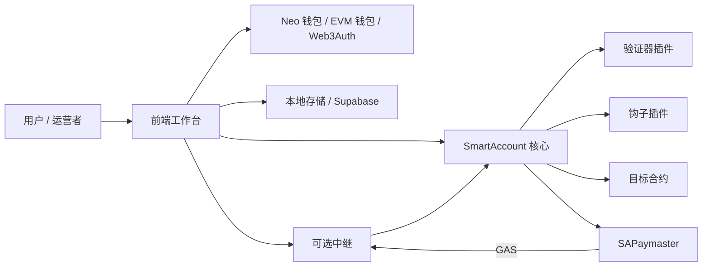
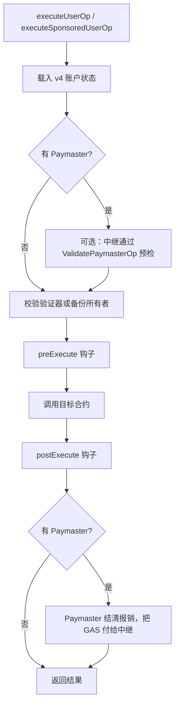
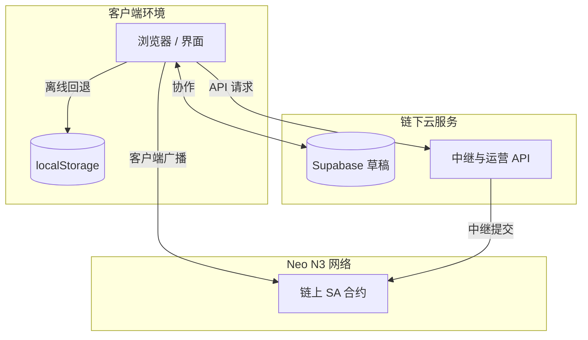
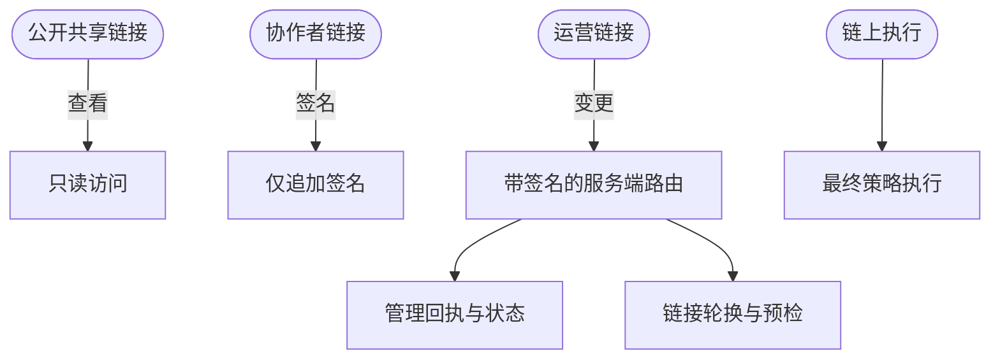
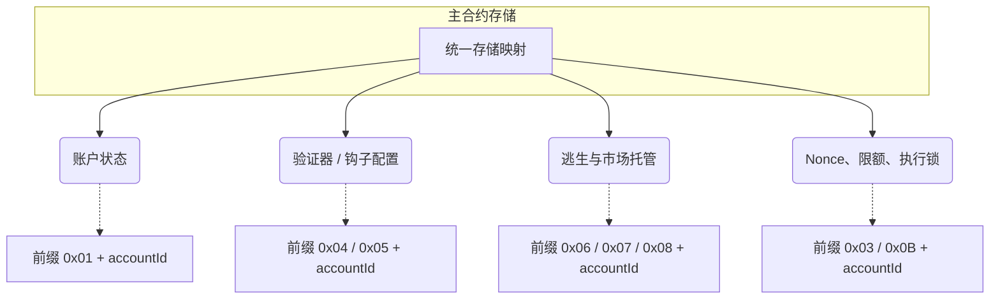
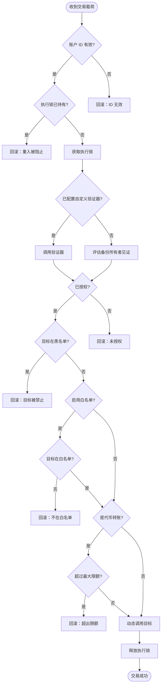
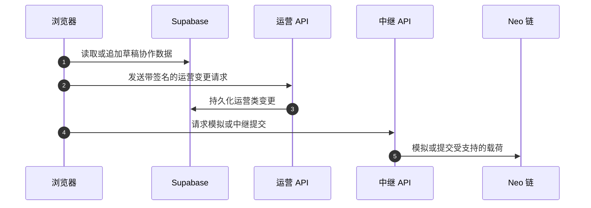
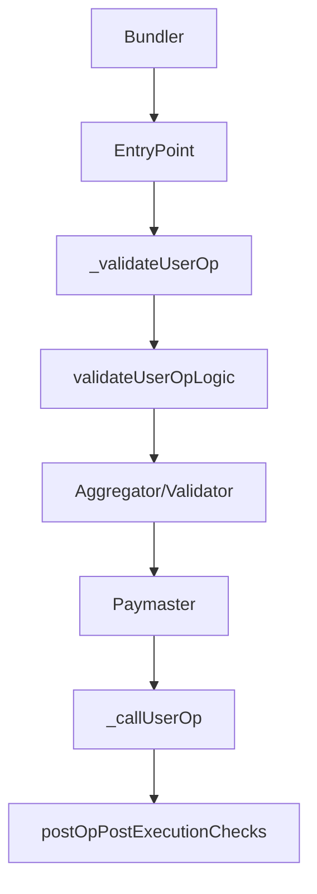
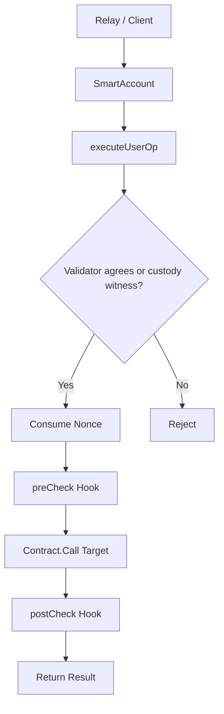
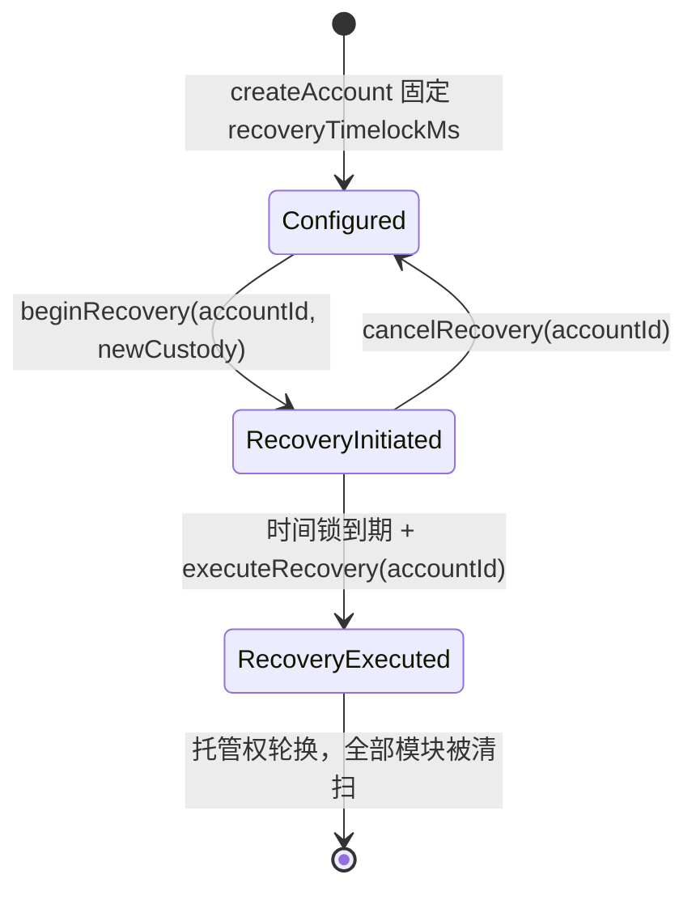

# SmartAccount 架构

> 中文版本与 `docs/ARCHITECTURE.md` 同构。若两者冲突，以英文版本为准。

本书是面向架构师与系统读者的架构参考，合并自原先的 architecture、NATIVE_SYSTEM_ARCHITECTURE、ORGANIZATION、SA-SYSTEM-STATUS、DATA_FLOW 与 ETHEREUM_AA_COMPARISON 六个主题；其内容按章节原样移入本书。用户指南见 `docs/GUIDE.zh-CN.md`，开发者 SDK 参考见 `docs/SDK.zh-CN.md`，安全模型见 `docs/SECURITY.zh-CN.md`。

## 目录

1. [Neo N3 Smart Account 架构](#neo-n3-smart-account-架构)
2. [原生系统架构](#原生系统架构)
3. [仓库布局](#仓库布局)
4. [系统状态与能力边界](#系统状态与能力边界)
5. [数据流与存储](#数据流与存储)
6. [与以太坊 AA 对比](#与以太坊-aa-对比)

## Neo N3 Smart Account 架构

当前 `main` 分支是**策略管控**的 v4 架构：一个仅原生（native-only）的最小化 `SmartAccount` 核心，加上通过配置意图安装的验证器与钩子模块实例。

### 1. 组件图



### 2. 账户模型

v4 账户模型以 `accountId` 为第一主键。

- 每个账户由确定性的 20 字节 `accountId` 作为键。
- 对外 Neo 地址由 `verify(accountId)` 脚本加主合约哈希在本地推导。
- 链上状态保存：
  - `verifier`
  - `hook`
  - `backupOwner`
  - `escapeTimelock`
  - `escapeTriggeredAt`
  - nonce 通道

核心钱包不再以管理员 / 经理 / dome 状态作为主要授权面。

### 3. 验证流水线

```mermaid
flowchart TD
  Start[交易到达 Neo 节点] --> Verify[节点触发 verify(accountId)]
  Verify --> Context[核心检查当前验证上下文]
  Context --> Allowed{目标是否符合预期?}
  Allowed -- 否 --> Reject1[拒绝意外的见证使用]
  Allowed -- 是 --> Execute[executeUserOp(accountId, op)]
  Execute --> Auth{验证器插件通过，或备份所有者见证通过?}
  Auth -- 否 --> Reject2[拒绝未授权操作]
  Auth -- 是 --> Nonce[消耗 nonce 并校验 deadline]
  Nonce --> Hooks[执行前后钩子]
  Hooks --> Return[返回结果]
```

### 4. 应用执行流水线



v4 核心刻意保持精简：授权委托给验证器插件，策略委托给钩子插件，核心只负责 nonce 消耗、恢复状态与执行上下文。

### 5. 授权模式

- 备份所有者原生见证
- Web3Auth / EIP-712 验证器
- TEE / WebAuthn / SessionKey / MultiSig / ZKEmail 验证器插件
- 由自定义钩子中介的策略检查

### 6. 合约文件地图

| 文件 | 职责 |
| --- | --- |
| `contracts/native/SmartAccount/SmartAccount.cs` | v4 账户控制记录、`verify`、`executeUserOp`、nonce 通道、无回调恢复、模块配置意图 |
| `contracts/plugins/validators/Web3AuthValidator.cs` | EIP-712 `UserOperation` 验证 |
| `contracts/plugins/validators/TeeKeyValidator.cs` | TEE 签名授权 |
| `contracts/plugins/validators/P256Validator.cs` | Passkey / P-256 授权 |
| `contracts/plugins/validators/SessionKeyValidator.cs` | 短期委托密钥，每个实例一套凭据 |
| `contracts/plugins/validators/MultiSigValidator.cs` | 阈值成员校验；策略由核心持有 |
| `contracts/plugins/validators/ZKEmailVerifier.cs` | 被禁用的邮箱授权模板；`onInstall` 拒绝 |
| `contracts/plugins/validators/DelegatedIdentityValidator.cs` | 委托（zkLogin）身份授权 |
| `contracts/plugins/validators/SubscriptionValidator.cs` | 有界周期性扣款；核心 nonce 是唯一序号 |
| `contracts/plugins/hooks/*.cs` | 可选策略，如每日限额、代币限制、凭证门控 |

### 7. 模块生命周期

每次模块变更都走配置意图路径，并发出通用模块事件：

- **安装**：`proposeConfiguration` -> 24 小时 -> `confirmConfiguration` 安装 validator 或 hook 实例并发出 `ModuleInstanceInstalled`
- **配置**：对已安装实例重新配置，经同一意图路径发出 `ModuleInstanceConfigured`
- **移除**：意图动作、市场结算或恢复清扫移除实例并发出 `ModuleInstanceRemoved`
- **取消 / 过期**：`cancelConfiguration` 发出 `ConfigurationIntentCancelled`；窗口关闭的意图发出 `ConfigurationIntentExpired`
- **策略**：`HookOrderSet` 与 `ThresholdPolicySet` 记录有序 hook 链与核心阈值策略

复用的 `ModuleInstalled` / `ModuleUpdateInitiated` / `ModuleUpdateConfirmed` / `ModuleRemoved` /
`ModuleUpdateCancelled` 事件继续为旧索引器供数。

### 8. 恢复模型

v4 恢复显式且不调用回调：

1. `beginRecovery(accountId, newCustody)` 记录一条待生效的托管权轮换，在账户的 `recoveryTimelockMs`（7-90 天，创建时固定）之后到期。
2. `cancelRecovery(accountId)` 删除待处理记录；同时只能存在一条，计时永不重置。
3. `executeRecovery(accountId)` 到期后无需许可：清扫全部模块行并推进 authority epoch，过程中不调用任何 validator、hook、Market 或 Oracle。
4. `getRecoveryStatus(accountId)` 以 `[exists, initiatedAt, matureAt, authorityEpochAtInit, newCustody]` 回读待处理记录。

这让恢复过程可审计，同时去掉了对旧插件活性的依赖。

### 9. Paymaster（赞助交易）

`SAPaymaster` 合约在 Neo N3 上实现无信任的免 Gas 执行：

1. **存款：** 赞助方通过 NEP-17 转账把 GAS 发给 Paymaster。
2. **策略：** 赞助方调用 `setPolicy(accountId, targetContract, method, maxPerOp, dailyBudget, totalBudget, validUntil)`。用 `accountId` 为零表示赞助任意账户的全局策略。
3. **执行：** 中继在 SA 核心上调用 `executeSponsoredUserOp(accountId, op, paymaster, sponsor, reimbursementAmount)`。
4. **结算：** 核心校验策略、执行用户操作，然后调用 `paymaster.settleReimbursement()`，原子性地从赞助方存款中扣除并把 GAS 转给中继。

对于带费用的交易，实际结算额是
`min(reimbursementAmount, 系统费 + 网络费)`。`maxPerOp` 限制的是这个结算额，而不是完整交易费用；只要请求的报销额符合策略，更大的交易费仍可通过。每日与总额预算按已解析策略作用域统计结算额，包括全局策略的共享作用域。违反策略会使整个调用失败。零费用 RPC 估算则把请求的报销额当作保守上限，因此标准费用估算仍然可用；中继应保留系统费余量。

Paymaster 从不对执行进行授权——它只在验证器与钩子已经批准操作之后为中继出资。

### 10. 安全不变量

1. `verify(accountId)` 只在预期的 `executeUserOp` 上下文中有效。
2. nonce 由核心钱包消耗，而不是验证器插件。
3. 验证器插件不能绕过钩子或目标合约策略。
4. 备份所有者恢复受时间锁约束。
5. 新集成一律面向 `executeUserOp`；V1/V2 的 `executeUnified` 与 `executeUnifiedByAddress` 已被移除，不存在于任何已部署清单与合约源码中，因此命名它们的交易会在验证阶段失败。
6. 只有当调用者是已授权的 SA 核心合约时，Paymaster 结算才会成功。
7. Paymaster 先扣减赞助方存款，再向中继转账 GAS（检查-生效-交互）。

## 原生系统架构

本章描述并行的[智能账户实现路径](#系统状态与能力边界) 中的原生实现。已部署合约实现是 NeoOS 近期的交付优先级。原生路径是 `SmartAccount`：一项具有小而明确的授权边界的协议服务。[ABI 2 配置](proposals/SMARTACCOUNT-NATIVE-PROFILE-DRAFT.md) 定义了线上的合约约定。[SDK](SDK.zh-CN.md) 与[工作台](GUIDE.zh-CN.md) 消费该约定；两者都无法授予原生合约会拒绝的权限。在 Neo 提案与激活流程完成之前，该配置仍是草案。公开的 custom `SmartAccount` 构建与私有的 `PLATFORM` 构建是相互独立的运行时配置，拥有各自的账户身份与工件。原生实现的进展不会废止或暂停已部署合约的开发。

[账户工作台](GUIDE.zh-CN.md) 涵盖初始化、备份、权限与时序矩阵以及恢复决策。

### 账户身份与权限

账户拥有稳定的账户 ID 与推导出的验证脚本地址。该地址持有资产，而不必为每个用户部署一个钱包合约。托管与恢复地址是权限，不是账户身份。更换托管不会改变资金地址，也不会重置操作 nonce。

| 角色 | 权限 |
| --- | --- |
| 托管（Custody） | 未安装验证器时直接以见证授权；按原生生命周期进行账户管理 |
| 恢复（Recovery） | 带时间锁的托管恢复与配置提供的紧急控制 |
| 验证器（Verifier） | 授权确切的操作；绑定到已准入模块及其当前配置 |
| 钩子（Hook） | 目标执行前后的策略检查 |
| 费用支付方 | 签署并支付完整交易，包括费用与到期时间 |
| RPC、SDK、界面 | 发现、构造、模拟与提交；不具独立权限 |

恢复会推进权限 epoch 与配置 nonce，替换托管，摘除验证器与钩子，并清除已登记的依赖与待生效配置。它不会调用旧模块。账户身份、操作 nonce 与冻结状态保持完整。解冻仍需要其必需的权限方；恢复不会悄悄启用一个已冻结的账户。

恢复权限同时也是紧急冻结的守护者（guardian）。请选择一个独立于托管控制、且受支持的 Neo 钱包权限方，并分别保存两者的钱包备份。守护者可以在没有托管参与的情况下冻结一个 Active 账户；解冻则需要托管与已配置的守护者共同参与。恢复会保留该守护者。若其密钥在账户处于 Frozen 时丢失，本配置不提供仅托管的豁免，也不支持在 Frozen 状态下更换守护者。在 Active 且没有待生效托管恢复时，托管可以提出守护者替换；该提案需要 24 小时成熟。

冻结在其交易执行时生效，并清除**所有待生效意图**，包括托管恢复与模块策略调用。若需要先紧急遏制再恢复，请先冻结、确认结果状态，然后发起新的恢复提案。仅提出恢复并不会冻结账户。一次成功的反向推进转换也会使待生效配置失效，因此后续每个操作都必须重新加载当前状态。

托管授权替换验证器、钩子或恢复地址的提案。24 小时之后，任何人都可以支付费用，通过 `activateVerifier`、`activateHook` 或 `activateRecoveryAddress` 激活当前已成熟的意图；激活时不需要托管或守护者签名。账户仍须处于 Active 且没有待生效的托管恢复。模块替换仍然会检查代码固定值并对旧模块执行清理。相比之下，应用延迟的模块策略调用需要托管再次参与，并提供完全相同的已存储方法与参数。托管可以在其选定的验证器或钩子角色的调用仍然待生效时取消该调用。仅涉及账户的激活 / 恢复调用在执行时作用于当时的待生效状态。SDK 的策略取消使用一段完整交易脚本：读取并序列化选定的待生效调用，断言其与被审阅的字节相等，然后才调用未变更的原生取消入口。内容改变或缺失时脚本会出错，而不会取消另一个提案。必须采用精确脚本签名；普通钱包调用无法表达这一保护。逐字节相同的重新提案仍可能匹配，因为协议没有唯一的提案实例计数器。参见[用户指南书](GUIDE.zh-CN.md)的“交易护栏”章节。请协调托管设备，并在执行后检查已确认状态。

受支持的原生模块按账户 ID 与权限 epoch 寻址存储。恢复之后重新安装同一模块，会从空的策略状态开始。常规模块替换仍会执行受检查的清理。独立的恢复路径用于处理损坏或不可用的旧模块。

### 执行与撤销

1. 在显式选定的网络上发现原生合约，并校验其身份、ABI 版本、配置摘要与激活状态。
2. 读取当前账户状态与选定的操作 nonce 通道。构造确切的目标、方法、类型化参数、截止时间与 nonce。
3. 把授权绑定到网络、原生合约、账户、权限 epoch 与配置 nonce。使用 `executeUserOp(accountId, operation, expectedAuthorityEpoch, expectedConfigurationNonce)` 执行；批量执行使用相同的四参数顺序。
4. 原生合约在授权与回调之前检查这两个计数器。代理验证路径会强制同样的规范封装。这把交易见证授权与操作签名同样绑定到经审阅的账户状态；一笔旧的已签名交易不能仅因其 nonce 与区块到期时间仍然有效，就在计数器变化后继续有效。
5. 在交易内运行有界的验证器与钩子回调、确切的目标调用以及执行后检查。回调参数与结果各自持有独立副本，因此一个回调无法改写另一个回调的输入。
6. 广播之前，把完整的已签名交易与节点快照比对；随后读取实际交易与应用结果。

代理见证只授予预期的目标帧。它不会给无限制的路由后代调用，也不会给后续的结算调用授予资产访问权。原生账户不能作为交易的费用支付方：其操作证明不授权任意的交易费用。

### 受支持的策略模块

| 原生模块 | 预期用途 |
| --- | --- |
| NeoWitnessValidator | 具有确切 validator 作用域的显式 Neo 见证授权 |
| SessionKeyValidator | 会过期的委托密钥与受限操作 |
| MultiSigValidator | 一个已配置的子签名者；阈值策略由核心持有 |
| WhitelistHook | 允许的目标与方法 |
| DailyLimitHook | 以实测代币余额变化计量有界支出 |
| TokenRestrictedHook | 受限的代币流动与策略检查 |

原生 MultiSig 按配置的名单顺序选择前若干个批准子项达到阈值。只有这些子项获得执行后权限并消耗各自的策略额度。达到法定人数之后，再提供一个有效签名并不会选中该子项。原生合约为该操作保留独立的批准回执，检查活跃的代码固定值，并在完成或失败时丢弃回执。验证回执绝不会带入 Application 阶段，批量操作也从不共享回执。

组合模块会在选定子项的执行后检查前后比对阈值、有序名单与签名域。这些子项会重新检查适用的当前策略，并为目标结果记账，而不重复 SessionKey 的密码学校验。回执的构造、复制以及所有后代调用都保持在固定的验证器预算之内。

原生 MultiSig 配置最多准入三个子模块、两个必需批准与三个聚合签名域。独立的 NeoWitnessValidator 有自己的十签名方上限；组合上限不会削减那项独立能力。诸如三-of-五的普通见证法定人数应放在该独立验证器中；MultiSigValidator 只校验一个已配置的子签名者。受支持的组合仍需针对当前费用策略与实际模块字节码通过执行。

受支持的原生 P-256 密钥以其标准 Neo 签名账户身份作为规范签名域。配置会在存储压缩公钥之前，使用 `canonicalP256PublicKey` 严格校验压缩与非压缩编码；非法曲线点会在任何策略写入之前被拒绝。因此，把同一把密钥同时用作 SessionKey 与 NeoNative 签名方，不会产生两票独立投票。这并不证明不同密钥属于彼此独立的人，也无法揭示谁控制任意的验证脚本。代币策略同样依赖所选代币的行为与余额查询。确切的配置元数据只是准入兼容性检查，不是对任意第三方字节码遵循受支持模块实现的证明。

模块配置延迟 24 小时；托管恢复延迟七天。会话到期必须为激活之后留出时间。延迟的密钥移除不是紧急撤销按钮：冻结提供即时遏制，恢复提供独立于旧模块的退出路径。

### 费用与用户体验

外部支付方可以为交易出资而不获得账户权限。原生配置没有报销型 Paymaster，也没有自动赞助结算。支付方在分别检查系统、网络与总费用上限之后，签署完整交易。

一笔已打包交易若 Application 以 FAULT 结束，仍可能向其支付方收费；回滚的状态变更不会退还交易费用。目标返回 Boolean `false` 属于业务结果，本身不是 VM 错误。模块与客户端会各自执行结果检查，包括 SDK 对 `transfer` 的严格 Boolean-true 要求。

有界调用需要留有足够的剩余 Gas 以容纳子预算，即使实际消耗更低。因此节点模拟除 `gasconsumed` 之外还会报告 `minimumrequired_fee`；钱包与 SDK 构造器会保留该要求。自定义代理验证与调用脚本也参与网络费用计算。签名之后提高费用需要一笔新的已审阅交易。

每个验证器回调有固定的 1 GAS 预算；每个钩子与维护回调各有 2.5 GAS 预算。全局验证上限同样适用：32 个操作的编码上限并不承诺 32 次昂贵授权能装进同一笔交易。SDK 会模拟并报价确切的批次。费用策略变化与任意第三方模块都会改变可行性，因此一条实测边界向量只为其记录的运行时与费用策略建立支持。

工作台以只读方式启动，并把身份与资金地址分开展示。恢复描述符包含公开的发现信息，而不是私钥。观察到网络、钱包、账户或待生效意图的变化，会使已准备的审阅失效。返回的交易 ID 只代表已提交；确认之前必须进行确切的交易与回执回读。提交超时之后，请先查询同一交易 ID，再准备替代交易。模拟成功不会预留 nonce，也不保证被打包。

普通钱包的 `invoke` API 可以处理受支持的单权限管理调用。代理执行与多权限场景需要精确的见证支持；工作台会为这些流程导出可审阅的 SDK 配方与确切脚本。它不会把脚本导出伪装成一笔已执行的交易。

### 验证与激活

源码、合约字节码、原生运行时、RPC 与客户端测试覆盖不同的层次。原生模块的 VM 探针不能证明原生恢复状态机。模拟的浏览器测试不能证明网络交易。手写的形式化模型不能建立完整的 NeoVM / 编译器精化或密码学可靠性。参见[形式化范围](engineering/VERIFICATION-AND-GATES.md) 与[剩余证明边界](reports/sa-native-open-boundaries-20261008.json)。

发布证据必须标识确切的源码与重建工件，在匹配的私有运行时上演练完整的已签名交易，在成功与拒绝之后校验状态与回执，并保留可复现的构建输入。提案获接受、外部评审、公开网络激活、生产部署与用户控制的钱包签名，仍然是彼此独立的决策。

## 系统状态与能力边界

这是一份源码层面的集成指南。一个已配置的地址、一次成功的构建，或一份历史部署回执，都不能证明公开合约包含当前实现。为用户启用任何能力之前，请校验确切的 NEF、清单、网络与核心绑定。

### 并行的实现路径

本项目通过两条实现路径开发同一套智能账户协议。已部署合约路径是 NeoOS 近期的交付优先级。原生路径并行推进标准与节点集成。原生激活的时间安排不得阻碍当前 NeoOS 的账户功能。已部署合约实现为 NeoOS 在当前公开运行时上服务。原生实现与协议评审并行推进，各自拥有独立的发布门禁。两条路径互不等待，且一条路径的证据不能为另一条路径建立运行时保证。

#### 协议与实现的职责

协议规则描述授权、执行顺序、重放保护、账户生命周期、恢复、失败结果与费用责任。每种运行时配置规定其确切身份、序列化、入口点与强制能力。参考实现只验证它真正实现的那部分规则；通过其测试并不等于某项 Neo 标准获得接受。

| 路径 | 起始实现 | 交付边界 |
| --- | --- | --- |
| 已部署合约 | `SmartAccount`、其 `public` 模块、`SmartAccountClient` 与应用 | 经工件、集成与发布校验之后，可部署在已发布的 Neo N3 运行时上 |
| 原生合约 | `SmartAccount`、原生 ABI 2 模块、`NativeSmartAccountClient` 与 `/native` | 匹配的节点实现、协议评审与硬分叉激活 |
| 运行时实验 | 私有 `PLATFORM` 构建 | 仅用于研究与受控验证；不是第三个公开产品 |

既有 V3 是已部署合约路径的运营起点，并不意味着其当前 ABI 已符合原生草案的每一条规则。演进必须保留既有用户，或引入显式的新版本与迁移。不要通过改变端点、核心哈希、构建符号或展示名称来覆盖已部署账户的含义。

#### 共同语义与显式差异

两条路径都必须规范并测试以下内容：确定性的账户发现；授权与费用支付分离；类型化操作承诺；nonce 与截止时间检查；有序的验证器、钩子与目标执行；应用层原子回滚；确认与提交的区别；模块变更；恢复；以及 VM 错误与返回 `false` 的成功调用之间的区别。

跨实现用例通过显式的配置适配器比较这些语义结果。字节级向量在两条路径都实现并验证同一编码之前，仍属于配置特有内容。具体而言：

| 边界 | 公开已部署 V3 | 原生 ABI 2 |
| --- | --- | --- |
| 可用性 | 常规部署与匹配模块 | 原生合约的共识激活 |
| 账户与资产身份 | V3 账户注册与代理脚本 | 原生账户推导与规范原生代理脚本 |
| 操作授权 | V3 各验证器的签名与见证规则 | 原生合约 / 网络 / 账户 / epoch / 配置承诺 |
| 回调资源 | 交易预算与经审阅的模块行为；没有隔离的子预算 | 平台强制的验证器、钩子与维护子预算 |
| 恢复 | 带时间锁与受检查旧模块清理的备份所有者逃生 | 独立的托管恢复通过权限 epoch 撤销旧模块 |
| 赞助费用 | 既有的受限 Paymaster 与中继流程 | 外部交易支付方；ABI 2 中没有原生报销 Paymaster |
| 合约变更 | 合约部署 / 更新权限与文档化的版本迁移 | 协议治理与硬分叉迁移 |

公开运行时无法用合约约定复现不可绕过的子执行预算。不要为了声称等价而弱化或移除原生要求。请在其运行时能力范围内改进已部署配置，并在 SDK、界面与集成约定中说明剩余限制。

#### 当前交付顺序

1. 校验已部署合约基线以及确切的 NeoOS 集成面：账户创建与发现、受支持的授权、代理资产转账、费用支付、持久化回执与备份所有者恢复。
2. 消除该路径中的产品与集成缺口。使用已发布的 Neo 包、隔离的测试部署，以及显式的账户 / 网络 / 核心身份检查。可选的模块与赞助必须落后于各自已验证的前置条件。
3. 为两种实现维护能力与一致性矩阵。每一次语义变更都要标识受影响的配置、预期结果与迁移影响；配置特有的改进要明确标注。
4. 独立地继续原生的正确性、资源计量、模块、SDK 与提案评审。常规部署既不是原生激活，也不是把该草案宣传为已采纳标准的许可。

#### 发布与迁移

每种实现都需要各自固定的源码、可复现工件、测试、部署身份与部署后回读。本地测试与历史回执不能证明当前公开部署包含经审阅的代码。公开部署、管理员更新与用户钱包签名仍是彼此独立的运营动作。

迁移到原生账户是显式选择加入的迁移。不得假定账户 ID、代理地址、余额、授权、插件设置与签名可移植。请在目标路径上验证每个用户的资产与运营依赖之前，保留旧路径。ABI 2 当前没有自动的旧版导入端点。

当前的实现与协议评审范围，参见下文的运行时配置与能力边界各节、[V3 架构](#neo-n3-smart-account-架构)、[原生架构](#原生系统架构) 与 [issue #242](https://github.com/neo-project/proposals/issues/242)。

### 运行时配置

| 配置 | 实现边界 | 部署要求 |
| --- | --- | --- |
| `public` | 标准 `System.Contract.Call`；账户 nonce、验证器模块与钩子、执行在同一笔交易中完成 | 已发布的 Neo 运行时；当前核心与匹配的模块工件 |
| 私有 `PLATFORM` | 增加有界的模块子调用 | 具备对应私有系统调用的运行时；不能靠选择某个公开 RPC 地址来部署 |
| 原生 SmartAccount | ABI 2 `SmartAccount`，独立推导身份，按 epoch 划分模块，有界回调 | 对应的 Neo 核心实现与硬分叉激活；公开 v4 部署不会激活它 |

公开配置没有按子项的模块 Gas 预算。中继与赞助方必须限制交易费用，并审阅所选模块及其可变子配置。私有配置的证明不能闭合这一公开运行时限制。

### 原生账户工作流

原生 ABI 2 实现具备独立的托管恢复、权限 epoch 模块存储、执行中显式的 epoch / 配置承诺、有界回调、受支持签名形态的见证费用估算，以及已签名交易预览。参见[原生架构](#原生系统架构)、[SDK](SDK.zh-CN.md) 与[工作台](GUIDE.zh-CN.md)。它需要匹配的原生运行时与激活；公开 v4 部署不是原生可用性的证据。

源码托管：本仓库的 `contracts/native/SmartAccount/` 是原生 `SmartAccount` 合约唯一可编辑副本（真实源码）；[原生 VM 工作流](../.github/workflows/native-profile.yml) 使用的、按 SHA 固定的 Neo 核心检出版本携带这些文件的生成副本，该工作流在任何构建或测试之前运行 `scripts/sync_native_smartaccount.py --check`，因此漂移、缺失或未纳管的副本会在此失败。该固定版本现已记录重新生成的标记提交。这一“真实源码 / 同步”结构及其 CI 门禁属于仓库机制，不会改变下文列出的外部激活、验收与回读边界。

发现流程绑定[当前配置参数](proposals/smartaccount-native-profile-v2-parameters.json)及其摘要，而不仅仅是 `getVersion() == 2`。身份推导仍是版本 1；授权与精确的 14 字段账户记录是版本 2。执行接收四个参数，包括当前权限 epoch 与配置 nonce。原生复合限额为三个子模块、两个批准 / 阈值与三个聚合签名域。验证器回调预算为 1 GAS；钩子与维护各 2.5 GAS。这些边界并不保证最大批次能满足网络的全局验证预算。

### 公开 v4 账户与运营工作流

| 能力 | 受支持的合约行为 | 剩余边界 |
| --- | --- | --- |
| 账户身份 | 从所选核心读取账户 ID、推导代理与已安装的验证器模块；不匹配即拒绝 | 旧账户的反向索引可能不可用，需要显式账户 ID |
| 共享草稿 | 执行已暂存的、一致的带签名调用 | 协作者记录与界面签名计数不能建立链上授权 |
| 多签 | 针对同一操作的链上有序子证明，各子签名域独立 | 阈值统计的是验证器模块，不能证明是独立的人或独立托管 |
| 会话转账 | 精确的 NEP-17 参数、代理作为发送方、非负金额、布尔成功 | 代币声明的金额不能度量任意的额外余额损失 |
| 每日限额 | 固定窗口记账与实际净扣减，包含返回 false 或零的目标 | 代币 `balanceOf` 是信任依赖；这不是按资产的通用余额预言机 |
| 订阅转账 | 正数金额且 NEP-17 结果成功后才消耗周期 | 通用非转账目标保留其文档化的返回语义 |
| 直接代理转账 | 推导见证、核心作用域回读与显式有界费用预留 | 中继模式与管理员配置的作用域；普通钱包调用 API 无法添加该见证 |
| 赞助执行 | 每个核心内共享按交易报销上限的策略校验结算 | 拒绝赞助代理见证；任意结算不得继承代理资产权限 |
| 运营密钥恢复 | 浏览器密钥持久存储与口令加密备份 | 导入需要草稿中已固定的公钥；仅凭链接无法替换它 |
| 备份所有者逃生 | 时间锁与所有者见证；常规清理式终结，或无需回调的永久仅所有者恢复 | 仅所有者恢复不可撤销且无法重装模块；托管、外部批准与模块持有的资金仍相互独立 |

### 模块名称不等于完整产品保证

- `P256Validator` 只验证其文档化的 P-256 证明格式。它本身不是包含 origin、RP ID 与认证器数据校验的完整 WebAuthn 仪式。
- `TeeKeyValidator` 信任其注册的签名密钥。仅有有效签名，并不能建立某个具体 enclave 的证明。
- `ZKEmailVerifier` 已禁用且无法安装（`getModuleProfile()` 不声明任何能力，核心会拒绝安装）；不要把它作为可用的账户选项提供。
- `DelegatedIdentityValidator` 使用其文档化的委托签名路径；不要把它描述为本地验证的通用零知识登录证明。
- 社交恢复的模块所有者与核心备份所有者是两份独立状态。更新其中一个，不是另一个也改变的证据。

### 验证与发布

对原生合约构建、前端、浏览器、SDK 消费方与依赖审计，运行 `scripts/verify_repo.sh --profile native`；native 是默认值，也是唯一的实现画像。按各自所需的工具运行形式化与私有链门禁，并检查其记录的作用域与跳过的检查。原生核构建到各项目自己的 `bin/Release/net10.0/`；模块与 epoch 探测回执则写入 `--output` 指向的目录。

独立的[原生 VM 工作流](../.github/workflows/native-profile.yml) 构建一个经评审的不可变核心提交与两份相同的原生模块副本，然后用真实的原生 VM 检查完整的实测复合场景矩阵。它拒绝缺失、重复、未知、失败或超预算的用例；合成交易签名人使这成为宿主测试，而不是内存池或出块确认。原生门禁中的 NativeEpochProbe 使用仅用于测试的 SmartAccount ABI 夹具，属于不同的测试边界。协议 v4 把模块改名为 validator，并把配置移到 `configure` 生命周期回调。该探针现在驱动这套回调：
对原生 profile 构建的每个模块执行安装、配置、按阶段校验与卸载，并断言固定核心调用方校验、
`(accountId, moduleId)` 实例存储，以及 `0xA2` 权威纪元布局已退役。全节点 SDK / 私有链回执仍另行处理。历史报告保留它们当时测试的提交与字节；后续的测试专用核心提交不会改变其中记录的生产运行时身份。

公开推广之前，请把每个已部署工件与授权绑定同经评审的源码比对；在目标运行时上演练账户创建、配置、转账、失败回滚、恢复与费用结算。用户钱包签名与公开链部署是两个独立的运营步骤。

### 当前源码：无回调的托管权恢复

`beginRecovery(accountId, newCustody)` 记录一条待生效的托管权轮换，在账户的
`recoveryTimelockMs`（7-90 天，创建时固定）之后到期；`cancelRecovery` 删除记录，
`executeRecovery` 在到期后无需许可即应用它。执行阶段不调用任何 validator、hook、Market 或 Oracle：
它清扫全部模块实例、阈值策略、hook 顺序、消息主体集合、待处理意图、nonce 通道与待处理迁移状态，
把托管权轮换到已批准的地址，清空恢复授权方，重新启用内置授权并推进 authority epoch、
configuration nonce 与控制修订号。`getRecoveryStatus` 以
`[exists, initiatedAt, matureAt, authorityEpochAtInit, newCustody]` 回读待处理记录。

恢复保留身份、资产地址与执行 nonce 历史，但它不是清除旧插件存储、退还插件持有资金、
撤销代币授权、结算进行中的市场托管或移除独立合约升级管理员的承诺。
这些属于源码候选能力；集成方必须先发现所选部署的 ABI 并读取链上状态，才能对外暴露它们。

### 当前源码：平台服务、冻结与发现读取

已提交的custom 源码候选把平台服务从核心中抽出：市场托管结算（`abandonListing`）位于 `SAAddressMarket`，Paymaster 报销（`settleReimbursement`）位于 `SAPaymaster`，平台账户注册与所有者轮换时间锁位于独立的 `SAPlatformRegistrar`（the retired custom treeregistrar/`）。在 2026-11-13 安全修复之上，该候选新增了备份所有者门控的冻结面（`freezeAccount` / `unfreezeAccount` / `isAccountFrozen`），它不属于已固定的公开工件。

2026-11-16 的 Ethereum-AA 对齐修订在该候选之上新增两个安全读取：`describeAccount(accountId)` 聚合完整账户描述符（ERC-7579 风格的能力发现）；`simulateValidation(accountId, op)` ——以 ERC-4337 的 EntryPoint 命名，便于 4337 工具找到熟悉的入口——是非故障的执行检查预检（不含签名与钩子执行），同时报告托管闩锁与原生备份所有者见证。同一修订让 `SessionKeyValidator` 在模块初始化数据中接受版本 0x01 的初始密钥数据块，使会话密钥账户在第一天即可使用；之后的密钥变更需要通过新的配置意图，并各自受 24 小时成熟期与七天过期窗口约束。SDK 暴露 `describeAccount` / `simulateValidation` / `buildSessionKeyInstallCommand`，以及 ERC-4337 形态（`toErc4337UserOperation`、`estimateUserOperationGas`）与 ERC-7715 形态（`buildSessionKeyPermission`）的适配器；类型化数据签名布局见 [SDK 书](SDK.zh-CN.md)的“EIP-712 签名”章。

使候选达到 81 条 ABI，对比已固定公开工件的 90 条。

公开部署仍然运行 90 方法的工件，因此抽取、冻结、发现与首日会话密钥这些面仍是源码候选能力，处在未变的“需要升级”边界之后：必须完成受治理的升级与独立回读，任何部署才能声称拥有它们。目前的本地证据仍限于源码层面——合约测试覆盖了抽出的服务 ABI 与冻结面，候选 NEF / 清单哈希已重新固定——而新的 NeoExpress 回执、工件可复现性证书、CI 车道与公开链回读仍是未闭合的证据门禁。

## 数据流与存储

Smart Account 模型把所有链上权限集中到 **主入口合约（Master Entry Contract）** 内，同时使用浏览器、Supabase 与可选中继服务来改善可用性与协作。

### 1. 系统边界

理解本系统最省力的方式是按信任边界切分。



各边界职责不同：

- **浏览器** 准备调用、展示就绪状态并持有临时界面状态
- **localStorage** 在缺少 Supabase 时保存仅本地草稿
- **Supabase** 存储协作草稿数据与作用域链接
- **中继 API** 模拟或提交可中继载荷，并接收带签名的运营变更
- **Neo N3 链** 保存真实的账户规则并执行最终调用

### 2. 数据归属矩阵

| 边界 | 存放什么 | 谁能修改 | 为何存在 |
| --- | --- | --- | --- |
| 链上主合约 | 按账户状态（验证器、钩子、备份所有者、逃生、市场托管、元数据）、nonce、执行锁，以及合约管理员与平台注册机槽位 | 各自以见证为门控的 SA 流程 | 授权与执行的唯一事实来源 |
| 浏览器内存 | 当前工作台状态、所选载荷模式、活动钱包会话 | 当前浏览器会话 | 快速交互与暂存 |
| `localStorage` 回退 | 仅本地草稿与偏好 | 同一浏览器 | 离线 / 无 Supabase 的开发路径 |
| Supabase | 草稿正文、仅追加签名、有界活动记录、有界回执、作用域标识 | 受作用域限制的协作流程 | 共享审阅与多方协调 |
| 中继服务器 | 进行中的模拟结果、中继签名人的使用、带签名运营变更的校验 | 服务端配置 + 带签名的运营请求 | 中继与运营专属操作的体验助手 |

### 3. 各边界的变更权限

并非每个边界都能修改同一份数据。



实际含义：

- 公开查看者可以检查草稿，但不能修改
- 协作者可以追加签名，但不能写入运营类中继活动
- 运营者可以请求敏感度更高的变更，但服务端仍会校验带签名的意图
- 交易是否有效，最终仍由链上裁定

### 4. 链上存储结构

合约使用统一的内部存储映射：键由一个静态前缀与用户 `accountId` 的定长表示拼接而成。



### 5. 执行期间的内部数据流

当执行指令进入主合约后，在调用任何外部智能合约之前，会先经过一层刚性的隔离、验证与限制流水线。



### 6. 中继与带签名的运营变更流程

中继与运营助手路径用于改善可用性，而不是替代合约。



### 7. 保留策略与实际限制

协作元数据层刻意设有上限：

- 保留最近 **100 条活动记录**
- 保留最近 **12 条提交回执**
- 不可变草稿正文与仅追加签名历史分开保存

这使长期存在的草稿仍然可解释、可审阅，同时不让元数据无限增长。

### 8. 存储键前缀表

| 前缀标识 | 十六进制 | 用途 |
| :--- | :---: | :--- |
| `Prefix_AccountState` | `0x01` | 按账户序列化状态：验证器、钩子、备份所有者、逃生时间锁。 |
| `Prefix_VerifyContext` | `0x02` | 当前见证校验所捕获的验证上下文。 |
| `Prefix_Nonce` | `0x03` | 按账户 nonce 通道的复合键。 |
| `Prefix_VerifierConfigContext` | `0x04` | 保留的验证器配置上下文。 |
| `Prefix_HookConfigContext` | `0x05` | 保留的钩子配置上下文。 |
| `Prefix_MarketEscrowContract` | `0x06` | 绑定到账户的市场托管合约。 |
| `Prefix_MarketEscrowListing` | `0x07` | 市场托管挂单记录。 |
| `Prefix_EscapeLastInitiated` | `0x08` | 当前逃生窗口的起始时间。 |
| `Prefix_PendingVerifierUpdate` | `0x09` | 等待成熟时间的验证器延迟更新。 |
| `Prefix_PendingHookUpdate` | `0x0A` | 等待成熟时间的钩子延迟更新。 |
| `Prefix_ExecutionLock` | `0x0B` | 单次操作期间持有的重入锁。 |
| `Prefix_MetadataUri` | `0x0C` | 账户元数据 URI。 |
| `Prefix_HookExecutionContext` | `0x0D` | 按账户的钩子执行上下文。 |
| `Prefix_VerifierExecutionContext` | `0x0E` | 按账户的验证器执行上下文。 |
| `Prefix_PendingVerifierCall` | `0x0F` | 延迟验证器调用记录。 |
| `Prefix_PendingHookCall` | `0x10` | 延迟钩子调用记录。 |
| `Prefix_ContractAdmin` | `0x11` | 裸槽位：共享核心的合约管理员。 |
| `Prefix_UpdateTimelock` | `0x14` | 裸槽位：合约更新的时间锁。 |
| `Prefix_PendingContractAdmin` | `0x15` | 裸槽位：待生效的合约管理员转移。 |
| `Prefix_AdminTransferTimelock` | `0x16` | 裸槽位：合约管理员转移的时间锁。 |
| `Prefix_PlatformRegistrar` | `0x17` | 裸槽位：平台注册机指针。 |
| `Prefix_PendingPlatformRegistrar` | `0x18` | 裸槽位：待生效的注册机指针。 |
| `Prefix_PlatformRegistrarTimelock` | `0x19` | 裸槽位：注册机指针的时间锁。 |
| `Prefix_PendingUpdateNefHash` | `0x1A` | 裸槽位：待更新 NEF 的哈希。 |
| `Prefix_PendingUpdateManifestHash` | `0x1B` | 裸槽位：待更新清单的哈希。 |
| `Prefix_VerifyScopeTarget` | `0x1C` | 当前见证校验所限定的目标。 |
| `Prefix_MarketEscrowCancelInitiated` | `0x1D` | 市场托管取消窗口的起始时间。 |
| `Prefix_PlatformAccountBinding` | `0x1E` | 按账户的平台绑定。 |
| `Prefix_PlatformProxyAccount` | `0x1F` | 平台绑定对应的代理账户。 |
| `Prefix_TransactionReimbursement` | `0x21` | 裸槽位：按交易的报销上限。 |
| `Prefix_HookDependencies` | `0x23` | 钩子的复合模块子项注册表。 |
| `Prefix_VerifierDependencies` | `0x24` | 验证器的复合模块子项注册表。 |
| `Prefix_DependencyMaintenance` | `0x25` | 裸槽位：依赖维护标记。 |
| `Prefix_ConfigurationContextDepth` | `0x26` | 裸槽位：配置上下文嵌套深度。 |

上表所列前缀属于已退役的 user-contract 内核，保留于此作为归档记录；一个键曾是前缀本身，或前缀拼接 20 字节 `accountId`。现存内核使用 `contracts/native/SmartAccount/SmartAccountModuleProtocol.cs` 声明的共享 `0x50`–`0x5F` 区域，键构造器位于 `contracts/native/SmartAccount/SmartAccountProtocol.cs`。

### `.matrix` 域名边界

`.matrix` 合约是对外的命名边界。它不是 SA 授权状态的来源，而是把人类可读标识解析为控制钱包地址。V3 不保存从该地址到其控制账户的反向索引，因此域名只能单向解析：对你已知的账户逐个用 `getAccount` 读取，而不要期待域名能列出它们。

## 与以太坊 AA 对比

### 概要

本文档把以太坊 ERC-4337（Account Abstraction）与 ERC-7579（Modular Smart Account）的概念映射到 Neo N3 Smart Account 实现上。理解这些映射有助于熟悉以太坊 AA 的开发者适应 Neo 生态。

> **当前状态说明（2026-09-21）：** 本对比是概念性的，并保留历史上针对
> 已发布运行时的限制措辞。当前私有的 SA 工件使用 `System.Contract.CallWithGasLimit`，
> verifier 回调上限为 10 GAS；匹配的 NeoExpress 证据记录在
> `docs/reports/sa-neoexpress-gas-cap-20260921.json`。公开激活与
> 部署仍未完成。

<!-- docs-truth: no fence claims for solidity; reason: the document compares Neo with Ethereum, so every solidity block lists the Ethereum interface (IValidator, IPaymaster, the ECDSA helper), not a Neo entrypoint. -->

---

### 1. 核心概念映射

| 以太坊概念 | Neo N3 对应物 | 实现说明 |
| --- | --- | --- |
| **EntryPoint 合约** | `SmartAccount` | 服务所有账户的全局单例合约。无需按账户部署。 |
| **Smart Account** | 虚拟账户（`accountId`） | 由 `verify(accountId)` 脚本派生的确定性地址，不是已部署合约。 |
| **WalletContract** | 不适用 | Neo 使用原生的 `CheckWitness` 配合 `VerifyContext`，而不是独立的 wallet 合约。 |
| **Paymaster** | `SAPaymaster` 合约 + 链下 Morpheus | 链上 Paymaster 合约提供存款/策略/结算的无信任赞助，另有可选的链下 Morpheus 集成。 |
| **Bundler** | 中继服务器 | 把 `UserOperation` 打包进 Neo 交易。 |
| **Aggregator** | 核心阈值策略 + `hookOrder` | v4 用核心阈值策略与有序 hook 链替代了 `MultiHook`；`MultiHook` 仅作为迁移取证工件存在，其 `onInstall` 拒绝新安装。 |
| **Validator** | Verifier 插件 | 签名校验逻辑（ECDSA、WebAuthn、TEE 等）。 |
| **Executor** | 不适用 | 核心合约直接执行；不需要独立的 executor。 |
| **Fallback Handler** | 托管权 / 恢复授权方 witness | 无回调的 `beginRecovery` → `executeRecovery` 轮换托管权并在不调用任何插件的情况下清扫全部模块。 |
| **UserOperation** | `UserOperation` 结构体 | 几乎相同：target、method、args、nonce、deadline、signature。 |

---

### 2. UserOperation 结构对比

#### 以太坊 ERC-4337 UserOperation

```solidity
struct UserOperation {
    address sender;
    uint256 nonce;
    bytes initCode;
    bytes callData;
    uint256 callGasLimit;
    uint256 verificationGasLimit;
    uint256 preVerificationGas;
    uint256 maxFeePerGas;
    uint256 maxPriorityFeePerGas;
    bytes paymasterAndData;
}
```

#### Neo N3 UserOperation

```csharp
public class UserOperation
{
    public UInt160 TargetContract;  // ~ callData.to
    public string Method;           // ~ callData.selector (full method name)
    public object[] Args;           // ~ callData
    public BigInteger Nonce;         // ~ nonce
    public BigInteger Deadline;        // ~ paymaster.sponsorshipPolicy (time-based expiry)
    public ByteString Signature;       // ~ signature
}
```

**关键差异：**
- Neo 使用 `TargetContract + Method + Args`，而不是编码的 `callData`
- Neo 把 gas 字段合并为提交时计算的网络/系统费用
- Neo 使用 `Deadline`（绝对时间戳）而不是 gas 价格上限
- Neo 不包含 `initCode`（无需按账户部署）

---

### 3. 校验流程对比

#### 以太坊 ERC-4337



**安全属性：**
- 校验与执行在不同调用中完成
- 每个操作都强制 gas 上限
- Paymaster 可以赞助或拒绝
- Aggregator 可以批量处理多个 userOp

#### Neo N3 Smart Account



**安全属性：**
- 单一原子交易（没有独立的预校验调用）
- verifier 以 `CallFlags.ReadOnly` 调用（不改状态）
- hooks 在执行前后强制策略
- 当前的私有工件通过平台扩展提供按 verifier 的回调上限；
  公开激活仍未完成
- Paymaster 可选（链上 SAPaymaster 或链下 Morpheus）

**历史上的关键差异：** 本对比所代表的已发布运行时并不强制独立的 verifier gas 限额。
当前私有的集成工件通过 `CallWithGasLimit` 做到了这一点；这还不是
公开网络激活的声明。

---

### 4. Nonce 管理对比

#### 以太坊 ERC-4337 二维 nonce

- **顺序模式：** `nonce = key << 64 + sequence`
  - 通道 0：0, 1, 2, 3...
  - 通道 1：0, 1, 2, 3...
- **用途：** 需要排序的标准 DeFi 交易

#### Neo N3 二维 nonce

- **规范 NeoVM 签名域（`0 <= nonce < 2^255`）：**
  ```csharp
  BigInteger channel = nonce >> 64;
  BigInteger sequence = nonce & 0xFFFFFFFFFFFFFFFF;
  ```
  - 低 64 位是每通道的 sequence；其余 191 位选择通道。
  - 每个通道都从 sequence 0 开始并独立推进；重放或跳号的 sequence 会被拒绝。
  - NeoVM 的有符号 Integer 表示意味着数学 uint256 的高半部分不是合法的操作值。

**映射：**
- Neo 的有界通道 + sequence ≈ ERC-4337 的顺序 nonce 通道
- Neo 只保留一条规范 nonce 路径，不暴露独立的 UUID/salt 模式

当前的 custom 源码还把 `getNonce` 的通道读取限制为 `0 <= channel < 2^191`。
较旧的已部署基础工件在重新发布之前可能接受高半部分通道用于读取；在签名操作边界下，
这些只读值仍然不可执行。

---

### 5. 签名校验对比

#### 以太坊 ECDSA 签名

```solidity
// Standard secp256k1 verification
function validateUserOpSignature(UserOperation calldata op, bytes32 hash) external;
```

#### Neo N3 签名选项

| 签名类型 | 曲线 | 用例 | 以太坊对应 |
| --- | --- | --- | --- |
| **Native N3** | secp256r1（Neo 原生） | 冷钱包备份 | 不适用 |
| **Web3Auth / EIP-712** | secp256k1 | EVM 钱包兼容 | EIP-712 Typed Data |
| **WebAuthn / Passkey** | secp256r1 | 硬件生物识别 | WebAuthn spec |
| **TEE** | secp256r1 | 可信执行 | BLS/TLS-notary |
| **SessionKey** | secp256r1 | 临时委派 | Session Keys（EIP-5732） |
| **MultiSig** | 异构 | 阈值批准 | 多签钱包 |

**关键优势：** Neo 在单一账户中支持异构签名方案（混合 EVM + Passkey + TEE）。

---

### 6. Hook/策略对比

#### 以太坊 ERC-7579 模块化 Smart Account

```solidity
interface IModule {
    function onInstall(bytes32 id) external;
    function onUninstall(bytes32 id) external;
}

interface IValidator {
    function validateUserOp(UserOperation calldata userOp, bytes32 userOpHash)
        external returns (uint256 validationData);
}

interface IExecutor {
    function execute(UserOperation calldata userOp) external;
}

interface IFallback {
    function handleFunctionCall(...) external;
}
```

#### Neo N3 插件

```csharp
// Verifier (Validator equivalent)
interface IVerifier {
    bool validateUserOp(UInt160 accountId, ByteString operationDigest, object[] operation);
    void onUserOpComplete(UInt160 accountId, object[] operation, object result);
}

// Hook (Policy module equivalent)
interface IHook {
    ByteString preCheck(UInt160 accountId, object[] operation);
    void postCheck(UInt160 accountId, object[] operation, object result, ByteString hookData);
}
```

**映射：**
- `IValidator.validateUserOp` ≈ ERC-7579 模块的 `onInstall/validateUserOp` 授权
- `IHook.preCheck` ≈ 执行前校验 hook
- `IHook.postCheck` ≈ 带 hookData 的执行后清理
- 核心持有的 `thresholdPolicy` ≈ ERC-7579 Aggregator（模块之间从不互相调用）

---

### 7. Paymaster/赞助对比

#### 以太坊 ERC-4337 Paymaster

```solidity
interface IPaymaster {
    function validatePaymasterUserOp(UserOperation calldata userOp, bytes32 userOpHash,
        uint256 maxCost) external returns (bytes memory context, uint256 validationData);
}
```

- 校验 gas 赞助
- 为 EntryPoint 返回 context
- 可以拒绝赞助

#### Neo N3 Paymaster（链上）

```csharp
// AAPaymaster contract
public class SponsorshipPolicy {
    public UInt160 TargetContract;  // Zero = any contract
    public string Method;            // empty = any method
    public BigInteger MaxPerOp;      // Max GAS per operation
    public BigInteger DailyBudget;   // Max GAS per day (0 = unlimited)
    public BigInteger TotalBudget;   // Max total GAS (0 = unlimited)
    public BigInteger ValidUntil;    // Expiry timestamp (0 = no expiry)
}

// Core integration
object result = executeSponsoredUserOp(accountId, op, paymaster, sponsor, reimbursementAmount);
// 1. Optional relay preflight via Paymaster.validatePaymasterOp()
// 2. executeUserOp() — full verification + execution
// 3. Paymaster.settleReimbursement() — atomic policy enforcement + GAS to relay
```

- 赞助方通过 NEP-17 转账把 GAS 存入 Paymaster
- 可按账户或全局（`accountId = Zero`）设置赞助策略
- 原子结算：策略校验 + 存款扣减 + 中继补偿
- 日/总预算跟踪，并自动重置 24 小时窗口
- `validatePaymasterOp` 以 `[Safe]` 只读形式提供给中继预检

#### Neo N3 Paymaster（链下 — Morpheus）

- **链下服务**（Morpheus Paymaster）
- **授权端点：** `/api/paymaster/authorize`
- **响应：** `{ approved: boolean, reason?: string }`

**与以太坊的关键差异：**
- Neo 同时支持链上（SAPaymaster）与链下（Morpheus）两种 paymaster 模型
- 链上模型更接近 ERC-4337：存款 + 策略 + 结算，但没有按操作的 gas 计量（Neo 交易是固定费用）
- 链下模型更易集成，但链上可验证性较弱
- 两种模型：paymaster 从不授权执行 —— 只有 verifier 或 backup owner 可以

---

### 8. 恢复/紧急访问对比

#### 以太坊恢复模式

1. **社交恢复：** 带 guardian 的多签
2. **时间锁：** 延迟的管理变更
3. **预言机恢复：** 链上预言机批准丢失的密钥
4. **EIP-4337 EntryPoint：** 没有原生恢复（依钱包而异）

#### Neo N3 L1 恢复



入口都接收账户 id；`beginRecovery` 还接收将要轮换到的托管权，`getRecoveryStatus`
回读待处理记录（`contracts/native/SmartAccount/SmartAccount.cs`）。

**特性：**
- **时间锁：** 7-90 天，创建时按账户固定
- **显式取消：** `cancelRecovery` 由托管权或恢复授权方触发
- **无回调执行：** `executeRecovery` 不调用任何 validator、hook、Market 或 Oracle
- **无按账户部署：** 适用于虚拟账户

**对比：** 比典型的以太坊 AA 恢复更健壮（后者往往依赖钱包专属的链下机制或复杂的社交恢复合约）。

---

### 9. 安全属性对比

| 安全属性 | 以太坊 AA | Neo N3 SA | 说明 |
| --- | --- | --- | --- |
| **重放保护** | ✓ Nonce | ✓ Nonce + Deadline | 两者都用二维 nonce + 过期 |
| **重入保护** | ✓ NonReentrant 修饰符 | ✓ ExecutionLock | 两者都用锁 |
| **跨链重放** | ✓ typed data 中的 ChainID | ✓ payload 中的 `Runtime.GetNetwork()` | 两者都包含网络 ID |
| **签名窃取** | ✓ Validator 隔离 | ✓ Verifier 隔离 | 两者都隔离校验 |
| **通过 Gas 的 DoS** | ✓ 校验的 gas 上限 | ✗ **无 GAS 上限** | **Neo 的弱点** |
| **恶意 Paymaster** | ✓ 校验返回失败 | ✓ 链下授权失败 | 两者都能拒绝 |
| **账户发现** | ✗ 未规定 | ✓ 反向索引 | Neo 的优势 |
| **批量操作** | ✓ UserOp[] | ✓ UserOperation[] | 两者都支持批量 |
| **校验上下文** | ✓ Sender, paymaster | ✓ accountId, contract | 接口面相似 |

---

### 10. 面向以太坊 AA 开发者的迁移指南

#### 从以太坊 EntryPoint 到 Neo SmartAccount

| 概念 | 如何适配 |
| --- | --- |
| **部署新账户** | 使用 `createAccount(accountId, custody, salt, recoveryTimelockMs, actions)` 而不是部署代理。身份由 custody+salt 决定，账户地址是确定性的。 |
| **发送 UserOperation** | 调用 `executeUserOp(accountId, op)` 而不是 `handleUserOps()`。 |
| **Paymaster 集成** | 使用 `SAPaymaster` 合约（链上存款/策略/结算）或链下 Morpheus 端点。链上用 `executeSponsoredUserOp()`，Morpheus 则实现链下授权。 |
| **Aggregator 模式** | 用核心阈值策略加 `hookOrder` 组合策略 hook；`MultiHook` 拒绝新安装，仅保留供迁移使用。 |
| **Bundler 集成** | 实现中继服务器，先调用 `simulateMetaInvocation()`，再调用 `relayMetaInvocation()`。 |
| **签名方案** | EVM 签名用 `Web3AuthValidator`，passkey 用 `P256Validator`。 |
| **恢复** | 用 `beginRecovery()` / `executeRecovery()` 作为 L1 备份。 |

#### 代码模式：以太坊 AA → Neo SA

**以太坊：**
```solidity
UserOp[] calldata ops;
entryPoint.handleOps(ops, beneficiary);
```

**Neo：**
```csharp
UserOperation[] ops;
object[] results = executeUserOps(accountId, ops);
// Or via SDK/relay:
relayMetaInvocation({ scriptHash: aaContract, operation: "executeUserOps", args: [accountId, ops] });
```

---

### 11. 相对以太坊 AA 的已知限制

1. **Verifier Gas 预算：** 匹配平台的有界调用扩展的公开激活
   仍未完成。当前私有工件使用
   `CallWithGasLimit`；参见 `docs/reports/sa-platform-gas-cap-20260921.json`。
2. **更简单的费用模型：** 没有按操作的 gas 估算 hook（Neo 交易是固定费用）。
3. **没有质押机制：** 链上 Paymaster 使用直接的 GAS 存款，而不是质押。
4. **聚合能力有限：** 核心阈值策略与有序 hook 不像以太坊聚合器那样聚合签名。

---

### 11a. 标准对齐面（2026-11-16）

custom 源码候选缩小了与以太坊 AA 工具面的实际互操作差距。在治理升级落地之前，
所有这些都位于未变的 upgrade-required 边界之后：

- **ERC-4337 `simulateValidation` = `simulateValidation(accountId, op)`：**
  该候选直接沿用 EntryPoint 的名称。这是对核心执行期检查的
  不 fault 预检。未知账户报告全 false 结果而不是 fault；托管锁存
  与原生 backup-owner witness 被显式报告。签名
  校验与 hook 执行仍被排除，与
  `previewUserOpValidation` 完全一致。
- **ERC-7579 能力发现 ≈ `describeAccount(accountId)`：** 一次 safe
  读取返回完整描述符 —— verifier、hook、backup owner、escape
  状态、market-escrow 锁存以及两个待生效更新的成熟窗口 ——
  让钱包与索引器不必再逐个字段 fan-out 到各 getter。
- **ERC-7715 会话权限 ≈ `buildSessionKeyPermission`：** SDK
  在规范的链上工件旁生成 7715 形式的授权（签名者 + 合约调用权限 + unix 秒
  过期）；注册期的 version-0x01 blob 立即安装第一把会话密钥
  （`SessionKeyValidator` 的 `onInstall` 初始化数据），在不为后续变更削弱 24h 意图时间锁
  冷却期的前提下，闭合首日可用性缺口。
- **4337 工具形态 ≈ `toErc4337UserOperation`：** sender = 账户 id，
  `callData` = Neo VM 调用脚本，gas 字段置零（Neo 按
  VM 执行定价），deadline 作为扩展字段携带。

有意不采纳：EIP-7702 EOA 委派（Neo 没有以太坊意义上的 EOA ——
虚拟账户代理已经覆盖该目标）、mempool
规则 / ERC-7562（Neo 没有需要治理的替代 mempool）、initCode（账户是
零部署的），以及 BLS 聚合签名（custom 面上没有原生配对预编译）。

---

### 12. Neo N3 相对以太坊 AA 的优势

1. **零部署虚拟账户：** 账户创建没有 gas 成本。
2. **异构签名支持：** 在一个账户中混合 EVM、Passkey、TEE。
3. **L1 原生逃生：** 健壮恢复，无需复杂的社交恢复。
4. **账户发现：** 反向索引实现 O(1) 账户查找。
5. **统一执行上下文：** 所有账户共用一个合约，简化索引。
6. **TEE 优先设计：** 为可信执行环境而构建。
7. **双 Paymaster 模型：** 链上无信任（`SAPaymaster`）与链下灵活（Morpheus）赞助并存。
