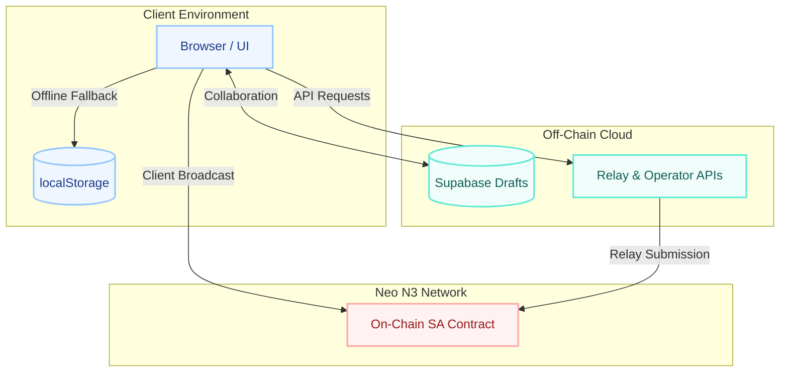
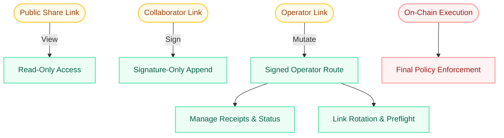
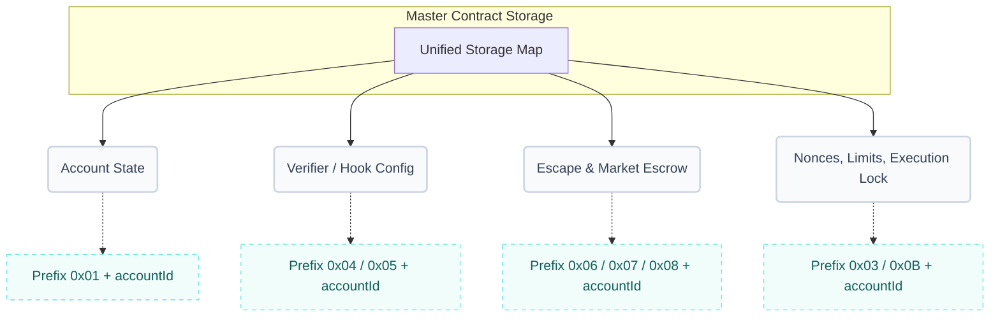
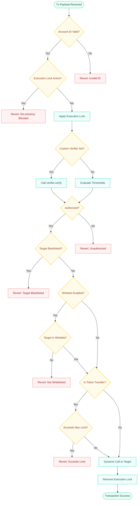
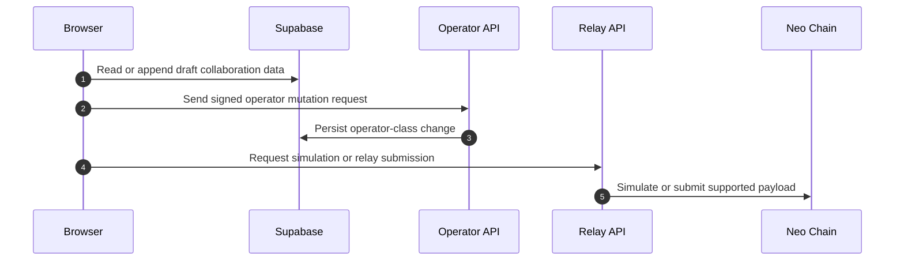

# Contract Data Flow & Storage

The Smart Account model centralizes all on-chain authority inside the **Master Entry Contract**, while using the browser, Supabase, and optional relay services to improve usability and collaboration.

## 1. System Boundaries

The easiest way to understand the system is to separate it into trust boundaries.

Those boundaries do different jobs:

- **Browser** prepares invocations, displays readiness, and holds temporary UI state
- **localStorage** preserves local-only drafts when Supabase is absent
- **Supabase** stores collaborative draft data and scoped links
- **Relay APIs** simulate or submit relay-ready payloads and accept signed operator mutations
- **Neo N3 chain** stores the real account rules and executes the final call

## 2. Data Ownership Matrix

| Boundary | What lives there | Who can mutate it | Why it exists |
| --- | --- | --- | --- |
| On-chain master contract | Per-account state (verifier, hook, backup owner, escape, market escrow, metadata), nonces, execution lock, plus the contract-admin and platform-registrar slots | Authorized SA flows, each gated by its own witness | Source of truth for authorization and execution |
| Browser memory | Current workspace state, selected payload mode, active wallet session | Current browser session | Fast UX and staging |
| `localStorage` fallback | Local-only drafts and preferences | Same browser only | Offline / no-Supabase development path |
| Supabase | Draft body, append-only signatures, bounded activity, bounded receipts, scoped slugs | Scope-limited collaboration flows | Shared review and multi-party coordination |
| Relay server | Simulation results in flight, relay signer use, signed operator mutation validation | Server config + signed operator requests | UX helper for relay and operator-only actions |

## 3. Mutation Authority by Boundary

Not every boundary is allowed to mutate the same data.

Practical meaning:

- public viewers can inspect a draft but cannot mutate it
- collaborators can add signatures but cannot append operator-class relay activity
- operators can request higher-sensitivity mutations, but the server still validates signed intent
- the chain remains the final authority for whether the transaction is valid

## 4. Storage Schema On-Chain

The contract utilizes a unified internal storage mapping where keys are derived by concatenating a static prefix with a hashed representation of the user's `accountId`.

## 5. Internal Data Flow During Execution

When an execution command enters the Master Contract, it flows through a rigid pipeline of isolation, verification, and restriction checks before any external smart contract is called.

## 6. Relay and Signed Operator Mutation Flow

The relay and operator helper paths exist to improve usability, not to replace the contract.

## 7. Retention and Practical Limits

The collaborative metadata layer is intentionally bounded:

- latest **100 activity entries** retained
- latest **12 submission receipts** retained
- immutable draft body preserved separately from append-only signature history

This keeps long-lived drafts explainable and reviewable without letting metadata grow without limit.

## 8. Storage Key Prefixes Table

| Prefix Identifier | Hex Value | Purpose |
| :--- | :---: | :--- |
| `Prefix_AccountState` | `0x01` | Serialized per-account state: verifier, hook, backup owner, escape timelock. |
| `Prefix_VerifyContext` | `0x02` | Verification context captured for the running witness check. |
| `Prefix_Nonce` | `0x03` | Composite key for the per-account nonce channels. |
| `Prefix_VerifierConfigContext` | `0x04` | Retained verifier configuration context. |
| `Prefix_HookConfigContext` | `0x05` | Retained hook configuration context. |
| `Prefix_MarketEscrowContract` | `0x06` | Market escrow contract bound to the account. |
| `Prefix_MarketEscrowListing` | `0x07` | Market escrow listing records. |
| `Prefix_EscapeLastInitiated` | `0x08` | Start of the current escape window. |
| `Prefix_PendingVerifierUpdate` | `0x09` | Delayed verifier update awaiting its maturity time. |
| `Prefix_PendingHookUpdate` | `0x0A` | Delayed hook update awaiting its maturity time. |
| `Prefix_ExecutionLock` | `0x0B` | Re-entrancy lock held for the duration of one operation. |
| `Prefix_MetadataUri` | `0x0C` | Account metadata URI. |
| `Prefix_HookExecutionContext` | `0x0D` | Per-account hook execution context. |
| `Prefix_VerifierExecutionContext` | `0x0E` | Per-account verifier execution context. |
| `Prefix_PendingVerifierCall` | `0x0F` | Deferred verifier call record. |
| `Prefix_PendingHookCall` | `0x10` | Deferred hook call record. |
| `Prefix_ContractAdmin` | `0x11` | Bare slot: the contract admin of the shared core. |
| `Prefix_UpdateTimelock` | `0x14` | Bare slot: timelock for a contract update. |
| `Prefix_PendingContractAdmin` | `0x15` | Bare slot: pending contract-admin transfer. |
| `Prefix_AdminTransferTimelock` | `0x16` | Bare slot: timelock for the contract-admin transfer. |
| `Prefix_PlatformRegistrar` | `0x17` | Bare slot: the platform registrar pointer. |
| `Prefix_PendingPlatformRegistrar` | `0x18` | Bare slot: pending registrar pointer. |
| `Prefix_PlatformRegistrarTimelock` | `0x19` | Bare slot: timelock for the registrar pointer. |
| `Prefix_PendingUpdateNefHash` | `0x1A` | Bare slot: NEF hash of a pending update. |
| `Prefix_PendingUpdateManifestHash` | `0x1B` | Bare slot: manifest hash of a pending update. |
| `Prefix_VerifyScopeTarget` | `0x1C` | Target the current witness check is scoped to. |
| `Prefix_MarketEscrowCancelInitiated` | `0x1D` | Start of the market-escrow cancellation window. |
| `Prefix_PlatformAccountBinding` | `0x1E` | Per-account platform binding. |
| `Prefix_PlatformProxyAccount` | `0x1F` | Proxy account of a platform binding. |
| `Prefix_TransactionReimbursement` | `0x21` | Bare slot: the per-transaction reimbursement ceiling. |
| `Prefix_HookDependencies` | `0x23` | Composite-module child registry for hooks. |
| `Prefix_VerifierDependencies` | `0x24` | Composite-module child registry for verifiers. |
| `Prefix_DependencyMaintenance` | `0x25` | Bare slot: dependency maintenance marker. |
| `Prefix_ConfigurationContextDepth` | `0x26` | Bare slot: configuration-context nesting depth. |

The prefixes above are the source of truth in `contracts/custom/SmartAccount.Internal.cs` (per-account keys) and `contracts/custom/SmartAccount.Admin.cs` / `contracts/custom/SmartAccount.PlatformRegistrar.cs` (bare slots); a key is the prefix alone or the prefix concatenated with the 20-byte `accountId`.

## Matrix Domain Boundary

The `.matrix` contract acts as an external naming boundary. It is not the source of SA authorization state; instead, it provides a human-readable identifier that resolves to the controlling wallet address. V3 keeps no reverse index from that address to the accounts it controls, so a name resolves one way only: read each account you know with `getAccountState` rather than expecting the domain to list them.
