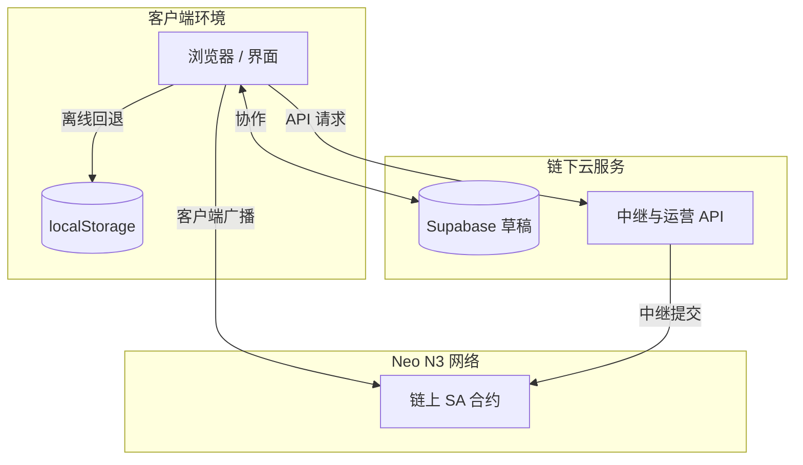
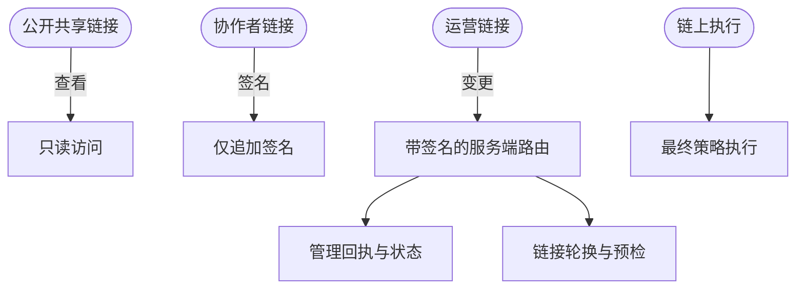
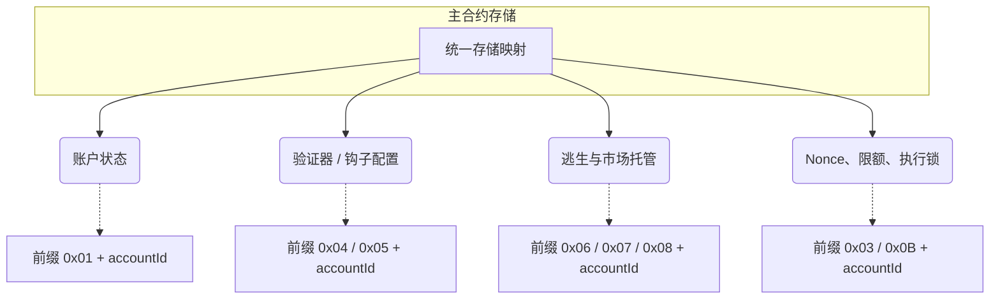
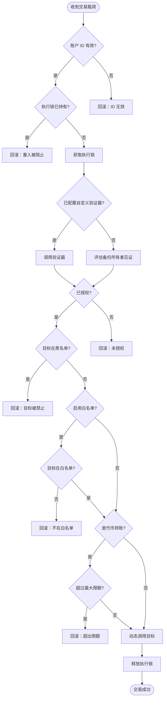
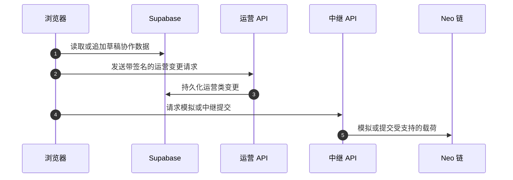

# 合约数据流与存储

Smart Account 模型把所有链上权限集中到 **主入口合约（Master Entry Contract）** 内，同时使用浏览器、Supabase 与可选中继服务来改善可用性与协作。

> 中文版本与 `docs/DATA_FLOW.md` 同构。若两者冲突，以英文版本为准。

## 1. 系统边界

理解本系统最省力的方式是按信任边界切分。

各边界职责不同：

- **浏览器** 准备调用、展示就绪状态并持有临时界面状态
- **localStorage** 在缺少 Supabase 时保存仅本地草稿
- **Supabase** 存储协作草稿数据与作用域链接
- **中继 API** 模拟或提交可中继载荷，并接收带签名的运营变更
- **Neo N3 链** 保存真实的账户规则并执行最终调用

## 2. 数据归属矩阵

| 边界 | 存放什么 | 谁能修改 | 为何存在 |
| --- | --- | --- | --- |
| 链上主合约 | 按账户状态（验证器、钩子、备份所有者、逃生、市场托管、元数据）、nonce、执行锁，以及合约管理员与平台注册机槽位 | 各自以见证为门控的 SA 流程 | 授权与执行的唯一事实来源 |
| 浏览器内存 | 当前工作台状态、所选载荷模式、活动钱包会话 | 当前浏览器会话 | 快速交互与暂存 |
| `localStorage` 回退 | 仅本地草稿与偏好 | 同一浏览器 | 离线 / 无 Supabase 的开发路径 |
| Supabase | 草稿正文、仅追加签名、有界活动记录、有界回执、作用域标识 | 受作用域限制的协作流程 | 共享审阅与多方协调 |
| 中继服务器 | 进行中的模拟结果、中继签名人的使用、带签名运营变更的校验 | 服务端配置 + 带签名的运营请求 | 中继与运营专属操作的体验助手 |

## 3. 各边界的变更权限

并非每个边界都能修改同一份数据。

实际含义：

- 公开查看者可以检查草稿，但不能修改
- 协作者可以追加签名，但不能写入运营类中继活动
- 运营者可以请求敏感度更高的变更，但服务端仍会校验带签名的意图
- 交易是否有效，最终仍由链上裁定

## 4. 链上存储结构

合约使用统一的内部存储映射：键由一个静态前缀与用户 `accountId` 的定长表示拼接而成。

## 5. 执行期间的内部数据流

当执行指令进入主合约后，在调用任何外部智能合约之前，会先经过一层刚性的隔离、验证与限制流水线。

## 6. 中继与带签名的运营变更流程

中继与运营助手路径用于改善可用性，而不是替代合约。

## 7. 保留策略与实际限制

协作元数据层刻意设有上限：

- 保留最近 **100 条活动记录**
- 保留最近 **12 条提交回执**
- 不可变草稿正文与仅追加签名历史分开保存

这使长期存在的草稿仍然可解释、可审阅，同时不让元数据无限增长。

## 8. 存储键前缀表

| 前缀标识 | 十六进制 | 用途 |
| :--- | :---: | :--- |
| `Prefix_AccountState` | `0x01` | 按账户序列化状态：验证器、钩子、备份所有者、逃生时间锁。 |
| `Prefix_VerifyContext` | `0x02` | 当前见证校验所捕获的验证上下文。 |
| `Prefix_Nonce` | `0x03` | 按账户 nonce 通道的复合键。 |
| `Prefix_VerifierConfigContext` | `0x04` | 保留的验证器配置上下文。 |
| `Prefix_HookConfigContext` | `0x05` | 保留的钩子配置上下文。 |
| `Prefix_MarketEscrowContract` | `0x06` | 绑定到账户的市场托管合约。 |
| `Prefix_MarketEscrowListing` | `0x07` | 市场托管挂单记录。 |
| `Prefix_EscapeLastInitiated` | `0x08` | 当前逃生窗口的起始时间。 |
| `Prefix_PendingVerifierUpdate` | `0x09` | 等待成熟时间的验证器延迟更新。 |
| `Prefix_PendingHookUpdate` | `0x0A` | 等待成熟时间的钩子延迟更新。 |
| `Prefix_ExecutionLock` | `0x0B` | 单次操作期间持有的重入锁。 |
| `Prefix_MetadataUri` | `0x0C` | 账户元数据 URI。 |
| `Prefix_HookExecutionContext` | `0x0D` | 按账户的钩子执行上下文。 |
| `Prefix_VerifierExecutionContext` | `0x0E` | 按账户的验证器执行上下文。 |
| `Prefix_PendingVerifierCall` | `0x0F` | 延迟验证器调用记录。 |
| `Prefix_PendingHookCall` | `0x10` | 延迟钩子调用记录。 |
| `Prefix_ContractAdmin` | `0x11` | 裸槽位：共享核心的合约管理员。 |
| `Prefix_UpdateTimelock` | `0x14` | 裸槽位：合约更新的时间锁。 |
| `Prefix_PendingContractAdmin` | `0x15` | 裸槽位：待生效的合约管理员转移。 |
| `Prefix_AdminTransferTimelock` | `0x16` | 裸槽位：合约管理员转移的时间锁。 |
| `Prefix_PlatformRegistrar` | `0x17` | 裸槽位：平台注册机指针。 |
| `Prefix_PendingPlatformRegistrar` | `0x18` | 裸槽位：待生效的注册机指针。 |
| `Prefix_PlatformRegistrarTimelock` | `0x19` | 裸槽位：注册机指针的时间锁。 |
| `Prefix_PendingUpdateNefHash` | `0x1A` | 裸槽位：待更新 NEF 的哈希。 |
| `Prefix_PendingUpdateManifestHash` | `0x1B` | 裸槽位：待更新清单的哈希。 |
| `Prefix_VerifyScopeTarget` | `0x1C` | 当前见证校验所限定的目标。 |
| `Prefix_MarketEscrowCancelInitiated` | `0x1D` | 市场托管取消窗口的起始时间。 |
| `Prefix_PlatformAccountBinding` | `0x1E` | 按账户的平台绑定。 |
| `Prefix_PlatformProxyAccount` | `0x1F` | 平台绑定对应的代理账户。 |
| `Prefix_TransactionReimbursement` | `0x21` | 裸槽位：按交易的报销上限。 |
| `Prefix_HookDependencies` | `0x23` | 钩子的复合模块子项注册表。 |
| `Prefix_VerifierDependencies` | `0x24` | 验证器的复合模块子项注册表。 |
| `Prefix_DependencyMaintenance` | `0x25` | 裸槽位：依赖维护标记。 |
| `Prefix_ConfigurationContextDepth` | `0x26` | 裸槽位：配置上下文嵌套深度。 |

上表以 `contracts/custom/SmartAccount.Internal.cs`（按账户键）与 `contracts/custom/SmartAccount.Admin.cs`、`contracts/custom/SmartAccount.PlatformRegistrar.cs`（裸槽位）为准；一个键要么是前缀本身，要么是前缀拼接 20 字节 `accountId`。

## `.matrix` 域名边界

`.matrix` 合约是对外的命名边界。它不是 SA 授权状态的来源，而是把人类可读标识解析为控制钱包地址。V3 不保存从该地址到其控制账户的反向索引，因此域名只能单向解析：对你已知的账户逐个用 `getAccount` 读取，而不要期待域名能列出它们。
