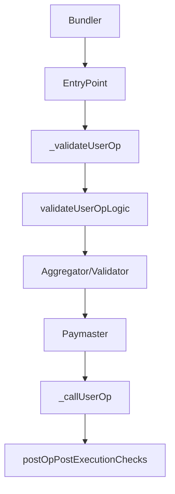
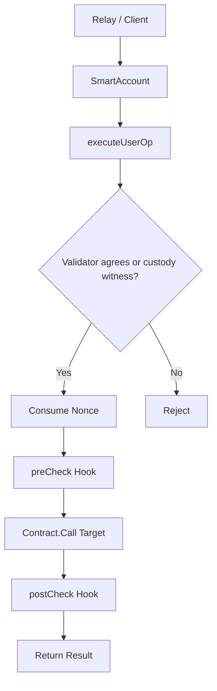
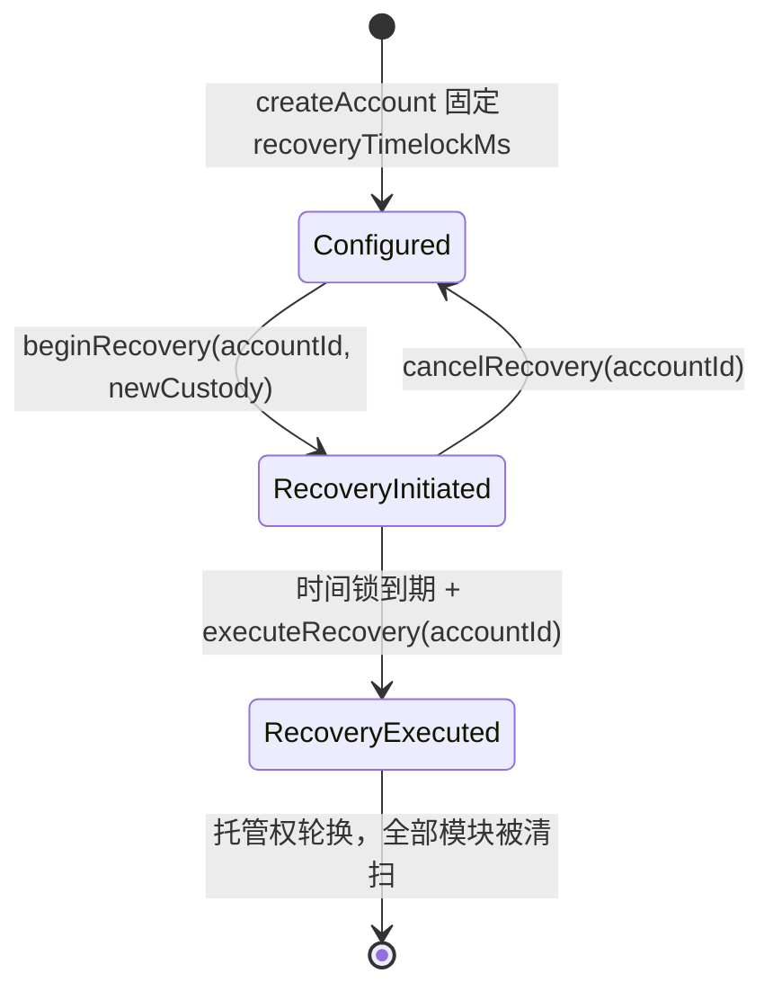

# 以太坊 ERC-4337/ERC-7579 与 Neo N3 Smart Account 对比

> 中文版本与 `docs/ETHEREUM_AA_COMPARISON.md` 同构。若两者冲突，以英文版本为准。

## 概要

本文档把以太坊 ERC-4337（Account Abstraction）与 ERC-7579（Modular Smart Account）的概念映射到 Neo N3 Smart Account 实现上。理解这些映射有助于熟悉以太坊 AA 的开发者适应 Neo 生态。

> **当前状态说明（2026-09-21）：** 本对比是概念性的，并保留历史上针对
> 已发布运行时的限制措辞。当前私有的 SA 工件使用 `System.Contract.CallWithGasLimit`，
> verifier 回调上限为 10 GAS；匹配的 NeoExpress 证据记录在
> `docs/reports/sa-neoexpress-gas-cap-20260921.json`。公开激活与
> 部署仍未完成。

<!-- docs-truth: no fence claims for solidity; reason: the document compares Neo with Ethereum, so every solidity block lists the Ethereum interface (IValidator, IPaymaster, the ECDSA helper), not a Neo entrypoint. -->

---

## 1. 核心概念映射

| 以太坊概念 | Neo N3 对应物 | 实现说明 |
| --- | --- | --- |
| **EntryPoint 合约** | `SmartAccount` | 服务所有账户的全局单例合约。无需按账户部署。 |
| **Smart Account** | 虚拟账户（`accountId`） | 由 `verify(accountId)` 脚本派生的确定性地址，不是已部署合约。 |
| **WalletContract** | 不适用 | Neo 使用原生的 `CheckWitness` 配合 `VerifyContext`，而不是独立的 wallet 合约。 |
| **Paymaster** | `SAPaymaster` 合约 + 链下 Morpheus | 链上 Paymaster 合约提供存款/策略/结算的无信任赞助，另有可选的链下 Morpheus 集成。 |
| **Bundler** | 中继服务器 | 把 `UserOperation` 打包进 Neo 交易。 |
| **Aggregator** | 核心阈值策略 + `hookOrder` | v4 用核心阈值策略与有序 hook 链替代了 `MultiHook`；`MultiHook` 仅作为迁移取证工件存在，其 `onInstall` 拒绝新安装。 |
| **Validator** | Verifier 插件 | 签名校验逻辑（ECDSA、WebAuthn、TEE 等）。 |
| **Executor** | 不适用 | 核心合约直接执行；不需要独立的 executor。 |
| **Fallback Handler** | 托管权 / 恢复授权方 witness | 无回调的 `beginRecovery` → `executeRecovery` 轮换托管权并在不调用任何插件的情况下清扫全部模块。 |
| **UserOperation** | `UserOperation` 结构体 | 几乎相同：target、method、args、nonce、deadline、signature。 |

---

## 2. UserOperation 结构对比

### 以太坊 ERC-4337 UserOperation

```solidity
struct UserOperation {
    address sender;
    uint256 nonce;
    bytes initCode;
    bytes callData;
    uint256 callGasLimit;
    uint256 verificationGasLimit;
    uint256 preVerificationGas;
    uint256 maxFeePerGas;
    uint256 maxPriorityFeePerGas;
    bytes paymasterAndData;
}
```

### Neo N3 UserOperation

```csharp
public class UserOperation
{
    public UInt160 TargetContract;  // ~ callData.to
    public string Method;           // ~ callData.selector (full method name)
    public object[] Args;           // ~ callData
    public BigInteger Nonce;         // ~ nonce
    public BigInteger Deadline;        // ~ paymaster.sponsorshipPolicy (time-based expiry)
    public ByteString Signature;       // ~ signature
}
```

**关键差异：**
- Neo 使用 `TargetContract + Method + Args`，而不是编码的 `callData`
- Neo 把 gas 字段合并为提交时计算的网络/系统费用
- Neo 使用 `Deadline`（绝对时间戳）而不是 gas 价格上限
- Neo 不包含 `initCode`（无需按账户部署）

---

## 3. 校验流程对比

### 以太坊 ERC-4337



**安全属性：**
- 校验与执行在不同调用中完成
- 每个操作都强制 gas 上限
- Paymaster 可以赞助或拒绝
- Aggregator 可以批量处理多个 userOp

### Neo N3 Smart Account



**安全属性：**
- 单一原子交易（没有独立的预校验调用）
- verifier 以 `CallFlags.ReadOnly` 调用（不改状态）
- hooks 在执行前后强制策略
- 当前的私有工件通过平台扩展提供按 verifier 的回调上限；
  公开激活仍未完成
- Paymaster 可选（链上 SAPaymaster 或链下 Morpheus）

**历史上的关键差异：** 本对比所代表的已发布运行时并不强制独立的 verifier gas 限额。
当前私有的集成工件通过 `CallWithGasLimit` 做到了这一点；这还不是
公开网络激活的声明。

---

## 4. Nonce 管理对比

### 以太坊 ERC-4337 二维 nonce

- **顺序模式：** `nonce = key << 64 + sequence`
  - 通道 0：0, 1, 2, 3...
  - 通道 1：0, 1, 2, 3...
- **用途：** 需要排序的标准 DeFi 交易

### Neo N3 二维 nonce

- **规范 NeoVM 签名域（`0 <= nonce < 2^255`）：**
  ```csharp
  BigInteger channel = nonce >> 64;
  BigInteger sequence = nonce & 0xFFFFFFFFFFFFFFFF;
  ```
  - 低 64 位是每通道的 sequence；其余 191 位选择通道。
  - 每个通道都从 sequence 0 开始并独立推进；重放或跳号的 sequence 会被拒绝。
  - NeoVM 的有符号 Integer 表示意味着数学 uint256 的高半部分不是合法的操作值。

**映射：**
- Neo 的有界通道 + sequence ≈ ERC-4337 的顺序 nonce 通道
- Neo 只保留一条规范 nonce 路径，不暴露独立的 UUID/salt 模式

当前的 custom 源码还把 `getNonce` 的通道读取限制为 `0 <= channel < 2^191`。
较旧的已部署基础工件在重新发布之前可能接受高半部分通道用于读取；在签名操作边界下，
这些只读值仍然不可执行。

---

## 5. 签名校验对比

### 以太坊 ECDSA 签名

```solidity
// Standard secp256k1 verification
function validateUserOpSignature(UserOperation calldata op, bytes32 hash) external;
```

### Neo N3 签名选项

| 签名类型 | 曲线 | 用例 | 以太坊对应 |
| --- | --- | --- | --- |
| **Native N3** | secp256r1（Neo 原生） | 冷钱包备份 | 不适用 |
| **Web3Auth / EIP-712** | secp256k1 | EVM 钱包兼容 | EIP-712 Typed Data |
| **WebAuthn / Passkey** | secp256r1 | 硬件生物识别 | WebAuthn spec |
| **TEE** | secp256r1 | 可信执行 | BLS/TLS-notary |
| **SessionKey** | secp256r1 | 临时委派 | Session Keys（EIP-5732） |
| **MultiSig** | 异构 | 阈值批准 | 多签钱包 |

**关键优势：** Neo 在单一账户中支持异构签名方案（混合 EVM + Passkey + TEE）。

---

## 6. Hook/策略对比

### 以太坊 ERC-7579 模块化 Smart Account

```solidity
interface IModule {
    function onInstall(bytes32 id) external;
    function onUninstall(bytes32 id) external;
}

interface IValidator {
    function validateUserOp(UserOperation calldata userOp, bytes32 userOpHash)
        external returns (uint256 validationData);
}

interface IExecutor {
    function execute(UserOperation calldata userOp) external;
}

interface IFallback {
    function handleFunctionCall(...) external;
}
```

### Neo N3 插件

```csharp
// Verifier (Validator equivalent)
interface IVerifier {
    bool validateUserOp(UInt160 accountId, ByteString operationDigest, object[] operation);
    void onUserOpComplete(UInt160 accountId, object[] operation, object result);
}

// Hook (Policy module equivalent)
interface IHook {
    ByteString preCheck(UInt160 accountId, object[] operation);
    void postCheck(UInt160 accountId, object[] operation, object result, ByteString hookData);
}
```

**映射：**
- `IValidator.validateUserOp` ≈ ERC-7579 模块的 `onInstall/validateUserOp` 授权
- `IHook.preCheck` ≈ 执行前校验 hook
- `IHook.postCheck` ≈ 带 hookData 的执行后清理
- 核心持有的 `thresholdPolicy` ≈ ERC-7579 Aggregator（模块之间从不互相调用）

---

## 7. Paymaster/赞助对比

### 以太坊 ERC-4337 Paymaster

```solidity
interface IPaymaster {
    function validatePaymasterUserOp(UserOperation calldata userOp, bytes32 userOpHash,
        uint256 maxCost) external returns (bytes memory context, uint256 validationData);
}
```

- 校验 gas 赞助
- 为 EntryPoint 返回 context
- 可以拒绝赞助

### Neo N3 Paymaster（链上）

```csharp
// AAPaymaster contract
public class SponsorshipPolicy {
    public UInt160 TargetContract;  // Zero = any contract
    public string Method;            // empty = any method
    public BigInteger MaxPerOp;      // Max GAS per operation
    public BigInteger DailyBudget;   // Max GAS per day (0 = unlimited)
    public BigInteger TotalBudget;   // Max total GAS (0 = unlimited)
    public BigInteger ValidUntil;    // Expiry timestamp (0 = no expiry)
}

// Core integration
object result = executeSponsoredUserOp(accountId, op, paymaster, sponsor, reimbursementAmount);
// 1. Optional relay preflight via Paymaster.validatePaymasterOp()
// 2. executeUserOp() — full verification + execution
// 3. Paymaster.settleReimbursement() — atomic policy enforcement + GAS to relay
```

- 赞助方通过 NEP-17 转账把 GAS 存入 Paymaster
- 可按账户或全局（`accountId = Zero`）设置赞助策略
- 原子结算：策略校验 + 存款扣减 + 中继补偿
- 日/总预算跟踪，并自动重置 24 小时窗口
- `validatePaymasterOp` 以 `[Safe]` 只读形式提供给中继预检

### Neo N3 Paymaster（链下 — Morpheus）

- **链下服务**（Morpheus Paymaster）
- **授权端点：** `/api/paymaster/authorize`
- **响应：** `{ approved: boolean, reason?: string }`

**与以太坊的关键差异：**
- Neo 同时支持链上（SAPaymaster）与链下（Morpheus）两种 paymaster 模型
- 链上模型更接近 ERC-4337：存款 + 策略 + 结算，但没有按操作的 gas 计量（Neo 交易是固定费用）
- 链下模型更易集成，但链上可验证性较弱
- 两种模型：paymaster 从不授权执行 —— 只有 verifier 或 backup owner 可以

---

## 8. 恢复/紧急访问对比

### 以太坊恢复模式

1. **社交恢复：** 带 guardian 的多签
2. **时间锁：** 延迟的管理变更
3. **预言机恢复：** 链上预言机批准丢失的密钥
4. **EIP-4337 EntryPoint：** 没有原生恢复（依钱包而异）

### Neo N3 L1 恢复



入口都接收账户 id；`beginRecovery` 还接收将要轮换到的托管权，`getRecoveryStatus`
回读待处理记录（`contracts/native/SmartAccount/SmartAccount.cs`）。

**特性：**
- **时间锁：** 7-90 天，创建时按账户固定
- **显式取消：** `cancelRecovery` 由托管权或恢复授权方触发
- **无回调执行：** `executeRecovery` 不调用任何 validator、hook、Market 或 Oracle
- **无按账户部署：** 适用于虚拟账户

**对比：** 比典型的以太坊 AA 恢复更健壮（后者往往依赖钱包专属的链下机制或复杂的社交恢复合约）。

---

## 9. 安全属性对比

| 安全属性 | 以太坊 AA | Neo N3 SA | 说明 |
| --- | --- | --- | --- |
| **重放保护** | ✓ Nonce | ✓ Nonce + Deadline | 两者都用二维 nonce + 过期 |
| **重入保护** | ✓ NonReentrant 修饰符 | ✓ ExecutionLock | 两者都用锁 |
| **跨链重放** | ✓ typed data 中的 ChainID | ✓ payload 中的 `Runtime.GetNetwork()` | 两者都包含网络 ID |
| **签名窃取** | ✓ Validator 隔离 | ✓ Verifier 隔离 | 两者都隔离校验 |
| **通过 Gas 的 DoS** | ✓ 校验的 gas 上限 | ✗ **无 GAS 上限** | **Neo 的弱点** |
| **恶意 Paymaster** | ✓ 校验返回失败 | ✓ 链下授权失败 | 两者都能拒绝 |
| **账户发现** | ✗ 未规定 | ✓ 反向索引 | Neo 的优势 |
| **批量操作** | ✓ UserOp[] | ✓ UserOperation[] | 两者都支持批量 |
| **校验上下文** | ✓ Sender, paymaster | ✓ accountId, contract | 接口面相似 |

---

## 10. 面向以太坊 AA 开发者的迁移指南

### 从以太坊 EntryPoint 到 Neo SmartAccount

| 概念 | 如何适配 |
| --- | --- |
| **部署新账户** | 使用 `createAccount(accountId, custody, salt, recoveryTimelockMs, actions)` 而不是部署代理。身份由 custody+salt 决定，账户地址是确定性的。 |
| **发送 UserOperation** | 调用 `executeUserOp(accountId, op)` 而不是 `handleUserOps()`。 |
| **Paymaster 集成** | 使用 `SAPaymaster` 合约（链上存款/策略/结算）或链下 Morpheus 端点。链上用 `executeSponsoredUserOp()`，Morpheus 则实现链下授权。 |
| **Aggregator 模式** | 用核心阈值策略加 `hookOrder` 组合策略 hook；`MultiHook` 拒绝新安装，仅保留供迁移使用。 |
| **Bundler 集成** | 实现中继服务器，先调用 `simulateMetaInvocation()`，再调用 `relayMetaInvocation()`。 |
| **签名方案** | EVM 签名用 `Web3AuthValidator`，passkey 用 `P256Validator`。 |
| **恢复** | 用 `beginRecovery()` / `executeRecovery()` 作为 L1 备份。 |

### 代码模式：以太坊 AA → Neo SA

**以太坊：**
```solidity
UserOp[] calldata ops;
entryPoint.handleOps(ops, beneficiary);
```

**Neo：**
```csharp
UserOperation[] ops;
object[] results = executeUserOps(accountId, ops);
// Or via SDK/relay:
relayMetaInvocation({ scriptHash: aaContract, operation: "executeUserOps", args: [accountId, ops] });
```

---

## 11. 相对以太坊 AA 的已知限制

1. **Verifier Gas 预算：** 匹配平台的有界调用扩展的公开激活
   仍未完成。当前私有工件使用
   `CallWithGasLimit`；参见 `docs/reports/sa-platform-gas-cap-20260921.json`。
2. **更简单的费用模型：** 没有按操作的 gas 估算 hook（Neo 交易是固定费用）。
3. **没有质押机制：** 链上 Paymaster 使用直接的 GAS 存款，而不是质押。
4. **聚合能力有限：** 核心阈值策略与有序 hook 不像以太坊聚合器那样聚合签名。

---

## 11a. 标准对齐面（2026-11-16）

custom 源码候选缩小了与以太坊 AA 工具面的实际互操作差距。在治理升级落地之前，
所有这些都位于未变的 upgrade-required 边界之后：

- **ERC-4337 `simulateValidation` = `simulateValidation(accountId, op)`：**
  该候选直接沿用 EntryPoint 的名称。这是对核心执行期检查的
  不 fault 预检。未知账户报告全 false 结果而不是 fault；托管锁存
  与原生 backup-owner witness 被显式报告。签名
  校验与 hook 执行仍被排除，与
  `previewUserOpValidation` 完全一致。
- **ERC-7579 能力发现 ≈ `describeAccount(accountId)`：** 一次 safe
  读取返回完整描述符 —— verifier、hook、backup owner、escape
  状态、market-escrow 锁存以及两个待生效更新的成熟窗口 ——
  让钱包与索引器不必再逐个字段 fan-out 到各 getter。
- **ERC-7715 会话权限 ≈ `buildSessionKeyPermission`：** SDK
  在规范的链上工件旁生成 7715 形式的授权（签名者 + 合约调用权限 + unix 秒
  过期）；注册期的 version-0x01 blob 立即安装第一把会话密钥
  （`SessionKeyValidator` 的 `onInstall` 初始化数据），在不为后续变更削弱 24h 意图时间锁
  冷却期的前提下，闭合首日可用性缺口。
- **4337 工具形态 ≈ `toErc4337UserOperation`：** sender = 账户 id，
  `callData` = Neo VM 调用脚本，gas 字段置零（Neo 按
  VM 执行定价），deadline 作为扩展字段携带。

有意不采纳：EIP-7702 EOA 委派（Neo 没有以太坊意义上的 EOA ——
虚拟账户代理已经覆盖该目标）、mempool
规则 / ERC-7562（Neo 没有需要治理的替代 mempool）、initCode（账户是
零部署的），以及 BLS 聚合签名（custom 面上没有原生配对预编译）。

---

## 12. Neo N3 相对以太坊 AA 的优势

1. **零部署虚拟账户：** 账户创建没有 gas 成本。
2. **异构签名支持：** 在一个账户中混合 EVM、Passkey、TEE。
3. **L1 原生逃生：** 健壮恢复，无需复杂的社交恢复。
4. **账户发现：** 反向索引实现 O(1) 账户查找。
5. **统一执行上下文：** 所有账户共用一个合约，简化索引。
6. **TEE 优先设计：** 为可信执行环境而构建。
7. **双 Paymaster 模型：** 链上无信任（`SAPaymaster`）与链下灵活（Morpheus）赞助并存。
