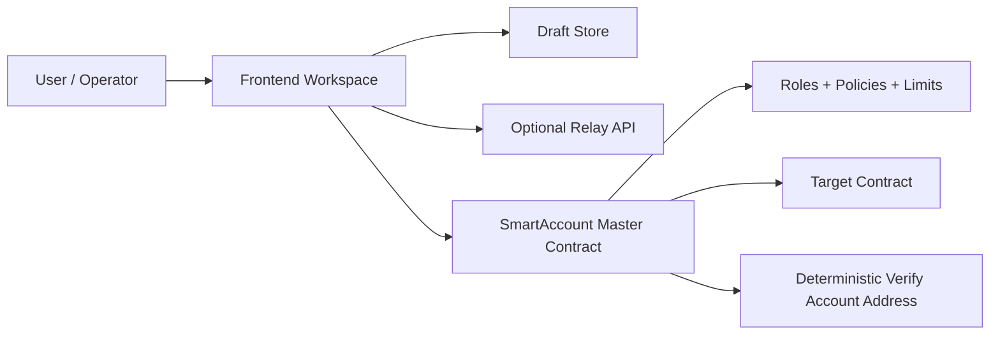
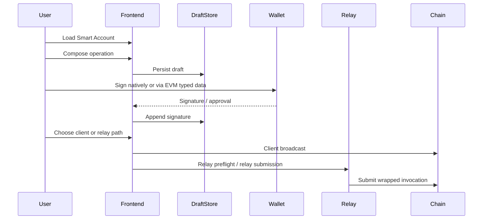
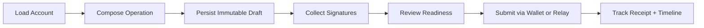
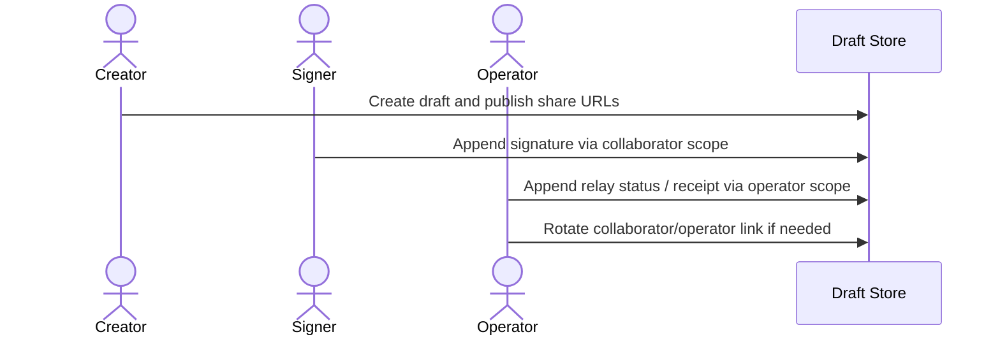
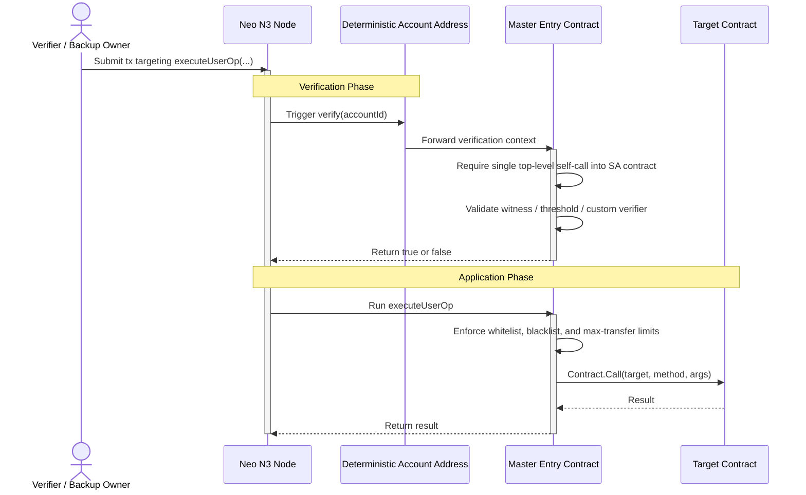
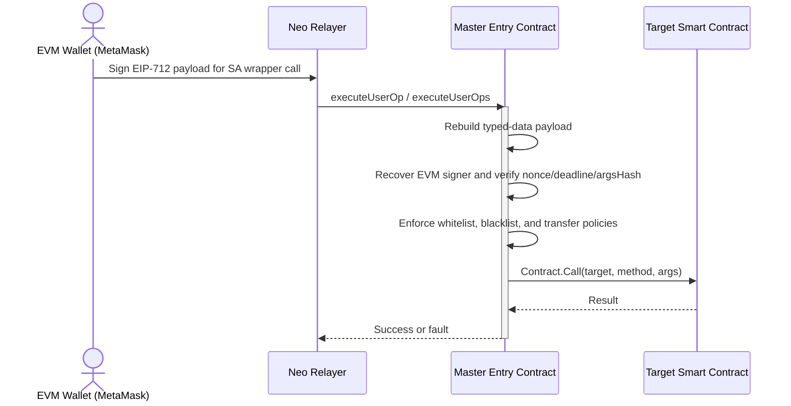

# SmartAccount User Guide

This book is the user-facing guide for ordinary users and wallet operators. It
merges the former topics HOW_IT_WORKS, QUICK_REFERENCE, WORKFLOWS,
NATIVE_ACCOUNT_WORKSPACE, NATIVE_ACCOUNT_TRANSACTION_GUARDS,
NATIVE_ACCOUNT_THRESHOLD_RECOVERY, NATIVE_SIGNED_TRANSACTION_IMPORT and
RECOVERY_AND_SESSIONS into one place for readers. The SDK developer reference
lives in `docs/SDK.md`.

## Contents

1. [How It Works & Usage Guide](#how-it-works--usage-guide)
2. [Quick Reference](#quick-reference)
3. [Smart Account Workflow Lifecycle](#smart-account-workflow-lifecycle)
4. [Native account workspace](#native-account-workspace)
5. [Native account transaction guards](#native-account-transaction-guards)
6. [Recovery and operational sessions](#recovery-and-operational-sessions)
7. [Threshold wallet authorities](#threshold-wallet-authorities)
8. [Signed native transaction import](#signed-native-transaction-import)
9. [Ethereum / EVM integration](#ethereum--evm-integration)
10. [Mixed multi-sig and shared draft collection](#mixed-multi-sig-and-shared-draft-collection)

## How It Works & Usage Guide

This guide explains the Neo Smart Account system end to end: what the contract does, how the website is organized, how a user creates and uses an account, how collaboration drafts work, and how transactions finally reach the chain.

### 1. Who This Is For

Use this page if you are trying to answer any of these questions:

- **New user:** What is a Smart Account and what do I click first?
- **Signer:** What can I review and sign without taking operator actions?
- **Operator:** How do I collect approvals, run relay checks, and submit safely?
- **Integrator:** Which parts are on-chain, off-chain, and server-side?

If you only want one mental model, use this:

> One global SA contract stores account configuration, while each logical account gets a deterministic verify address that routes authorization back through the shared policy-gated engine.

### 2. Mental Model

An Smart Account in this project is **not** a new smart contract deployed per user.

Instead, the system uses one global master contract plus a deterministic verification account address for each logical account.



The result is:

- one shared on-chain execution engine
- zero per-account deployment cost
- isolated account configuration per `accountId`
- support for both native Neo signatures and EVM EIP-712 signatures
- one consistent permission surface for native calls, relay-assisted calls, and meta-transactions
- optional on-chain Paymaster for trustless sponsored/gasless execution

#### Account Discovery and Batch Operations

V3 has no admin, manager or threshold state and no reverse indices: that V1/V2 role model was
removed in the V3 rewrite, and the SDK keeps `getAccountsByAdmin`/`getAccountsByManager` only as
stubs that throw `LEGACY_V3_REMOVED`. Per-account state is read with `getAccount(accountId)`,
one account at a time.

- **Batch creation:** `createAccounts(UInt160[] accountIds, UInt160 custody, ByteString[] salts, Integer recoveryTimelockMs)`
  creates several accounts for one custody in a single transaction (1-64 entries, all or nothing);
  a batch entry installs no modules, so configuration afterwards travels the 24-hour intent path.
- **Creation authority:** `createAccount(accountId, custody, salt, recoveryTimelockMs, actions)`
  requires the `custody` witness (`contracts/native/SmartAccount/SmartAccount.cs`). The initial
  configuration actions install atomically for a fresh account; every later change is a
  `proposeConfiguration` → 24 h → `confirmConfiguration` intent.

Identity is derived, not registered: `accountId = hash160('aa524704' || custody || salt)`.
Persist each salt, because the salt is the only part of that preimage the chain does not hand
back. Read an account you know with `getAccount(accountId)`: the control record answers custody,
recovery authority and timelock, authority epoch, configuration nonce, hook-order revision,
installed modules and the pending configuration intent.

**Via SDK:**

```javascript
const { createNativeSmartAccountClient } = require('./sdk/js/src');

const client = await createNativeSmartAccountClient({ rpcUrl, contractHash, networkMagic });
await client.discover();

const identity = client.deriveIdentity({ custodyAddress: custody, salt });
const state = await client.getAccount(identity.accountId);
const validators = await client.getModules(identity.accountId, 'validator');
```

**Use cases:**

- Portfolio management: re-derive each account from its custody address and salt, then read it
- Access audit: list the installed validator and hook modules and read each instance with
  `getModule(accountId, moduleId)`

The JS client builds one registration script at a time with `buildCreateAccountScript`; a
`createAccounts` batch is the same call repeated per id/salt pair, submitted either as the
contract's own `createAccounts` invocation or as one transaction per account. Every account
shares the custody address and the recovery timelock; the call carries no recovery authority,
because the core has no action that sets one — naming another recovery authority is a
governance module's change, not the core's.

```javascript
const plan = client.buildCreateAccountScript({
  custodyAddress: custody,
  salt: saltA,
  recoveryTimelockMs: 30 * 86_400_000,
});
```

Key behaviors:

- The custody address must witness the transaction; each account id must equal
  `hash160('aa524704' || custody || salt)` or the call faults
- A timelock of `0` selects the 7-day minimum; the accepted range is 7..90 days, in milliseconds
- A `createAccounts` batch is atomic: every account is created or none is
- No verifier or hook is chosen at creation. Modules are installed afterwards by configuration
  intents, which mature for 24 hours; only the single-account `createAccount` call can carry
  initial install actions atomically

Typical uses: team onboarding (several accounts under one custody witness), project setup
(dev/staging/prod accounts together) and service accounts created atomically one call at a time.

### 3. Choose the Right Path

Use the path that matches your role and risk profile:

| Situation | Recommended path | Why |
| --- | --- | --- |
| One user, one browser, ready to submit | Client-side broadcast | Simplest and safest default path. |
| Shared review and signature collection | Draft + collaborator link | Lets signers review and approve without operator powers. |
| Gasless / sponsored transaction | On-chain Paymaster + relay | Sponsor deposits GAS, relay submits and gets reimbursed atomically. |
| Relay simulation before submit | Operator link + relay preflight | Shows VM state, gas, and payload details before final submission. |
| EVM wallet approval flow | Meta signature + relay-ready invocation | Keeps EIP-712 signing while preserving Neo policy enforcement. |
| No Supabase configured | Local-only draft flow | Compose, save, and sign in the same browser without cross-device sharing. |

### 4. What the System Contains

Think of the full product as four connected surfaces:

1. **On-chain engine** — the master contract plus deterministic verify path
2. **Frontend workspace** — compose, review, sign, and broadcast UI
3. **Collaboration storage** — immutable draft body plus append-only signatures/activity
4. **Optional server helpers** — relay submission and signed operator mutations

Those surfaces are connected, but they do not all have the same authority. Supabase does not replace the contract permission model, and a shared URL does not by itself bypass operator-only actions.

### 5. What Happens During One Transaction?

Most users interact through the home workspace:



The key design choice is that the downstream target contract is **not** called directly by a raw proxy-signed transaction. Instead, execution routes through `executeUserOp(accountId, op)` (or `executeUserOps(accountId, ops)` for a batch), where the policy engine can enforce verifier, hook and target checks. The V1/V2 wrapper entrypoints were removed and exist in no deployed manifest and no contract source.

### 6. Draft Collaboration Model

The website uses a three-scope draft model:

- **Share link** — read-only review
- **Collaborator link** — signature collection only
- **Operator link** — relay checks, broadcast, receipt updates, and link rotation

That means:

- people reviewing a draft cannot mutate it
- signers cannot impersonate operators
- operators can rotate write-capable links if one leaks
- operator actions still pass through the signed server-side mutation path when configured

### 7. Human-Readable Domain Access

The frontend can use `.matrix` domains as a discovery layer. If you remember your `.matrix` name
more easily than an SA address, enter the domain in the load field. During account creation, a
compatible Neo wallet can submit a single batched transaction that both creates the SA and
registers the `.matrix` domain to the signer wallet. Later, the frontend resolves the domain back
to the controlling wallet address. V3 keeps no reverse index, so a domain does not list the SA
accounts it controls: read each one with `getAccount(accountId)`.

### 8. How a User Uses the Website

#### For a new user

1. Open **Home**
2. Load or derive the smart account
3. Choose an operation preset or create a custom invocation
4. Persist the draft
5. Share links depending on the collaborator role
6. Collect approvals
7. Run relay checks if needed
8. Broadcast through a wallet or relay

#### For a signer

1. Open the collaborator link
2. Review the draft and operation snapshot
3. Add a manual signature or an EVM typed-data approval
4. Leave relay/broadcast tasks to the operator

#### For an operator

1. Open the operator link
2. Monitor signatures and relay readiness
3. Run preflight checks
4. Broadcast client-side or via relay
5. Rotate collaborator or operator links when needed

#### For a developer or auditor

1. Read the **Core Architecture** page for contract structure
2. Read the **Workflow Lifecycle** page for execution sequences
3. Read the **Data Flow & Storage** page for boundary ownership
4. Read **SDK Integration** for runtime and relay configuration

### 9. What Gets Stored Where?

The draft body and collaboration state live off-chain, while authority and execution rules live on-chain.

- **On-chain:** verifier and hook configuration, backup owner, escape timelock, whitelist / blacklist rules, and transfer limits
- **Browser / Supabase:** immutable draft body, collected signatures, activity timeline, relay preflight snapshots, and bounded submission receipt history
- **Relay server:** simulation, raw transaction forwarding if explicitly enabled, and meta invocation submission when a relay signer is configured

Shared draft metadata is intentionally bounded: the frontend retains only the latest **100 activity entries** and the latest **12 submission receipts** so collaboration records stay lightweight over time.

### 10. Sponsored / Gasless Transactions

The on-chain `SAPaymaster` contract enables users to execute operations without holding GAS:

1. A **sponsor** (dApp, organization, or service) deposits GAS into the Paymaster contract and creates a sponsorship policy specifying which accounts, contracts, methods, and budgets to fund.
2. The **relay** calls `executeSponsoredUserOp` on the SA core with the sponsor and paymaster details.
3. Relays can optionally preflight `validatePaymasterOp`, while the SA core executes the UserOp normally (verifier + hooks) and then atomically settles the reimbursement — deducting from the sponsor's deposit and sending GAS to the relay.

Sponsors can create **per-account policies** (specific accountId) or **global policies** (accountId = Zero) to sponsor any account. Policies support:
- Per-operation GAS limits
- Daily spend budgets (24-hour rolling window)
- Total lifetime budgets
- Target contract and method restrictions
- Expiry timestamps

The Paymaster never replaces the verifier or backup-owner — it only funds the relay after the operation has been fully authorized.

### 11. Key Security Boundaries

Every execution path still flows through the same protection layer:

- account existence checks
- verifier / backup-owner witness verification
- optional custom verifier hook
- escape timelock and finalization rules
- method allowlist
- blacklist / whitelist
- max transfer restrictions

The practical security result is:

- deterministic proxy witnesses are limited to hardened SA wrapper flows
- public links are read-only
- collaborator links are signature-only
- operator actions use signed server-side mutations
- direct proxy-signed external spends remain invalid

### 12. Recommended Reading Order

If you are learning the system for the first time, read these pages in order:

1. **How It Works & Usage Guide**
2. **Core Architecture**
3. **Workflow Lifecycle**
4. **Data Flow & Storage**
5. **SDK Integration**

For practical operator and signer steps beyond this chapter, continue with
the Quick Reference and Smart Account Workflow Lifecycle chapters above, plus
the data-flow chapter of `docs/ARCHITECTURE.md` and `docs/SA-MODULE-PROTOCOL.md`.

### 13. Glossary

- **Smart Account** — a logical account identified by an `accountId`, enforced by the shared SA contract
- **Deterministic account address** — the Neo address derived from the `verify(accountId)` script
- **Master contract** — the shared on-chain execution and permission engine
- **Draft** — the off-chain collaboration record containing operation data, signatures, and metadata
- **Collaborator link** — a scoped link for signature collection only
- **Operator link** — a scoped link for relay, broadcast, receipts, and link rotation
- **Relay preflight** — a server-backed simulation of a relay-ready invocation before submission
- **Meta invocation** — the SA payload created from EVM typed-data signatures; it targets `executeUserOp`
- **Account discovery** — reading one account's state with `getAccount(accountId)`; the V1/V2 reverse indices were removed, so there is no admin/manager role query
- **Batch registration** — creating several accounts for one custody in one transaction with `createAccounts` (no shared governance: every account carries its own validator instances, hook order and recovery timelock)
- **Paymaster** — on-chain contract (`SAPaymaster`) that holds sponsor GAS deposits and reimburses relays after successful execution
- **Sponsor** — an address that deposits GAS into the Paymaster and creates policies to fund operations for other accounts
- **Sponsorship policy** — configuration defining which accounts, contracts, methods, and budgets a sponsor will fund
- **Settlement** — atomic post-execution step where the Paymaster deducts from the sponsor deposit and sends GAS to the relay

## Quick Reference

### Core local verification

```bash
./scripts/verify_repo.sh

# Release-grade cross-repository identity-kernel gate:
NEOOS_REQUIRE_SERVICES_ARTIFACTS=1 ./scripts/verify_repo.sh --contracts-only

# Opt-in formal gate (Coq/Z3/TLC) and private-chain validation (neoxp):
./scripts/verify_repo.sh --contracts-only --formal --neoexpress
```

### Frontend only

```bash
cd frontend && npm test
cd frontend && npm run build
```

### SDK only

```bash
cd sdk/js && npm test
```


### SDK API Reference

Every snippet below drives the v4 protocol through the SDK's public entry point
`sdk/js/src/index.js`, which re-exports the native client implemented in the shared
`nativeSmartAccountClient.mjs`: one native kernel, one 13-field operation and one `SA_*`
vocabulary. The v3 calls (`registerAccount`,
`createAccountPayload`, `getVerifier`, `updateHook`) were removed with the v3 runtime, and the
custom-kernel client factory `createSmartAccountClient` was removed with the custom delivery
track: there is no alias.

#### Account Lifecycle

A v4 identity is committed to at creation and nowhere else:
`accountId = hash160('aa524704' || custody || salt)`. The salt is 1..128 bytes of public uniqueness
input, and the recovery timelock is 7..90 days, passed in milliseconds.

```javascript
const { createNativeSmartAccountClient } = require('./sdk/js/src');

const client = await createNativeSmartAccountClient({ rpcUrl, contractHash, networkMagic });
await client.discover(); // pins protocolVersion and implementationId

const identity = client.deriveIdentity({ custodyAddress: custody, salt });

// createAccount(Hash160 accountId, Hash160 custody, ByteArray salt,
//               Integer recoveryTimelockMs, Array actions)
const plan = client.buildCreateAccountScript({
  custodyAddress: custody,
  salt,
  recoveryTimelockMs: 30 * 86_400_000,
});

const state = await client.getAccount(identity.accountId);
```

The create call carries the derived id, the custody address, the salt and the timelock; no verifier
or hook is chosen at creation. `state` returns the control record (custody, recovery authority and
timelock, authority epoch, configuration nonce, hook-order revision). The recovery slots the
descriptor still carries report their inactive value: the recovery lifecycle is a module's, so a
reader never mistakes an ABI-stability slot for a pending handover.

#### Modules

An account can install modules at registration or afterwards. Choose validator (1), hook (4) or recovery (5). A basic account needs none. Every current module has a [named profile](proposals/nep-smartaccount-module-profiles.mediawiki) that describes its permissions and accepted installation data.

Use `installModule(accountId, moduleType, moduleContractHash, initData)`. Record the returned instance ID. To remove a named module, call `removeModule(accountId, moduleId, [])`. Before mandatory threshold enrollment, direct administration accepts custody or an authorized installed validator. A governance proposal follows its own 24-hour delay.

Page installed instances with `getModules(accountId, 'recovery', {cursor, limit})`, substituting `'hook'` or `'validator'` for other roles. Use `getModule(accountId, moduleId)` to inspect an instance before changing it. The core calls lifecycle methods; wallet-facing reads and management actions are listed in the named profile.

#### Execution

Execution is `executeUserOp(accountId, op)` for one operation and `executeUserOps(accountId, ops)`
for a batch. The operation is the v4 13-field array: version, target, method, args, nonce,
nonce subkey, deadline, validator id, credential generation, authority epoch, configuration nonce,
signature, hook proofs. Sign the typed data the core checks:

```javascript
const operation = {
  targetContract,
  method: 'transfer',
  args: [{ type: 'Hash160', value: recipient }, { type: 'Integer', value: '100000000' }],
  nonce,
  nonceSubkey,
  deadline,
  validatorId: 1,
  credentialGeneration: 1,
  authorityEpoch,
  configurationNonce,
  signature,
  hookProofs: [],
};

const typedData = buildUserOperationTypedData({
  chainId,
  verifyingContract: proxyAddress,
  accountId,
  coreContractHash,
  validatorId: operation.validatorId,
  targetContract: operation.targetContract,
  method: operation.method,
  argsHashHex,
  nonce: operation.nonce,
  deadline: operation.deadline,
  operationDigest,
});
```

### Canonical docs

- `docs/GUIDE.md`
- `docs/ARCHITECTURE.md`
- `docs/SDK.md`

## Smart Account Workflow Lifecycle

The Neo N3 Smart Account workflow turns user intent into verified on-chain execution through the master contract. After the March 6, 2026 hardening update, deterministic proxy witnesses are only valid for a single top-level self-call back into the Smart Account contract. That means direct proxy-signed external token transfers are rejected, while V3 executes through `executeUserOp(accountId, op)`, or `executeUserOps(accountId, ops)` for a batch. The V1/V2 wrappers `executeUnified` and `executeUnifiedByAddress` were removed in the V3 rewrite and exist in no deployed manifest and no contract source.

### Home Operations Workspace

The home operations workspace is now the fastest path for day-to-day usage. It lets a user load a Smart Account, stage the SA invocation, persist an immutable share draft, collect mixed Neo + EVM approvals, and then choose the final submission path. For client-side Neo execution, the workspace now stages a concrete `executeUserOp` invocation against the SA contract instead of pointing the wallet directly at the downstream target contract.

For v1, both broadcast modes are supported:

- **Client-side broadcast:** safest default path; a connected Neo browser wallet signs and submits the invocation directly.
- **Relay broadcast:** optional path for either already-signed raw transactions or relay-ready `executeUserOp` invocations assembled from collected EVM signatures. When a relayer signer is configured, the server can submit those meta invocations without requiring users to reconstruct the call body manually.

Anonymous collaboration drafts can be backed by Supabase. The public share link carries only the opaque read slug, a collaborator link carries signature-collection authority, and a separate operator link carries relay, broadcast, and draft-management authority. Signer links also cannot forge relay or broadcast timeline entries; those activity classes are reserved for operator scope. That keeps ordinary shared links read-only while still preserving the cheap anonymous collaboration flow. If either write-capable URL leaks, the workspace can rotate the collaborator or operator link in place without rebuilding the draft.

To keep shared drafts lightweight over time, the frontend now retains only the latest 100 activity entries and the latest 12 submission receipts in draft metadata. That bounded-retention policy is applied consistently in both the local browser fallback and the Supabase-backed shared draft path.

If Supabase is not configured, the workspace falls back to a local-only draft store backed by `localStorage`. That keeps the compose → persist → sign → review flow working in the same browser, but those share links are intentionally local-only and are not a substitute for the real anonymous Supabase collaboration path.

The composer ships with concrete presets for **Generic Invoke**, **NEP-17 Transfer**, and **Multisig Draft** flows so users can stage common SA operations without hand-writing every JSON argument from scratch.

If you want the UI to treat collected EVM meta signatures as directly relayable, expose `VITE_AA_RELAY_META_ENABLED=1` alongside the server-side `AA_RELAY_WIF` configuration. That lets the workspace show an accurate relay-readiness state before submission. When both a signed raw transaction and a relay-ready meta invocation exist, the UI now offers explicit **Best Available**, **Signed Raw Tx**, and **Meta Invocation** choices so operators can control which relay path is used. The **Check Relay** action runs a server-backed preflight simulation for relay-ready meta invocations before submission and clearly reports when signed raw transaction simulation is not supported. The dedicated **Relay Preflight** panel then shows the selected payload mode, simulated VM state, gas estimate, operation, any exception details, and an expandable **Stack Preview** for inspecting return values. Stack items are also decoded for common VM types such as `Integer`, `Boolean`, `ByteString`, and nested `Array` values. Operators can also use **Copy Payload**, **Copy Stack**, and **Export JSON** actions directly from that panel for handoff and debugging.

### 1. First Transaction Walkthrough

For a first successful transaction, the recommended sequence is:

1. **Load the account** — enter the SA address or derive it from the expected identity path.
2. **Choose the operation** — start with a preset like Generic Invoke or NEP-17 Transfer.
3. **Persist the draft** — lock in the body before collecting external signatures.
4. **Collect signatures** — native Neo, EVM typed-data, or both depending on threshold requirements.
5. **Review readiness** — confirm signer progress, relay mode, and explorer settings.
6. **Choose submission path** — client-side wallet broadcast or relay-backed submission.
7. **Monitor the receipt** — txid, result, timeline entry, and follow-up actions.



### 2. Choose the Submission Path

Use this rule of thumb:

| Path | Best for | Requirements | Tradeoff |
| --- | --- | --- | --- |
| Client-side broadcast | Native Neo wallet users | Browser wallet connected | Simplest and most transparent |
| Relay preflight only | Operators who want simulation before submit | Relay endpoint configured | Adds server dependency, but gives VM/gas feedback |
| Relay raw submission | Existing signed raw transaction | Raw forwarding explicitly enabled | Only use when you intentionally want passthrough |
| Relay meta submission | EVM signature collection flow | Relay signer + relay meta mode configured | Most flexible for mixed-signature workflows |
| Sponsored (Paymaster) | Gasless execution for users | SAPaymaster deployed + sponsor has deposit/policy | User pays no GAS; relay reimbursed atomically |

### 3. Collaboration Lifecycle

The collaboration lifecycle exists so different people can contribute without sharing the same power level.



### 4. Standard Native Invocation

Native Neo execution now flows through Smart Account wrapper methods instead of relying on a raw proxy witness to call an external contract directly.



> Raw external contract calls signed only by the deterministic proxy are intentionally rejected after hardening.

### 5. Meta-Transaction Workflow

Ethereum users can still sign EIP-712 payloads off-chain while a Neo relayer pays network fees and submits the wrapped SA execution.



### 6. Before You Broadcast

Before a production submission, operators should verify:

- the draft body matches the intended target and method
- signer progress satisfies the configured threshold
- the chosen payload mode is the one you actually want to send
- relay readiness is green if using relay submission
- explorer base URL is set if you want receipt links
- collaborator/operator links are rotated if an older scoped URL leaked

### 7. If Something Fails

Use the failure mode to decide where to look next:

- **Wallet connect issue** — browser wallet integration or missing provider
- **Signature count incomplete** — draft collaboration or threshold mismatch
- **Relay readiness warning** — runtime config mismatch or unsupported payload mode
- **Simulation fault** — contract policy or target-call failure
- **Broadcast failure** — network fee, RPC, or signer-side submission problem


### Domain-Assisted Account Workflow

A compatible Neo wallet can batch two invocations into one transaction during account creation:

1. `createAccount(accountId, custody, salt, recoveryTimelockMs, actions)` on the SA master contract, with the initial module installs carried in `actions`
2. `register(domain, ownerHash160)` on the `.matrix` contract

In this repository, the `.matrix` domain is registered to the signer wallet address. V3 has no admin or manager reverse index: that V1/V2 role model was removed, and per-account state is read with `getAccountState(accountIdHash)`. The V2 account-discovery helper that named the removed `getAccountAddressesByAdmin` / `getAccountAddressesByManager` reads has been deleted, so no frontend path targets those reads any more.

## Native account workspace

`/native` is an independent ABI 2 workflow. It never substitutes the deployed V3
contract for the fixed native SmartAccount contract. A new endpoint starts
read-only; discovery requires the expected network magic, native contract id,
native contract hash/name, exact ABI, profile digest and successful getVersion=2.

Native SmartAccount is a draft protocol. Use a node that has explicitly activated the
matching profile and completes native discovery. External protocol review, public-network
activation and production deployment remain separate draft-release gates, and selecting a
public RPC endpoint does not activate the service. The former account user guide is merged
into this chapter: the backup requirements, the authority and timing matrix, and the key-loss
scenarios are the sections below.

New authority admission requires consent: registration includes custody and a nonzero guardian; guardian replacement includes custody and the new nonzero guardian; custody recovery proposals include the configured guardian and proposed custody. The review lists every required witness and fails submission if the selected signing integration cannot supply them. A signer entry without its wallet or contract witness does not satisfy consent. Native account proxies are not supported authority addresses. Mature activation remains permissionless.

Consent is checked when an authority is newly introduced relative to the current custody, recovery and pending-authority addresses. Re-proposing an already admitted pending address does not require fresh recipient consent; current controlling-authority checks still apply.

### Set up and keep the right backups

| Item | Purpose | What to keep |
| --- | --- | --- |
| Account ID | Identifies the account and its settings | Network and account ID |
| Funding address | Holds the account's assets | The independently verified address shown after registration |
| Public recovery descriptor | Records the original custody, salt, identity, funding address and profile | A copy you can use to find and verify the account |
| Custody wallet backup | Authorizes administration and default execution | The wallet's private-key or recovery backup, stored securely |
| Guardian wallet backup | Authorizes emergency freeze and custody recovery | A separate secure backup controlled independently from custody |

The descriptor contains no private key. It cannot sign, restore a lost wallet key or remove a
guardian. After custody recovery, its original identity fields still identify the same account;
fresh on-chain state shows the current custody. Never put private keys in a descriptor or
reviewed request.

Set up in this workspace: verify the network and node, then choose accepted Neo wallet
authorities for custody and an independently controlled guardian. Review the derived account
ID and separate funding address, obtain custody and guardian consent witnesses in the same
transaction, confirm registration, and read the recorded account state before funding it. Fund
the account's funding address, and keep wallet backups separately from the public descriptor.
The [SDK guide](SDK.md) describes supported signing interfaces and exact transaction
review.

### Who can act, and when

The guardian is the account's configured recovery authority. Every action needs a transaction
fee payer; paying does not grant account authority. A payer can also act as custody or guardian
when it controls the required wallet.

| Change | Who starts it | Who completes it, and when | Who can cancel while pending |
| --- | --- | --- | --- |
| Replace or remove verifier/hook | Custody, while Active with no pending custody recovery | Any payer after 24 hours; account must still meet those state conditions | Custody, including after maturity until activation executes |
| Change module policy, including a session key | Custody, while Active with no pending custody recovery | Custody repeats the exact stored call after 24 hours | Custody; select the verifier or hook role and review its pending call |
| Change guardian | Custody plus the new nonzero guardian, while Active with no pending custody recovery | Any payer after 24 hours | Custody while pending |
| Recover custody to a new wallet | Configured guardian plus the proposed custody wallet, while Active or Frozen | Any payer after seven days | Guardian at any time while pending; custody only strictly before maturity |
| Freeze | Configured guardian, while Active | Takes effect when the transaction executes; no protocol waiting period | No pending proposal; resuming requires unfreeze |
| Unfreeze | Custody and configured guardian together | Takes effect when the transaction executes; no protocol waiting period | No pending proposal |

A mature activation applies the authorized intent present when it executes; its payer does not
choose the replacement in the activation call. Module replacement still requires valid module
code and successful cleanup. Module-policy application is a different action and requires
custody again. Inspect the current pending payload before activation or cancellation. Cancelling
a policy proposal does not revoke the currently active policy.

In the workspace, refresh the account and chain time before acting. A snapshot does not update
itself when another transaction changes the account; revalidation rejects changes it observes.
Coordinate custody devices and inspect confirmed account and pending-policy state. Deadlines
and delays use **chain time in milliseconds**, not your device clock: an operation is valid at its
exact deadline, an intent is mature at its exact maturity time, and custody's right to cancel
recovery ends at that time. A transaction included in a later block can miss its deadline even
after a successful preview. Counter-advancing transitions invalidate other pending
configuration; reload state before each subsequent action.

### Emergency containment and guardian trust

Removing or changing a session key is delayed. An active key can keep exercising its existing
permission until it expires or the account is frozen. When immediate containment is needed,
freeze first, confirm the Frozen state, and then start recovery if custody needs replacement.
Freeze clears **all pending intents**, including recovery, verifier/hook changes, guardian changes
and module-policy calls, so freezing after proposing recovery cancels that recovery proposal.
Proposing recovery alone does not freeze an Active account. Recovery preserves the account ID,
funding address, operation nonce channels, guardian and Frozen status; it replaces custody and
detaches the old verifier and hook without calling them. Unfreezing still requires the new
custody and configured guardian, and a Frozen account must be unfrozen before new module
configuration.

Choose a guardian you trust to remain available and cooperate. It can freeze without custody,
and custody cannot unfreeze alone when a guardian is configured. The profile has no
custody-only override if the guardian key is lost while Frozen. Recovery does not remove or
replace the guardian. While Active and without pending custody recovery, custody can propose a
guardian replacement with a 24-hour delay; that pending change is also cleared by freeze. A
standard Neo threshold multisignature wallet can serve as the guardian: independently backed-up
2-of-3 keys tolerate one unavailable key while the remaining two still authorize the guardian.
That is one guardian address with a threshold witness, separate from the account's verifier
module. Custody must still participate in unfreezing. If fewer than the threshold remain while
Frozen, there is no override; threshold recovery reduces individual-key failure risk without
creating authority after all usable backups are lost.

### If a key or backup is lost

| Situation | Available path |
| --- | --- |
| Custody key lost; guardian available | Guardian proposes recovery to a new custody wallet; complete after seven days. Freeze first if the old key may be compromised. |
| Guardian key lost; account Active and custody available | With no pending custody recovery, custody can propose a new guardian and activate it after 24 hours. |
| Guardian key lost; account Frozen | Restore the guardian wallet from its backup. Custody recovery does not bypass the guardian needed for unfreeze. |
| Session key lost or compromised; custody available | Review a delayed replacement/removal. Use guardian freeze for immediate containment if necessary. |
| Descriptor lost; wallet keys available | Recover the known network/account ID from your records and verify on-chain state. Wallet backups and a descriptor serve different purposes. |
| Custody key lost; no usable guardian | There is no key-recovery shortcut in this profile. A configured verifier may still allow its own operations, but does not replace custody for administration. |

### Fees, results and uncertain submissions

The native account itself cannot be the fee payer: an external payer signs the complete
transaction and pays its fees. Review the exact target, arguments, deadline, authorities and
system/network/total fee limits before signing. Workspace consumption and minimum-budget
previews are not a final transaction quote; review the final network fee and total with the
wallet or SDK.

A returned transaction ID means submission, not confirmation. If a request times out, query
**that same transaction ID** and inspect the wallet's submission before preparing a replacement.
Do not automatically sign another transaction or raise fees. A successful preview reserves
neither a nonce nor a place in a block.

### User flows and trust boundaries

1. **Connect a node**: enter its RPC URL and expected network magic, then verify.
   Changing either value or a wallet network/account event discards prepared work.
   Public networks without activation show an explicit read-only error.
2. **Create**: generate a cryptographic 32-byte salt; enter Neo custody/recovery
   script hashes from accepted Neo wallet authorities. Default verifier/hook are
   absent so custody witness works immediately. Choose a guardian controlled
   independently from custody; no recovery requires an
   explicit acknowledgment. Preview stable identity and separate funding address.
3. **Backup / restore**: export a public recovery descriptor (network, profile,
   identity, funding address, custody and salt). It contains no private key and
   cannot replace wallet-key backup. Restore checks format, profile and derived
   identity before any RPC; it never selects an imported endpoint.
4. **Manage / recover**: show custody, recovery, frozen state, authority epoch,
   configuration nonce and channel-zero nonce. Proposals show 24-hour module or
   7-day custody recovery delay; activation is a separate transaction. Native ABI
   2 recovery detaches old modules without requiring their callbacks, advances
   authority epoch and preserves funding address, nonces and frozen state.
   The configured recovery authority may cancel any still-pending recovery;
   custody may cancel only strictly before maturity.
   **Cancellation authority** selects the wallet that authorizes cancellation,
   separately from **Fee payer**. The same-wallet default remains available.
   An independent payer receives `None` scope; the selected authority receives
   `CustomContracts` restricted to the native contract. Choosing different wallets
   automatically uses the exact-script SDK path. At maturity, including the exact
   boundary, custody can no longer cancel; recovery can cancel while the proposal
   is still pending. Fresh chain time is checked again before export and handoff.
   Mature verifier, hook and guardian-address activations, and mature custody
   recovery execution, require only a fee payer. They operate on the pending
   intent present at execution and must pass current state and maturity checks.
   The review snapshot does not lock that state until inclusion.
5. **Restricted sessions / multiple approvals**: build declared module calls
   with typed values, finite session expiry and an explicit positive spending
   cap. Session configuration excludes the automatically prepended account id.
   MultiSig thresholds count verifier modules, not independently controlled
   humans. Inspect pending policy calls separately for verifier and hook roles;
   review their selected module, method, typed arguments and maturity. Custody
   can cancel the selected pending call. Cancellation removes that proposal,
   not an active key or policy. Applying the policy after 24 hours still requires
   custody and its exact stored arguments. Delayed policy calls are exported as exact scripts; configuration
   never masquerades as an immediate key revocation. A cancellation export includes an
   execution-time comparison against the reviewed pending bytes.
6. **Business operation**: build an exact typed operation with RPC nonce, finite
   deadline, current authority domain and digest cross-check. Show fee payer,
   exact targets, bytes and profile bounds. Native sponsorship is absent; there
   is no gasless checkbox. Execution exports proxy witness and CustomContracts
   target scope for an exact-script SDK/wallet integration, not legacy invoke.

Account state and displayed chain time are snapshots. Use **Refresh account and
chain time** before acting on a pending change. In the policy tab, select
**Module role**, then **Refresh pending policy**. The pending card shows the
root and selected module, method, typed arguments, maturity and checked chain
time. **Review policy cancellation** compares the freshly read pending call to
that inspected snapshot; an observed change requires a new review.
**Review pending activation**
uses the selected role and repeats the exact stored call after maturity. New
hook-policy proposals are built through the SDK.

The review separates **Application consumption** from **Minimum system fee
budget**. Its **Network fee** remains unquoted until an exact transaction and
witness roster are available. These preview values are not a final total-fee
approval; review the wallet's final fees or use SDK fee caps before signing.

### Manual wallet hand-off

Supported registration and lifecycle calls use the existing wallet invoke
service only after fresh discovery, account-state revalidation, successful
simulation, matching live wallet account and matching live wallet network. The
selected provider must expose `getNetwork()` or `getNetworks()` with a recognizable
active network (numeric magic or MainNet/TestNet). A supported-networks list alone is
not proof of the selected network. The actor is the fee payer and uses
`CalledByEntry`; Global scope is never requested. Dual-authority unfreeze,
configuration, guarded policy cancellation and proxy execution use exact-script
exports with explicit required signer/witness details. A standard wallet
multisignature can represent the configured guardian as one script hash; retain
the complete script, member keys and threshold as described in
[threshold recovery](#threshold-wallet-authorities).
Wallet confirmation is a user action; automated
QA never requests a live signature. Wallet rejection leaves the review intact.
A returned transaction id is submitted, not confirmed; readback checks its exact
script and HALT application log before marking confirmation.

For an exact-script review, the **Import and submit a signed transaction** panel
accepts the SDK's exported JSON file after explicit system, network and total GAS
ceilings are entered. **Check signed transaction** validates its canonical bytes,
network/profile, ordered signer roster, signatures and complete signed preflight.
**Broadcast signed transaction** repeats preflight and sends the same bytes once.
Changing the review or fee limits invalidates the imported approval. A timeout
keeps the original transaction ID available through **Check imported transaction
confirmation**; a committed FAULT is shown as unsuccessful. See
[signed transaction import](#signed-native-transaction-import) for supported
formats and confirmation recovery.

Before freezing, the review shows both custody and guardian identities, the
effect on pending proposals and recovery timing, and the authority needed to
unfreeze. An explicit acknowledgment is required. Freezing does not introduce a
custody-only override if the configured guardian loses its signing quorum.

### Validation contract

Red tests precede implementation for unavailable/native-v1/wrong-digest endpoints,
malformed account records, endpoint-switch stale work, identity-tampered recovery
descriptors, expired operations, unsafe session defaults, network/account mismatch,
changed chain state before handoff, simulation failure, and non-exact wallet lanes.
Browser checks exercise discovery, creation preview, descriptor export/import,
management review and offline states on desktop and mobile. Mock RPC and wallet
fixtures provide interaction evidence only; they do not establish native-network
activation or production deployment readiness.

### Consuming an exported request

The JSON is a **review document, not a signed transaction or universal wallet
import format**. For SDK consumption, select **Native SDK · exact script** before
building the review. The default management **Wallet invoke** path has a separate
`CalledByEntry` signer schema and exports a primitive `request`; that artifact
must not be fed to the SDK transaction builder. Changing paths discards the old
review and requires another explicit approval. Its `recipe` names the native SDK builder and contains the typed
input; `plan.script` is the exact comparison target. Rebuild in a fresh client
on the recorded network and profile before supplying any private signer:

```js
import { rebuildNativeReview } from "./frontend/src/features/native/nativeWorkspace.js";
const plan = await rebuildNativeReview(client, exported);
```

This repository helper uses an explicit builder whitelist and compares the full
fresh discovery profile and **every public field of the rebuilt plan** with the
review. This includes authority epoch, configuration nonce, full account state,
pending recovery/configuration intent, module-call phase and execution
context/digest/proof. It then revalidates the fresh plan before returning it.
A downstream SDK/wallet integration must preserve these comparisons if it ports
the helper. Comparing only the script is unsafe: `executeRecovery(accountId)`
can have the same script after a different new custody has been proposed.

A signer integration must also compare the exported network, service and profile
digest against the fresh discovery result, and the selected actual fee payer / authority and
proxy signer scopes against the rebuilt plan. Then use the native SDK's
`prepareTransaction` with explicit maximum system, network and total fee bounds,
its actual wallet signer interfaces and final user approval. SDK-mode scopes are
shown before export: payer first (`None` unless also required), proxy second for
execution, then remaining authorities with `CustomContracts` restricted to the
native contract. Recovery cancellation exports its selected `cancellationAuthority`
separately from `feePayer`, and includes only that selected custody/recovery wallet
in the required set. Rebuilding checks the exported authority and the complete
actual signer roster against the fresh plan; it does not change the issued plan.
Older version-one cancellation exports that omit this field are accepted only
when the payer is also the required cancellation authority and their complete
signer roster matches that same-wallet selection. Explicit invalid fields or
an independent-payer roster do not receive this compatibility fallback.
Pass that same `cancellationAuthority` to `prepareTransaction`, supply the payer
wallet as `feePayer`, and supply the selected authority in `authoritySigners` when
it differs from the payer. Editing either selection invalidates the previous
review and any imported signed transaction. Receipt checks require the same signer order and exact
scopes; no broader superset is accepted. Additional NeoWitnessValidator or MultiSig
transaction witness signers are not collected by this UI. Such integrations need
a separate SDK review that includes their discovered module scopes; this page
will not call an unreviewed larger signer roster a confirmed success. Do not call arbitrary
methods from an imported JSON file. Never replay an old signature after a script,
nonce, authority epoch or configuration change.

The descriptor's custody/salt describe the **original identity derivation**.
After recovery, the descriptor still finds the same account; fresh on-chain
state supplies current authority. A descriptor does not reset authority or
recover a lost wallet private key.

An exported policy cancellation includes its explicit verifier/hook role and
the complete pending-call snapshot. Its signed script asserts the canonical
pending bytes on chain before invoking cancellation, so changed or missing
content faults before deletion even if it changed after client revalidation.
The workspace requires exact-script signing and disables ordinary wallet invoke
for this operation. The unchanged native method still supports deliberate role
slot cancellation by other callers. An exactly identical record recreated in
the same block can match the guard; this is content binding rather than a unique
proposal-instance identifier. Inspect confirmed pending state. The
[guard specification](#native-account-transaction-guards) defines the exact
script, byte encoding and compatibility boundary.

Session defaults use a 48-hour expiry so the initial 24-hour configuration delay
leaves a useful session. New grants ending before activation are rejected. The
pending-activation action reloads and repeats the exact stored arguments; it
never silently extends a session. Revocation is also delayed. Freeze remains the
immediate containment action once its transaction executes, and recovery provides
the old-plugin-independent exit. Freeze clears every pending intent, including
custody recovery and policy calls. Freeze first and confirm, then start recovery;
a recovery proposal on its own leaves an Active account active. Recovery retains
the guardian and Frozen status. Unfreeze requires custody and the configured
guardian, so a lost guardian key while Frozen has no custody-only override.
While Active without pending custody recovery, custody can propose a guardian
replacement with the normal 24-hour delay.

Times shown for deadlines and maturity are chain milliseconds. Equality is valid
for a deadline and sufficient for maturity; custody cancellation of recovery
ends strictly before maturity. An included FAULT can charge fees despite rolling
back application changes. Boolean `false` is not itself a VM fault; review the
operation's result and applicable policy. After a timeout, inspect the same
transaction ID before preparing another transaction.

If the wallet request was already opened when the network changed, the
page cannot recall it; a late result asks the user to inspect the wallet before
retrying and is never shown as confirmation of the new context.

`npm run prebuild` synchronizes canonical native sources when the complete repo
is present. A frontend-only deployment uses its committed copies; repository
tests compare their SHA-256 hashes with the canonical modules. Browser QA is
`npm run test:native:browser`, included in the existing frontend browser gate.

## Native account transaction guards

The native SDK binds a configuration-intent cancellation to the complete pending intent record
reviewed by the signer. The signed Application script reads that record again at execution,
compares its canonical bytes with the reviewed ones, and only then calls the native cancellation
method. This closes the interval between client revalidation and transaction inclusion, without
changing the native ABI or the account counters.

### Complete cancellation script

The script executes these instructions in this order, with no additional calls between the
comparison and the cancellation:

```text
PUSH intentId
PUSH accountIdBytes
PUSH 2; PACK
PUSH ReadOnly
PUSH "getPendingConfiguration"
PUSH SmartAccountHashBytes
SYSCALL System.Contract.Call

PUSH 1; PACK
PUSH None
PUSH "serialize"
PUSH StdLibHashBytes
SYSCALL System.Contract.Call
PUSH reviewedIntentBytes
EQUAL
ASSERT

PUSH intentId
PUSH accountIdBytes
PUSH 2; PACK
PUSH All
PUSH "cancelConfiguration"
PUSH SmartAccountHashBytes
SYSCALL System.Contract.Call
```

`ReadOnly`, `None`, and `All` are call flags `5`, `0`, and `15`. `intentId` is the id
`proposeConfiguration` returned in its `ConfigurationIntentProposed` notification; the account
derives ids from a monotonic counter, so an id is never reused. Both contract hashes and
`accountIdBytes` use VM wire byte order. The first call is a read, serialization is pure
computation, and cancellation re-checks the intent's own authorization. There is no external
module callback in this sequence, and no other transaction can execute between these instructions.

### Canonical bytes

`reviewedIntentBytes` is the exact Neo binary serialization of the record the caller reviewed:

```text
[true, intentId, proposedAt, matureAt, expiresAt, authorityEpoch, actionDigest, actions]
```

The outer value and `actions` are Arrays and each action is itself an Array of the form
`[code, operand…]`. Array and Struct arguments stay distinct; ByteStrings keep their bytes;
Integers keep exact values; Null and Boolean keep their VM types. The SDK uses the canonical VM
serializer, never JSON, display-order hashes or reconstructed action operands. This guard compares
bytes directly and defines no new digest or hash domain.

A missing intent serializes as an empty Array and fails the comparison. Any changed field — the
action digest, the operands, the maturity, the authority epoch — fails `ASSERT` before the
cancellation. A malformed native record faults before deletion. A match still has to satisfy the
native cancellation authorization: a live intent needs the custody witness on an active account,
and an intent past `expiresAt` is dropped by anyone without a witness. The guard grants no
additional authority. Faulting transactions do not commit application writes.

### Submission and compatibility

Cancellation plans keep `intentId` and the reviewed record, and add `reviewedIntentBytes` and
`requiresExactScript: true`. Preparation, simulation, signing, export and import must preserve the
entire `plan.script`. A wallet method-and-arguments request cannot express the comparison, so such
plans must use the exact-script SDK route; the interface must not fall back to an unguarded
`wallet.invoke` request.

`cancelConfiguration(accountId, intentId)` remains available to applications that deliberately
authorize cancellation of whatever the intent currently carries. The guard is a guarantee of the
guarded SDK transaction, not a new invariant on every native caller. Native methods, the profile
digest, the record format, identity, the authorization domain and the configuration-counter
semantics are unchanged, and an older client does not gain this guard automatically.

The extra read, serialization, comparison and embedded bytes increase script size and fees.
Existing simulation and transaction fee ceilings apply to the complete script; a client must not
reuse an estimate for the old single-call form.

### Content identity and regression coverage

This is exact-content binding over a record that already carries a unique id. A cancelled intent
that is proposed again with identical actions gets a new `intentId` from the monotonic counter, so
the old guard no longer matches; identical re-proposal inside one block cannot replay it.

Regression coverage must execute actual SDK script bytes against the native engine: a matching
cancellation succeeds; a replaced or missing intent faults; a changed operand or action digest
faults; an expired intent is cleaned without the witness; a live intent without custody faults. A
script with the comparison removed demonstrates why the two-argument native call alone cannot bind
content. Tests also cover canonical VM type distinctions, unchanged account records during
replacement, the identical-id boundary, and preservation of the complete script through
transaction signing.

## Recovery and operational sessions

Recovery and session authority for SA accounts spans four boundaries that used
to live in separate documents: the recovery and identity read contract, draft
operator key persistence, SocialRecoveryVerifier action sessions, and the
Morpheus private-action integration. Those chapters are consolidated below.

### Recovery and identity read contract

`proposeConfiguration` / `confirmConfiguration` is the timelocked owner path that
changes an account's module set. Before dispatching a lifecycle callback the core
resolves the target instance from its own recorded module set and re-checks the
installed module's profile and lifecycle ABI; a caller-supplied replacement
address is never trusted. An empty validator set remains the explicit return to
custody-only authorization.

Recovery is atomic, but its completion depends on the installed validator and hook
instances successfully executing `onUninstall`. A destroyed, incompatible, or faulting
plugin can therefore block finalization even after the timelock. This is not an
unconditional recovery guarantee. Ignoring cleanup faults would leave persistent
plugin authority behind; removing that dependency requires a separately designed
authority epoch/revocation boundary and migration of all consumers of plugin state.

The identity UI accepts an explicit account ID, a platform proxy script hash, or
both. It reads only the existing core ABI:

- `getAccountIdByProxy(proxy)` resolves platform-registered accounts. The reverse
  index is not populated for all legacy accounts. A zero result requires an
  explicit account ID; the UI must not substitute the proxy address as the ID.
- `getProxyScriptHash(accountId)` verifies a supplied or resolved ID against the
  requested proxy, when both are available.
- `getModules(accountId)` confirms the account exists and lists its installed
  validator and hook instances by module id and role; `getAccount(accountId)`
  returns the account record. Neo RPC returns UInt160 values as little-endian 20-byte stack values;
  the UI converts them to display-order hex before using Hash160 arguments.

The RPC URL and core hash must be configured, and malformed inputs, mismatched
identity, FAULT responses, and malformed stack values fail closed. The `getAccountIdByAddress` and `getVerifierContractByAddress` names are absent from every
deployed manifest: this core exposes no such ABI. Changing
the account, core, or account-ID prefill invalidates pending UI reads so a late
response cannot restore an earlier account's recovery context.

#### Current ticket and execution-configuration boundaries

Recovery signatures use the `neodid-recovery-v2` domain and compact-v3 encoding.
New action requests use `neo_n3_action_v4`: compact action-v4 tickets signed
under `neodid-sa-action-v3`, binding the enrolled master nullifier and current
action-authorization epoch. Both paths bind the SA core and raw 20-byte account
ID along with their ticket-specific context; the proxy address is not the raw
account ID. Direct ticket submission re-derives the expected action ID instead
of accepting an unrelated ID solely because its signature matches. Existing
v3 action signatures are accepted only through the legacy manual route with
current-owner and executor witnesses; old Oracle v3 action packets are rejected.
Pre-v4 active sessions require explicit current-owner reauthorization or a new
authorized session. See [action identity enrollment and sessions](#action-identity-enrollment-and-sessions).
Tickets issued before raw-account binding remain incompatible; deployment and
in-flight request migration still require an owner-approved plan.

Account configuration calls reject reentry while execution, verification, or a
verifier/hook configuration or execution context is active. This covers plugin
rotation and configuration calls, metadata, escape, and market escrow, so an
arbitrary target cannot reuse the outer operation's backup-owner witness to change
account authority. Direct owner-authorized configuration outside those contexts
remains available.

#### A possible authority-epoch recovery design (proposal only)

The current implementation already provides a useful boundary for assets at the
core-derived proxy: `executeUserOp` selects the verifier and hook from core state,
and `verify` accepts Application-phase witness requests only in an active target
context. Configuration callbacks require a temporary context; execution callbacks
require the active root and immediate caller, resolved through
`getAuthorizedModuleId(accountId, phase)`. The checks are implemented in
`SmartAccount.Execution.cs`, `SmartAccount.ModuleProtocol.cs` and
`SmartAccount.VerifyContext.cs`; the corresponding module-side checks are
in `ValidatorAuthority.cs` and `HookAuthority.cs`.

Those checks do not prove that detaching a module erases all of its authority:

- Existing module configuration is keyed by account ID, without an installation
  generation. `MultiSigVerifier.ClearAccount` and `MultiHook.ClearAccount` invoke
  core dependency cleanup before deleting their own topology. The core calls each
  supported leaf's cleanup from the registered roster or supported legacy-roster
  fallback; a cleanup fault rolls back the operation. This does not establish
  cleanup for unsupported legacy rosters. Reinstallation can still make
  configuration retained by a module relevant again.
- `SocialRecoveryVerifier.VerifyExecution`, `VerifyAdmin`, and the corresponding
  legacy meta-transaction methods read the plugin's own owner/session state.
  They do not require a current core execution context. External integrations
  trusting those methods need their own revocation migration.
- The recovery verifier owns per-account oracle credits. Its cleanup transfers
  funds back to the recorded owner, which is an external call and another reason
  cleanup may fault. Rotating a core pointer cannot recover funds in a plugin.
- Successful execution of an arbitrary module's `clearAccount` is not proof that
  a malicious implementation actually removed its storage.

A versioned implementation should therefore be specified and tested as follows:

1. Store a monotonic authority epoch in a new core storage namespace, retaining
   the existing account ID, proxy address, and nonce-channel history. This avoids
   silently changing the positional serialized `AccountState` layout.
2. Bind each authorized root and child configuration to `(core, accountId,
   epoch, module)`. Core configuration/execution contexts carry the epoch and
   check it against current state on every callback. Epoch-aware modules reject
   retained configuration from an earlier installation. Reinstallation requires
   initialization for the new epoch; a capability marker alone is insufficient.
3. Version operation-signing domains to include the epoch, including session,
   recovery/action tickets, message-signature validation, and sponsored flows.
   Preserve consumed nonces/nullifiers; incrementing a counter only in core state
   cannot invalidate a plugin's old signature if its signed message omits it.
4. A dedicated emergency transition, after the existing timelock and backup-owner
   witness checks, increments the epoch, clears pending configuration and module
   bindings, and selects backup-owner-only authorization. It must reject entry
   during an active operation and avoid all calls to the old modules. Optional
   cleanup and credit withdrawal happen in separate transactions so their failure
   cannot roll back authority revocation.
5. Quarantine legacy module installations after emergency revocation. Permit
   reattachment only through a reviewed epoch-aware migration with initialized
   state. Third-party contracts must consult the canonical current epoch/binding;
   integrations that permanently trust a plugin's standalone answer remain outside
   the core's revocation guarantee.

Required evidence includes a faulting/destroyed/lying cleanup plugin, stale child
configuration, reinstallation, in-flight callback/reentrancy, pre-epoch signatures
on unused nonce channels, oracle callbacks/credits, and byte-for-byte proxy-address
stability. Both public and private runtimes need actual VM/private-chain coverage.
The proposal introduces no current ABI and has not been implemented or deployed.

### Operator key persistence and recovery

Draft operator keys authorize off-chain draft administration, not account spending.
The server pins the first P-256 public key and verifies every mutation against that
key and the current counter. An operator URL remains necessary, but cannot replace
a lost, already-pinned key.

#### Threat model and user flows

- A browser restart must preserve the same key. Store an AES-GCM encrypted private
  JWK in IndexedDB with a non-extractable, origin-local wrapping key. Do not write
  private JWKs, backup passwords or operator links to localStorage or URLs.
- Browser storage deletion, a different browser or a different device requires an
  explicitly exported, password-encrypted backup plus the current operator link.
  Without that backup, an already-lost key cannot be recovered. There is no server
  reset or bearer-link takeover endpoint.
- An operator exports a backup from the draft's key panel using a password of at
  least 12 characters. The backup contains the draft identity and an encrypted key
  pair, never an operator access link. Keep the password separately from the file.
- On import, validate the format, authenticated encryption, draft identity and
  private/public key correspondence. Ask the existing claim endpoint to verify the
  pinned public key before replacing local key material. Wrong keys and malformed
  backups must not overwrite a working local key or issue mutations.
- Existing sessionStorage keys migrate after a successful IndexedDB write and
  readback. Malformed existing data fails closed; it is not silently replaced.
- Origin compromise (XSS), a malicious browser extension or an unlocked device can
  use the local key. Browser encryption limits plaintext exposure; it does not
  create protection from a hostile same-origin runtime. A stolen backup permits
  offline password guessing, so choose a long, unique passphrase.

#### Interfaces and data

`createOperatorMutationTransport()` retains `run({ shareSlug, accessSlug,
mutation, payload })`. The counter is refreshed by the authenticated claim before
each mutation. Link rotation does not rotate or reset the pinned key.
Claims always read the current server pin and counter; Redis response replay is
disabled for claims, including requests with explicit idempotency keys. Mutation
replay is bound to the signature, HTTP method and canonical request fields. Only
an exact signed retry can retrieve its previous response, including a rotated
operator link; this replay is receipt recovery, not a fresh authorization grant.
Adding those fields also prevents old cache entries from being used after deploy.
Request journaling is retained. Public-key matching
compares P-256 curve and coordinates, so JSONB property reordering is harmless.

Additional local interfaces are `exportBackup({ shareSlug, accessSlug,
passphrase })` and `importBackup({ shareSlug, accessSlug, passphrase, backup })`.
Export returns a JSON string for a user-initiated download. Import returns only
success; secret material never appears in error strings, telemetry or HTTP bodies.
Only public keys and signed canonical mutations are sent to `/api/draft-operator`.

The backup envelope has format `neo-sa-operator-backup`, version `1`, `shareSlug`,
PBKDF2-SHA256 parameters (600,000 iterations, 16-byte random salt), and AES-GCM
parameters (256-bit key, 12-byte random IV, 128-bit tag). The format, version and
draft identity are authenticated as additional data. Pre-switch
`neo-aa-operator-backup` envelopes remain importable (they decrypt with their own
legacy additional data; every export re-seals under the new format). The decrypted
payload holds
the draft identity and P-256 public/private JWK pair. File size is limited to 16 KiB
and cryptographic parameters are fixed, preventing arbitrary KDF work on import.

Browser records have version `2`, draft identity, public JWK, encrypted private
JWK, IV and a non-extractable AES-GCM wrapping CryptoKey, stored in the
`sa_operator_keys` IndexedDB database whose name doubles as the record AES-GCM
additional-data tag. A one-time fail-closed migration re-seals readable
pre-switch `aa_operator_keys` records under the new database/AAD and deletes a
legacy row only after its re-sealed record survives a new-AAD readback; unreadable
legacy rows stay untouched. IndexedDB transactions
atomically reuse the first generated record when same-origin tabs race to create
a key. A per-draft lock serializes local claim/mutate and import operations when
the Web Locks API is available; server counter checks remain authoritative.

If a new tab persisted a key that the server rejected before an old tab migrated,
the original tab may offer its legacy key. Only a successful server pin check
allows that legacy key to replace the rejected durable record.

#### Errors, performance and rollout

Unavailable or corrupt durable storage blocks key creation before server binding.
Backup failures have fixed error codes: weak password, invalid backup, wrong
draft, key mismatch, unavailable storage or pinned-key recovery required. UI errors
never echo input. Password derivation happens only on explicit export/import;
normal mutations use the local wrapping key and do not run PBKDF2.

Deploy the frontend and draft-operator API together; no database migration or
server trust-policy change is required. Existing users must export a backup or
perform an operator action in the old session to migrate before closing it.
Users who already lost the only session key must create a new draft;
neither this migration nor an operator link can recreate the lost private key.

Validation commands (run in `frontend/`):

```sh
node --test tests/operatorKeyRecovery.test.js tests/operatorMutationHelpers.test.js tests/operatorMutationWiring.test.js tests/operatorClaimFreshness.test.js tests/requestDurability.test.js
npm run test:operator-recovery:browser
```

The browser test uses a disposable Chromium profile and a local endpoint to verify
the real backup UI, encrypted download, full browser restart with IndexedDB key
retention, incorrect password rejection and recovery in a fresh browser profile.
The repository verification script runs it after the existing frontend browser
suite, so CI covers recovery without requiring a separate workflow.

### Action identity enrollment and sessions

SocialRecoveryVerifier action sessions use a separate owner-enrolled identity set.
Recovery factors are never copied into it. The initial owner still authenticates
`setupRecovery` against the pinned core's backup-owner registry. Subsequent
enrollment uses the verifier's **current owner**, including an owner changed by
threshold/timelock recovery; it does not substitute the old core backup owner.

The owner explicitly invokes `setActionIdentity(accountId, masterNullifier,
enabled)`. The 32-byte master nullifier is the existing DID-derived identity
root; the transaction grants the distinct action purpose. A provider login or
DID bind response alone does not grant that purpose. The UI's enrollment/revoke
buttons request normal owner-wallet transactions only when clicked. Recovery
remains ownerless through its existing recovery-ticket, threshold and timelock
path. Action membership neither counts as a recovery approval nor bypasses it.

The source getter `SocialRecoveryVerifier.GetActionAuthorizationEpoch(accountId)`
returns a persistent, monotonically increasing integer. New enrollment/removal, revoke-all, session revoke, shared
trust-config changes, recovery finalization, cleanup and setup advance it.
Cleanup deletes grants/session authorization but **retains** the epoch. An added
identity does not remove other enrolled identities; it invalidates outstanding
tickets and sessions from the prior epoch. No-op enrollment of an existing
identity does not advance the epoch. The identity list is bounded to 16 entries.
Integer exhaustion faults atomically; the epoch never wraps or resets to zero.

#### Wire contract

- Encoding: `neo_n3_action_v4`; both existing selector names `callback_encoding`
  and `result_encoding` reach the same issuer guard. Conflicting values fail.
- Action ID keeps the exact `sa_proxy:` formula binding network text,
  raw core/account/executor bytes, session nonce and expiry.
- Digest: SHA256 of `UTF8("neodid-sa-action-v3") || LP(network) || rawCore20 ||
  rawAccount20 || rawVerifier20 || LP(accountText) || rawExecutor20 ||
  LP(actionId) || LP(expiryDecimal) || actionNullifier32 || masterNullifier32 ||
  LP(authorizationEpochDecimal)`. `LP` is one UTF-8 byte-count byte followed by
  those exact UTF-8 bytes (maximum 255 bytes). Do not trim opaque signing text,
  normalize Unicode or reverse the raw UInt160 bytes in the digest.
- Oracle packet: ASCII `4|base64(master32)|epochDecimal|base64(actionNullifier32)|base64(signature64)`.
  Exactly five fields; epoch is positive canonical decimal. The DID owner source
  exports its encoder. Recovery packet v3 and its digest domain are unchanged.
- Manual entry: `submitActionTicket(accountId, executor, actionId, expiresAt,
  masterNullifier, authorizationEpoch, actionNullifier, verificationSignature)`.
  Manual and Oracle routes share activation's current membership/epoch guard,
  followed by the existing context/signature/expiry/replay checks and atomic
  session/nonce writes. Oracle requests retain their original epoch separately,
  so delayed responses cannot borrow a later enrollment generation.

The issuer authenticates the provider UID inside the TEE and derives the same
master nullifier from the existing server salt. A server-owned reader must
attest the configured canonical core -> installed verifier -> current action
grant, exact account/context, epoch and session nonce at one coherent state.
Unknown, missing, FAULT or incoherent reads fail before any custody signing.
Caller RPC URLs, owner strings, posted grants or valid JWTs alone cannot supply
this authority. The action lane does not inherit the recovery provider override.

#### Owner reauthorization of an active session

A session whose authorization row was invalidated by an epoch advance returns
false from the session execution branch until the current owner explicitly
invokes `reauthorizeActiveActionSession(accountId, expectedExecutor,
expectedActionId, expectedExpiresAt, expectedActionNullifier)`, or authorizes a
new session. The method compares the exact displayed tuple before recording
consent; a concurrent replacement cannot receive accidental approval. Ordinary
current-owner execution remains available. Reauthorization does not enroll an
identity or grant permission to create subsequent sessions. Epoch changes
invalidate this session-specific consent too.

Preserve the salt and stable identity roots. Existing users enroll the action
purpose with the owner wallet; they do not re-register the consumed nullifier
in NeoDIDRegistry. Deployments need freshly built artifacts and an explicit
consumer/issuer/Services composition plan; source changes and fake controls do
not establish compilation or production readiness.

### Morpheus private actions and NeoDID binding

Under the v4 Smart Account architecture, heavy on-chain components (like Oracle Dead-man switches and Social Recovery) have been removed in favor of the lightweight **L1 Native Escape Hatch**. However, the Neo Smart Account system still seamlessly integrates with the **Morpheus TEE Environment** to enable Private Actions, Session Keys, and NeoDID bindings.

#### How It Works

Instead of storing recovery state on-chain, Morpheus provides a **Trusted Execution Environment (TEE)** built on AWS Nitro Enclaves. This off-chain, secure enclave acts as a co-signer or policy enforcer without exposing the logic to the public chain.

The process flows exclusively through the `TEEVerifier`, `NeoDIDCredentialHook`, and the on-chain `NeoDIDRegistry`.

##### 1. NeoDID Binding via Web3Auth

Users can bind their NeoDID to their Smart Account. This allows a user to authorize actions via their social accounts (Google, Discord, etc.) through Web3Auth, which resolves to a NeoDID signature.

- **Frontend:** User authenticates via Web3Auth.
- **Enclave:** The Morpheus Enclave validates the Web3Auth token and signs an authorization payload.
- **Contracts:** the Oracle / NeoDID flow writes a binding into `NeoDIDRegistry`, and `NeoDIDCredentialHook` checks that registry binding before allowing the gated action.

##### 2. Private Actions & Privacy Policies

For actions where the policy (e.g., daily limits, whitelisted addresses, or conditional logic) shouldn't be publicly visible on-chain:

1. The user defines their policy and stores it privately within the Morpheus TEE node.
2. When the user wishes to execute a transaction, they send the intent to the TEE node.
3. The TEE node evaluates the private policy.
4. If approved, the TEE node signs the channel and exact next sequence in the bounded nonce domain, or a direct transaction hash.
5. The `TEEVerifier` contract on N3 validates the enclave's hardware-level signature before allowing the transaction to proceed.

##### 3. Session Keys

Session Keys allow an application to submit transactions on behalf of the user without prompting for a signature every time, bounded by limits enforced by the TEE.

- A temporary keypair is generated.
- The TEE signs a certificate binding the temporary key to specific limits (e.g., time, token amounts).
- The `TEEVerifier` checks the certificate and processes the transaction as long as the session constraints are met.

#### Verification Flow (V3)

1. **Prepare:** The client builds the transaction and gathers standard N3/EVM signatures.
2. **TEE Signature:** The client requests the Morpheus Enclave to evaluate the private policy. The Enclave returns an `ActionTicket`.
3. **Execute:** The transaction is submitted. The Smart Account delegates validation to the `TEEVerifier`, which successfully authenticates the Enclave's signature, validating the off-chain private rules.

By keeping policy logic inside the TEE and eliminating the legacy on-chain Oracle Dead-man switch, the v4 architecture significantly reduces gas costs and deployment complexity while retaining robust privacy and NeoDID support.

## Threshold wallet authorities

A standard Neo P-256 m-of-n wallet can be the account's custody address, its recovery authority or
its fee payer. It is a transaction-witness account, not a threshold policy over modules and not
another native account proxy. It does not change account identity, the recovery timelock or the
module model. Public activation remains a separate protocol decision.

The account's recovery authority lives in its control record and is changed by a governance module,
not by the core: the core carries no action that sets it, so the module runs its own maturity window
before it submits the change. `beginRecovery(accountId, newCustody)` then needs
the custody address **or** the configured recovery authority, and additionally the new custody
address's witness. `cancelRecovery(accountId)` accepts either of the two. `freezeAccount` is
custody-only, and — unlike the v3 guardian model — `unfreezeAccount` is custody-only as well:
authorising a recovery authority grants recovery power, not unfreeze power.

### Signer contract

Supply the standard wallet script hash as `account` and its exact canonical `verificationScript`.
Single-signature adapters keep returning a 64-byte P1363 signature string. A multisig adapter returns
an array of `{ publicKey, signature }` entries from `sign(signDataHex)`. Public keys are compressed
P-256 points and signatures cover the exact supplied network-bound transaction sign data with
P-256/SHA-256 once. The SDK stores no private keys.

```js
const authority = {
  account: authorityScriptHash,
  verificationScript: authorityVerificationScript,
  async sign(signDataHex) {
    return Promise.all(availableMembers.map(async member => ({
      publicKey: member.publicKey,
      signature: await member.sign(signDataHex),
    })));
  },
};

const action = { method: 'unfreezeAccount', accountId };
const plan = client.buildAccountActionScript(action);
const prepared = await client.prepareTransaction(plan, {
  feePayer: payer,
  recipe: { method: 'buildAccountActionScript', input: action },
  authorizers: [custody],
  ...feeLimits,
});
const signed = await client.signTransaction(prepared);
await client.broadcastTransaction(signed);
```

`prepareTransaction` rebuilds the plan from the `recipe` it was reviewed with, resolves the fee payer
to witness scope `None`, and scopes every `authorizers` entry to exactly the core hash, because the
core recognizes an authority with `Runtime.CheckWitness`. Present the fixed transaction, threshold,
complete public-key roster, account role, scopes and fees to each participant before signing.

Only canonical standard CHECKSIG and CHECKMULTISIG scripts are accepted. Every point must be valid;
multisig members must be unique and ordered as Neo orders EC points (X, then Y). The script hash must
match the signer. All submitted signatures are checked, including signatures beyond the threshold.
Duplicate, unknown or invalid entries reject the response; none are silently discarded. After
validation, the first m available members in script order form the witness, independent of callback
completion or response-array order.

Both invocation and verification scripts must fit Neo's existing 1,024-byte witness limits. Standard
66-byte signature pushes limit m to 15; canonical 35-byte public-key pushes and script framing limit
n to 29. Larger scripts are rejected rather than expanding protocol limits. Network-fee estimation
uses m signature placeholders and the full verification script, then checks the final witness fee.
These limits do not promise a transaction fits every other fee, size or verification-gas bound;
signed preflight still must succeed.

The portable signed-transaction import path must use the same script, signature, ordering and size
validation. JSON is not permission to sign or broadcast. Browser validation uses P-256 WebCrypto and
the same public script parser; no private key or signing capability is required to inspect a signed
artifact.

### Availability and recovery boundaries

For a 2-of-3 recovery authority, losing one member key still leaves a working quorum. `beginRecovery`
carries a 7..90 day timelock chosen at creation, and `executeRecovery` is permissionless once that
timelock matures and the authority epoch is unchanged. Execution is callback-free: it deletes every
module-model row, clears the recovery authority, restores `Active`, and re-enables default operation
and message authorization. The new custody therefore starts without any installed module and must
install its validators again with `installModule`.

If custody is lost and fewer than m recovery members remain usable, there is no cryptographic
shortcut: changing the threshold or roster produces a different wallet script hash and does not
change the configured recovery authority. While Active with no pending recovery, custody replaces
it directly with `removeModule` followed by `installModule`; there is no maturity window to wait
for.

Keep the threshold, complete public-key roster and exact verification script with public account
records, and keep participant wallet backups independently. Different public keys do not prove
different people or independent backups. Any available quorum can exercise recovery, so a threshold
distributes that power as well as improving key-loss tolerance. Because the recovery authority does
not gate unfreeze, custody should not be a single key you cannot replace.

### Validation and rollout

SDK tests cover all 2-of-3 quorums, response order, invalid surplus signatures, malformed or oversized
scripts, fee placeholders, and authority/custody/payer roles. Core tests use public fixture keys and
actual transaction Verification before freeze, recovery and unfreeze. They do not exercise registered
native-account cross-proxy authority. Runtime support must be demonstrated with the chosen wallet
integration before relying on a threshold authority; an ordinary wallet `invoke` alone does not prove
multisig coordination capability.

## Signed native transaction import

The browser reviews a native plan before accepting a signed transaction. The existing wallet adapter exposes invocation only, so exact scripts and complete witnesses are signed externally with the native SDK. `client.exportSignedTransaction(signed)` produces a versioned JSON artifact containing public transaction fields and witnesses. It never exports signer callbacks or private keys. Only objects signed by the same SDK tool instance can be exported.

The portable artifact transport is shared by the SDK and browser. Import checks bounded input, an exact schema, canonical transaction serialization, transaction hash and network signing bytes, the discovered profile, current review script, ordered signer descriptors and fee payer, explicit fee caps, transaction expiry, canonical proxy witnesses, and every wallet signature through the shared standard wallet witness validator. Unknown verification scripts and extra verifier signers are rejected unless the current review explicitly contains the same supported signer roster. Import does not reconstruct a new transaction or alter signed fees.

Before an explicit broadcast, the transport revalidates the current plan and requires a fresh `invoketransaction` response for the complete signed bytes. SDK and browser call the same response validator: exact transaction/network identity, successful verification and Application execution, successful next-block OnPersist preparation, snapshot identity, complete simulation context, admission fee within the signed budget, and successful token-transfer return values. Application-only simulation is insufficient.

Broadcast transmits the exact imported bytes once. The transport checks the UI's current-review callback immediately before submission. A timeout after submission begins retains the original transaction ID and cached outcome; it does not retry submission or rebuild a transaction. Receipt lookup verifies persisted bytes and Application-log identity against that original artifact. A confirmed FAULT or unsuccessful token transfer is reported as confirmed but unsuccessful. Receipt lookup does not require the pre-execution account state to remain unchanged.

The first format supports version-zero Neo transactions without attributes, the exact reviewed None/CustomContracts signer descriptors, standard wallet witnesses supported by `nativeWalletWitness.mjs`, and the canonical native proxy witness. The browser has no generic raw-transaction parser or authority to infer additional signers. A changed plan, payer, signer set, fee approval, network, or profile requires a new review. JSON input is limited to 1 Mi characters and serialized transactions to 102,400 bytes.

With a freshly rebuilt SDK plan and an existing wallet adapter that signs the exact network transaction data, export the public artifact after the SDK verifies all signatures:

```js
const prepared = await client.prepareTransaction(plan, {
  feePayer,
  authoritySigners,
  maxSystemFee: "300000",
  maxNetworkFee: "100000",
  maxTotalFee: "400000",
});
const signed = await client.signTransaction(prepared);
const artifact = client.exportSignedTransaction(signed);
const artifactJson = JSON.stringify(artifact, null, 2);
```

The example fees are integer datoshi limits and must be chosen for the actual reviewed transaction. Signer adapters are supplied by the existing wallet integration; the workspace does not create keys or convert ordinary message signatures into transaction signatures. In the browser, select the exact-script review, enter explicit fee limits, import the artifact JSON file, inspect the validated transaction and complete signed preflight, and explicitly broadcast. A fresh preflight runs again immediately before transmission.

After a reload, open **Restore a transaction receipt**. Select the original exported review file (`neo-native-reviewed-request`, version 1) under **Archived reviewed request** and its matching artifact under **Signed transaction for receipt**. Choose **Verify receipt files**, then **Check restored receipt**. `restoreForReceipt(client, archivedReview, artifactText)` validates the public signatures, exact bytes, profile, payer and signer descriptors, and reconstructs the archived recipe's script without reading current account state. The current node must still pass native discovery with the same network and profile. Expired or executed transactions can therefore be restored for receipt lookup.

Historical restoration returns an object permanently marked `receiptOnly`. Both signed preflight and broadcast reject it before consulting submission caches. It cannot authorize a new transaction. Receipt lookup still verifies the original persisted raw bytes, transaction ID and Application execution. A successful VM result and strict transfer return values are reported separately from confirmation.

An archived JSON file is not proof of its historical prose or account snapshot. Restoration discards descriptions, old account state, pending-intent labels and authority-role claims. Registration, lifecycle and module-call recipes must reconstruct the exact signed script; guarded cancellation must reconstruct its exact pending-byte assertion. Workspace operation receipts reconstruct the single operation's context, method, arguments, nonce, deadline and proof into the exact script before interpreting transfer results. Unsupported recipes are rejected. `semanticsVerified` means these script-bound semantics were reconstructed; it does not authenticate discarded metadata or assert the resulting current account state.

Regression validation uses only fixed public development vectors, local RPC fixtures and mocked transport. It covers canonical-byte tampering, signer and profile mismatch, wrong signatures and expiry, fee caps, complete signed-preflight failures, review changes before submission, submission uncertainty, exact-byte receipt verification, historical restore after expiry or execution, forged archive semantics, and receipt-only restrictions even when a normal broadcast cache exists. No user wallet, private key or live network is needed.

## Ethereum / EVM integration

The Smart Account contract natively supports Secp256k1 + Keccak256 verification so Ethereum wallets can authorize Neo execution via EIP-712 typed data.

### Testnet Path

The canonical shared testnet SA core is `0xdbf38e7b2117186bf7a5e17ead702322c0c5b6f2`; the
generated `frontend/src/config/generatedMorpheusRegistry.js` is the source of that anchor and the
repository README restates it. Point the client there unless you are deliberately overriding it:

- `executeUserOp(accountId, op)` succeeds with a valid EVM signature (the routed `Web3AuthValidator`
  instance runs the typed-data path)
- stale nonces, expired deadlines, wrong chain IDs, wrong verifying contracts, and tampered
  `argsHash` values are rejected
- a freeze, a matured recovery or a settlement advances the authority epoch, and a signature built
  against the previous epoch is stale by construction

The V1/V2 wrappers `executeUnified` and `executeUnifiedByAddress` were removed. No deployed manifest
and no contract source in this repository defines them, so the earlier "hardened testnet
deployment" that the examples here used (`0x5be915…`) is a V1/V2 core and cannot carry a v4
invocation.

### Signing Flow

1. Build the EIP-712 payload from the Neo execution intent.
2. Sign it in MetaMask or another EVM wallet.
3. Relay the signature to Neo through `executeUserOp` (or `executeUserOps` for a batch).
4. Let the Smart Account contract recover the signer and enforce runtime restrictions before calling the target contract.

### Important Hardening Note

A deterministic proxy witness alone is no longer enough to authorize a raw external contract call. The proxy witness is restricted to a single self-call back into the Smart Account contract, so EVM signatures must ultimately drive the SA wrapper entrypoint `executeUserOp`, where the policy checks are enforced.

## Mixed multi-sig and shared draft collection

A single Smart Account can aggregate native Neo witnesses and EVM EIP-712 signatures toward the same threshold.

### Mixed Flow

On the V1/V2 hardened testnet deployment `0x5be915aea3ce85e4752d522632f0a9520e377aaf` (superseded; the canonical shared testnet SA core is now `0xdbf38e7b2117186bf7a5e17ead702322c0c5b6f2` in `frontend/src/config/generatedMorpheusRegistry.js`), the validator of that time exercised a mixed Neo-relayer + EVM-signer path where:

- the EVM signer authorizes an SA wrapper action with EIP-712 typed data
- the Neo account relays and pays GAS for the transaction
- the contract increments nonces correctly and still enforces whitelist mode and related restrictions

### App Workspace Draft Sharing

The app workspace also supports anonymous share drafts for mixed approval collection. In the frontend, Supabase stores the immutable transaction body, signer requirements, and append-only signatures behind an opaque read-only share slug plus a separate collaborator link for signatures and an operator link for relay/broadcast actions.

That means a coordinator can:

1. stage an SA invocation or transfer in the app workspace
2. persist it to Supabase with a read-only share link plus collaborator and operator links
3. collect EVM approvals or manual Neo signature material from collaborators through the collaborator link while reviewers can stay on the read-only link
4. keep relay checks, final broadcast, and link rotation behind the operator link
5. use the Rotate Collaborator Link or Rotate Operator Link actions when needed to invalidate an older write-capable URL without recreating the draft
6. choose the final client-side wallet broadcast or relay submission path

Shared draft metadata stays intentionally bounded here as well: the frontend keeps only the latest 100 activity entries and the latest 12 submission receipts for each draft so long-lived approval threads stay lightweight.

### Execution Model

Mixed signing does **not** bypass hardening. The combined authorization still has to execute through the canonical v4 runtime entrypoint `executeUserOp` (or `executeUserOps` for a batch). The V1/V2 wrappers `executeUnified` and `executeUnifiedByAddress` were removed and appear in no deployed manifest and no contract source. Direct proxy-signed external calls remain invalid.

### Practical Example

- **Signer A:** Ethereum wallet signs typed data for an SA-managed action routed through `executeUserOp`
- **Signer B:** Neo wallet submits the outer transaction and attaches the native witness
- **Contract:** counts valid authorization across both ecosystems, then enforces whitelist / blacklist / transfer policies before the target call
