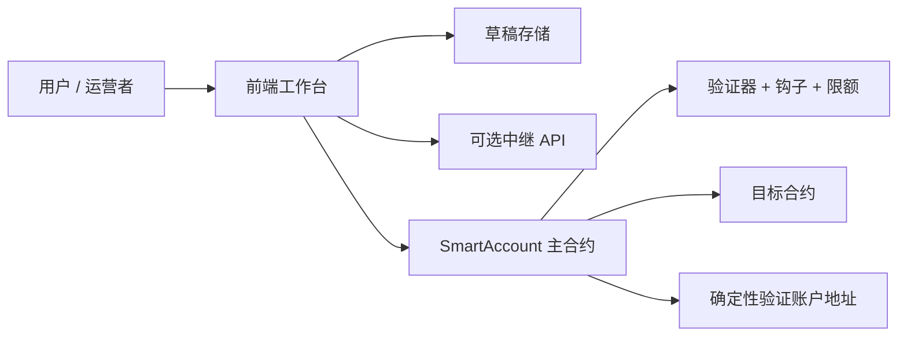
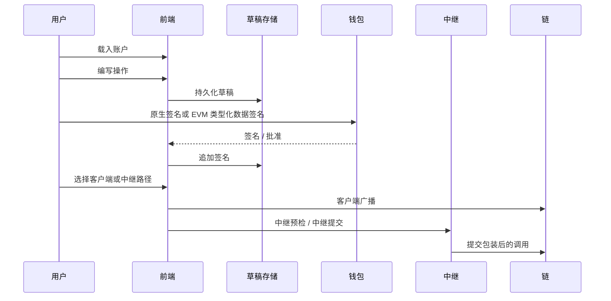
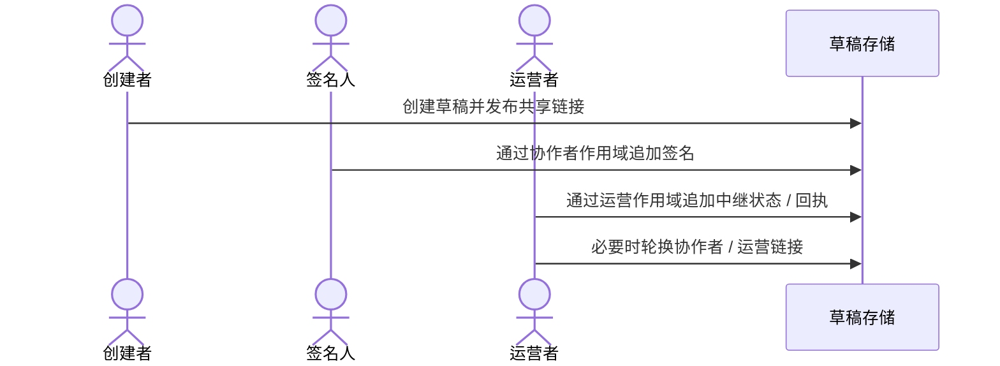
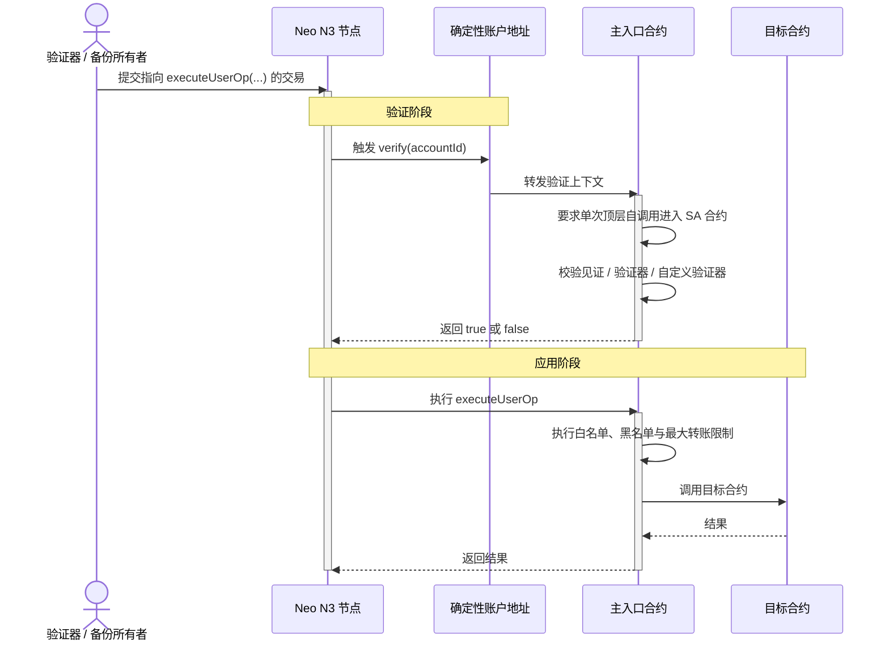
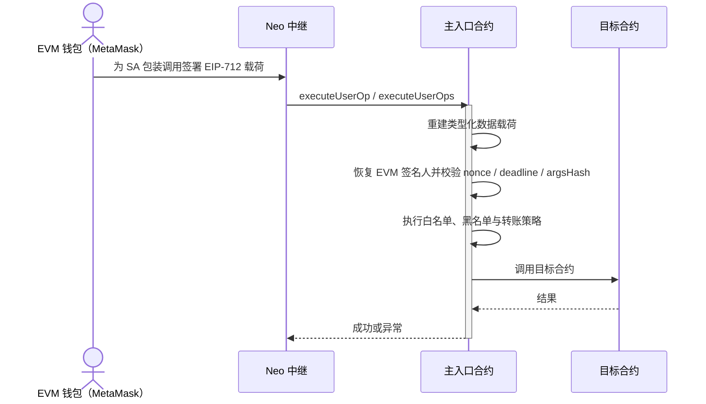

# SmartAccount 用户指南

> 中文版本与 `docs/GUIDE.md` 同构。若两者冲突，以英文版本为准；本文件跟随英文版本的每次修订同步更新。

本书是面向普通用户与钱包运营者的用户指南，合并自原 HOW_IT_WORKS、QUICK_REFERENCE、WORKFLOWS、NATIVE_ACCOUNT_WORKSPACE、NATIVE_ACCOUNT_TRANSACTION_GUARDS、NATIVE_ACCOUNT_THRESHOLD_RECOVERY、NATIVE_SIGNED_TRANSACTION_IMPORT 与 RECOVERY_AND_SESSIONS 主题。SDK 开发者参考见 `docs/SDK.zh-CN.md`。

## 目录

1. [工作原理与使用指南](#工作原理与使用指南)
2. [快速参考](#快速参考)
3. [Smart Account 工作流生命周期](#smart-account-工作流生命周期)
4. [原生账户工作台](#原生账户工作台)
5. [原生账户交易守卫](#原生账户交易守卫)
6. [恢复与操作会话](#恢复与操作会话)
7. [阈值钱包权限方](#阈值钱包权限方)
8. [原生已签名交易的导入](#原生已签名交易的导入)

## 工作原理与使用指南

本指南从头到尾说明 Neo Smart Account（SA）系统：合约做什么、网站如何组织、用户如何创建与使用账户、协作草稿如何工作，以及交易最终如何上链。

### 1. 读者对象

如果你在问下面任一问题，本页就是为你写的：

- **新用户：** 什么是 Smart Account，我第一步点哪里？
- **签名人：** 在不具备运营权限的前提下，我能审阅并签署什么？
- **运营者：** 我如何收集授权、执行中继检查并安全提交？
- **集成方：** 哪些部分在链上、哪些在链下、哪些在服务端？

如果只需要一个心智模型，请记住：

> 一个全局 SA 合约保存账户配置，每个逻辑账户拥有一个确定性的验证地址，把授权请求路由回共享的、由策略管控的执行引擎。

### 2. 心智模型

本项目中的 Smart Account **不是**为每个用户单独部署的新合约。

系统使用一个全局主合约，外加每个逻辑账户一个确定性的验证账户地址。



由此得到：

- 一个共享的链上执行引擎
- 每个账户零部署成本
- 按 `accountId` 隔离的账户配置
- 同时支持 Neo 原生签名与 EVM EIP-712 签名
- 原生调用、中继调用与元交易共用同一套权限面
- 可选的链上 Paymaster，支持无信任的赞助 / 免 Gas 执行

#### 账户发现与批量操作

V3 没有管理员、经理、阈值状态，也没有反向索引：这套 V1/V2 角色模型在 V3 重写中已被移除，SDK 中保留的 `getAccountsByAdmin` / `getAccountsByManager` 只是抛出 `LEGACY_V3_REMOVED` 的存根。账户状态通过 `getAccount(accountId)` 逐账户读取。

- **批量创建：** `createAccounts(UInt160[] accountIds, UInt160 custody, ByteString[] salts, Integer recoveryTimelockMs)` 在一个交易中为同一托管权创建多个账户（1-64 项，全有或全无）；批量入口不安装任何模块，因此其后的配置都走 24 小时意图路径。
- **创建权限：** `createAccount(accountId, custody, salt, recoveryTimelockMs, actions)` 要求 `custody` 的见证（`contracts/native/SmartAccount/SmartAccount.cs`）。初始配置动作对新账户原子安装；此后每次变更都是 `proposeConfiguration` → 24 小时 → `confirmConfiguration` 意图。

身份是推导出来的，不是注册登记的：`accountId = hash160('aa524704' || custody || salt)`。请持久化每一个盐，因为盐是这段原像中链上唯一无法归还的部分。用 `getAccount(accountId)` 读取你已知的账户：控制记录会回答托管地址、恢复权限方与时间锁、权限 epoch、配置 nonce、钩子顺序修订号、已安装模块以及待确认的配置意图。

**通过 SDK：**

```javascript
const { createNativeSmartAccountClient } = require('./sdk/js/src');

const client = await createNativeSmartAccountClient({ rpcUrl, contractHash, networkMagic });
await client.discover();

const identity = client.deriveIdentity({ custodyAddress: custody, salt });
const state = await client.getAccount(identity.accountId);
const validators = await client.getModules(identity.accountId, 'validator');
```

**适用场景：**

- 资产盘点：用托管地址与盐重新推导每个账户，再逐个读取
- 权限审计：列出已安装的验证器与钩子模块，并用 `getModule(accountId, moduleId)` 读取每个实例

JS 客户端每次只构造一笔注册脚本 `buildCreateAccountScript`；`createAccounts` 批量就是对每个 id/盐对重复调用，既可以作为合约自身的 `createAccounts` 调用提交，也可以每个账户一笔交易。所有账户共享托管地址与恢复时间锁；该调用不携带恢复权限方，因为核心没有任何设置它的动作——另行指定恢复权限方属于治理模块的变更，而不是核心的。

```javascript
const plan = client.buildCreateAccountScript({
  custodyAddress: custody,
  salt: saltA,
  recoveryTimelockMs: 30 * 86_400_000,
});
```

关键行为：

- 托管地址必须见证该交易；每个 account id 必须等于 `hash160('aa524704' || custody || salt)`，否则调用会故障
- 时间锁为 `0` 时选择 7 天下限；接受的范围是 7..90 天，以毫秒计
- `createAccounts` 批量是原子的：要么全部账户创建成功，要么全部失败
- 创建时不选择任何验证器或钩子。模块在之后通过配置意图安装，并且有 24 小时成熟期；只有单账户的 `createAccount` 调用可以原子地携带初始安装动作

典型用途：团队入驻（同一托管见证下创建多个账户）、项目搭建（一起创建开发 / 预发 / 生产账户），以及以原子方式逐次创建的服务账户。

### 3. 选择正确的路径

按你的角色与风险偏好选择路径：

| 场景 | 推荐路径 | 原因 |
| --- | --- | --- |
| 单用户、单浏览器、准备提交 | 客户端广播 | 最简单也最安全的默认路径。 |
| 需要共享审阅与收集签名 | 草稿 + 协作者链接 | 签名人无需运营权限即可审阅与批准。 |
| 免 Gas / 赞助交易 | 链上 Paymaster + 中继 | 赞助方存入 GAS，中继提交并在同一交易内获得报销。 |
| 提交前做中继模拟 | 运营链接 + 中继预检 | 提交前展示虚拟机状态、Gas 与载荷细节。 |
| EVM 钱包审批流程 | 元签名 + 可中继调用 | 保留 EIP-712 签名，同时保留 Neo 策略约束。 |
| 未配置 Supabase | 仅本地草稿 | 在同一浏览器内编写、保存与签名，不跨设备共享。 |

### 4. 系统由什么组成

把整个产品理解为四个相互连接的面：

1. **链上引擎** —— 主合约加确定性验证路径
2. **前端工作台** —— 编写、审阅、签名与广播界面
3. **协作存储** —— 不可变草稿正文，加仅追加的签名与活动记录
4. **可选服务端助手** —— 中继提交与带签名的运营变更

这些面彼此连接，但权限并不相同。Supabase 不能替代合约的权限模型，共享链接本身也不能绕过仅限运营者的操作。

### 5. 一笔交易发生了什么

大多数用户通过首页工作台操作：



关键设计选择是：下游目标合约**不会**被代理签名的裸交易直接调用。执行而是经由 `executeUserOp(accountId, op)`（批量时为 `executeUserOps(accountId, ops)`）路由，由策略引擎在那里执行验证器、钩子与目标检查。V1/V2 的包装入口已被移除，在任何已部署清单和合约源码中都不存在。

### 6. 草稿协作模型

网站使用三档作用域：

- **共享链接** —— 只读审阅
- **协作者链接** —— 仅收集签名
- **运营链接** —— 中继检查、广播、回执更新与链接轮换

这意味着：

- 审阅者无法修改草稿
- 签名人无法冒充运营者
- 写权限链接一旦泄露，运营者可以轮换
- 在配置了服务端的情况下，运营操作仍需经过带签名的服务端变更路径

### 7. 人类可读的域名访问

前端可以使用 `.matrix` 域名作为发现层。如果你更容易记住 `.matrix` 名称而不是 SA 地址，可以在载入框中输入域名。创建账户时，兼容的 Neo 钱包可以提交一笔批量交易，同时创建 SA 并把 `.matrix` 域名注册到签名钱包。之后前端把域名解析回控制钱包地址。V3 不保留反向索引，因此域名不会列出它控制的 SA 账户：逐个用 `getAccount(accountId)` 读取。

### 8. 用户如何使用网站

#### 新用户

1. 打开 **首页**
2. 载入或推导出智能账户
3. 选择操作预设或编写自定义调用
4. 持久化草稿
5. 按协作者角色分发链接
6. 收集批准
7. 需要时执行中继检查
8. 通过钱包或中继广播

#### 签名人

1. 打开协作者链接
2. 审阅草稿与操作快照
3. 添加手动签名或 EVM 类型化数据批准
4. 中继与广播交由运营者

#### 运营者

1. 打开运营链接
2. 监控签名与中继就绪状态
3. 执行预检
4. 通过客户端或中继广播
5. 必要时轮换协作者或运营链接

#### 开发者与审计者

1. 阅读 **核心架构** 页了解合约结构
2. 阅读 **工作流生命周期** 页了解执行序列
3. 阅读 **数据流与存储** 页了解边界归属
4. 阅读 **SDK 集成** 页了解运行时与中继配置

### 9. 数据存放在哪里

草稿正文与协作状态在链下，权限与执行规则在链上。

- **链上：** 验证器与钩子配置、备份所有者、逃生时间锁、白名单 / 黑名单规则、转账限额
- **浏览器 / Supabase：** 不可变草稿正文、已收集签名、活动时间线、中继预检快照、有界提交回执历史
- **中继服务器：** 模拟、显式开启时的原始交易转发、配置了中继签名人时的元调用提交

共享草稿元数据刻意设有上限：前端只保留最近 **100 条活动记录** 与最近 **12 条提交回执**，使协作记录长期保持轻量。

### 10. 赞助 / 免 Gas 交易

链上 `SAPaymaster` 合约让用户无需持有 GAS 即可执行操作：

1. **赞助方**（dApp、组织或服务）向 Paymaster 合约存入 GAS，并创建赞助策略，指定资助哪些账户、合约、方法与预算。
2. **中继**携带赞助方与 Paymaster 信息调用 SA 核心的 `executeSponsoredUserOp`。
3. 中继可以选择预检 `validatePaymasterOp`，而 SA 核心正常执行用户操作（验证器 + 钩子），随后原子性地结清报销：从赞助方存款中扣除并把 GAS 发给中继。

赞助方可以创建 **按账户策略**（指定 accountId）或 **全局策略**（accountId 为零）来赞助任意账户。策略支持：

- 单次操作 Gas 上限
- 每日支出预算（24 小时滚动窗口）
- 生命周期总预算
- 目标合约与方法限制
- 过期时间戳

Paymaster 从不替代验证器或备份所有者——它只在操作被完整授权之后为中继出资。

### 11. 关键安全边界

每条执行路径都经过同一层保护：

- 账户存在性检查
- 验证器 / 备份所有者见证校验
- 可选的自定义验证器钩子
- 逃生时间锁与终结规则
- 方法白名单
- 黑名单 / 白名单
- 最大转账限制

实际的安全结论是：

- 确定性代理见证只对加固后的 SA 包装流程有效
- 公开链接只读
- 协作者链接只能签名
- 运营操作使用带签名的服务端变更
- 由代理直接签名的外部支出始终无效

### 12. 建议阅读顺序

首次了解系统时，请按顺序阅读：

1. **工作原理与使用指南**（本章）
2. **核心架构**（`docs/ARCHITECTURE.md` 的“核心架构”章）
3. **工作流生命周期**（本书“Smart Account 工作流生命周期”章）
4. **数据流与存储**（`docs/ARCHITECTURE.md` 的“数据流与存储”章）
5. **SDK 集成**（`frontend/src/assets/docs/sdk-usage.md`）

本章之外的运营者与签名人实操步骤，可继续阅读本书的“快速 参考”与“Smart Account 工作流生命周期”章，以及 `docs/ARCHITECTURE.md`（数据流章节）与 `docs/SA-MODULE-PROTOCOL.md`。

### 13. 术语表

- **Smart Account（SA）** —— 由 `accountId` 标识、由共享 SA 合约执行的逻辑账户
- **确定性账户地址** —— 由 `verify(accountId)` 脚本推导出的 Neo 地址
- **主合约** —— 共享的链上执行与权限引擎
- **草稿** —— 链下协作记录，包含操作数据、签名与元数据
- **协作者链接** —— 仅用于收集签名的作用域链接
- **运营链接** —— 用于中继、广播、回执与链接轮换的作用域链接
- **中继预检** —— 提交前对可中继调用做服务端模拟
- **元调用** —— 由 EVM 类型化数据签名生成的 SA 载荷，目标是 `executeUserOp`
- **账户发现** —— 用 `getAccount(accountId)` 读取单个账户状态；V1/V2 反向索引已移除
- **批量创建** —— 用 `createAccounts` 在一笔交易中为同一托管权创建多个账户（无共享治理：每个账户自带 validator 实例、hook 顺序与恢复时间锁）
- **Paymaster** —— 持有赞助方 GAS 存款、并在执行成功后为报销中继的链上合约（`SAPaymaster`）
- **赞助方** —— 向 Paymaster 存款并为其他账户的操作创建资助策略的地址
- **赞助策略** —— 定义资助哪些账户、合约、方法与预算的配置
- **结算** —— 执行后从赞助方存款扣款并把 GAS 付给中继的原子步骤

## 快速参考

### 本地核心验证

```bash
./scripts/verify_repo.sh

# 发布级跨仓库身份内核门禁：
NEOOS_REQUIRE_SERVICES_ARTIFACTS=1 ./scripts/verify_repo.sh --contracts-only

# 可选的形式化门禁（Coq/Z3/TLC）与私有链验证（neoxp）：
./scripts/verify_repo.sh --contracts-only --formal --neoexpress
```

### 仅前端

```bash
cd frontend && npm test
cd frontend && npm run build
```

### 仅 SDK

```bash
cd sdk/js && npm test
```

### SDK API 参考

下列代码均通过 SDK 公共入口 `sdk/js/src/index.js` 驱动 v4 协议，该入口再导出由共享的
`nativeSmartAccountClient.mjs` 实现的原生客户端：一个原生内核、一个 13 字段操作与一套 `SA_*`
词汇。v3 调用（`registerAccount`、`createAccountPayload`、`getVerifier`、`updateHook`）已随 v3 运行时移除，
自定义内核客户端工厂
`createSmartAccountClient` 也已随 custom 交付轨道移除：不存在别名。

#### 账户生命周期

v4 身份只在创建时提交一次：`accountId = hash160('aa524704' || custody || salt)`。盐是 1..128
字节的公开唯一性输入，恢复时间锁为 7..90 天，按毫秒传入。

```javascript
const { createNativeSmartAccountClient } = require('./sdk/js/src');

const client = await createNativeSmartAccountClient({ rpcUrl, contractHash, networkMagic });
await client.discover(); // 固定 protocolVersion 与 implementationId

const identity = client.deriveIdentity({ custodyAddress: custody, salt });

// createAccount(Hash160 accountId, Hash160 custody, ByteArray salt,
//               Integer recoveryTimelockMs, Array actions)
const plan = client.buildCreateAccountScript({
  custodyAddress: custody,
  salt,
  recoveryTimelockMs: 30 * 86_400_000,
});

const state = await client.getAccount(identity.accountId);
```

创建调用携带派生 id、托管地址、盐与时间锁；创建时不选择任何验证器或钩子。`state` 返回控制记录
（托管、恢复权限方与时间锁、权限 epoch、配置 nonce、钩子顺序修订号）。描述符仍保留的恢复槽位
报告其非活动值：恢复生命周期属于模块，因此读者不会把用于 ABI 稳定性的槽位误认为待执行的移交。

#### 模块

账户可以在注册时或注册后安装模块。类型是验证器（1）、钩子（4）和恢复席位（5）。基础收款、转账无需安装任何模块。[具名模块条款](proposals/SMARTACCOUNT-MODULE-NEPS.zh-CN.md)列出了每个模块的权限和安装数据。

调用 `installModule(accountId, moduleType, moduleContractHash, initData)` 后记录返回的实例编号。卸载具名模块调用 `removeModule(accountId, moduleId, [])`。启用强制支出多签前，托管人或获准的已安装验证器可以直接管理模块。通过治理提案变更配置则须经过 24 小时延时。

用 `getModules(accountId, 'recovery', {cursor, limit})` 分页读取恢复席位，读取钩子或验证器时分别使用 `'hook'` 或 `'validator'`。变更前用 `getModule(accountId, moduleId)` 核对实例。生命周期回调由核心发起；钱包可直接使用的查询和管理方法以对应模块条款为准。

#### 执行

单个操作使用 `executeUserOp(accountId, op)`，批量使用 `executeUserOps(accountId, ops)`。操作就是
v4 的 13 字段数组：版本、目标、方法、参数、nonce、nonce 子键、截止时间、验证器 id、凭证代数、
权限 epoch、配置 nonce、签名、钩子证明。按核心校验的类型化数据签名：

```javascript
const operation = {
  targetContract,
  method: 'transfer',
  args: [{ type: 'Hash160', value: recipient }, { type: 'Integer', value: '100000000' }],
  nonce,
  nonceSubkey,
  deadline,
  validatorId: 1,
  credentialGeneration: 1,
  authorityEpoch,
  configurationNonce,
  signature,
  hookProofs: [],
};

const typedData = buildUserOperationTypedData({
  chainId,
  verifyingContract: proxyAddress,
  accountId,
  coreContractHash,
  validatorId: operation.validatorId,
  targetContract: operation.targetContract,
  method: operation.method,
  argsHashHex,
  nonce: operation.nonce,
  deadline: operation.deadline,
  operationDigest,
});
```

### 权威文档

- `docs/GUIDE.md`
- `docs/ARCHITECTURE.md`
- `docs/SDK.md`

## Smart Account 工作流生命周期

Neo N3 Smart Account 的工作流把用户意图通过主合约转为经过验证的链上执行。2026 年 3 月 6 日加固更新之后，确定性代理见证只对一次顶层自调用回 Smart Account 合约有效。这意味着由代理直接签名的外部代币转账会被拒绝，而 V3 通过 `executeUserOp(accountId, op)`（批量时为 `executeUserOps(accountId, ops)`）执行。V1/V2 的 `executeUnified` 与 `executeUnifiedByAddress` 包装在 V3 重写中已移除，在任何已部署清单与合约源码中都不存在。

### 首页操作工作台

首页操作工作台是日常使用最快的路径。用户可以载入 Smart Account、暂存 SA 调用、持久化不可变共享草稿、收集 Neo + EVM 混合批准，然后选择最终提交路径。对于客户端 Neo 执行，工作台会针对 SA 合约暂存一个具体的 `executeUserOp` 调用，而不是让钱包直接指向下游目标合约。

当前支持两种广播模式：

- **客户端广播：** 最安全的默认路径；已连接的 Neo 浏览器钱包直接签名并提交调用。
- **中继广播：** 可选路径，适用于已签名的原始交易，或由已收集 EVM 签名组装的可中继 `executeUserOp` 调用。配置了中继签名人后，服务端可以提交这些元调用，用户无需手工重建调用体。

匿名协作草稿可以由 Supabase 承载。公开共享链接只携带不透明读取标识；协作者链接携带收集签名的权限；另一个独立的运营链接携带中继、广播与草稿管理权限。签名链接无法伪造中继或广播时间线条目——这些活动类别仅属于运营作用域。这样普通共享链接保持只读，同时保留低成本的匿名协作流程。任一具备写权限的链接泄露时，工作台可以就地轮换协作者或运营链接，无需重建草稿。

为让共享草稿长期保持轻量，前端在草稿元数据中只保留最近 100 条活动记录与最近 12 条提交回执。该有界保留策略在本地浏览器回退与 Supabase 共享草稿路径上一致执行。

若未配置 Supabase，工作台回退到由 `localStorage` 支持的仅本地草稿存储。这使“编写 → 持久化 → 签名 → 审阅”流程在同一浏览器内可用，但这些共享链接刻意仅限本地，不能替代真实的匿名 Supabase 协作路径。

编排器内置 **通用调用**、**NEP-17 转账** 与 **多签草稿** 等预设，用户无需从零手写每个 JSON 参数即可暂存常见 SA 操作。

若希望界面把已收集的 EVM 元签名视为可直接中继，请同时暴露 `VITE_AA_RELAY_META_ENABLED=1` 与服务端 `AA_RELAY_WIF` 配置。这样工作台在提交前会显示准确的中继就绪状态。当已签名原始交易与可中继元调用同时存在时，界面提供明确的 **最佳可用**、**已签名原始交易**、**元调用** 三个选择，由运营者控制使用哪条中继路径。**检查中继** 操作会在提交前对可中继元调用执行服务端预检模拟，并在不支持已签名原始交易模拟时明确报告。专用的 **中继预检** 面板展示所选载荷模式、模拟的虚拟机状态、Gas 估算、操作、异常细节，以及可展开的 **栈预览** 用于查看返回值。栈项也会针对 `Integer`、`Boolean`、`ByteString` 与嵌套 `Array` 等常见 VM 类型解码。运营者还可以直接从该面板使用 **复制载荷**、**复制栈** 与 **导出 JSON**，用于交接与排障。

### 1. 第一笔交易演练

首次成功交易的推荐顺序：

1. **载入账户** —— 输入 SA 地址，或从预期身份路径推导。
2. **选择操作** —— 从通用调用或 NEP-17 转账等预设开始。
3. **持久化草稿** —— 在收集外部签名前锁定正文。
4. **收集签名** —— 按阈值要求使用 Neo 原生、EVM 类型化数据，或两者兼用。
5. **审阅就绪状态** —— 确认签名进度、中继模式与浏览器设置。
6. **选择提交路径** —— 客户端钱包广播或中继提交。
7. **跟踪回执** —— txid、结果、时间线条目与后续操作。


### 2. 选择提交路径

经验规则：

| 路径 | 适用 | 要求 | 代价 |
| --- | --- | --- | --- |
| 客户端广播 | Neo 原生钱包用户 | 已连接浏览器钱包 | 最简单、最透明 |
| 仅中继预检 | 想在提交前模拟的运营者 | 已配置中继端点 | 增加服务端依赖，但给出 VM / Gas 反馈 |
| 中继原始交易提交 | 已有签名原始交易 | 显式开启原始转发 | 只在你确实需要透传时使用 |
| 中继元调用提交 | EVM 签名收集流程 | 已配置中继签名人 + 元调用模式 | 混合签名流程最灵活 |
| 赞助（Paymaster） | 用户免 Gas 执行 | 已部署 SAPaymaster + 赞助方已有存款与策略 | 用户不付 GAS；中继被原子报销 |

### 3. 协作生命周期

协作生命周期让不同的人以不同权限参与。



### 4. 标准原生调用

Neo 原生执行现在通过 Smart Account 包装方法流转，而不再依赖代理见证直接调用外部合约。



> 加固后，仅由确定性代理签名的原始外部合约调用会被刻意拒绝。

### 5. 元交易工作流

Ethereum 用户仍可在链下签署 EIP-712 载荷，由 Neo 中继支付网络费用并提交包装后的 SA 执行。



### 6. 广播之前

生产提交前，运营者应确认：

- 草稿正文与预期目标、方法一致
- 签名进度满足已配置的阈值
- 所选载荷模式确实是你想发送的
- 若使用中继提交，中继就绪状态为绿色
- 若需要回执链接，浏览器基础 URL 已设置
- 若旧的作用域链接曾泄露，协作者 / 运营链接已轮换

### 7. 出现失败时

按失败类型决定下一步排查方向：

- **钱包连接问题** —— 浏览器钱包集成或缺少 provider
- **签名数不足** —— 草稿协作或阈值不匹配
- **中继就绪告警** —— 运行时配置不匹配，或载荷模式不受支持
- **模拟异常** —— 合约策略或目标调用失败
- **广播失败** —— 网络费用、RPC 或签名方提交问题

### 域名辅助的账户工作流

兼容的 Neo 钱包可以在创建账户时把两次调用批量进一笔交易：

1. 主合约上的 `registerAccount(accountId, verifier, verifierParams, hookId, backupOwner, escapeTimelock)`
2. `.matrix` 合约上的 `register(domain, ownerHash160)`

在本仓库中，`.matrix` 域名注册到签名钱包地址。V3 没有管理员或经理反向索引：该 V1/V2 角色模型已移除，账户状态通过 `getAccountState(accountIdHash)` 逐账户读取。命名了已移除的 `getAccountAddressesByAdmin` / `getAccountAddressesByManager` 读取的 V2 账户发现助手已被删除，前端没有任何路径再指向这些读取。

## 原生账户工作台

`/native` 是一条独立的 ABI 2 工作流。它绝不会用已部署的 V3 合约替代固定的原生 SmartAccount 合约。新端点以只读方式启动；发现流程要求期望的网络 magic、原生合约 id、原生合约哈希 / 名称、确切的 ABI、配置摘要，以及成功的 getVersion=2。

原生 SmartAccount 是草案协议。请使用已显式激活匹配配置、并能完成原生发现的节点。外部协议评审、公开网络激活与生产部署仍是彼此独立的草案发布门禁，选择某个公开 RPC 端点并不会激活该服务。原账户用户指南已并入本章：备份要求、权限与时序矩阵与密钥丢失场景即下方各节。

新的权限方准入需要同意：注册包含托管与非零守护者；守护者替换包含托管与新的非零守护者；托管恢复提案包含已配置守护者与拟定的托管。审阅会列出每一个必需的见证，若选定的签名集成无法提供这些见证，则拒绝提交。仅有签名方条目而没有对应钱包或合约见证，不满足同意要求。原生账户代理不是受支持的权限地址。已成熟的激活仍然无需许可。

当某个权限方相对于当前托管、恢复与待生效权限地址是首次引入时，会检查其同意。对已准入的待生效地址重新提案不需要新的接收方同意；但当前控制权限的检查仍然适用。

### 初始化并保管好正确的备份

| 项目 | 用途 | 需要保留什么 |
| --- | --- | --- |
| 账户 ID | 标识账户及其设置 | 网络与账户 ID |
| 资金地址 | 持有账户资产 | 注册后展示的、经独立核验的地址 |
| 公开恢复描述符 | 记录原始托管、盐值、身份、资金地址与配置 | 一份可用于查找并核验账户的副本 |
| 托管钱包备份 | 授权管理与默认执行 | 钱包私钥或恢复备份，妥善保管 |
| 守护者钱包备份 | 授权紧急冻结与托管恢复 | 与托管分离、独立控制的另一份安全备份 |

描述符不含私钥。它无法签名、无法恢复丢失的钱包密钥，也无法移除守护者。托管恢复之后，其原始身份字段仍标识同一账户；新的链上状态展示当前托管。绝不要把私钥写进描述符或经审阅的请求中。

在本工作台中：先核验网络与节点，然后为托管选择一个受支持的 Neo 钱包权限方，并为守护者选择另一个独立控制的权限方。审阅推导出的账户 ID 与独立的资金地址，在同一笔交易中取得托管与守护者的同意见证，确认注册，并在充值之前读取已记录的账户状态。向账户的资金地址充值，并把钱包备份与公开描述符分开保管。[SDK 指南](SDK.zh-CN.md) 描述了受支持的签名接口与确切的交易审阅方式。

### 谁能行动，以及何时

守护者是账户配置的恢复权限方。每个操作都需要一个交易费用支付方；付费不会授予账户权限。当支付方控制所需钱包时，它也可以同时充当托管或守护者。

| 变更 | 谁发起 | 谁完成，何时 | 待生效期间谁能取消 |
| --- | --- | --- | --- |
| 替换或移除验证器 / 钩子 | 托管，账户处于 Active 且没有待生效的托管恢复 | 24 小时之后由任意支付方完成；账户仍须满足这些状态条件 | 托管，包括成熟之后、激活执行之前 |
| 变更模块策略，包括会话密钥 | 托管，账户处于 Active 且没有待生效的托管恢复 | 托管在 24 小时之后重复完全相同的已存储调用 | 托管；选择验证器或钩子角色并审阅其待生效调用 |
| 变更守护者 | 托管与新指定的非零守护者，账户处于 Active 且没有待生效的托管恢复 | 24 小时之后由任意支付方完成 | 待生效期间由托管取消 |
| 将托管恢复到新钱包 | 已配置的守护者与拟定的托管钱包，账户处于 Active 或 Frozen | 七天之后由任意支付方完成 | 待生效期间守护者可随时取消；托管只能在成熟之前取消 |
| 冻结 | 已配置的守护者，账户处于 Active | 交易执行时生效；没有协议等待期 | 不存在待生效提案；恢复使用需要解冻 |
| 解冻 | 托管与已配置的守护者共同参与 | 交易执行时生效；没有协议等待期 | 不存在待生效提案 |

已成熟的激活会应用其执行时存在的已授权意图；其支付方无法在激活调用中选择替换对象。模块替换仍然需要有效的模块代码与成功的清理。模块策略的应用是另一项操作，需要托管再次参与。在激活或取消之前，请检查当前的待生效载荷。取消策略提案不会撤销当前活跃的策略。

在工作台中，行动之前请刷新账户与链时间。快照不会在另一笔交易改变账户时自动更新；重新校验会拒绝它观察到的变化。请协调托管设备，并检查已确认的账户与待生效策略状态。截止时间与延迟使用**链上时间（毫秒）**，而不是你的设备时钟：操作在其确切截止时间仍然有效，意图在其确切成熟时间成熟，托管对恢复的取消权在那一刻终止。一笔被打包进更晚区块的交易可能在预览成功之后仍然错过其截止时间。反向推进的转换会使其他待生效配置失效；每次后续操作之前都要重新加载状态。

### 紧急遏制与守护者信任

移除或变更会话密钥是延迟的。活跃的密钥可以持续行使其既有权限，直到它过期或账户被冻结。需要立即遏制时，请让守护者**先冻结**，确认 Frozen 状态，然后**再发起恢复**（如果托管需要更换）。冻结会清除**所有待生效意图**，包括恢复、验证器 / 钩子变更、守护者变更与模块策略调用，因此在提出恢复之后冻结会取消该恢复提案。仅提出恢复并不会冻结一个 Active 账户。恢复会保留账户 ID、资金地址、操作 nonce 通道、守护者与 Frozen 状态；它替换托管，并在不调用旧模块的情况下摘除旧验证器与钩子。解冻仍然需要新的托管与已配置的守护者，Frozen 账户必须先解冻才能进行新的模块配置。

请选择一个你信任其持续可用并愿意配合的守护者。它可以在没有托管参与的情况下冻结账户，而在已配置守护者时，托管无法单独解冻。若守护者密钥在 Frozen 期间丢失，本配置没有仅托管的豁免。恢复不会移除或替换守护者。在 Active 且没有待生效托管恢复时，托管可以提出守护者替换，需 24 小时延迟；该待生效变更同样会被冻结清除。标准 Neo 阈值多签钱包可以作为守护者：独立备份的 2-of-3 密钥可以容忍一把密钥不可用，其余两把仍能授权守护者。这是一个带有阈值见证的守护者地址，与账户的验证器模块相互独立。托管仍必须参与解冻。若 Frozen 期间可用密钥少于阈值，则没有豁免；阈值恢复降低了单把密钥失效的风险，但在所有可用备份都丢失之后并不会创造新的权限。

### 若密钥或备份丢失

| 情况 | 可用路径 |
| --- | --- |
| 托管密钥丢失，守护者可用 | 守护者提出恢复到新的托管钱包，七天之后完成。若旧密钥可能已泄露，请先冻结。 |
| 守护者密钥丢失，账户 Active 且托管可用 | 在没有待生效托管恢复的前提下，托管可以提出新的守护者，并在 24 小时之后激活。 |
| 守护者密钥丢失，账户 Frozen | 从其备份恢复守护者钱包。托管恢复无法绕过解冻所需的守护者。 |
| 会话密钥丢失或泄露，托管可用 | 审阅延迟的替换 / 移除操作。如有必要，使用守护者冻结进行即时遏制。 |
| 描述符丢失，钱包密钥可用 | 从你的记录中找回已知的网络 / 账户 ID，并在链上核验状态。钱包备份与描述符承担不同用途。 |
| 托管密钥丢失，且没有可用守护者 | 本配置没有密钥恢复捷径。已配置的验证器可能仍允许其自身的操作，但不会在管理事务上替代托管。 |

### 费用、结果与不确定的提交

原生账户本身不能作为费用支付方：由外部支付方签署完整交易并支付其费用。签名之前，请审阅确切的目标、参数、截止时间、权限方以及系统 / 网络 / 总费用上限。工作台的消耗估算与最小预算预览不是最终交易报价；请通过钱包或 SDK 审阅最终网络费用与总额。

返回交易 ID 意味着已提交，而不是已确认。若请求超时，请查询**同一个交易 ID** 并检查钱包的提交情况，然后再准备替代交易。不要自动签署另一笔交易或提高费用。成功的预览既不预留 nonce，也不保证在区块中占据位置。

### 用户流程与信任边界

1. **连接节点**：输入 RPC URL 与期望的网络 magic，然后校验。改动其中任一值，或发生钱包网络 / 账户事件，都会丢弃已准备的工作。未激活的公开网络会显示明确的只读错误。
2. **创建**：生成 32 字节的密码学盐值；输入来自受支持 Neo 钱包权限方的托管 / 恢复脚本哈希。默认的验证器 / 钩子为空，因此托管见证可以立即生效。选择一个独立于托管控制的守护者；不做恢复需要显式确认。预览稳定的身份与独立的资金地址。
3. **备份 / 恢复**：导出公开恢复描述符（网络、配置、身份、资金地址、托管与盐值）。它不含私钥，也无法替代钱包密钥备份。恢复会在任何 RPC 之前检查格式、配置与推导出的身份；它绝不会选择导入的端点。
4. **管理 / 恢复**：展示托管、恢复、冻结状态、权限 epoch、配置 nonce 与通道零 nonce。提案会显示 24 小时模块延迟或 7 天托管恢复延迟；激活是另一笔交易。原生 ABI 2 的恢复在不要求旧模块回调的情况下摘除它们，推进权限 epoch，并保留资金地址、nonce 与冻结状态。已配置的恢复权限方可以取消任何仍待生效的恢复；托管只能在成熟之前严格取消。**取消权限方** 选择授权取消的钱包，与**费用支付方**分离。同钱包默认仍然可用。独立支付方获得 `None` 作用域；所选权限方获得限于原生合约的 `CustomContracts`。选择不同钱包会自动使用精确脚本的 SDK 路径。在成熟时（包括恰好在边界上），托管不能再取消；恢复可以在提案仍待生效时取消。导出与交接之前会再次检查最新的链上时间。已成熟的验证器、钩子与守护者地址激活，以及已成熟的托管恢复执行，只需要一个费用支付方。它们作用于执行时存在的待生效意图，并且必须通过当前状态与成熟度检查。审阅快照在被打包之前不会锁定该状态。
5. **受限会话 / 多重批准**：以类型化值、有限的会话到期时间与显式的正数支出上限构建已声明的模块调用。会话配置不包含自动前置的账户 id。MultiSig 阈值统计验证器模块，而不是独立控制的人。请按验证器与钩子角色分别检查待生效策略调用；审阅其选定模块、方法、类型化参数与成熟时间。托管可以取消选定的待生效调用。取消移除的是该提案，而不是活跃密钥或策略。24 小时之后应用策略仍需要托管及其确切的已存储参数。延迟的策略调用以精确脚本导出；配置绝不会伪装成立即生效的密钥撤销。取消导出会包含一项执行时比对，对照经审阅的待生效字节。
6. **业务操作**：构建带有 RPC nonce、有限截止时间、当前权限域与摘要交叉校验的确切类型化操作。展示费用支付方、确切目标、字节与配置边界。原生赞助不存在；没有免 Gas 勾选框。执行会为精确脚本的 SDK / 钱包集成导出代理见证与 CustomContracts 目标作用域，而不是旧式 invoke。

账户状态与展示的链上时间都是快照。在对某个待生效变更采取行动之前，请使用**刷新账户与链时间**。在策略页签中，先选择**模块角色**，再**刷新待生效策略**。待生效卡片会展示根与所选模块、方法、类型化参数、成熟时间与已检查的链上时间。**审阅策略取消**会把刚读取的待生效调用与那份已检查的快照比对；观察到变化就需要重新审阅。**审阅待生效激活**会使用所选角色，并在成熟之后重复完全相同的已存储调用。新的钩子策略提案通过 SDK 构建。

审阅会把**Application 消耗**与**最小系统费用预算**分开。在获得确切交易与见证名单之前，**网络费用**仍不报价。这些预览值不是最终总费用的批准；签名之前请审阅钱包给出的最终费用，或使用 SDK 费用上限。

### 手动钱包交接

受支持的注册与生命周期调用，只有在完成全新发现、账户状态重新校验、成功模拟、匹配的实时钱包账户与匹配的实时钱包网络之后，才会使用既有的钱包调用服务。所选提供方必须暴露 `getNetwork()` 或 `getNetworks()`，并能给出可识别的活跃网络（数值 magic 或 MainNet/TestNet）。仅有受支持网络列表，并不构成所选网络的证明。执行者是费用支付方并使用 `CalledByEntry`；绝不会请求 Global 作用域。双权限解冻、配置、受保护的策略取消与代理执行使用精确脚本导出，并带有显式的必需签名方 / 见证细节。标准钱包多签可以把已配置的守护者表示为一个脚本哈希；请保留完整脚本、成员密钥与阈值，详见[阈值恢复](#阈值钱包权限方)。钱包确认是用户行为；自动化 QA 绝不会请求真实签名。钱包拒绝会保留审阅内容。返回的交易 id 代表已提交，而不是已确认；回读会检查其确切脚本与 HALT 应用日志，然后才标记为确认。

对于精确脚本审阅，**导入并提交已签名交易**面板会在输入显式的系统、网络与总 GAS 上限之后，接受 SDK 导出的 JSON 文件。**检查已签名交易**会校验其规范字节、网络 / 配置、有序签名方名单、签名与完整的已签名预检。**广播已签名交易**会重复预检并只发送一次相同字节。改动审阅内容或费用上限会使已导入的批准失效。超时后仍可通过**检查导入交易的确认状态**获得原始交易 ID；已提交的 FAULT 会显示为失败。受支持的格式与确认恢复见[已签名交易导入](#原生已签名交易的导入)。

冻结之前，审阅会展示托管与守护者双方的标识、对待生效提案的影响与恢复时序，以及解冻所需的权限。此时需要显式确认。若已配置的守护者失去签名法定人数，冻结不会引入仅托管的豁免。

### 校验约定

针对以下场景，先写失败测试再实现：不可用 / 原生 v1 / 摘要错误的端点、畸形账户记录、端点切换后的陈旧工作、身份被篡改的恢复描述符、过期操作、不安全的会话默认值、网络 / 账户不匹配、交接前链上状态变化、模拟失败，以及非精确的钱包车道。浏览器检查会在桌面与移动端演练发现、创建预览、描述符导出 / 导入、管理审阅与离线状态。模拟的 RPC 与钱包夹具只提供交互证据；它们不建立原生网络激活或生产部署就绪。

### 消费导出的请求

该 JSON 是**审阅文档，不是已签名交易，也不是通用的钱包导入格式**。若要供 SDK 消费，请在构建审阅之前选择 **原生 SDK · 精确脚本**。默认的管理**钱包调用**路径有另一套 `CalledByEntry` 签名方 schema，并导出原始的 `request`；该工件不得喂给 SDK 交易构造器。切换路径会丢弃旧审阅，并要求另一次显式批准。其 `recipe` 指明原生 SDK 构造器并包含类型化输入；`plan.script` 是精确比对目标。在任何私有签名方参与之前，请在记录的网络与配置上，于全新的客户端中重建：

```js
import { rebuildNativeReview } from "./frontend/src/features/native/nativeWorkspace.js";
const plan = await rebuildNativeReview(client, exported);
```

该仓库辅助函数使用显式的构造器白名单，并把完整的最新发现配置以及**重建方案的每一个公开字段**与审阅比对。这包括权限 epoch、配置 nonce、完整账户状态、待生效恢复 / 配置意图、模块调用阶段与执行上下文 / 摘要 / 证明。返回之前它还会重新校验新方案。下游 SDK / 钱包集成若移植该辅助函数，必须保留这些比对。只比对脚本是不安全的：在不同的新托管被提出之后，`executeRecovery(accountId)` 的脚本可能完全相同。

签名集成还必须把导出的网络、服务与配置摘要同最新发现结果比对，并把实际选定的费用支付方 / 权限方与代理签名方作用域同重建方案比对。然后使用原生 SDK 的 `prepareTransaction`，带上显式的系统、网络与总费用上限、其真实钱包签名接口以及最终用户批准。SDK 模式的作用域会在导出前展示：支付方在前（若非必需则为 `None`），执行时代理第二，其余权限方随后，作用域为限于原生合约的 `CustomContracts`。恢复取消会把选定的 `cancellationAuthority` 与 `feePayer` 分开导出，并且只把那一个选定的托管 / 恢复钱包纳入必需集合。重建会检查导出的权限方与完整实际签名方名单是否与最新方案一致；它不会改变已签发的方案。省略该字段的旧版 v1 取消导出，只有在支付方同时是必需取消权限方、且其完整签名方名单与该同钱包选择一致时才会被接受。字段显式无效或使用独立支付方名单的，不会获得这一兼容回退。把同一个 `cancellationAuthority` 传给 `prepareTransaction`，把支付方钱包作为 `feePayer` 提供，并在其不同于支付方时把所选权限方放入 `authoritySigners`。改动任一选择都会使先前的审阅与任何已导入的已签名交易失效。回执检查要求相同的签名方顺序与确切作用域；不接受任何更宽的超集。本界面不收集额外的 NeoWitnessValidator 或 MultiSig 交易见证签名方。此类集成需要另一套包含其已发现模块作用域的 SDK 审阅；本页面不会把未经审阅的更大签名方名单称为确认成功。不要从导入的 JSON 文件调用任意方法。绝不要在脚本、nonce、权限 epoch 或配置变更之后重放旧签名。

描述符中的托管 / 盐值描述的是**原始身份推导**。恢复之后，描述符仍能找到同一账户；最新的链上状态提供当前权限。描述符不会重置权限，也不会找回丢失的钱包私钥。

导出的策略取消包含其显式的验证器 / 钩子角色与完整的待生效调用快照。其已签名脚本会在调用取消之前，在链上断言规范的待生效字节，因此内容变动或缺失会在删除之前出错，即使变化发生在客户端重新校验之后。工作台要求精确脚本签名，并为此操作禁用普通钱包调用。未变更的原生方法仍支持其他调用方有意的角色槽位取消。同一区块内重建的完全相同记录仍可能匹配该守卫；这是内容绑定，而不是唯一的提案实例标识。请检查已确认的待生效状态。[守卫规范](#原生账户交易守卫) 定义了确切的脚本、字节编码与兼容边界。

会话默认使用 48 小时到期时间，以便在初始 24 小时配置延迟之后仍有一段可用会话。在激活之前结束的新授权会被拒绝。待生效激活动作会重新加载并重复完全相同的已存储参数；它绝不会悄悄延长会话。撤销同样是延迟的。冻结在其交易执行之后仍是即时遏制手段，而恢复提供独立于旧插件的退出路径。冻结会清除每一个待生效意图，包括托管恢复与策略调用。请先冻结并确认，再发起恢复；单独的恢复提案会让 Active 账户保持活跃。恢复会保留守护者与 Frozen 状态。解冻需要托管与已配置的守护者，因此在 Frozen 期间丢失守护者密钥没有仅托管的豁免。在 Active 且没有待生效托管恢复时，托管可以按常规 24 小时延迟提出守护者替换。

截止时间与成熟时间显示为链上毫秒。相等对截止时间有效，对成熟也足够；托管对恢复的取消权在成熟之前严格结束。已打包的 FAULT 仍可能收费，即使应用层变更被回滚。Boolean `false` 本身不是 VM 错误；请审阅操作结果与适用策略。超时之后，请先检查同一交易 ID，再准备另一笔交易。

若网络变更时钱包请求已经打开，页面无法撤回它；迟到的结果会要求用户在重试之前检查钱包，并且绝不会被展示为新上下文的确认。

在完整仓库存在时，`npm run prebuild` 会同步规范的原生源码。仅前端部署使用其已提交的副本；仓库测试会把它们的 SHA-256 哈希与规范模块比对。浏览器 QA 为 `npm run test:native:browser`，已纳入既有的前端浏览器门禁。

## 原生账户交易守卫

原生 SDK 把配置意图取消绑定到签名方审阅过的完整待生效意图记录。已签名的 Application 脚本会在执行时再次读取该记录，把它的规范字节与审阅过的字节比对，然后才调用原生取消方法。这在客户端重新校验与交易打包之间闭合了空窗，且不改变原生 ABI 或账户计数器。

### 完整的取消脚本

脚本按以下顺序执行这些指令，比对与取消之间没有任何额外调用：

```text
PUSH intentId
PUSH accountIdBytes
PUSH 2; PACK
PUSH ReadOnly
PUSH "getPendingConfiguration"
PUSH SmartAccountHashBytes
SYSCALL System.Contract.Call

PUSH 1; PACK
PUSH None
PUSH "serialize"
PUSH StdLibHashBytes
SYSCALL System.Contract.Call
PUSH reviewedIntentBytes
EQUAL
ASSERT

PUSH intentId
PUSH accountIdBytes
PUSH 2; PACK
PUSH All
PUSH "cancelConfiguration"
PUSH SmartAccountHashBytes
SYSCALL System.Contract.Call
```

`ReadOnly`、`None` 与 `All` 分别是调用标志 `5`、`0` 与 `15`。`intentId` 是 `proposeConfiguration` 在其 `ConfigurationIntentProposed` 通知中返回的 id；账户从单调计数器派生 id，因此 id 永不复用。两个合约哈希与 `accountIdBytes` 都使用 VM 线序字节。第一次调用是读取，序列化是纯计算，而取消会重新检查意图自身的授权。该序列中没有外部模块回调，其他交易无法在这些指令之间执行。

### 规范字节

`reviewedIntentBytes` 是调用方审阅过的记录的确切 Neo 二进制序列化：

```text
[true, intentId, proposedAt, matureAt, expiresAt, authorityEpoch, actionDigest, actions]
```

外层值与 `actions` 都是 Array，每个动作自身是 `[code, operand…]` 形式的 Array。Array 与 Struct 参数保持区分；ByteString 保留其字节；Integer 保留确切值；Null 与 Boolean 保留其 VM 类型。SDK 使用规范 VM 序列化器，绝不使用 JSON、显示顺序哈希或重建的动作操作数。该守卫直接比对字节，不定义新的摘要或哈希域。

缺失的意图会序列化为空 Array 并使比对失败。任何字段变化——动作摘要、操作数、成熟时间、授权 epoch——都会在取消之前让 `ASSERT` 失败。畸形的原生记录会在删除之前出错。匹配成功仍必须满足原生取消授权：活跃账户上的待生效意图需要托管见证，而超过 `expiresAt` 的意图无需见证即可被任何人丢弃。该守卫不授予额外权限。出错的交易不会提交应用层写入。

### 提交与兼容性

取消方案保留 `intentId` 与审阅过的记录，并新增 `reviewedIntentBytes` 与 `requiresExactScript: true`。准备、模拟、签名、导出与导入都必须完整保留 `plan.script`。钱包的"方法 + 参数"请求无法表达该比对，因此此类方案必须走精确脚本 SDK 路径；界面不得回退到无守卫的 `wallet.invoke` 请求。

`cancelConfiguration(accountId, intentId)` 仍对有意授权取消意图当前内容的应用程序开放。该守卫是受保护 SDK 交易的保证，不是对每个原生调用方强制的新不变量。原生方法、配置摘要、记录格式、身份、授权域与配置计数器语义都保持不变，较旧的客户端不会自动获得该守卫。

额外的读取、序列化、比对与内嵌字节会增加脚本大小与费用。既有的模拟与交易费用上限适用于完整脚本；客户端不得复用旧单次调用形式的估算。

### 内容身份与回归覆盖

这是对已经携带唯一 id 的记录的精确内容绑定。被取消的意图若以完全相同的动作重新提出，会从单调计数器得到新的 `intentId`，因此旧守卫不再匹配；同一区块内的相同重新提案无法重放它。

回归覆盖必须让实际的 SDK 脚本字节在原生引擎上执行：匹配的取消成功；意图被替换或缺失会出错；操作数或动作摘要变化会出错；已过期的意图无需见证即可清理；没有托管的待生效意图会出错。去掉比对的脚本可以说明为何仅靠原生两参数调用无法绑定内容。测试还覆盖规范 VM 类型的区分、替换期间账户记录不变、相同 id 边界，以及在交易签名过程中完整保留脚本。

## 恢复与操作会话

SA 账户的恢复与会话权限横跨四个边界：恢复与身份读取约定、草稿运营者密钥的持久化、SocialRecoveryVerifier 的动作会话，以及 Morpheus 私密操作集成。这些章节原先各自成文，现合并于此。

### 恢复与身份读取约定

`proposeConfiguration` / `confirmConfiguration` 是带时间锁的所有者路径，用于变更账户的模块集合。核心在派发生命周期回调之前，会从自己记录的模块集合解析目标实例，并重新校验已安装模块的 profile 与生命周期 ABI；绝不信任调用方提供的替换地址。空的 validator 集合则是显式回到仅托管授权的路径。

恢复是原子的，但其完成取决于已安装的验证器与钩子能否成功执行 `clearAccount`。被销毁、不兼容或出错的插件，即使在时间锁到期后也仍然可以阻断终结。这不是无条件的恢复保证。忽略清理故障会留下持久的插件权限；要移除这一依赖，需要另行设计权限 epoch / 撤销边界，并迁移所有插件状态的消费方。

身份界面接受显式账户 ID、平台代理脚本哈希，或两者兼有。它只读取既有的核心 ABI：

- `getAccountIdByProxy(proxy)` 解析平台注册的账户。反向索引并非对所有旧账户都已填充。结果为零时，必须要求显式账户 ID；界面不得用代理地址代替账户 ID。
- `getProxyScriptHash(accountId)` 在同时具备两者时，用请求的代理校验提供或解析出的 ID。
- `getModules(accountId)` 确认账户存在并按模块 id 与角色列出其已安装的 validator 与 hook 实例；`getAccount(accountId)` 返回账户记录。Neo RPC 以 20 字节小端栈值返回 UInt160；界面在使用 Hash160 参数之前会将其转换为显示顺序的十六进制。

RPC URL 与核心哈希必须配置；畸形输入、身份不匹配、FAULT 响应与畸形栈值都必须失败关闭。`getAccountIdByAddress` 与 `getVerifierContractByAddress` 已从所有已部署清单中移除：本核心不暴露这类 ABI。切换账户、核心或账户 ID 预填值时，界面会作废尚未完成的读取，因此迟到的响应无法恢复先前账户的恢复上下文。

#### 当前的票据与执行配置边界

恢复签名使用 `neodid-recovery-v2` 域与 compact-v3 编码。新的动作请求使用 `neo_n3_action_v4`：在 `neodid-sa-action-v3` 下签名的紧凑 action-v4 票据，绑定已登记的 master nullifier 与当前的动作授权 epoch。两条路径都绑定 SA 核心与原始 20 字节账户 ID 以及各自的票据上下文；代理地址不是原始账户 ID。直接提交票据时会重新推导期望的 action ID，而不是仅因为签名匹配就接受一个无关的 ID。既有的 v3 动作签名只通过旧式手动路径接受，并需要当前所有者与执行者见证；旧的 Oracle v3 动作包会被拒绝。v4 之前的活跃会话需要显式的当前所有者重新授权，或一个新的已授权会话。参见下文[动作身份登记与会话](#动作身份登记与会话)。在原始账户绑定之前签发的票据仍然不兼容；部署与在途请求的迁移仍需要所有者批准的方案。

在执行、验证，或某个验证器 / 钩子的配置或执行上下文处于活跃状态时，账户配置调用会拒绝重入。这覆盖插件轮换与配置调用、元数据、逃生以及市场托管，因此任意目标都无法复用外层操作的备份所有者见证来改变账户权限。在上述上下文之外，由所有者直接授权的配置仍然可用。

#### 一种可能的权限 epoch 恢复设计（仅为提案）

当前实现已经为核心推导代理上的资产提供了有用的边界：`executeUserOp` 从核心状态中选择验证器与钩子，而 `verify` 只在活跃的目标上下文中接受 Application 阶段的见证请求。配置回调要求临时上下文；执行回调要求活跃的根与直接调用方。这些检查实现在 `SmartAccount.Execution.cs` 与 `SmartAccount.VerifyContext.cs` 中；模块侧对应的检查位于 `ValidatorAuthority.cs` 与 `HookAuthority.cs`。

这些检查并不能证明摘除模块就抹除了它的全部权限：

- 既有的模块配置以账户 ID 为键，没有安装代际。`MultiSigVerifier.ClearAccount` 与 `MultiHook.ClearAccount` 在删除自身拓扑之前调用核心依赖清理。核心会从已登记的名单或支持的旧名单回退中，调用每个受支持叶子的清理；清理故障会回滚该操作。这并不建立对不受支持的旧名单的清理。重新安装仍可能让模块保留的配置重新变得有效。
- `SocialRecoveryVerifier.VerifyExecution`、`VerifyAdmin` 以及对应的旧式元交易方法读取插件自己的所有者 / 会话状态。它们不要求当前的核心执行上下文。信任这些方法的外部集成需要各自的撤销迁移。
- 恢复验证器持有按账户的 oracle 额度。其清理会把资金转回记录的持有者，这是一次外部调用，也是清理可能出错的另一个原因。轮换核心指针无法找回插件内的资金。
- 任意模块的 `clearAccount` 成功执行，并不证明恶意实现真的删除了自己的存储。

因此，带版本的实现应按如下方式规范并测试：

1. 在新的核心存储命名空间中保存单调递增的权限 epoch，保留既有的账户 ID、代理地址与 nonce 通道历史。这样可避免悄悄改变按位置序列化的 `AccountState` 布局。
2. 把每个已授权的根与子配置绑定到 `(core, accountId, epoch, module)`。核心的配置 / 执行上下文携带该 epoch，并在每次回调时与当前状态比对。能识别 epoch 的模块拒绝来自更早安装的保留配置。重新安装必须为新 epoch 初始化；仅有能力标记是不够的。
3. 为操作签名域加入版本并包含该 epoch，包括会话、恢复 / 动作票据、消息签名校验与赞助流程。保留已消耗的 nonce / nullifier；只在核心状态中递增计数器，无法作废插件在签名消息中未包含该计数器的旧签名。
4. 专用的紧急转换：在既有的时间锁与备份所有者见证检查之后，递增 epoch、清除待生效配置与模块绑定，并选择仅备份所有者授权。它必须在操作活跃期间拒绝进入，并避免对旧模块的任何调用。可选的清理与额度提取放在独立交易中，使其失败无法回滚权限撤销。
5. 在紧急撤销之后隔离旧模块安装。只有通过经评审的、能识别 epoch 且已初始化状态的迁移，才允许重新挂载。第三方合约必须查询规范的当前 epoch / 绑定；永久信任插件独立答复的集成，仍处在核心撤销保证之外。

所需证据包括：会出错 / 已被销毁 / 撒谎的清理插件、陈旧的子配置、重新安装、在途回调 / 重入、未使用 nonce 通道上的 epoch 前签名、oracle 回调 / 额度，以及逐字节稳定的代理地址。公开与私有运行时都需要真实的 VM / 私有链覆盖。该提案不引入任何当前 ABI，也尚未实现或部署。

### 草稿运营者密钥的持久化与恢复

草稿运营者密钥授权的是链下草稿管理，而不是账户支出。服务器固定首个 P-256 公钥，并针对该公钥与当前计数器校验每一次变更。运营者链接仍然必要，但无法替代一把已丢失、已被固定的密钥。

#### 威胁模型与用户流程

- 浏览器重启必须保留同一把密钥。把 AES-GCM 加密的私钥 JWK 存入 IndexedDB，并使用不可导出、源本地的包装密钥。不要把私钥 JWK、备份口令或运营者链接写入 localStorage 或 URL。
- 浏览器存储被清除、换用其他浏览器或其他设备时，需要一份显式导出的、口令加密的备份，加上当前运营者链接。没有该备份，已丢失的密钥无法恢复。不存在服务器重置或持有者链接接管端点。
- 运营者通过草稿的密钥面板导出备份，口令至少 12 个字符。备份包含草稿身份与加密密钥对，绝不含运营者访问链接。请把口令与文件分开保存。
- 导入时校验格式、认证加密、草稿身份与私钥 / 公钥的对应关系。在替换本地密钥材料之前，先请求既有 claim 端点校验已固定的公钥。错误的密钥与畸形备份不得覆盖可用的本地密钥，也不得发出变更。
- 既有的 sessionStorage 密钥会在 IndexedDB 写入并回读成功之后迁移。畸形的既有数据会失败关闭，不会被悄悄替换。
- 源被攻陷（XSS）、恶意浏览器扩展或未锁屏的设备都可以使用本地密钥。浏览器加密限制明文暴露，但并不提供对敌意同源运行时的防护。被盗的备份允许离线猜解口令，因此请选择长且唯一的口令短语。

#### 接口与数据

`createOperatorMutationTransport()` 保留 `run({ shareSlug, accessSlug, mutation, payload })`。计数器在每次变更之前由已认证的 claim 刷新。链接轮换不会轮换或重置已固定的密钥。claim 始终读取服务器当前的固定值与计数器；claim 请求禁用 Redis 响应回放，包括带显式幂等键的请求。变更回放绑定到签名、HTTP 方法与规范请求字段。只有完全相同的已签名重试才能取回其先前响应，包括在运营者链接轮换之后；该回放属于回执恢复，不是新的授权。加入这些字段还可防止部署后继续使用旧缓存条目。请求日志仍保留。公钥匹配会比较 P-256 曲线与坐标，因此 JSONB 属性重排无害。

额外的本地接口是 `exportBackup({ shareSlug, accessSlug, passphrase })` 与 `importBackup({ shareSlug, accessSlug, passphrase, backup })`。导出返回一个 JSON 字符串，供用户主动下载。导入只返回成功；机密材料绝不会出现在错误字符串、遥测或 HTTP 响应体中。只有公钥与已签名的规范变更会发送到 `/api/draft-operator`。

备份信封格式为 `neo-sa-operator-backup`，版本 `1`，包含 `shareSlug`、PBKDF2-SHA256 参数（600,000 次迭代、16 字节随机盐）与 AES-GCM 参数（256 位密钥、12 字节随机 IV、128 位标签）。格式、版本与草稿身份作为附加认证数据。切换前的 `neo-aa-operator-backup` 信封仍可导入（按其自身的旧附加认证数据解密；每次导出都按新格式重新封装）。解密后的载荷保存草稿身份与 P-256 公 / 私 JWK 对。文件大小限制为 16 KiB，密码学参数固定，防止在导入时执行任意 KDF 工作量。

浏览器记录版本为 `2`，包含草稿身份、公钥 JWK、加密私钥 JWK、IV 与不可导出的 AES-GCM 包装 CryptoKey，存放在 `sa_operator_keys` IndexedDB 库中，库名同时充当记录的 AES-GCM 附加认证数据标签。一次性 fail-closed 迁移会把可读的切换前 `aa_operator_keys` 记录按新库 / 新 AAD 重新封装，且仅在某行重新封装后通过新 AAD 回读校验才删除旧行；不可读的旧行保持原样。当同源的多个页签竞相创建密钥时，IndexedDB 事务会原子地复用首个生成的记录。在 Web Locks API 可用时，按草稿的锁会串行化本地 claim / mutate 与导入操作；服务器的计数器检查仍是权威。

若某个新页签持久化了一把服务器在旧页签迁移之前拒绝的密钥，原页签可以提供其旧版密钥。只有通过服务器固定值校验，才允许该旧版密钥替换被拒绝的持久记录。

#### 错误、性能与上线

不可用或损坏的持久存储会在服务器绑定之前阻止密钥创建。备份失败有固定错误码：口令过弱、无效备份、草稿不匹配、密钥不匹配、存储不可用或需要已固定密钥的恢复。界面错误绝不回显输入。口令派生只在显式导出 / 导入时发生；常规变更使用本地包装密钥，不运行 PBKDF2。

前端与 draft-operator API 需一起部署；不需要数据库迁移或服务器信任策略变更。既有用户必须在关闭旧会话之前导出备份，或在旧会话中执行一次运营者操作以完成迁移。已经丢失唯一会话密钥的用户必须创建新的草稿；本次迁移与运营者链接都无法重建丢失的私钥。

校验命令（在 `frontend/` 中运行）：

```sh
node --test tests/operatorKeyRecovery.test.js tests/operatorMutationHelpers.test.js tests/operatorMutationWiring.test.js tests/operatorClaimFreshness.test.js tests/requestDurability.test.js
npm run test:operator-recovery:browser
```

浏览器测试使用一次性的 Chromium 配置与本地端点，验证真实的备份界面、加密下载、带 IndexedDB 密钥保留的完整浏览器重启、错误口令拒绝以及全新浏览器配置中的恢复。仓库校验脚本会在既有前端浏览器套件之后运行它，因此 CI 无需额外工作流即可覆盖恢复路径。

### 动作身份登记与会话

SocialRecoveryVerifier 的动作会话使用一套独立的、由所有者登记的身份集合。恢复因子绝不会被复制进去。初始所有者仍要针对已固定核心的备份所有者注册表认证 `setupRecovery`。后续登记使用验证器的**当前所有者**，包括经阈值 / 时间锁恢复更换后的所有者；它不会替代旧的核心备份所有者。

所有者显式调用 `setActionIdentity(accountId, masterNullifier, enabled)`。32 字节的 master nullifier 是既有的、由 DID 推导的身份根；该交易授予独立的动作用途。仅凭提供方登录或 DID 绑定响应，并不授予该用途。界面的登记 / 撤销按钮只在被点击时才请求常规的所有者钱包交易。恢复仍通过其既有的恢复票据、阈值与时间锁路径保持无所有者参与。动作成员资格既不计为恢复批准，也不绕过恢复。

源码读取函数 `SocialRecoveryVerifier.GetActionAuthorizationEpoch(accountId)` 返回持久的、单调递增的整数。新的登记 / 移除、全部撤销、会话撤销、共享信任配置变更、恢复终结、清理与初始化都会推进它。清理会删除授权 / 会话授权，但**保留**该 epoch。新增身份不会移除其他已登记身份；它会使上一 epoch 的未决票据与会话失效。对已存在身份的空操作登记不会推进 epoch。身份列表上限为 16 项。整数耗尽会原子出错；epoch 绝不回绕或重置为零。

#### 线上的合约约定

- 编码：`neo_n3_action_v4`；既有的两个选择器名称 `callback_encoding` 与 `result_encoding` 都会到达同一个签发守卫。冲突值会失败。
- 动作 ID 保留精确的 `sa_proxy:` 公式，绑定网络文本、原始 core/account/executor 字节、会话 nonce 与到期时间。
- 摘要：`SHA256(UTF8("neodid-sa-action-v3") || LP(network) || rawCore20 || rawAccount20 || rawVerifier20 || LP(accountText) || rawExecutor20 || LP(actionId) || LP(expiryDecimal) || actionNullifier32 || masterNullifier32 || LP(authorizationEpochDecimal))`。`LP` 是一个 UTF-8 字节计数字节，其后紧跟那些确切的 UTF-8 字节（最多 255 字节）。不要裁剪不透明的签名文本、规范化 Unicode，或在摘要中反转原始 UInt160 字节。
- Oracle 数据包：ASCII `4|base64(master32)|epochDecimal|base64(actionNullifier32)|base64(signature64)`。恰好五个字段；epoch 是正数的规范十进制。DID 所有者源导出其编码器。恢复数据包 v3 及其摘要域保持不变。
- 手动录入：`submitActionTicket(accountId, executor, actionId, expiresAt, masterNullifier, authorizationEpoch, actionNullifier, verificationSignature)`。手动与 Oracle 路径共享激活当前的成员资格 / epoch 守卫，随后是既有的上下文 / 签名 / 到期 / 重放检查与原子会话 / nonce 写入。Oracle 请求会单独保留其原始 epoch，因此迟到的响应无法借用更晚的登记代际。

签发方在 TEE 内认证提供方 UID，并从既有的服务器盐值推导同一个 master nullifier。服务器持有的读取器必须在一个连贯状态下证明：已配置的规范核心 → 已安装验证器 → 当前动作授权、确切账户 / 上下文、epoch 与会话 nonce。未知、缺失、FAULT 或不连贯的读取会在任何托管签名之前失败。调用方的 RPC URL、所有者字符串、提交的授权或有效 JWT 本身都无法提供该权限。动作车道不会继承恢复提供方的覆盖配置。

#### 活跃会话的所有者重新授权

当某个会话的授权行因 epoch 推进而失效时，其会话执行分支会返回 false，直到当前所有者显式调用 `reauthorizeActiveActionSession(accountId, expectedExecutor, expectedActionId, expectedExpiresAt, expectedActionNullifier)`，或授权一个新的会话。该方法在记录同意之前比对确切展示的元组；并发替换无法获得意外批准。常规的当前所有者执行仍然可用。重新授权不会登记身份，也不会授予创建后续会话的许可。epoch 变化同样会使这项会话专属同意失效。

请保留盐值与稳定的身份根。既有用户用所有者钱包登记动作用途；他们不会在 NeoDIDRegistry 中重新注册已消耗的 nullifier。部署需要重新构建的工件，以及显式的消费方 / 签发方 / Services 组合方案；源码变更与模拟控件不能建立编译或生产就绪。

### Morpheus 私密操作与 NeoDID 绑定

在 v4 智能账户架构下，沉重的链上组件（如预言机失能开关和社交恢复）已被移除，取而代之的是轻量级的 **L1 原生逃生舱 (Escape Hatch)**。然而，Neo 智能账户系统仍然与 **Morpheus TEE 环境** 无缝集成，以启用私密操作 (Private Actions)、会话密钥 (Session Keys) 和 NeoDID 绑定。

#### 工作原理

Morpheus 提供了一个基于 AWS Nitro Enclaves 的**可信执行环境 (TEE)**，而不是在链上存储恢复状态。这个链下安全飞地充当共同签名者或策略执行者，而不会将逻辑暴露给公共链。

该过程完全通过 `TEEVerifier`、`NeoDIDCredentialHook` 和链上的 `NeoDIDRegistry` 完成。

##### 1. 通过 Web3Auth 绑定 NeoDID

用户可以将他们的 NeoDID 绑定到智能账户。这允许用户通过 Web3Auth 通过他们的社交账户（Google、Discord 等）授权操作，Web3Auth 解析为 NeoDID 签名。

- **前端:** 用户通过 Web3Auth 进行身份验证。
- **飞地 (Enclave):** Morpheus 飞地验证 Web3Auth 令牌并签署授权有效负载。
- **合约:** Oracle / NeoDID 流程先把绑定写入 `NeoDIDRegistry`，`NeoDIDCredentialHook` 再读取该注册表并校验目标操作所需的绑定是否处于激活状态。

##### 2. 私密操作与隐私策略

对于那些不应在链上公开可见的策略（例如，每日限额、白名单地址或条件逻辑）：

1. 用户定义其策略并将其私密地存储在 Morpheus TEE 节点内。
2. 当用户希望执行交易时，他们将意图发送到 TEE 节点。
3. TEE 节点评估私密策略。
4. 如果获得批准，TEE 节点将签署有界 nonce 域中的通道和严格下一个序列，或直接签署交易哈希。
5. 在允许交易继续之前，N3 上的 `TEEVerifier` 合约会验证飞地的硬件级签名。

##### 3. 会话密钥 (Session Keys)

会话密钥允许应用程序代表用户提交交易，而无需每次都提示输入签名，其受 TEE 执行的限制的约束。

- 生成临时密钥对。
- TEE 签署将临时密钥绑定到特定限制（例如，时间、代币数量）的证书。
- `TEEVerifier` 检查证书，只要满足会话约束就处理交易。

#### 验证流程 (V3)

1. **准备:** 客户端构建交易并收集标准 N3/EVM 签名。
2. **TEE 签名:** 客户端请求 Morpheus 飞地评估隐私策略。飞地返回一个 `ActionTicket`。
3. **执行:** 提交交易。智能账户将验证委托给 `TEEVerifier`，后者成功对飞地的签名进行身份验证，从而验证了链下私密规则。

通过将策略逻辑保留在 TEE 内部并消除旧的链上预言机失能开关，v4 架构显著降低了 Gas 成本和部署复杂性，同时保留了强大的隐私和 NeoDID 支持。

## 阈值钱包权限方

标准 Neo P-256 的 m-of-n 钱包可以作为账户的托管地址、恢复权限方或费用支付方。它是交易见证账户，不是作用在模块上的阈值策略，也不是另一个原生账户代理。它不改变账户身份、恢复时间锁或模块模型。公开激活仍是独立的协议决策。

账户的恢复权限方保存在其控制记录里，由一个治理模块修改，而不是核心：核心没有任何设置它的动作，因此该模块在提交变更前先跑自己的成熟窗口。之后的 `beginRecovery(accountId, newCustody)` 需要托管地址**或**已配置的恢复权限方，并且还需要新托管地址的见证。`cancelRecovery(accountId)` 接受这两者中的任意一个。`freezeAccount` 只允许托管，而且——不同于 v3 的守护者模型——`unfreezeAccount` 也**只**允许托管：授权一个恢复权限方授予的是恢复权力，不是解冻权力。

### 签名方约定

把标准钱包脚本哈希作为 `account`，并提供其确切的规范 `verificationScript`。单签名适配器继续返回 64 字节的 P1363 签名字符串。多签适配器从 `sign(signDataHex)` 返回 `{ publicKey, signature }` 条目数组。公钥是压缩的 P-256 点，签名使用 P-256/SHA-256 对确切提供的、绑定网络的交易签名数据签名一次。SDK 不存储任何私钥。

```js
const authority = {
  account: authorityScriptHash,
  verificationScript: authorityVerificationScript,
  async sign(signDataHex) {
    return Promise.all(availableMembers.map(async member => ({
      publicKey: member.publicKey,
      signature: await member.sign(signDataHex),
    })));
  },
};

const action = { method: 'unfreezeAccount', accountId };
const plan = client.buildAccountActionScript(action);
const prepared = await client.prepareTransaction(plan, {
  feePayer: payer,
  recipe: { method: 'buildAccountActionScript', input: action },
  authorizers: [custody],
  ...feeLimits,
});
const signed = await client.signTransaction(prepared);
await client.broadcastTransaction(signed);
```

`prepareTransaction` 按评审时使用的 `recipe` 重建脚本，把费用支付方解析为 `None` 见证作用域，并把每个 `authorizers` 条目限定到确切的 core hash，因为核心用 `Runtime.CheckWitness` 识别权限方。签名之前，请向每位参与者展示固定的交易、阈值、完整公钥名单、账户角色、作用域与费用。

只接受规范的标准 CHECKSIG 与 CHECKMULTISIG 脚本。每个点都必须有效；多签成员必须唯一，并按 Neo 对 EC 点的排序（先 X 后 Y）排列。脚本哈希必须与签名方匹配。所有提交的签名都会被检查，包括超出阈值的签名。重复、未知或无效条目会拒绝该响应；绝不会被悄悄丢弃。校验之后，脚本顺序中前 m 个可用成员构成见证，独立于回调完成顺序或响应数组顺序。

调用脚本与验证脚本都必须满足 Neo 既有的 1,024 字节见证限制。标准的 66 字节签名压栈把 m 限制为 15；规范的 35 字节公钥压栈与脚本框架把 n 限制为 29。更大的脚本会被拒绝，而不是扩展协议限制。网络费用估算使用 m 个签名占位符与完整验证脚本，然后检查最终见证费用。这些限制并不承诺交易能满足所有其他费用、大小或验证 Gas 边界；已签名预检仍必须成功。

可移植的已签名交易导入路径必须使用相同的脚本、签名、顺序与大小校验。JSON 不是签名或广播的许可。浏览器校验使用 P-256 WebCrypto 与同一个公开脚本解析器；检查已签名工件不需要私钥或签名能力。

### 可用性与恢复边界

对于 2-of-3 的恢复权限方，丢失一把成员密钥仍能有可用的法定人数。`beginRecovery` 携带创建时选定的 7..90 天时间锁，时间锁成熟且授权 epoch 未变之后，`executeRecovery` 无需权限。执行是无回调的：它删除每一行模块模型记录、清空恢复权限方、恢复 `Active`，并重新启用默认操作与消息授权。因此新的托管启动时没有任何已安装模块，必须再次用 `installModule` 安装其验证器。

若托管已丢失且可用恢复成员少于 m，没有密码学捷径：更改阈值或名单会产生不同的钱包脚本哈希，且不会改变已配置的恢复权限方。在 Active 且没有待生效恢复时，托管可以通过 `installModule` / `removeModule` 直接替换恢复权限方，不需要等任何成熟窗口。

请把阈值、完整公钥名单与确切的验证脚本同公开账户记录放在一起，并独立保存参与者的钱包备份。不同公钥并不证明是不同的人或独立的备份。任何可用法定人数都可以行使恢复，因此阈值在分配该权力的同时也提升密钥丢失容忍度。由于恢复权限方不参与解冻，托管不应是你无法替换的单把密钥。

### 校验与上线

SDK 测试覆盖所有 2-of-3 法定人数、响应顺序、无效的多余签名、畸形或超长脚本、费用占位符，以及权限方 / 托管 / 支付方角色。核心测试使用公开夹具密钥，并在冻结、恢复与解冻之前执行真实的交易 Verification。它们不演练已登记原生账户的跨代理权限。依赖阈值权限方之前，必须用所选的钱包集成演示运行时支持；仅凭普通钱包 `invoke` 无法证明多签协同能力。

## 原生已签名交易的导入

浏览器在接受已签名交易之前会先审阅原生方案。既有的钱包适配器只暴露调用能力，因此精确脚本与完整见证需要通过原生 SDK 在外部签名。`client.exportSignedTransaction(signed)` 生成带版本号的 JSON 工件，包含公开交易字段与见证。它绝不导出签名方回调或私钥。只有由同一个 SDK 工具实例签名的对象才能被导出。

可移植工件传输由 SDK 与浏览器共用。导入会检查有界输入、确切 schema、规范交易序列化、交易哈希与网络签名字节、已发现的配置、当前审阅脚本、有序签名方描述符与费用支付方、显式费用上限、交易到期时间、规范代理见证，以及通过共享标准钱包见证校验器验证的每一个钱包签名。未知验证脚本与额外验证器签名方都会被拒绝，除非当前审阅显式包含相同的受支持签名方名单。导入不会重建新交易，也不会改动已签名费用。

在显式广播之前，传输会重新校验当前方案，并要求针对完整已签名字节的新鲜 `invoketransaction` 响应。SDK 与浏览器调用同一个响应校验器：确切的交易 / 网络身份、成功的验证与 Application 执行、成功的次区块 OnPersist 准备、快照身份、完整的模拟上下文、位于已签名预算之内的准入费用，以及成功的代币转账返回值。仅有 Application 模拟是不够的。

广播只发送一次确切的导入字节。传输会在提交之前立即检查界面的当前审阅回调。提交开始之后的超时会保留原始交易 ID 与缓存结果；它不会重试提交或重建交易。回执查询会把持久化字节与 Application 日志身份同那份原始工件比对。已确认的 FAULT 或不成功的代币转账会报告为已确认但不成功。回执查询不要求执行前的账户状态保持不变。

首个格式支持无属性的版本零 Neo 交易、确切审阅的 None/CustomContracts 签名方描述符、由 `nativeWalletWitness.mjs` 支持的标准钱包见证，以及规范的的原生代理见证。浏览器没有通用的原始交易解析器，也无权推断额外签名方。方案、支付方、签名方集合、费用批准、网络或配置发生变化，都需要新的审阅。JSON 输入限制为 1 Mi 字符，序列化交易限制为 102,400 字节。

在 SDK 完成全部签名校验之后，使用刚重建的 SDK 方案与既有、可对确切网络交易数据签名的钱包适配器导出公开工件：

```js
const prepared = await client.prepareTransaction(plan, {
  feePayer,
  authoritySigners,
  maxSystemFee: "300000",
  maxNetworkFee: "100000",
  maxTotalFee: "400000",
});
const signed = await client.signTransaction(prepared);
const artifact = client.exportSignedTransaction(signed);
const artifactJson = JSON.stringify(artifact, null, 2);
```

示例费用是以 datoshi 计的整数上限，必须按实际审阅的交易选择。签名方适配器由既有钱包集成提供；工作台不创建密钥，也不会把普通消息签名转换为交易签名。在浏览器中，选择精确脚本审阅、输入显式费用上限、导入工件 JSON 文件、检查已校验交易与完整的已签名预检，然后显式广播。传输之前会再次运行一次全新的预检。

重新加载之后，打开**恢复交易回执**。在**已归档的审阅请求**下选择原始导出的审阅文件（`neo-native-reviewed-request`，版本 1），并在**用于回执的已签名交易**下选择匹配的工件。依次选择**校验回执文件**与**检查已恢复的回执**。`restoreForReceipt(client, archivedReview, artifactText)` 会校验公开签名、确切字节、配置、支付方与签名方描述符，并在不读取当前账户状态的情况下重建已归档配方的脚本。当前节点仍须以相同的网络与配置通过原生发现。因此已过期或已执行的交易仍可被恢复以查询回执。

历史恢复返回一个永久标记为 `receiptOnly` 的对象。已签名预检与广播都会在查询提交缓存之前拒绝它。它无法授权新交易。回执查询仍会校验原始持久化字节、交易 ID 与 Application 执行。成功的 VM 结果与严格的转账返回值会与确认状态分别报告。

已归档的 JSON 文件不是其历史叙述或账户快照的证明。恢复会丢弃描述、旧账户状态、待生效意图标签与权限角色声明。注册、生命周期与模块调用配方必须重建确切的已签名脚本；受保护的取消必须重建其确切的待生效字节断言。工作台操作回执会把单个操作的上下文、方法、参数、nonce、截止时间与证明重建为确切脚本，然后才解读转账结果。不受支持的配方会被拒绝。`semanticsVerified` 表示这些与脚本绑定的语义已被重建；它不认证被丢弃的元数据，也不断言由此得到的当前账户状态。

回归校验只使用固定的公开开发向量、本地 RPC 夹具与模拟传输。它覆盖规范字节篡改、签名方与配置不匹配、错误签名与到期、费用上限、完整已签名预检失败、提交前的审阅变更、提交不确定性、逐字节回执校验、过期或已执行之后的历史恢复、伪造的归档语义，以及在存在正常广播缓存时仍施加的仅回执限制。无需用户钱包、私钥或真实网络。
