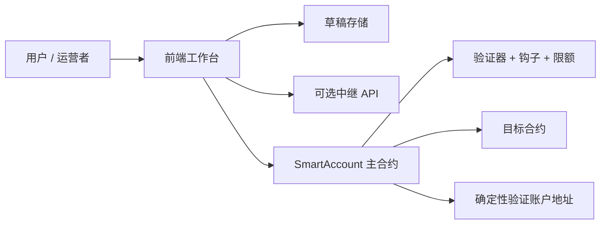
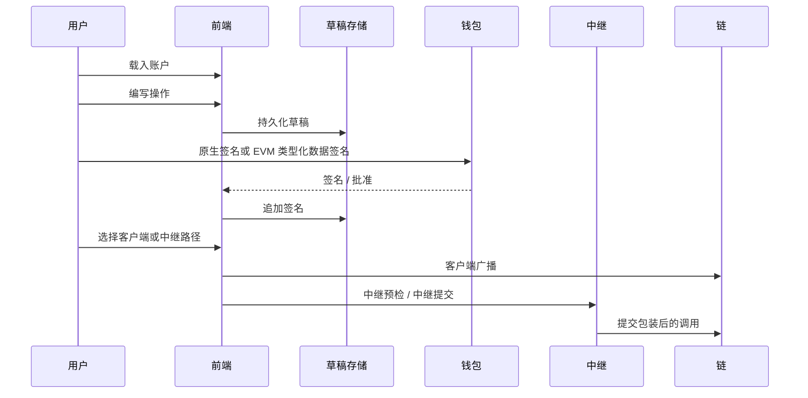

# 工作原理与使用指南

本指南从头到尾说明 Neo Smart Account（SA）系统：合约做什么、网站如何组织、用户如何创建与使用账户、协作草稿如何工作，以及交易最终如何上链。

> 中文版本与 `docs/HOW_IT_WORKS.md` 同构。若两者冲突，以英文版本为准；本文件跟随英文版本的每次修订同步更新。

## 1. 读者对象

如果你在问下面任一问题，本页就是为你写的：

- **新用户：** 什么是 Smart Account，我第一步点哪里？
- **签名人：** 在不具备运营权限的前提下，我能审阅并签署什么？
- **运营者：** 我如何收集授权、执行中继检查并安全提交？
- **集成方：** 哪些部分在链上、哪些在链下、哪些在服务端？

如果只需要一个心智模型，请记住：

> 一个全局 SA 合约保存账户配置，每个逻辑账户拥有一个确定性的验证地址，把授权请求路由回共享的、由策略管控的执行引擎。

## 2. 心智模型

本项目中的 Smart Account **不是**为每个用户单独部署的新合约。

系统使用一个全局主合约，外加每个逻辑账户一个确定性的验证账户地址。

由此得到：

- 一个共享的链上执行引擎
- 每个账户零部署成本
- 按 `accountId` 隔离的账户配置
- 同时支持 Neo 原生签名与 EVM EIP-712 签名
- 原生调用、中继调用与元交易共用同一套权限面
- 可选的链上 Paymaster，支持无信任的赞助 / 免 Gas 执行

### 账户发现与批量操作

V3 没有管理员、经理、阈值状态，也没有反向索引：这套 V1/V2 角色模型在 V3 重写中已被移除，SDK 中保留的 `getAccountsByAdmin` / `getAccountsByManager` 只是抛出 `LEGACY_V3_REMOVED` 的存根。账户状态通过 `getAccountState(accountIdHash)` 逐账户读取。

- **批量创建：** 主合约上的 `registerAccounts` 在一个交易中注册多个账户；SDK 没有批量载荷构造器，因此按账户分别构造 `createAccountPayload`，再通过该入口提交。
- **注册权限：** `registerAccount` 要求 `backupOwner` 参数（`contracts/SmartAccount.Accounts.cs:75`）的见证，而不是交易发送者的见证。

## 3. 选择正确的路径

按你的角色与风险偏好选择路径：

| 场景 | 推荐路径 | 原因 |
| --- | --- | --- |
| 单用户、单浏览器、准备提交 | 客户端广播 | 最简单也最安全的默认路径。 |
| 需要共享审阅与收集签名 | 草稿 + 协作者链接 | 签名人无需运营权限即可审阅与批准。 |
| 免 Gas / 赞助交易 | 链上 Paymaster + 中继 | 赞助方存入 GAS，中继提交并在同一交易内获得报销。 |
| 提交前做中继模拟 | 运营链接 + 中继预检 | 提交前展示虚拟机状态、Gas 与载荷细节。 |
| EVM 钱包审批流程 | 元签名 + 可中继调用 | 保留 EIP-712 签名，同时保留 Neo 策略约束。 |
| 未配置 Supabase | 仅本地草稿 | 在同一浏览器内编写、保存与签名，不跨设备共享。 |

## 4. 系统由什么组成

把整个产品理解为四个相互连接的面：

1. **链上引擎** —— 主合约加确定性验证路径
2. **前端工作台** —— 编写、审阅、签名与广播界面
3. **协作存储** —— 不可变草稿正文，加仅追加的签名与活动记录
4. **可选服务端助手** —— 中继提交与带签名的运营变更

这些面彼此连接，但权限并不相同。Supabase 不能替代合约的权限模型，共享链接本身也不能绕过仅限运营者的操作。

## 5. 一笔交易发生了什么

大多数用户通过首页工作台操作：

关键设计选择是：下游目标合约**不会**被代理签名的裸交易直接调用。执行而是经由 `executeUserOp(accountId, op)`（批量时为 `executeUserOps(accountId, ops)`）路由，由策略引擎在那里执行验证器、钩子与目标检查。V1/V2 的包装入口已被移除，在任何已部署清单和合约源码中都不存在。

## 6. 草稿协作模型

网站使用三档作用域：

- **共享链接** —— 只读审阅
- **协作者链接** —— 仅收集签名
- **运营链接** —— 中继检查、广播、回执更新与链接轮换

这意味着：

- 审阅者无法修改草稿
- 签名人无法冒充运营者
- 写权限链接一旦泄露，运营者可以轮换
- 在配置了服务端的情况下，运营操作仍需经过带签名的服务端变更路径

## 7. 人类可读的域名访问

前端可以使用 `.matrix` 域名作为发现层。创建账户时，兼容的 Neo 钱包可以提交一笔批量交易，同时创建 SA 并把 `.matrix` 域名注册到签名钱包。之后前端把域名解析回控制钱包地址。V3 不保留反向索引，因此域名不会列出它控制的 SA 账户：逐个用 `getAccountState(accountIdHash)` 读取。

## 8. 用户如何使用网站

### 新用户

1. 打开 **首页**
2. 载入或推导出智能账户
3. 选择操作预设或编写自定义调用
4. 持久化草稿
5. 按协作者角色分发链接
6. 收集批准
7. 需要时执行中继检查
8. 通过钱包或中继广播

### 签名人

1. 打开协作者链接
2. 审阅草稿与操作快照
3. 添加手动签名或 EVM 类型化数据批准
4. 中继与广播交由运营者

### 运营者

1. 打开运营链接
2. 监控签名与中继就绪状态
3. 执行预检
4. 通过客户端或中继广播
5. 必要时轮换协作者或运营链接

### 开发者与审计者

1. 阅读 **核心架构** 页了解合约结构
2. 阅读 **工作流生命周期** 页了解执行序列
3. 阅读 **数据流与存储** 页了解边界归属
4. 阅读 **SDK 集成** 页了解运行时与中继配置

## 9. 数据存放在哪里

草稿正文与协作状态在链下，权限与执行规则在链上。

- **链上：** 验证器与钩子配置、备份所有者、逃生时间锁、白名单 / 黑名单规则、转账限额
- **浏览器 / Supabase：** 不可变草稿正文、已收集签名、活动时间线、中继预检快照、有界提交回执历史
- **中继服务器：** 模拟、显式开启时的原始交易转发、配置了中继签名人时的元调用提交

共享草稿元数据刻意设有上限：前端只保留最近 **100 条活动记录** 与最近 **12 条提交回执**，使协作记录长期保持轻量。

## 10. 赞助 / 免 Gas 交易

链上 `SAPaymaster` 合约让用户无需持有 GAS 即可执行操作：

1. **赞助方**（dApp、组织或服务）向 Paymaster 合约存入 GAS，并创建赞助策略，指定资助哪些账户、合约、方法与预算。
2. **中继**携带赞助方与 Paymaster 信息调用 SA 核心的 `executeSponsoredUserOp`。
3. 中继可以选择预检 `validatePaymasterOp`，而 SA 核心正常执行用户操作（验证器 + 钩子），随后原子性地结清报销：从赞助方存款中扣除并把 GAS 发给中继。

赞助方可以创建 **按账户策略**（指定 accountId）或 **全局策略**（accountId 为零）来赞助任意账户。策略支持：

- 单次操作 Gas 上限
- 每日支出预算（24 小时滚动窗口）
- 生命周期总预算
- 目标合约与方法限制
- 过期时间戳

Paymaster 从不替代验证器或备份所有者——它只在操作被完整授权之后为中继出资。

## 11. 关键安全边界

每条执行路径都经过同一层保护：

- 账户存在性检查
- 验证器 / 备份所有者见证校验
- 可选的自定义验证器钩子
- 逃生时间锁与终结规则
- 方法白名单
- 黑名单 / 白名单
- 最大转账限制

实际的安全结论是：

- 确定性代理见证只对加固后的 SA 包装流程有效
- 公开链接只读
- 协作者链接只能签名
- 运营操作使用带签名的服务端变更
- 由代理直接签名的外部支出始终无效

## 12. 建议阅读顺序

首次了解系统时，请按顺序阅读：

1. **工作原理与使用指南**（本页）
2. **核心架构**（`docs/architecture.md`）
3. **工作流生命周期**（`docs/WORKFLOWS.md`）
4. **数据流与存储**（`docs/DATA_FLOW.md`）
5. **SDK 集成**（`frontend/src/assets/docs/sdk-usage.md`）

## 13. 术语表

- **Smart Account（SA）** —— 由 `accountId` 标识、由共享 SA 合约执行的逻辑账户
- **确定性账户地址** —— 由 `verify(accountId)` 脚本推导出的 Neo 地址
- **主合约** —— 共享的链上执行与权限引擎
- **草稿** —— 链下协作记录，包含操作数据、签名与元数据
- **协作者链接** —— 仅用于收集签名的作用域链接
- **运营链接** —— 用于中继、广播、回执与链接轮换的作用域链接
- **中继预检** —— 提交前对可中继调用做服务端模拟
- **元调用** —— 由 EVM 类型化数据签名生成的 SA 载荷，目标是 `executeUserOp`
- **账户发现** —— 用 `getAccountState(accountIdHash)` 读取单个账户状态；V1/V2 反向索引已移除
- **批量注册** —— 用 `registerAccounts` 在一笔交易中注册多个账户（无共享治理：每个账户自带验证器、钩子与备份所有者）
- **Paymaster** —— 持有赞助方 GAS 存款、并在执行成功后为报销中继的链上合约（`SAPaymaster`）
- **赞助方** —— 向 Paymaster 存款并为其他账户的操作创建资助策略的地址
- **赞助策略** —— 定义资助哪些账户、合约、方法与预算的配置
- **结算** —— 执行后从赞助方存款扣款并把 GAS 付给中继的原子步骤
