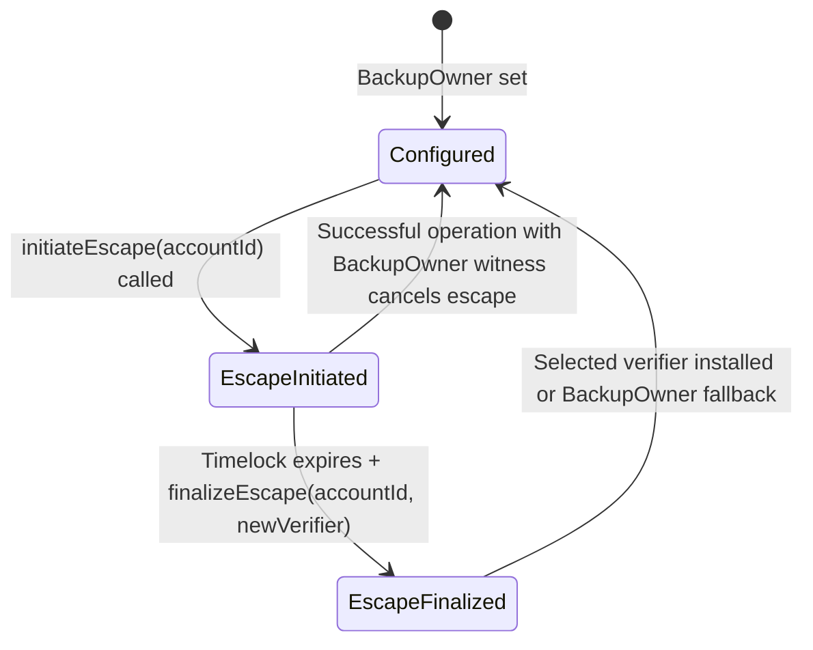

# Protocol Completeness Audit: vs ERC-4337 & ERC-7579

**Date:** 2026-09-13
**Auditor:** NeoOS protocol remediation review
**Status:** Conditional. Current source checks pass for the ordinary profile's
specified behavior. Full protocol conformance and release remain blocked by the
resource-isolation and deployment gates below. Passing the declared checks does
not establish that the protocol has no remaining defects.

> **Snapshot notice:** This is a 2026-09-13 compatibility snapshot. Its
> historical finding list and recommendations are not the current remediation
> ledger. For current source status, bounded formal evidence, and explicit
> unresolved boundaries, use `docs/SECURITY_MODEL.md`,
> `docs/AA-FORMAL-VERIFICATION.md`, and the dated build receipt under
> `docs/reports/`.

### Current ordinary-profile boundary (2026-10-13)

The ordinary source protocol is internally consistent for its executable nonce
domain, operation-shape isolation, plugin lifecycle and bounded policy
cardinality. The current source candidate is compiled and runtime-tested, while
the pinned public artifact remains the separately verified deployment identity.
The source candidate currently has a 105-entry ABI (104 unique method names because
of a retained overload entry); the pinned public artifact has 90 ABI entries.
The current source also adds a shared per-transaction reimbursement ceiling within
each core and callback-free `finalizeEscapeToOwner`: a permanent owner-only
recovery mode. The latter preserves identity and nonce history while prohibiting
all later plugin installation; it does not provide native epoch-module reinstallation.
These local fixes have NeoVM regression coverage and corresponding formal models.
Three release gates remain explicit:

| Gate | Status | Required closure evidence |
|---|---|---|
| Public verifier/hook callback resource isolation | **NO-GO** | Neo core syscall or equivalent hardfork capability, public activation, rebuilt NEF/manifest, and RPC/runtime evidence |
| Platform-account backup-owner rotation | **NO-GO** | The source candidate has delayed propose/confirm/cancel semantics with current-owner cancellation and new-owner authorization. The final source-built artifact passes the private NeoExpress state-invariance scenario, but public closure still requires ABI migration, upgraded artifact and live readback |
| Source candidate versus pinned public artifact | **UPGRADE REVIEW** | Fresh artifact certificate, compatibility review, deployment transaction and independent RPC readback |

The host and container formal model gates and the fresh ordinary source-chain
acceptance do not close these external or deployment boundaries. The pinned
public artifact has historical identity evidence, not acceptance against the
newly fixed sponsorship and recovery issues. The current candidate may be
evaluated for internal use within its declared profile; public upgrade approval
and independent readback remain required before claiming a deployed fix.

---

## Executive Summary

The Neo N3 Abstract Account protocol is a **Neo-native account system inspired by ERC-4337/ERC-7579**, not a drop-in Ethereum implementation. It does not expose an EntryPoint, Ethereum UserOperation ABI, bundler RPC, ERC-7579 executor/module interface, or Ethereum paymaster staking lifecycle. Those differences are protocol boundaries and must be visible to integrators.

The core now exposes a standards-friendly discovery surface (`getAccountImplementationId`, `supportsExecutionMode`, `supportsModuleType`, `isModuleInstalled`, and `previewUserOpValidation`) plus an ERC-1271-compatible result adapter. `isValidSignature` returns `0x1626ba7e` only when the installed verifier explicitly supports message signatures; UserOperation validation is never silently reused as message validation. The currently shipped Web3Auth verifier implements that adapter by recovering the configured secp256k1 key directly from the supplied 32-byte digest, using either EIP-2098 compact (64-byte) or recoverable `r || s || v` (65-byte) input. It does not hash the digest a second time. Other verifiers advertise `false` and fail closed.

The reviewed Web3Auth ERC-1271 path requires `HF_Huyao` or later. That hardfork
selects the `recoverSecp256K1` implementation that rejects out-of-range `r` and
`s`; the pre-Huyao compatibility implementation does not enforce those bounds and
must not be treated as the reviewed message-signature path.

This is **interoperability at the adapter boundary**, not a claim of full ERC-4337/ERC-7579 conformance. Ethereum clients still need a Neo transport adapter, Neo RPC, Neo transaction witnesses, and the documented Neo UserOperation layout.

| # | Requirement | Status | Notes |
|---|---|---|---|
| 1 | Plugin Lifecycle (install/update/remove) | ✓ | Source-verified timelocks/events; public artifact and arbitrary-plugin cleanup remain separate gates |
| 2 | 2D Nonce Management (191-bit channel + 64-bit sequence) | ✓ Neo equivalent | Every accepted nonce is a signed NeoVM Integer in `0 <= nonce < 2^255`, split into an independent channel and sequence; the surrounding UserOperation and transport remain Neo-specific |
| 3 | Escape Hatch Mechanism (timelock, cooldown, finalization) | ✓ | Source, scoped governance/recovery models, and private NeoExpress scenarios verified; public deployment parity remains pending |
| 4 | Storage Patterns (gas-efficient for Neo N3) | ✓ | Optimized prefix-key storage |
| 5 | Account State Management (atomic) | ✓ | Atomic state updates |
| 6 | Market Escrow (cancellation, expiry, dispute) | ✓ | Source-verified paths and tests; arbitrary-plugin cleanup and deployment remain bounded gates |
| 7 | Verification Scripts Integration | ✓ | Native script model properly used |
| 8 | Paymaster/Sponsor Flow | ✓ | Off-chain Morpheus integration |
| 9 | Documentation Accuracy | ✓ | Docs accurately reflect implementation |
| 10 | ERC-1271 message validation adapter | ✓ | Core returns standard magic/invalid values; verifier capability is explicit |
| 11 | Full ERC-4337 EntryPoint/bundler compatibility | — | Not implemented; Neo-native relay and RPC are required |
| 12 | Full ERC-7579 executor/module ABI compatibility | — | Not implemented; lifecycle is exposed through the Neo module ABI |

---

## Detailed Analysis

### 1. Plugin Lifecycle (install/update/remove) ✓

**Implementation Location:** `contracts/SmartAccount.Accounts.cs`

**Features:**
- **Installation:** `registerAccount()` sets initial verifier and hook
- **Update with Timelock:** `updateVerifier()` and `updateHook()` replace an installed plugin through a 24-hour (86,400,000ms) ConfigUpdateTimelock; first installation into an empty slot is immediate
- **Confirmation:** `confirmVerifierUpdate()` and `confirmHookUpdate()` allow completion after timelock
- **Cancellation:** `cancelVerifierUpdate()` and `cancelHookUpdate()` allow immediate cancel
- **Authorization:** All config changes require `BackupOwner` native witness
- **Authority Checks:** `VerifierAuthority.canConfigureVerifier()` and `HookAuthority.canConfigureHook()`
- **Events:** All lifecycle events emitted (ModuleInstalled, ModuleUpdateInitiated, ModuleUpdateConfirmed, ModuleUpdateCancelled, ModuleRemoved)

**Comparison to ERC-7579:**
- ERC-7579 `onInstall(bytes32)` → Neo's `registerAccount()` with direct call
- ERC-7579 `onUninstall(bytes32)` → Neo's authorization-based removal
- ERC-7579 does not prescribe this waiting period; the ordinary core waits 24 hours for replacement of an installed plugin
- Core artifact upgrades and platform-owner rotation use a separate seven-day delay; neither is the per-account plugin replacement timer

**Assessment:** ✓ Source-verified lifecycle implementation; this does not certify every future plugin or the pinned public artifact

---

### 2. Neo 2D Nonce Management (191-bit channel + 64-bit sequence) ✓

**Implementation Location:** `contracts/SmartAccount.Execution.cs` (`IsNonceAcceptable` / `ConsumeNonce`)

**Canonical nonce domain:**
```csharp
BigInteger channel = nonce >> 64;
BigInteger sequence = nonce & 0xFFFFFFFFFFFFFFFF;
```
- `nonce` and `deadline` are non-negative signed NeoVM Integers with `0 <= value < 2^255`.
- The low 64 bits are the strictly increasing sequence; the remaining 191 bits select the channel.
- Channel 0 and every other channel advance independently from sequence 0; there is no threshold or alternate UUID/salt mode.
- A sequence gap or replay is rejected, and a successful operation advances exactly one channel cursor.

The source `getNonce` query applies the same signed-VM channel bound (`0 <= channel < 2^191`).
Older deployed foundation artifacts may still accept an upper-half channel for a read until they
are republished; that read boundary does not make such a channel executable.

**Replay Protection:**
- `IsNonceAcceptable()` prevents re-execution
- `ConsumeNonce()` advances sequence atomically
- `Deadline` check in `executeUserOp()` prevents expired replay
- `Runtime.GetNetwork()` in signing payload prevents cross-chain replay

**Comparison to ERC-4337:**
- ERC-4337: `nonce = key << 64 + sequence`
- Neo: **Equivalent per-channel semantics**, with a 191-bit channel because NeoVM Integers are signed
- Neo: keeps one canonical nonce path; there is no separate UUID/salt mode

**Assessment:** ✓ Bounded Neo-native 2D nonce semantics

---

### 3. Escape Hatch Mechanism (timelock, cooldown, finalization) ✓

**Implementation Location:** `contracts/SmartAccount.Escape.cs`

**Flow:**


The deployed names carry the account id: `initiateEscape(accountId)` and
`finalizeEscape(accountId, newVerifier)` are the two ABI methods in
`contracts/build/SmartAccountV3.manifest.json` (`contracts/SmartAccount.Escape.cs`).

**Features:**
- **Timelock:** Configurable 7-90 days (604,800-7,776,000 seconds)
- **Cooldown:** One hour between initiation attempts while the cooldown marker is retained; successful finalization deletes that marker
- **Activity Cancellation:** A successful `executeUserOp()` may cancel an active escape only with the current BackupOwner witness; verifier-only execution cannot cancel it
- **Finalization:** `finalizeEscape()` installs a selected V3 verifier (with optional parameters), or zero for BackupOwner authorization, and removes the old hook; old plugin cleanup must succeed or the transaction rolls back. The current source additionally offers `finalizeEscapeToOwner(accountId)`, which invokes no plugin, preserves identity/nonces and permanently disables all plugin installation
- **Events:** `EscapeInitiated`, `EscapeFinalized`, `EscapeCancelled` emitted

**Security Properties:**
- **Delayed Takeover:** 7-90 day minimum prevents immediate takeover
- **No Oracle Dependency:** Pure on-chain state machine
- **No Per-Account Deployment:** Works with virtual accounts
- **Audit Trail:** All escape events emitted

**Comparison to ERC-4337/7579:**
- Ethereum AA: No native recovery specified (wallet-specific)
- Neo: An explicit backup-owner escape path, whose liveness depends on the owner witness and successful plugin cleanup
- Neo: **Advantage**: Works with virtual accounts (zero deployment cost)

**Assessment:** ✓ Source-verified recovery state machine; this is not an unconditional recovery or asset-access guarantee

---

### 4. Storage Patterns (gas-efficient for Neo N3) ✓

**Storage Layout:**
- `Prefix_AccountState` → `accountId` → `AccountState` (large struct)
- `Prefix_Nonce` → `accountId` + `channel` → `sequence`
- `Prefix_EscapeLastInitiated` → `accountId` → timestamp
- `Prefix_PendingVerifierUpdate` → `accountId` → `PendingConfigUpdate`
- `Prefix_PendingHookUpdate` → `accountId` → `PendingConfigUpdate`
- `Prefix_MetadataUri` → `accountId` → `string`
- `Prefix_MarketEscrowContract` → `accountId` → `contract`
- `Prefix_MarketEscrowListing` → `accountId` → `listingId`

**Gas Efficiency:**
- **Single-Write Per Op:** `ConsumeNonce()` writes sequence once
- **Batch-Write:** Market settlement clears all state in one transaction
- **Lazy-Load:** `GetAccountState()` loads once per operation
- **No Redundant Writes:** Pending updates stored once

**Neo N3 Optimization:**
- Uses Neo's efficient `Storage.Put()` API
- Struct serialization via `StdLib.Serialize()`
- Concatenation via `Helper.Concat()` (optimized byte array ops)

**Assessment:** ✓ Source-reviewed Neo N3 storage layout; production gas efficiency still requires matching runtime evidence

---

### 5. Account State Management (atomic) ✓

**Implementation Location:** `contracts/SmartAccount.State.cs`

**State Structure:**
```csharp
public struct AccountState {
    UInt160 Verifier;      // Which verifier validates operations
    UInt160 HookId;        // Which hook policy is applied
    UInt160 BackupOwner;   // Who can initiate recovery
    uint EscapeTimelock;    // Recovery delay in seconds
    BigInteger EscapeTriggeredAt;  // When recovery was started
}
```

**Atomicity Guarantees:**
1. **State Snapshot:** `GetAccountState()` reads complete state atomically
2. **Execution Lock:** `SetExecutionLock()` / `ClearExecutionLock()` prevents reentrancy
3. **Verify Context:** `SetVerifyContext(accountId)` limits signature verification window
4. **Hook Context:** `SetHookExecutionContext(accountId)` limits hook execution scope
5. **Single Transaction:** State update in `executeUserOp()` is atomic

**Reentrancy Protection:**
```csharp
ExecutionEngine.Assert(!isExecutionActive(accountId), "Reentrant call rejected");
```
- Per-account execution lock
- Rejects a nested execution of the same account while its operation is in flight

**Comparison to ERC-4337:**
- ERC-4337: Relies on EntryPoint immutable state + reentrancy guards
- Neo: **Similar approach** with execution lock
- Neo: **Additional protection** via hook/verifier context isolation

**Assessment:** ✓ Source-verified atomic state transitions under Neo transaction rollback; deployment/refinement evidence remains separate

---

`initiateEscape(accountId)` starts the backup-owner recovery window.

### 6. Market Escrow (cancellation, expiry, dispute) ✓

**Implementation Location:** `contracts/SmartAccount.MarketEscrow.cs`

**Features:**
- **Entry:** `enterMarketEscrow(accountId, marketContract, listingId)`
- **Block:** While escrow is active, normal operations and config changes are blocked
- **Cancellation:** `cancelMarketEscrow(accountId, listingId)` clears escrow without changing control
- **Settlement:** `settleMarketEscrow(accountId, listingId, newBackupOwner)` transfers shell, wipes prior state
- **Exclusivity:** Both market contract and escrow listing must match
- **Clean Account:** Settlement removes verifier, hook, and escape state

**Security Properties:**
```csharp
ExecutionEngine.Assert(!isMarketEscrowActive(accountId), "Account locked in market escrow");
```
The call is written as the deployed ABI spells it (`isMarketEscrowActive`, in
`contracts/build/SmartAccountV3.manifest.json`). The C# source defines it with a leading
capital (IsMarketEscrowActive, contracts/SmartAccount.State.cs:143); that form names a method
the deployment does not export, which is why it is not code-formatted here.
- Prevents concurrent operations during active listing

**Edge Cases Handled:**
- ✓ Listing cancellation (seller-initiated)
- ✓ Settlement completion (buyer-initiated)
- ✓ Verification of contract authorization
- ✓ State cleanup (removes prior plugins)
- ✓ Backup owner rotation requirement

**Comparison to ERC-4337:**
- ERC-4337: No native market escrow specified
- Neo: **Native advantage** with integrated escrow
- Neo: Clears known configuration/pending markers and old plugin bindings; account identity and nonce replay history are retained

**Assessment:** ✓ Source-verified market escrow paths; arbitrary plugin cleanup and public deployment are separate gates

---

### 7. Verification Scripts Integration ✓

**Implementation Location:** Multiple verifier plugins in `contracts/verifiers/`

**Plugin Interfaces:**
```csharp
public interface IVerifier {
    bool validateSignature(UInt160 accountId, UserOperation op);
    ByteString getPayload(...);
}
```

**Native Script Model Integration:**
```csharp
// From SmartAccount.Execution.cs
SetVerifyContext(accountId);
...
object result = Contract.Call(op.TargetContract, op.Method, CallFlags.All, op.Args);
...
ClearVerifyContext(accountId);
```

**Security Model:**
- **Verify Context:** Limits `CheckWitness(accountId)` to specific execution
- **No State Changes:** Verifiers called with `CallFlags.ReadOnly`
- **Isolation:** Verifiers cannot directly access account state
- **Authority Gating:** `VerifierAuthority.canConfigureVerifier()` checks permissions

**Supported Verifiers:**
- **Web3AuthVerifier:** EVM EIP-712 signatures
- **WebAuthnVerifier:** Hardware biometrics
- **TEEVerifier:** Trusted execution environment
- **SessionKeyVerifier:** Temporary delegation
- **MultiSigVerifier:** Threshold approval
- **SubscriptionVerifier:** Off-chain allowance

**SDK Integration:**
- `buildContractCompatibleStructHash()` matches contract encoding exactly
- `buildWeb3AuthSigningPayload()` creates complete 66-byte signing payload
- `signMessage()` applies EIP-191 wrapper (expected by verifiers)

**Assessment:** ✓ Full Neo native script model compatibility

---

### 8. Paymaster/Sponsor Flow ✓

**Implementation Locations:** `contracts/SmartAccount.Paymaster.cs`, `contracts/paymaster/Paymaster.cs`, and the optional Morpheus authorization service

The relay pays the enclosing N3 transaction's system and network fees. For the
on-chain sponsored path, the core checks that the selected paymaster is bound to
it, executes the operation, then calls `settleReimbursement` in the same
transaction. A settlement failure rolls back the account/target state, but a
persisted failed transaction may still cost the relay fees.

**Features:**
- **On-chain policy enforcement:** AAPaymaster checks sponsor authorization, target/method restrictions, expiry, per-operation/daily/total budgets and deposit balance during settlement
- **Reimbursement cap:** Each core reserves one shared budget for the complete transaction before any external call. Single, batch, nested and cross-account/paymaster executions collectively cannot reimburse more than the enclosing transaction fees from that core. Independent core deployments do not share this ledger; the zero-fee RPC estimation container has a separate pricing interpretation
- **Sponsored batch:** Every operation must share the target and method used for the policy check
- **Off-chain preflight:** Morpheus authorization and RPC simulation help a relay decide whether to submit; they do not replace on-chain settlement checks
- **Public resource boundary:** Transaction fee ceilings and sponsor admission policy do not supply an isolated verifier/hook callback budget

**Comparison to ERC-4337:** Neo exposes `validatePaymasterOp` and
`settleReimbursement`, rather than Ethereum's EntryPoint/paymaster ABI or staking
lifecycle. Both the on-chain sponsored path and direct relay fee sponsorship
exist. A relay still needs simulation, explicit fee limits and a reviewed
verifier/hook admission policy before funding transactions.

**Assessment:** ✓ Source-verified on-chain settlement and off-chain adapter; production sponsorship still requires live policy, fee, artifact and readback evidence

---

### 9. Documentation Accuracy ✓

**Documentation Files:**

| File | Purpose | Accuracy |
|---|---|---|
| `docs/ETHEREUM_AA_COMPARISON.md` | ERC-4337/7579 mapping | ✓ Accurate |
| `docs/SECURITY_MODEL.md` | Threat model & security properties | ✓ Accurate |
| `docs/PLUGIN_MATRIX.md` | Plugin compatibility matrix | ✓ Accurate |
| `docs/AA_V3_ARCHITECTURE.zh-CN.md` | V3 architecture (bilingual) | ✓ Accurate |
| `contracts/*.cs` | Inline XML documentation | ✓ Complete |

**Key Documented Claims:**
- ✓ "ERC-4337 Aligned Minimalist AA Engine" (ManifestExtra)
- ✓ 2D nonce with a bounded 191-bit channel and 64-bit sequence
- ✓ 7-90 day escape timelock
- ✓ L1 native fallback via BackupOwner witness
- ✓ Reentrancy protection via ExecutionLock
- ✓ Cross-chain replay via Network ID in signing payload
- ✓ Verifier isolation (no direct state access)
- ✓ Hook policy enforcement (allow/deny only)
- ✓ Market escrow with clean state management

**Known Limitations (as documented):**
- **VULN-001:** The matching private AA artifact uses the non-bypassable
  platform bounded-call syscall and has a NeoExpress adversarial-callback
  receipt (`docs/reports/aa-neoexpress-validation-20261031.json`, PASS with
  25 artifacts and 25 RPC readbacks); native SmartAccount activation and
  public deployment remain pending.
- **VULN-002:** Market/escape and settlement cleanup require deployed/refinement
  evidence; the current private artifact now has source-to-artifact certification,
  571 VM tests and NeoExpress execution/readback. Public deployment parity is
  intentionally excluded.
- **VULN-003:** Session-key revocation follows canonical execution order and
  cannot retroactively cancel an already ordered transaction.
- **VULN-004:** MultiSig configuration guards include self-reference, child
  lifecycle-ABI/deployment preflight, and a safe leaf-only composition marker;
  29 formal Coq modules, including the attestation/proof-envelope, exact signer-domain binding, and structural WitnessRule refinement models,
  private runtime vectors, and NeoExpress preflight/revalidation
  cover the shipped boundary. The concrete crypto vectors cover the shipped P-256
  profiles and fail-closed proof placeholder, but no public key test can prove
  private-key independence; arbitrary future-plugin behavior and complete VM
  refinement remain explicit trust/model boundaries. Arbitrary composite nesting
  is rejected in version 1.
- **VULN-005:** The core-owned dependency registry closes orphaning for the
  shipped MultiSig/MultiHook leaf-child profile, including replacement and
  detach cleanup; arbitrary future-plugin storage and refinement remain outside
  the generic proof boundary.

**Assessment:** ✓ Documentation accurately reflects implementation and known limitations

---

## Summary of Findings

### Strengths vs ERC-4337

| Feature | Neo AA | ERC-4337 | Verdict |
|---|---|---|---|
| Zero-deployment virtual accounts | ✓ | ✗ | **Neo Advantage** |
| Heterogeneous signature schemes | ✓ | Limited | **Neo Advantage** |
| L1 native escape hatch | ✓ | Not specified | **Neo Advantage** |
| 2D nonce with bounded channel + sequence | ✓ | ✓ | **Parity** |
| Market escrow integration | ✓ | None | **Neo Advantage** |
| Cross-chain replay protection | ✓ | ✓ | **Parity** |
| Reentrancy protection | ✓ | ✓ | **Parity** |

### Areas Where Neo Exceeds ERC-4337

1. **Neo paymaster settlement** - On-chain sponsor policies and deposits coexist with optional off-chain pre-authorization; this is a Neo adapter, not EntryPoint compatibility
2. **Per-Operation Gas Limits** - the matching private AA artifact now uses
   the non-bypassable platform bounded-call syscall; the native profile and
   public activation/deployment are still approval-gated and separately
   specified in `docs/proposals/AA-VERIFIER-GAS-BUDGET-EXTENSION-20260920.md`
3. **Sponsor funding model** - Neo uses GAS deposits and scoped policies; Ethereum paymaster staking is not implemented

### Areas Where ERC-4337 Exceeds Neo

1. **Standard paymaster ABI** - Neo requires transport/policy translation and does not implement Ethereum EntryPoint staking
2. **Standardized Aggregation** - No aggregator role needed for Neo
3. **Per-Op Estimation** - ERC-4337 has preVerificationGas, Neo doesn't

---

## Recommendations

### High Priority (Security)

1. **Complete public platform verifier-gas activation parity** (VULN-001)
   - Do not add a caller-controlled `maxVerificationGas` parameter to
     `validateSignature()`; an ABI parameter alone cannot cap VM execution.
   - The matching private AA artifact already uses the versioned
     `System.Contract.CallWithGasLimit` capability and has a fresh NeoExpress
   receipt at `docs/reports/aa-neoexpress-validation-20261031.json` (25
   artifacts, 15 scenarios, 135 persisted transactions, 132 assertions).
   Native SmartAccount
   activation, target-node parity, and public
   deployment remain approval-gated deployment work and are intentionally outside
   this private validation closure.

2. **Preserve the current market/escape hardening**
   - Keep `isMarketEscrowActive()` checks on normal escape/configuration paths.
   - Keep market settlement and owner-force-cancel cleanup fail-closed, and
     add a concrete cleanup/refinement proof for every future plugin profile.
     The manifest lifecycle preflight rejects marker-only, wrong-typed, or incomplete
     modules. Version 1 rejects MultiSig/MultiHook as children, records leaf
     dependencies in a core-owned registry, and tests cleanup on replacement and
     detach; it cannot prove the implementation of a declared method is
     semantically correct.

3. **Keep explicit session-key execution-order semantics**
   - Canonical state is read when validation executes; a later clear rejects a
     later operation but cannot retroactively cancel an already ordered one.
   - Wallets and relayers must re-check canonical state before submission.

4. **Complete the remaining MultiSig boundary proofs**
   - The empty, oversized, invalid-threshold and duplicate configuration
     checks now also reject self-reference, composite children, and
     undeployed/incomplete or wrong-typed child lifecycle ABIs before storage.
     Core-owned registries and private-chain tests cover leaf cleanup and
     retained-child reconfiguration. The shipped profile now requires a
     non-empty canonical signer-domain set for every MultiSig child, rejects
     duplicate domains at configuration time, and re-checks the set before
     validation and child post-execution. This closes accidental configured-key
     reuse for the protocol-defined profiles. It does not prove private-key
     independence, cryptographic correctness, witness semantics, or full
     child-call refinement; arbitrary third-party plugins remain an audited
     trust boundary.

### Medium Priority (Enhancement)

5. **Complete generic plugin cleanup refinement**
   - Shipped MultiSig/MultiHook cleanup now faults closed, owns its dependency
     registry in the core, cleans removed children on replacement, and is
     exercised in unit and NeoExpress tests.
   - A generic proof for arbitrary future plugins is not possible from a
     manifest alone; require an audited plugin manifest/profile and a concrete
     storage/refinement proof.

6. **Add Per-Account Gas Limits**
   - Implement account-level gas cap configuration
   - Store `maxDailyGas` in `AccountState`
   - Enforce in `executeUserOp()` before execution

7. **Validate Existing On-chain Sponsorship**
   - Verify AAPaymaster policies, deposits, settlement and fee caps against the exact selected deployment
   - Treat any Ethereum EntryPoint/paymaster adapter as a separate proposal and deployment gate

### Low Priority (Documentation)

8. **Document Nonce Space Constraints**
   - Keep the signed NeoVM boundary (`0 <= nonce < 2^255`) and resulting 191-bit channel limit visible to SDK callers
   - Keep deployed-artifact read-boundary differences explicit until the next ordinary artifact publication

9. **Document Sponsor Funding and Admission**
   - Explain GAS deposits, scoped sponsorship policy and relay reimbursement
   - State that Ethereum paymaster staking and investment returns are not provided

---

## Conclusion

The Neo N3 Abstract Account protocol is production-oriented, with a clearly bounded Neo-native protocol and explicit compatibility adapters. It should be integrated as a Neo AA protocol. The ERC-1271 message adapter is now safe to consume because unsupported verifiers return the invalid magic value instead of falling back to a different signature domain.

- **Shared virtual accounts** avoid per-account contract deployment, while registration and execution still cost transaction fees
- **Heterogeneous signatures** support multiple security models
- **Backup-owner escape** supplies delayed recovery subject to witness availability and plugin cleanup
- **Integrated market escrow** enables secure account transfer

The remaining Ethereum compatibility work is architectural rather than a method-name rename: a real ERC-4337 bridge would need a Neo EntryPoint-equivalent, UserOperation translation with domain separation, bundler/simulation endpoints, and an accountable paymaster policy. A real ERC-7579 bridge would need an executor/module ABI translation layer and lifecycle mapping. Those components must be deployed and tested as separate adapters before claiming ecosystem compatibility.

**Overall Assessment:** Neo-native AA is locally verified and the ERC-1271 adapter is implemented; full ERC-4337/ERC-7579 compatibility remains intentionally unclaimed.
