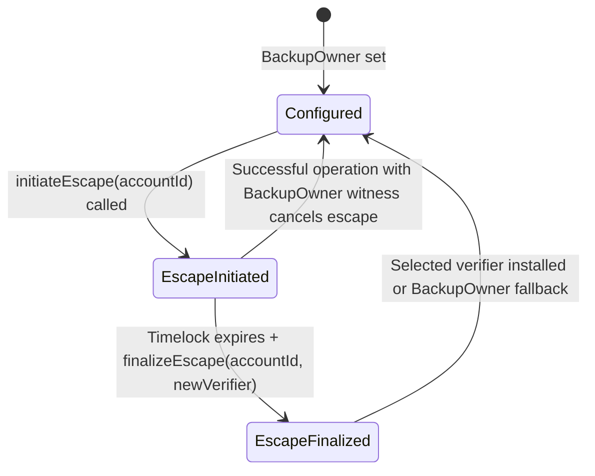

# 协议完备性审计：对照 ERC-4337 与 ERC-7579

> 中文版本与 `docs/PROTOCOL_COMPLETENESS_AUDIT.md` 同构。若两者冲突，以英文版本为准。

**日期：** 2026-09-13
**审计方：** NeoOS 协议补救评审
**状态：** 有条件通过。custom 配置的既定行为通过了当前源码检查。完整协议一致性
与发布仍被下面的资源隔离与部署门禁阻塞。通过所声明的检查
并不确立该协议没有剩余缺陷。

> **快照说明：** 这是 2026-09-13 的兼容性快照。它的
> 历史发现清单与建议不是当前的补救台账。当前源码状态、有界
> 形式证据与显式未解边界，请使用 `docs/SECURITY_MODEL.md`、
> `docs/AA-FORMAL-VERIFICATION.md` 以及 `docs/reports/` 下带日期的构建回执。

### 当前 custom 配置边界（2026-11-16）

custom 源码协议在其可执行 nonce 域、操作形状隔离、插件生命周期与有界策略
基数方面是内部一致的。当前源码候选已编译并经过运行时测试，而
固定版本的公开工件仍是单独验证过的部署身份。
源码候选当前有 109 条 ABI（由于保留了一个重载条目，实为 108 个唯一方法名）；
固定版本的公开工件有 90 条 ABI。当前源码还在每个核心内新增了
共享的按交易补偿上限，以及无回调的 `finalizeEscapeToOwner`：
一种永久的、仅 owner 的恢复模式。后者保留身份与 nonce 历史，
同时禁止其后所有插件安装；它不提供 native epoch 模块重装。
2026-11-16 的以太坊 AA 对齐修订新增了 `describeAccount`
能力发现读取，以及不 fault 的 `simulateValidation` 预检
（沿用 ERC-4337 的 EntryPoint 名称），并让 `SessionKeyVerifier.setPublicKey`
在注册期接收 version-0x01 初始密钥 blob 作为 verifier 参数，因此
会话密钥账户从第一天起就可用。
这些本地修复有 NeoVM 回归覆盖与对应的形式模型。
仍有三个发布门禁需要显式说明：

| 门禁 | 状态 | 所需闭合证据 |
|---|---|---|
| 公开 verifier/hook 回调资源隔离 | **NO-GO** | Neo core syscall 或等价硬分叉能力、公开激活、重建的 NEF/manifest，以及 RPC/运行时证据 |
| 平台账户 backup-owner 轮换 | **NO-GO** | 源码候选具备延迟的 propose/confirm/cancel 语义，带当前 owner 取消与新 owner 授权。最终的源码构建工件通过了私有 NeoExpress 状态不变场景，但公开闭合仍需要 ABI 迁移、升级后的工件与在线回读 |
| 源码候选与固定公开工件 | **UPGRADE REVIEW** | 新的工件证书、兼容性评审、部署交易与独立 RPC 回读 |

宿主与容器的形式模型门禁、以及新一轮 custom 源码链验收，都不闭合这些外部或部署边界。
固定版本的公开工件具有历史身份证据，而不是针对新修复的赞助与恢复问题的验收。
当前候选可以在其声明配置内评估内部使用；在声称已部署修复之前，
仍需要公开升级批准与独立回读。

---

## 概要

Neo N3 Smart Account 协议是一个**受 ERC-4337/ERC-7579 启发的 Neo 原生账户系统**，
而不是可直接替换的以太坊实现。它不暴露 EntryPoint、以太坊 UserOperation ABI、bundler RPC、
ERC-7579 executor/module 接口或以太坊 paymaster 质押生命周期。这些差异是协议边界，
必须对集成方可见。

核心现在暴露了便于对齐标准的发现面（`getAccountImplementationId`、`supportsExecutionMode`、
`supportsModuleType`、`isModuleInstalled` 与 `previewUserOpValidation`），外加一个与 ERC-1271 兼容的结果适配器。
只有当已安装的 verifier 显式支持消息签名时，`isValidSignature` 才返回 `0x1626ba7e`；
UserOperation 校验绝不会被悄悄复用为消息校验。当前随附的 Web3Auth verifier 通过
从所提供的 32 字节摘要直接恢复配置的 secp256k1 密钥来实现该适配器，
输入可以是 EIP-2098 紧凑形式（64 字节）或可恢复的 `r || s || v`（65 字节）。
它不会对摘要再哈希一次。其他 verifier 声明 `false` 并 fail closed。

经审阅的 Web3Auth ERC-1271 路径要求 `HF_Huyao` 或更高版本。该硬分叉
选择的是会拒绝越界 `r` 与 `s` 的 `recoverSecp256K1` 实现；
Huyao 之前的兼容实现不强制这些边界，不得被视为
经审阅的消息签名路径。

这是**适配器边界上的互操作**，而不是对完整 ERC-4337/ERC-7579 一致性的声明。
以太坊客户端仍需要 Neo 传输适配器、Neo RPC、Neo 交易 witness，
以及文档化的 Neo UserOperation 布局。

| # | 要求 | 状态 | 说明 |
|---|---|---|---|
| 1 | 插件生命周期（安装/更新/移除） | ✓ | 源码验证的 timelock/事件；公开工件与任意插件清理仍是独立门禁 |
| 2 | 二维 Nonce 管理（191 位通道 + 64 位序列） | ✓ Neo 等价 | 每个被接受的 nonce 都是 `0 <= nonce < 2^255` 范围内的有符号 NeoVM Integer，拆分为独立的通道与序列；周边 UserOperation 与传输仍是 Neo 专属 |
| 3 | 逃生机制（timelock、冷却、最终化） | ✓ | 源码、限定范围的治理/恢复模型与私有 NeoExpress 场景已验证；公开部署一致性仍未完成 |
| 4 | 存储模式（对 Neo N3 而言 gas 高效） | ✓ | 优化的前缀键存储 |
| 5 | 账户状态管理（原子） | ✓ | 原子状态更新 |
| 6 | 市场托管（取消、过期、争议） | ✓ | 源码验证的路径与测试；任意插件清理与部署仍是有界门禁 |
| 7 | 校验脚本集成 | ✓ | 正确使用原生脚本模型 |
| 8 | Paymaster/赞助流程 | ✓ | 链下 Morpheus 集成 |
| 9 | 文档准确性 | ✓ | 文档准确反映实现 |
| 10 | ERC-1271 消息校验适配器 | ✓ | 核心返回标准 magic/invalid 值；verifier 能力显式声明 |
| 11 | 完整 ERC-4337 EntryPoint/bundler 兼容 | — | 未实现；需要 Neo 原生中继与 RPC |
| 12 | 完整 ERC-7579 executor/module ABI 兼容 | — | 未实现；生命周期通过 Neo 模块 ABI 暴露 |

---

## 详细分析

### 1. 插件生命周期（安装/更新/移除）✓

**实现位置：** `contracts/custom/SmartAccount.Accounts.cs`

**特性：**
- **安装：** `registerAccount()` 设置初始 verifier 与 hook
- **带时间锁的更新：** `updateVerifier()` 与 `updateHook()` 通过 24 小时（86,400,000ms）的 ConfigUpdateTimelock 替换已安装插件；向空槽位的首次安装是立即生效的
- **确认：** `confirmVerifierUpdate()` 与 `confirmHookUpdate()` 允许在时间锁之后完成
- **取消：** `cancelVerifierUpdate()` 与 `cancelHookUpdate()` 允许立即取消
- **授权：** 所有配置变更都要求 `BackupOwner` 原生 witness
- **权限检查：** `VerifierAuthority.canConfigureVerifier()` 与 `HookAuthority.canConfigureHook()`
- **事件：** 所有生命周期事件均已发出（ModuleInstalled、ModuleUpdateInitiated、ModuleUpdateConfirmed、ModuleUpdateCancelled、ModuleRemoved）

**与 ERC-7579 的对比：**
- ERC-7579 `onInstall(bytes32)` → Neo 的 `registerAccount()` 直接调用
- ERC-7579 `onUninstall(bytes32)` → Neo 基于授权的移除
- ERC-7579 不规定该等待期；custom 核心在替换已安装插件时等待 24 小时
- 核心工件升级与平台 owner 轮换使用独立的七天延迟；两者都不是按账户的插件替换计时器

**评估：** ✓ 源码验证的生命周期实现；这不认证每个未来插件，也不认证固定版本的公开工件

---

### 2. Neo 二维 Nonce 管理（191 位通道 + 64 位序列）✓

**实现位置：** `contracts/custom/SmartAccount.Execution.cs`（`IsNonceAcceptable` / `ConsumeNonce`）

**规范 nonce 域：**
```csharp
BigInteger channel = nonce >> 64;
BigInteger sequence = nonce & 0xFFFFFFFFFFFFFFFF;
```
- `nonce` 与 `deadline` 是满足 `0 <= value < 2^255` 的非负有符号 NeoVM Integer。
- 低 64 位是严格递增的序列；其余 191 位选择通道。
- 通道 0 与所有其他通道都从序列 0 独立推进；没有阈值，也没有替代的 UUID/salt 模式。
- 序列跳号或重放会被拒绝，一次成功的操作恰好推进一个通道游标。

源码的 `getNonce` 查询施加同一有符号 VM 通道边界（`0 <= channel < 2^191`）。
较旧的已部署基础工件在重新发布前可能仍接受高半部分通道用于读取；
该读取边界不会使这样的通道变得可执行。

**重放保护：**
- `IsNonceAcceptable()` 阻止重复执行
- `ConsumeNonce()` 原子推进序列
- `executeUserOp()` 中的 `Deadline` 检查阻止过期重放
- 签名 payload 中的 `Runtime.GetNetwork()` 阻止跨链重放

**与 ERC-4337 的对比：**
- ERC-4337：`nonce = key << 64 + sequence`
- Neo：**等价的每通道语义**，通道为 191 位，因为 NeoVM Integer 是有符号的
- Neo：只保留一条规范 nonce 路径；没有独立的 UUID/salt 模式

**评估：** ✓ 有界的 Neo 原生二维 nonce 语义

---

### 3. 逃生机制（timelock、冷却、最终化）✓

**实现位置：** `contracts/custom/SmartAccount.Escape.cs`

**流程：**


已部署的名称携带账户 id：`initiateEscape(accountId)` 与
`finalizeEscape(accountId, newVerifier)` 是
`contracts/build/SmartAccount.manifest.json` 中的两个 ABI 方法（`contracts/custom/SmartAccount.Escape.cs`）。

**特性：**
- **时间锁：** 可配置 7-90 天（604,800-7,776,000 秒）
- **冷却：** 在冷却标记保留期间，两次发起之间间隔一小时；成功最终化会删除该标记
- **活动取消：** 一次成功的 `executeUserOp()` 只有在携带当前 BackupOwner witness 时才能取消进行中的逃生；仅 verifier 的执行无法取消它
- **最终化：** `finalizeEscape()` 安装选定的 V3 verifier（可带参数），或以其为零表示 BackupOwner 授权，并移除旧 hook；旧插件清理必须成功，否则交易回滚。当前源码还提供 `finalizeEscapeToOwner(accountId)`，它不调用任何插件、保留身份/nonce，并永久禁用所有插件安装
- **事件：** 发出 `EscapeInitiated`、`EscapeFinalized`、`EscapeCancelled`

**安全属性：**
- **延迟接管：** 7-90 天的最短期限阻止立即接管
- **无预言机依赖：** 纯链上状态机
- **无按账户部署：** 适用于虚拟账户
- **审计痕迹：** 所有逃生事件均已发出

**与 ERC-4337/7579 的对比：**
- 以太坊 AA：未规定原生恢复（依钱包而异）
- Neo：显式的 backup-owner 逃生路径，其活性取决于 owner witness 与成功的插件清理
- Neo：**优势**：适用于虚拟账户（零部署成本）

**评估：** ✓ 源码验证的恢复状态机；这不是无条件恢复或资产访问的保证

---

### 4. 存储模式（对 Neo N3 而言 gas 高效）✓

**存储布局：**
- `Prefix_AccountState` → `accountId` → `AccountState`（大结构体）
- `Prefix_Nonce` → `accountId` + `channel` → `sequence`
- `Prefix_EscapeLastInitiated` → `accountId` → 时间戳
- `Prefix_PendingVerifierUpdate` → `accountId` → `PendingConfigUpdate`
- `Prefix_PendingHookUpdate` → `accountId` → `PendingConfigUpdate`
- `Prefix_MetadataUri` → `accountId` → `string`
- `Prefix_MarketEscrowContract` → `accountId` → `contract`
- `Prefix_MarketEscrowListing` → `accountId` → `listingId`

**Gas 效率：**
- **每操作单次写入：** `ConsumeNonce()` 只写一次序列
- **批量写入：** 市场结算在一个交易中清除所有状态
- **惰性加载：** `GetAccountState()` 每操作加载一次
- **无冗余写入：** 待生效更新只存一次

**Neo N3 优化：**
- 使用 Neo 高效的 `Storage.Put()` API
- 通过 `StdLib.Serialize()` 序列化结构体
- 通过 `Helper.Concat()` 拼接（优化的字节数组操作）

**评估：** ✓ 源码审阅的 Neo N3 存储布局；生产 gas 效率仍需要匹配的运行时证据

---

### 5. 账户状态管理（原子）✓

**实现位置：** `contracts/custom/SmartAccount.State.cs`

**状态结构：**
```csharp
public struct AccountState {
    UInt160 Verifier;      // Which verifier validates operations
    UInt160 HookId;        // Which hook policy is applied
    UInt160 BackupOwner;   // Who can initiate recovery
    uint EscapeTimelock;    // Recovery delay in seconds
    BigInteger EscapeTriggeredAt;  // When recovery was started
}
```

**原子性保证：**
1. **状态快照：** `GetAccountState()` 原子读取完整状态
2. **执行锁：** `SetExecutionLock()` / `ClearExecutionLock()` 防止重入
3. **校验上下文：** `SetVerifyContext(accountId)` 限制签名校验窗口
4. **Hook 上下文：** `SetHookExecutionContext(accountId)` 限制 hook 执行范围
5. **单一交易：** `executeUserOp()` 中的状态更新是原子的

**重入保护：**
```csharp
ExecutionEngine.Assert(!isExecutionActive(accountId), "Reentrant call rejected");
```
- 按账户的执行锁
- 在同一账户的操作进行中时拒绝其嵌套执行

**与 ERC-4337 的对比：**
- ERC-4337：依赖 EntryPoint 不可变状态 + 重入防护
- Neo：**相似方法**，用执行锁
- Neo：**额外保护**，通过 hook/verifier 上下文隔离

**评估：** ✓ 源码验证的、在 Neo 交易回滚下的原子状态转换；部署/精化证据仍单独保留

---

`initiateEscape(accountId)` 启动 backup-owner 恢复窗口。

### 6. 市场托管（取消、过期、争议）✓

**实现位置：** `contracts/custom/SmartAccount.MarketEscrow.cs`

**特性：**
- **进入：** `enterMarketEscrow(accountId, marketContract, listingId)`
- **阻断：** 托管激活期间，正常操作与配置变更被阻断
- **取消：** `cancelMarketEscrow(accountId, listingId)` 在不改变控制权的情况下清除托管
- **结算：** `settleMarketEscrow(accountId, listingId, newBackupOwner)` 转移外壳、抹除先前状态
- **排他性：** 市场合约与托管挂单必须同时匹配
- **干净账户：** 结算移除 verifier、hook 与逃生状态

**安全属性：**
```csharp
ExecutionEngine.Assert(!isMarketEscrowActive(accountId), "Account locked in market escrow");
```
该调用按部署 ABI 的拼写书写（`isMarketEscrowActive`，位于
`contracts/build/SmartAccount.manifest.json`）。C# 源码定义时首字母大写
（IsMarketEscrowActive, contracts/custom/SmartAccount.State.cs:143）；那种写法命名的是
部署并不导出的方法，因此这里没有按代码格式化。
- 在挂单激活期间阻止并发操作

**已处理的边界情况：**
- ✓ 挂单取消（卖方发起）
- ✓ 结算完成（买方发起）
- ✓ 合约授权校验
- ✓ 状态清理（移除先前的插件）
- ✓ backup owner 轮换要求

**与 ERC-4337 的对比：**
- ERC-4337：未规定原生市场托管
- Neo：**原生优势**，内置托管
- Neo：清除已知配置/待生效标记与旧插件绑定；账户身份与 nonce 重放历史被保留

**评估：** ✓ 源码验证的市场托管路径；任意插件清理与公开部署是独立门禁

---

### 7. 校验脚本集成 ✓

**实现位置：** `contracts/plugins/verifiers/` 中的多个 verifier 插件

**插件接口：**
```csharp
public interface IVerifier {
    bool validateSignature(UInt160 accountId, UserOperation op);
    ByteString getPayload(...);
}
```

**原生脚本模型集成：**
```csharp
// From SmartAccount.Execution.cs
SetVerifyContext(accountId);
...
object result = Contract.Call(op.TargetContract, op.Method, CallFlags.All, op.Args);
...
ClearVerifyContext(accountId);
```

**安全模型：**
- **校验上下文：** 把 `CheckWitness(accountId)` 限制到特定执行
- **无状态变更：** verifier 以 `CallFlags.ReadOnly` 调用
- **隔离：** verifier 无法直接访问账户状态
- **权限门禁：** `VerifierAuthority.canConfigureVerifier()` 检查权限

**支持的 Verifier：**
- **Web3AuthVerifier：** EVM EIP-712 签名
- **WebAuthnVerifier：** 硬件生物识别
- **TEEVerifier：** 可信执行环境
- **SessionKeyVerifier：** 临时委派
- **MultiSigVerifier：** 阈值批准
- **SubscriptionVerifier：** 链下额度

**SDK 集成：**
- `buildContractCompatibleStructHash()` 与合约编码精确匹配
- `buildWeb3AuthSigningPayload()` 生成完整的 66 字节签名 payload
- `signMessage()` 施加 EIP-191 包装（verifier 期望的形式）

**评估：** ✓ 完整的 Neo 原生脚本模型兼容

---

### 8. Paymaster/赞助流程 ✓

**实现位置：** `contracts/custom/SmartAccount.Paymaster.cs`、`contracts/custom/paymaster/Paymaster.cs`，以及可选的 Morpheus 授权服务

中继支付外层 N3 交易的系统费用与网络费用。对于链上赞助路径，核心检查所选 paymaster
是否绑定到它，执行操作，然后在同一交易中调用 `settleReimbursement`。
结算失败会回滚账户/目标状态，但一笔已持久化的失败交易
仍可能让中继付出费用。

**特性：**
- **链上策略强制：** AAPaymaster 在结算期间检查赞助方授权、target/method 限制、过期、按操作/每日/总预算以及存款余额
- **补偿上限：** 每个核心在任何外部调用之前为整笔交易预留一份共享预算。单笔、批量、嵌套以及跨账户/paymaster 的执行，合计补偿不得超过该核心的外层交易费用。独立的核心部署不共享该台账；零费用 RPC 估算容器有不同的定价解释
- **赞助批量：** 每个操作都必须共享策略检查所用的 target 与 method
- **链下预检：** Morpheus 授权与 RPC 模拟帮助中继决定是否提交；它们不取代链上结算检查
- **公开资源边界：** 交易费用上限与赞助方准入策略并不提供隔离的 verifier/hook 回调预算

**与 ERC-4337 的对比：** Neo 暴露 `validatePaymasterOp` 与
`settleReimbursement`，而不是以太坊的 EntryPoint/paymaster ABI 或质押
生命周期。链上赞助路径与直接的中继费用赞助同时存在。
中继在为交易出资之前，仍需要模拟、显式的费用限制以及
经审阅的 verifier/hook 准入策略。

**评估：** ✓ 源码验证的链上结算与链下适配器；生产赞助仍需要实时的策略、费用、工件与回读证据

---

### 9. 文档准确性 ✓

**文档文件：**

| 文件 | 用途 | 准确性 |
|---|---|---|
| `docs/ETHEREUM_AA_COMPARISON.md` | ERC-4337/7579 映射 | ✓ 准确 |
| `docs/SECURITY_MODEL.md` | 威胁模型与安全属性 | ✓ 准确 |
| `docs/PLUGIN_DEVELOPER_GUIDE.md` | 插件兼容性与生命周期 | ✓ 准确 |
| `docs/architecture.zh-CN.md` | V3 架构（中文对照） | ✓ 准确 |
| `contracts/*.cs` | 内联 XML 文档 | ✓ 完整 |

**关键记录声明：**
- ✓ "ERC-4337 Aligned Minimalist AA Engine"（ManifestExtra）
- ✓ 二维 nonce，191 位有界通道与 64 位序列
- ✓ 7-90 天的逃生时间锁
- ✓ 通过 BackupOwner witness 的 L1 原生回退
- ✓ 通过 ExecutionLock 的重入保护
- ✓ 通过签名 payload 中的 Network ID 防止跨链重放
- ✓ Verifier 隔离（无直接状态访问）
- ✓ Hook 策略强制（仅允许/拒绝）
- ✓ 带干净状态管理的市场托管

**已知限制（如文档所述）：**
- **VULN-001：** 匹配的私有 AA 工件使用不可绕过的
  平台有界调用 syscall，并有 NeoExpress 对抗性回调
  回执（`docs/reports/aa-neoexpress-validation-20261031.json`，PASS，
  25 个工件与 25 次 RPC 回读）；native SmartAccount 激活与
  公开部署仍未完成。
- **VULN-002：** 市场/逃生与结算清理需要部署/精化
  证据；当前私有工件现已具备源码到工件的认证、
  571 个 VM 测试与 NeoExpress 执行/回读。公开部署一致性
  被有意排除。
- **VULN-003：** 会话密钥撤销遵循规范执行顺序，
  无法追溯取消一笔已排序的交易。
- **VULN-004：** MultiSig 配置守卫包含自引用、子
  生命周期 ABI/部署预检，以及安全的仅叶节点组合标记；
  29 个形式 Coq 模块（包括 attestation/proof-envelope、精确签名域绑定与结构型 WitnessRule 精化模型）、
  私有运行时向量，以及 NeoExpress 预检/复验
  覆盖了随附边界。具体密码学向量覆盖随附的 P-256
  配置与失败即拒绝的证明占位符，但没有任何公钥测试能证明
  私钥独立性；任意未来插件行为与完整的 VM
  精化仍是显式的信任/模型边界。任意复合嵌套
  在版本 1 中被拒绝。
- **VULN-005：** 核心拥有的依赖注册表闭合了随附
  MultiSig/MultiHook 叶节点子配置的孤儿化，包括替换与
  分离清理；任意未来插件存储与精化仍位于
  通用证明边界之外。

**评估：** ✓ 文档准确反映实现与已知限制

---

## 发现汇总

### 相对 ERC-4337 的优势

| 特性 | Neo AA | ERC-4337 | 结论 |
|---|---|---|---|
| 零部署虚拟账户 | ✓ | ✗ | **Neo 优势** |
| 异构签名方案 | ✓ | 有限 | **Neo 优势** |
| L1 原生逃生口 | ✓ | 未规定 | **Neo 优势** |
| 二维 nonce，有界通道 + 序列 | ✓ | ✓ | **对等** |
| 市场托管集成 | ✓ | 无 | **Neo 优势** |
| 跨链重放保护 | ✓ | ✓ | **对等** |
| 重入保护 | ✓ | ✓ | **对等** |

### Neo 超越 ERC-4337 的方面

1. **Neo paymaster 结算** —— 链上赞助策略与存款，与可选的链下预授权共存；这是 Neo 适配器，不是 EntryPoint 兼容
2. **按操作的 Gas 限制** —— 匹配的私有 AA 工件现已使用
   不可绕过的平台有界调用 syscall；native 配置与
   公开激活/部署仍受批准门禁约束，并在
   `docs/proposals/AA-VERIFIER-GAS-BUDGET-EXTENSION-20260920.md` 中单独规定
3. **赞助方出资模型** —— Neo 使用 GAS 存款与限定范围的策略；以太坊 paymaster 质押未实现

### ERC-4337 超越 Neo 的方面

1. **标准 paymaster ABI** —— Neo 需要传输/策略翻译，且不实现以太坊 EntryPoint 质押
2. **标准化聚合** —— Neo 不需要聚合器角色
3. **按操作估算** —— ERC-4337 有 preVerificationGas，Neo 没有

---

## 建议

### 高优先级（安全）

1. **完成公开平台 verifier-gas 激活一致性**（VULN-001）
   - 不要向 `validateSignature()` 添加调用方控制的 `maxVerificationGas` 参数；
     仅靠 ABI 参数无法限制 VM 执行。
   - 匹配的私有 AA 工件已使用带版本的
     `System.Contract.CallWithGasLimit` 能力，并拥有新的 NeoExpress
   回执 `docs/reports/aa-neoexpress-validation-20261031.json`（25 个
   工件、15 个场景、135 笔持久化交易、132 条断言）。
   Native SmartAccount 激活、目标节点一致性与公开
   部署仍是受批准门禁约束的部署工作，被有意置于
   本私有验证闭合之外。

2. **保持当前的市场/逃生加固**
   - 在正常逃生/配置路径上保留 `isMarketEscrowActive()` 检查。
   - 保持市场结算与 owner 强制取消清理 fail-closed，并为每个未来插件配置
     添加具体的清理/精化证明。
     manifest 生命周期预检拒绝仅标记、类型错误或不完整的
     模块。版本 1 拒绝把 MultiSig/MultiHook 作为子节点，把叶节点
     依赖记录在核心拥有的注册表中，并在替换与
     分离时测试清理；它无法证明所声明方法的实现
     在语义上正确。

3. **保持显式的会话密钥执行顺序语义**
   - 规范状态在验证执行时读取；之后的清除只会拒绝
     之后的操作，无法追溯取消一笔已排序的交易。
   - 钱包与中继方必须在提交前重新检查规范状态。

4. **完成剩余的 MultiSig 边界证明**
   - 空、超大、无效阈值与重复配置检查，
     现在还会在写入存储前拒绝自引用、复合子节点，以及
     未部署/不完整或类型错误的子生命周期 ABI。
     核心拥有的注册表与私有链测试覆盖叶节点清理与
     保留子节点的重配置。随附配置现在要求每个 MultiSig 子节点
     具有非空规范签名域集合，在配置期拒绝
     重复域，并在验证与子执行后重新检查该集合。这闭合了
     协议定义配置下的意外配置密钥复用。它不证明私钥
     独立性、密码学正确性、witness 语义或完整的
     子调用精化；任意第三方插件仍是经审计的
     信任边界。

### 中优先级（增强）

5. **完成通用插件清理精化**
   - 随附的 MultiSig/MultiHook 清理现已 fail closed，在核心中拥有其依赖
     注册表，在替换时清理被移除的子节点，并在单元测试与 NeoExpress 测试中
     得到演练。
   - 仅凭 manifest 不可能为任意未来插件给出通用证明；
     需要经审计的插件 manifest/配置以及具体的
     存储/精化证明。

6. **添加按账户 Gas 限制**
   - 实现账户级 gas 上限配置
   - 在 `AccountState` 中存储 `maxDailyGas`
   - 在执行前于 `executeUserOp()` 中强制

7. **验证既有的链上赞助**
   - 针对确切的选定部署验证 AAPaymaster 策略、存款、结算与费用上限
   - 把任何以太坊 EntryPoint/paymaster 适配器视为单独的提案与部署门禁

### 低优先级（文档）

8. **记录 Nonce 空间约束**
   - 让 SDK 调用方持续看到有符号 NeoVM 边界（`0 <= nonce < 2^255`）与由此产生的 191 位通道限制
   - 在下一个 custom 工件发布之前，让部署工件的读取边界差异保持显式

9. **记录赞助方出资与准入**
   - 解释 GAS 存款、限定范围的赞助策略与中继补偿
   - 说明不提供以太坊 paymaster 质押与投资回报

---

## 结论

Neo N3 Smart Account 协议是面向生产的，具有清晰有界的 Neo 原生协议与显式的兼容适配器。
它应作为 Neo Smart Account 协议被集成。ERC-1271 消息适配器现在可以安全消费，
因为不支持的 verifier 会返回 invalid magic 值，而不是回退到不同的签名域。

- **共享虚拟账户** 避免按账户部署合约，但注册与执行仍产生交易费用
- **异构签名** 支持多种安全模型
- **backup-owner 逃生** 提供延迟恢复，但受制于 witness 可用性与插件清理
- **集成式市场托管** 支持安全的账户转移

剩余的以太坊兼容工作是架构性的，而不是方法名重命名：真正的 ERC-4337 桥需要
Neo 的 EntryPoint 等价物、带域分离的 UserOperation 翻译、bundler/模拟端点，
以及可问责的 paymaster 策略。真正的 ERC-7579 桥需要 executor/module ABI 翻译层
与生命周期映射。这些组件必须作为独立适配器部署并测试之后，才能声称生态兼容。

**总体评估：** Neo 原生 AA 已通过本地验证，ERC-1271 适配器已实现；完整的 ERC-4337/ERC-7579 兼容被有意保持为未声明。
