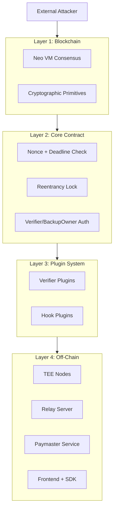
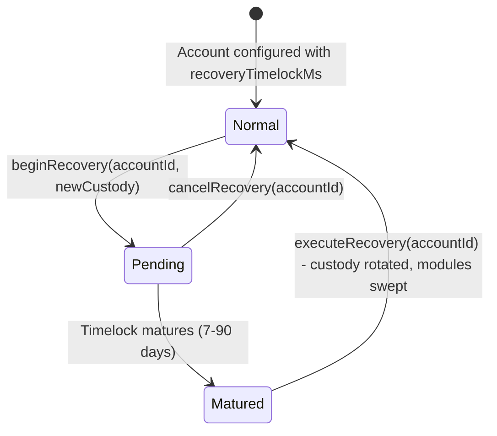
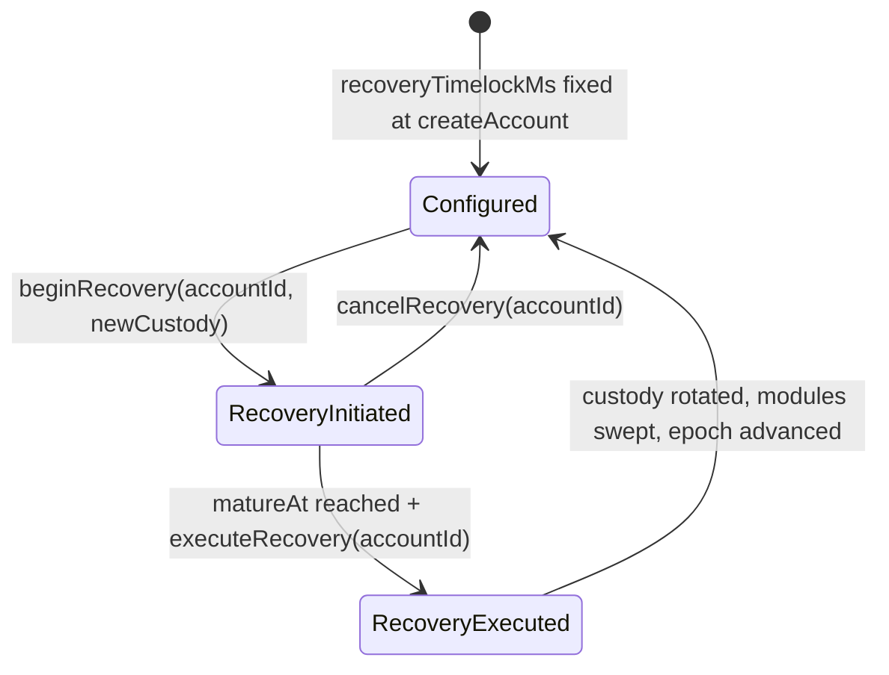

# Neo N3 Smart Account Security Model

## Runtime and authority versions (2026-10-09 convergence)

Custom deployed `SmartAccount` remains the `public` implementation
from the tested main branch; its separate `PLATFORM` build retains 10 GAS bounded
verifier callbacks. Neither is the native SmartAccount contract. Native ABI 2
uses a 1 GAS verifier budget (within the 1.5 GAS verification envelope), 2.5 GAS
hook/maintenance budgets, and explicit epoch-aware module packaging.

Native recovery now requires a checked authority-epoch and configuration-nonce
advance, detaches old roots/dependencies without calling old modules, and leaves
identity, asset address, execution nonce and frozen state unchanged. All module
storage uses `0xA2 || policyPrefix || accountIdLE20 || authorityEpochLE64 || suffix`. The native four-argument execution envelope commits both counters in the unsigned
transaction script, covering custody fallback and native transaction witnesses;
operation-signature preimages also bind them. Prior-generation
keys or signatures cannot be restored by reinstalling a module. This is distinct
from the legacy escape lane carried by the pinned `contracts/build/` artifact, whose
old-module cleanup can still fail closed. The current source additionally offers the
callback-free recovery lane `beginRecovery` / `cancelRecovery` / `executeRecovery`
(read back through `getRecoveryStatus`): maturity rotates custody, sweeps every module
row without calling a plugin, and advances the authority epoch; it does not provide
native epoch-module reinstallation.
The normative rules are in `docs/proposals/SMARTACCOUNT-NATIVE-PROFILE-DRAFT.md`.
The amended native composite path uses a core-owned, single-operation receipt:
only the first threshold of valid children obtains post-execution authority.
Validation and post-execution still check current policy and all active binding
pins; an Application receipt is created afresh and never reused from Verification
or another operation. Modules require an exact current profile fingerprint and
an explicit Boolean verifier-composition marker. The shipped native P-256
profiles map a session key and its standard-account witness to the same signer
domain, preventing those two representations from supplying separate votes.
Independent control of arbitrary script accounts is not established by that rule.

Historical receipts below identify their own pinned ABI 1, preceding ABI 2, or
custom-contract snapshots. They do not certify this amended ABI 2 source,
SDK or runtime. Its three-child/two-approval/three-domain limits require actual
VM budget evidence, separate from the bounded policy proofs.


## Executive Summary

The Neo N3 Smart Account system implements a policy-gated, plugin-based account abstraction architecture. This document defines the threat model, trust assumptions, security properties, and defense-in-depth mechanisms across all layers of the system.

The deployed-contract profile is not automatically compatible with native
SmartAccount. The native NeoNativeVerifier, WhitelistHook, SessionKeyVerifier,
DailyLimitHook and TokenRestrictedHook historical ABI 1 profiles
have private-chain evidence for actual witnesses, exact invocation grants,
delayed configuration, rollback and cleanup. The remaining modules still require
their own native-profile adaptation and validation. The consolidated evidence is
`docs/reports/sa-native-restricted-validation-20261008.json`; the detailed
scope is `docs/proposals/SMARTACCOUNT-NATIVE-MODULE-PROFILES.md`. None of these
receipts establishes complete cryptographic or compiler refinement.

The native SessionKey profile uses the canonical operation preimage, actual
P-256 signatures and the registered asset proxy. Its Verification clock must
use persisted ledger time: Runtime.Time is unavailable when no persisting block
exists. The private matrix distinguishes witness admission rejection from
persisted Application FAULT and checks real GAS transfer rollback when a capped
transfer returns false. Ordinary session configuration/revocation remains delayed;
immediate freeze requires a configured recovery authority. This is not a promise
of immediate session revocation or proof of an arbitrary token's semantics.
Rotation preserves spent allowance. Reducing a positive cap below the amount
already spent blocks even zero-amount transfers; at the exact cap, zero transfers
remain admissible. Explicit delayed revocation clears the key and allowance but
retains the rotation timestamp, whereas account cleanup removes all session
prefixes (four in the legacy profile, six in amended native ABI 2). Native
prefix `0x05` holds the canonical signer domain, written atomically with session
configuration and freshly read during discovery; missing or malformed values
fail closed, with no fallback to old layouts. Native
prefix `0x06` holds a canonical UInt64 last-use Integer; metadata reads project it
into the original three-field record, avoiding repeated description writes on
execution. Invalid or missing timestamps fail closed, including negative,
overflowing and noncanonical byte encodings. The historical lifecycle matrix
covers the four-prefix layout; amended ABI 2 requires new replay for both split
entries.
The additional scope matrix is
`docs/reports/sa-native-session-scope-validation-20261007.json`. Zero means no
session spending cap, not zero allowance. A wildcard method remains bound to one
target but can authorize its entire value-moving surface; a whole-balance GAS
transfer is exercised. Uncapped Boolean-false HALT consumes nonce and updates
last-use metadata, whereas target FAULT rolls back. Capped false transfers still
fault. The event exposes the exact scope and uncapped flag.

The historical ABI 1 replay restored identical signature bytes after regrant
when nonce/deadline still permitted them. ABI 2 closes that behavior: every
configuration transition changes configurationNonce in the signing domain;
recovery additionally advances authorityEpoch. Regranting the same public key
cannot revive a pre-transition signature. The ABI 2 matrix must retain the old
bytes and reject them after regrant, then accept a freshly signed operation.
Old ABI 1 receipts remain historical evidence and must not be relabelled.

DailyLimitHook native-profile evidence is recorded separately in
`docs/reports/sa-native-daily-balance-validation-20261007.json`. Its net-outflow meter
uses every configured token's proxy balance rather than inferring success from
the target return value. False results leave no persistent snapshot. Fixed
window anchors do not slide on subsequent transfers; rolling history has an
explicit live-record bound. Arbitrary tokens must still provide honest balances,
and callback-budget sufficiency for arbitrary configurations remains unproven.
The single-token fifty-record capacity was initially unreachable: repeated
history scans exhausted a callback budget on record 21. Single-pass sum/count
and post-execution pruning fix that measured case without changing the budget.
The diagnostic token's real balance writes verify false-result accounting and
over-limit rollback; it deliberately violates NEP-17 success semantics and is
not a production token. Nested GAS calls do not inherit the proxy witness from
the active target; this restriction is tested, not relaxed.
Negative and non-Integer balance replies, query faults and query gas exhaustion
are rejected in both hook phases on two private chains. Post-hook rejection
rolls back the diagnostic token's actual raw balance/mode storage together with
nonce and policy state. Removing the faulty token limit through delayed
configuration restores a successful GAS operation without querying that token.
This is bounded recovery evidence, not immediate availability or a proof that
arbitrary tokens report honest balances. No callback budget was raised.

The native TokenRestrictedHook rejects direct interaction with a restricted
token and rejects any observed restricted-token net outflow through another
target, independently of the target's return value. Its private diagnostic
router has an explicit token-side delegation; it does not inherit native proxy
witness authority. Inflows and zero-net movement remain allowed. Strict balance
types, query faults, inherited gas exhaustion, raw-storage rollback, delayed
removal and both-prefix cleanup are exercised. Missing-snapshot rejection has a
source guard and an abstract proof; a separate unchanged-NEF host probe now
deletes an actual snapshot between authenticated callbacks and verifies
rejection and parent-store rollback. That diagnostic injection is not a
persisted on-chain attack. The host also covers every VM stack-item type with
representative balance replies in both phases and verifies stale-snapshot cleanup
isolation. Post-phase type rejection rolls back the diagnostic mode write,
account nonce and transient snapshot. Direct calls without phase authority and
host-injected malformed callback Arrays reject. These diagnostic injections do
not establish that malformed callbacks are reachable through the native parser.
Full-NEF measured instruction/conditional-edge coverage is 83.64%/68.13%, below
the completion threshold; it is not C# source coverage. See
`docs/reports/sa-native-nef-phases-validation-20261008.json`. Arbitrary token
honesty, gross intermediate movement, large configured sets and complete C#/NEF
branch coverage remain outside the demonstrated scope.

---

## 1. Threat Model

### 1.1 Attackers

| Attacker Type | Capabilities | Primary Attack Vectors |
| --- | --- | --- |
| **External Attacker** | No private keys, can submit transactions | Replay, gas DoS, front-running, signature forgery |
| **Compromised Verifier** | Control of verifier signing key | Unauthorize withdrawals, bypass hooks |
| **Compromised Relay** | Can submit to bundler/relay | Censorship, front-running, selective relay |
| **Compromised TEE Node** | TEE private key access | Unlimited automated transactions |
| **Compromised Paymaster Sponsor** | Sponsor wallet private key | Policy manipulation, deposit withdrawal |
| **Stolen Cold Wallet** | Backup owner private key | Escape hatch takeover |
| **Smart Contract Developer** | Plugin code deployment | Logic bugs, backdoors, malicious hooks/verifiers |

### 1.2 Assets at Risk

| Asset | Protection Mechanism | Threat Level |
| --- | --- | --- |
| **Native Neo Tokens** (NEO, GAS) | Verifier signature + Hook policies + Nonce | High |
| **NEP-17 Tokens** | Verifier signature + Hook policies + Nonce | High |
| **NFTs / SBTs** | Verifier signature + Hook policies + Nonce | Medium |
| **Account Control** (Verifier, Hooks, BackupOwner) | Timelocks, authority checks | Critical |
| **Reputation / Identity** | NeoDID binding + Credential hooks | Medium |

---

## 2. Trust Assumptions

### 2.1 Layer 1: Neo N3 Blockchain

| Assumption | Rationale | Risk if Violated |
| --- | --- | --- |
| **NeoVM is sound** | Code execution is deterministic | Global consensus failure |
| **Cryptography is secure** | secp256k1/r1 are battle-tested | Private key recovery via weaknesses |
| **Consensus fault bound holds** | Byzantine validators remain within the deployed consensus protocol's tolerated fault bound | Safety or liveness can fail beyond that bound |

### 2.2 Layer 2: Core Contract

| Assumption | Rationale | Risk if Violated |
| --- | --- | --- |
| **Verifier plugins are honest** | Signature = authorization | Malicious verifier drains funds |
| **Hook plugins don't censor** | Policies only reject, not modify | Hook prevents valid operations |
| **Backup owner is secure** | L1 escape mechanism | Account takeover without recovery |

### 2.3 Layer 3: Plugin Ecosystem

| Assumption | Rationale | Risk if Violated |
| --- | --- | --- |
| **Plugin deployment is authorized** | Only backup owner can install | Unauthorized plugin installation |
| **TEE enclaves are secure** | Hardware-level isolation | TEE key compromise |
| **Relays are semi-honest** | Multiple competing relays | Censorship or front-running |
| **Paymaster is solvent** | On-chain deposit balance or off-chain gas sponsorship | Failed transactions if deposit exhausted |
| **Paymaster policy is honest** | Sponsor controls policy creation | Sponsor can revoke/expire policies at will |

### 2.4 Layer 4: Frontend & SDK

| Assumption | Rationale | Risk if Violated |
| --- | --- | --- |
| **User's device is secure** | Private key storage | Key theft via malware |
| **RPC endpoints are honest** | Transaction submission | Transaction censorship |
| **Supabase is secure** | Draft/collaboration storage | Draft manipulation |

---

## 3. Security Properties by Layer

### 3.1 Core Contract Layer

| Property | Implementation | Threat Mitigated |
| --- | --- | --- |
| **Integrity** | State in `SmartAccount` | Contract can't be modified without deployer |
| **Confidentiality** | No confidentiality guarantee from account abstraction | Transaction and stored contract data are public; secrets must not be placed on-chain |
| **Availability** | No per-account deployment | Single point of failure |
| **Non-repudiation** | Nonce + Deadline | Sender can't deny transaction |
| **Replay Protection** | Nonce + Network ID + Deadline | Can't replay on same/different chain |
| **Operation Shape** | Target/method/argument/serialization/signature/batch bounds | Rejects malformed and resource-amplifying input before execution |

### 3.2 Verification Layer

| Property | Implementation | Threat Mitigated |
| --- | --- | --- |
| **Authentication** | Verifier signature checks | Unauthorized ops rejected |
| **Authorization** | Backup owner / Verifier separation | Privilege escalation prevented |
| **Freshness** | Per-channel nonce cursor and deadline | Replay and out-of-order operations rejected |
| **Cross-chain isolation** | `Runtime.GetNetwork()` in payload | Can't replay across networks |

### 3.3 Policy/Hook Layer

| Property | Implementation | Threat Mitigated |
| --- | --- | --- |
| **Transfer limits** | `DailyLimitHook` | Large thefts mitigated |
| **Target allowlisting** | `WhitelistHook` | Fraudulent contract interaction blocked |
| **Token restrictions** | `TokenRestrictedHook` | Unauthorized token transfers blocked |
| **Credential gating** | `NeoDIDCredentialHook` | Unverified users blocked |
| **Composability** | `MultiHook` | Combined policies enforce AND logic |

### 3.4 Recovery Layer

| Property | Implementation | Threat Mitigated |
| --- | --- | --- |
| **L1 fallback** | Backup owner native witness | Verifier failure recovery |
| **Delayed takeover** | Escape timelock (7-90 days) | Immediate takeover prevented |
| **Activity cancellation** | Only a successful operation with the current BackupOwner witness cancels escape | Verifier-only operations cannot cancel recovery |
| **Auditability** | Escape events logged | Recovery attempts visible |

---

## 4. Defense-in-Depth Architecture



### Layer 1: Blockchain Primitives
- **NeoVM:** Deterministic execution, bounded gas
- **Cryptography:** secp256k1 (EVM), secp256r1 (Passkey/TEE), SHA256, Keccak256

### Layer 2: Core Contract
- **Nonce + Deadline:** Replay protection
- **Execution Lock:** Reentrancy prevention, read as `isExecutionActive(accountId)` on the deployed core
- **Verify Context:** Limits `CheckWitness(accountId)` to execution context
- **Authority Separation:** Verifier (who) vs Hook (what) vs Core (how)

### Layer 3: Plugin System
- **Verifier Isolation:** Stateless, no direct state access
- **Hook Gating:** Pre/post execution policies
- **Authority Validation:** `getAuthorizedModuleId` phase resolution plus the module-side `ValidatorAuthority` / `HookAuthority` checks
- **Module Lifecycle:** Timelocked updates with events

The core passes hook callbacks a single canonical operation tuple in both phases:
`[TargetContract, Method, Args, Nonce, Deadline, Signature]`; the account id remains a separate
callback argument. This prevents a hook from validating one operation representation and metering
another. Post callbacks receive detached copies of the authenticated operation and target result,
so a verifier or hook cannot rewrite the operation later used for the execution event or sponsored
settlement. `MultiHook` also re-serializes the target result for each child post-hook, preventing
one policy leaf from changing the result observed by the next leaf. A real NeoVM regression vector
confirms that `WhitelistHook` accepts the signed target,
rejects an unlisted target before dispatch, and rolls back the nonce on rejection.
The callback result is required to cross the Neo StdLib serialization boundary: ordinary VM values
such as Null, Boolean, Integer, ByteString, Buffer, Array, Struct and Map are copied, while
InteropInterface values (including iterators and storage contexts), Pointer values, cyclic graphs,
and repeated container references fail closed before post callbacks. The enclosing invocation rolls
back target writes and nonce state on that fault; transaction fees remain chargeable.

### Layer 4: Off-Chain Infrastructure
- **TEE Attestation:** Hardware root of trust (future)
- **Relay Diversity:** Multiple competing relays prevent censorship
- **Paymaster Policy:** Off-chain sponsorship rules
- **Frontend Sanitization:** Input validation, error message stripping

---

## 5. Critical Security Invariants

### 5.1 Must-Hold Invariants

1. **Nonce Monotonicity:** Nonces never decrease within a channel
2. **Deterministic Address:** Same `accountId` always resolves to same address
3. **Replay Prevention:** Same operation cannot execute twice
4. **Context Isolation:** `CheckWitness(accountId)` only valid during `executeUserOp`
5. **Escape Atomicity:** Either completes fully or not at all
6. **Market Escrow Exclusivity:** Escape/initiative changes blocked during escrow

### 5.2 Should-Hold Invariants

1. **Gas Limits on Verifiers:** *(PROFILE DEPENDENT)* The private `PLATFORM` core uses a 10 GAS child budget for each verifier callback on the matching runtime. `public` uses standard `System.Contract.Call` and has no child budget; lifecycle admission, simulation and transaction fee ceilings do not establish one. Historical private runtime evidence requires revalidation after source/runtime changes.
2. **Plugin State Cleanup:** *(PARTIAL)* Current settlement clears known plugin markers and rejects modules whose manifest omits the v4 lifecycle ABI; semantic cleanup/refinement coverage for arbitrary future plugins is pending.
   Every validator and hook must implement `onUninstall` and delete every instance-scoped key it owns: the core calls it without a fallback from
   `confirmConfiguration`, the escape lane and `settleMarketEscrow`, and a
   nested call to a missing method faults the enclosing transaction uncatchably. The
   `SocialRecoveryService` source now implements it (core-gated, oracle credit refunded to the
   recovery owner, consumed action nullifiers retained as replay protection). The recovery module
   artifacts recorded as deployed on TestNet and MainNet predate v4, so an account bound to
   a deployed instance cannot rotate away from it, finalize an escape or be sold until that instance
   is upgraded through the timelocked `proposeConfiguration`/`confirmConfiguration` path. On the newer
   core candidate, the callback-free permanent owner-only escape lane provides an alternative
   for regaining account execution; it does not refund credits retained by the old plugin.
3. **Session Key Revocation:** *(DEFINED)* Revocation is effective at canonical transaction execution order; a later validation sees no active key, and `SessionKeyRevoked` is emitted. No protocol component promises mempool cancellation or retroactive invalidation of an operation already executed earlier in the chain.
4. **Transfer-Source Metering:** A virtual account's assets live at the core-derived proxy script
   hash (`getProxyScriptHash(accountId)`), never at the `accountId`. A verifier or hook that pins or
   meters a transfer source must compare against that proxy address; `SubscriptionValidator` and
   `DailyLimitHook` do so, and a source equal to the `accountId` is rejected outright.
5. **Plugin-Level Witness Checks Need a Reaching Scope:** A verifier or hook runs as a nested call
   from the core, so a `Runtime.CheckWitness` inside it (the merchant check in
   `SubscriptionValidator`, for example) only sees signers whose scope reaches the plugin.
   `CalledByEntry` stops at the core and is rejected; the private-chain validation records that
   fault and the successful pull with a reaching scope. A merchant scopes its signer to the
   verifier with `CustomContracts` rather than signing `Global`.

### 5.3 Credential-generation channels

Three records carry a generation and they are not one counter. A signature binds
whichever record its route names, so collapsing them into a single default is a
security defect rather than a convenience:

| Route | Bound generation | Record |
| --- | --- | --- |
| built-in message signer (`validatorId` 0) | the account's `SubjectRevision` | 0x57 |
| installed validator instance | that instance's `CredentialGeneration` | 0x52 |
| active threshold policy | the policy's `CredentialGeneration` | 0x5B |

- **The built-in generation is not the constant 1.** Every committed security
  configuration, credential revocation, freeze/unfreeze, recovery and custody
  change advances `SubjectRevision`; an account with no 0x57 subject record is at
  revision 1 only until the first such change. A client that substitutes 1 for a
  moved account derives a domain and a nonce channel the core never produced, so
  the built-in route rejects the message with its invalid-signature result while
  an installed-validator or policy route faults with `SA_CREDENTIAL_STALE` — a
  rejected operation either way, not a retryable nonce mismatch that a relayer
  could paper over.
- **Code and credentials advance different counters.** Rebinding a module's code
  advances `moduleRevision`. Only `revokeCredentials` (custody-authorized,
  callback-free) retires an installed instance's credential generation, and only
  a policy rewrite advances a threshold policy's generation, carrying the
  previous value forward and bumping it so a reshape never resets to 1.
- **The core resolves the generation, not the caller.** `getNonce` reads the
  route's generation internally and answers with the channel the core would
  actually use; a client may cross-check its own derivation against that answer
  but must not re-derive a substitute.
- **Offline builders must be told.** A digest or nonce builder that runs without
  chain access cannot read `SubjectRevision` by construction. It therefore
  requires an explicit `credentialGeneration` and raises when it is absent.
  Defaulting to 1, defaulting to 2, or assuming `getAccount` publishes a revision
  are all unsound: each produces a well-formed signature over a namespace the
  account does not use. A hard-coded 1 is acceptable only in a reviewed
  fresh-account fixture that states the account has never advanced.

### 5.4 Subject keys, subject matching and custody provenance

- **Two 0x57 keys, two widths.** `0x57 ‖ accountId` (21 bytes) is the canonical
  `MessageSubjectRecord`: up to 16 subjects, a threshold and `SubjectRevision`.
  `0x57 ‖ accountId ‖ 0x01` (22 bytes) is an internal provenance marker written
  and deleted only by the core; it is never a second subject row. The canonical
  key stays 21 bytes — widening it to 22 would relocate every existing account's
  record and silently change a reviewed key.
- **Subject matching accepts exactly two widths.** A 32-byte subject must equal
  the raw `SHA256` of the signer's verification script; a 20-byte subject must
  equal the signer's account address (`RIPEMD160(SHA256(script))`, the N3 script
  hash). Any other width matches nothing. Both forms verify the same ECDSA check
  over `messageDigest`, so mixing them is permitted and neither is a weaker
  identity claim.
- **Custody-derived provenance is recorded, never inferred.** Registration
  writes `Subjects = [custody]`, threshold 1, `SubjectRevision` 1 and the 22-byte
  marker. A custody rotation rewrites the subject set and advances the revision
  **only while that marker is present**. A missing marker means the provenance is
  unknown: the subject set may have been configured deliberately through the
  subject intent, or the account may predate the marker and still carry its
  historical default subject state. The runtime makes no inference in either
  direction — it simply does not rotate — and a subject that happens to equal
  the old custody address is never read as evidence of explicit delegation:
  address equality is never used to infer provenance. A present marker with an
  unexpected value is an integrity fault, not a rotation signal. Escape and
  account teardown delete both keys.

### 5.5 Reviewed artifact identity, and what a re-pin is not

The reviewed 2026-11-21 rebuild of the custom `public` artifact is NEF
`397f96ab…` with manifest `4939cf01…`; the separate `PLATFORM` build is
`7d5fad65…` / `296a3ad4…` and is not the artifact these pins describe. The
refreshed evidence is enumerated, not blanket: the refinement suites' NEF,
manifest and offset pins, the golden vectors, the gas receipts, the initializer
source inventory, the source-lock and the reproducibility reports were
re-anchored to those bytes, and the renumbering they exposed was fixed in the
model rather than in the observation: slot 58 (not 38) carries
`Prefix_TransactionReimbursement`, and the codec tokens are `deserialize` 2 /
`serialize` 3 (not 3 / 4).

The composition helper certificate was re-issued on Rocq 9.0.1 against the
current artifact, and the dependent composition proofs were regenerated with it.
The receipt `formal/refinement/fixtures/current-method-proof/method-proof.json`
(digest `a4bd1854…`) binds NEF `397f96ab…`, the complete helper `[36586,36867)`
(281 bytes, 116 instructions), method digest `9aec81b7…`, certificate digest
`f339b6ec…` and the `CapMethodVm` model `5ac5fa2c…`. It records
`kernelChecked: true`, `referenceRefinementVerified: true` and
`fullImplementationVerified: false`: `coqc` and `coqchk -silent` are clean, all
111 closed assumptions are enumerated, the six semantic controls are rejected,
and the composition, context, public-purity and gas lane suites
(`test_composition_proofs.py`, `test_context_proofs.py`,
`test_public_pure_proofs.py`, `test_gas_proofs.py`) pass 28/28. That result certifies the bounded helper and its reference refinement
only. It does not prove the whole implementation, ApplicationEngine composition,
native binary codecs or gas accounting, caller reachability, the 81 public ABI
entrypoints, or initializer execution. The initializer `CapContext` still does
not cover the `PUSHINT8`/`SHL`/`SUB` writes that establish the v4 `UInt64Mask`
statics; that lane is being handled under Task 26 and is not closed here.

Nothing in that refresh changes the proxy-transfer boundary. The current custom
Verification kernel accepts exactly four precise transaction shapes: the
two-argument `executeUserOp`/`executeUserOps` calls and the five-argument
`executeSponsoredUserOp`/`executeSponsoredUserOps` wrappers, each in single and
batch form, and the runtime suite drives a real proxy witness through the exact
five-argument sponsored GAS-transfer envelope while rejecting an appended
trailing call, a shaped call for another account or core, and a non-proxy fee
payer. That is kernel acceptance, not relay or deployment support: the relay
route has not been migrated to v4, the historical deployment receipts describe
earlier deployments and are not a proof of this v4 source, and no current-source
on-chain receipt asserts a real sponsored proxy-transfer settlement. A refreshed
hash never converts kernel acceptance or those historical receipts into an
accepted deployment capability.

---

## 6. Attack Surface Analysis

### 6.1 Known Vulnerabilities

| ID | Severity | Component | Description | Status |
| --- | --- | --- | --- |
| **VULN-001** | Critical | **Verifier Gas DoS** | `public` permits lifecycle-compatible verifier callbacks through standard `Contract.Call` without a child budget | Open for public arbitrary-verifier sponsorship; current private `PLATFORM` artifact has bounded-callback NeoExpress evidence and RPC readback |
| **VULN-002** | High | **Escape Hatch Bypass** | Market settlement intentionally clears escape; owner cancellation is timelocked | Source candidate, scoped Coq governance/recovery models, and private NeoExpress escape/market scenarios verified; TestNet/MainNet deployment parity remains pending |
| **VULN-003** | Medium | **Session Key Ordering** | A signed operation can execute before a later revocation transaction is ordered | Defined execution-order semantics; residual pre-inclusion operational risk |
| **VULN-004** | Medium | **MultiSig Composition Boundary** | Empty, oversized, invalid-threshold, duplicate, self-referential, incomplete-child, and signer-domain-reuse configurations | Bounded Coq policy + 571 VM tests + private NeoExpress child manifest/domain preflight and revalidation; shipped-profile cryptographic vectors are covered, while private-key independence is not inferable from public keys and arbitrary future plugins remain a declared trust boundary |
| **VULN-005** | Medium | **Plugin State Orphaning** | Settlement cleanup is finite and not proven for every plugin | Core-owned leaf dependency registries, manifest lifecycle preflight, and fail-closed cleanup close the shipped MultiSig/MultiHook leaf profiles; arbitrary future-plugin storage/refinement coverage remains open |
| **VULN-006** | Low | **Nonce Channel Bounds** | Executable nonces use a 191-bit channel + 64-bit sequence within the non-negative signed NeoVM Integer range | The current source explicitly rejects negative and out-of-range channels at `IsNonceAcceptable` with `Invalid channel`. Replay/sequence properties and per-channel independence are verified by unit tests (`AAFormalCorrespondenceRuntimeTests.cs`) and the Coq model `NativeIntegerDomain.v`, which proves decomposition, cursor isolation and exhaustion properties. The private NeoExpress evidence (15 scenarios) does not exercise these negative/invariant checks directly, but they are covered by the test suite and formal model; public ABI migration and readback of the pinned public foundation artifact remain open. |
| **VULN-007** | High | **Platform Owner Rotation** | The pinned public ABI lets the trusted platform registrar change `BackupOwner` immediately | Delayed proposal/confirmation/cancellation with current-owner cancellation and a new-owner witness implemented; the final source-built artifact passed private NeoExpress state-invariance, event, persistence and proxy-address checks; public ABI migration and public deployment readback remains pending |

**VULN-001 closure gate:** a transaction-wide gas limit or voluntary
`Runtime.GasLeft`/`BurnGas` accounting is insufficient. The current private
artifact instead uses the platform-level `System.Contract.CallWithGasLimit`
capability. Its 1,000,000,000-datoshi (10 GAS) budget is charged against the
child and every ancestor before counters mutate; ordinary nested calls inherit
the budget and fee whitelisting cannot bypass it. The matching core passes 9/9
targeted vectors and 1,435/1,435 full unit tests. The matching SA artifact
passes 571/571 contract tests, and the current private NeoExpress receipt drives
burning verifier and hook callbacks to the bounded gas fault with
nonce/configuration rollback and 25-artifact RPC readback parity. See
`docs/reports/sa-neoexpress-validation-20261031.json`,
`docs/reports/sa-private-artifact-provenance-20261031.json`,
`docs/reports/sa-platform-gas-cap-20260921.json` and
`docs/reports/sa-neoexpress-gas-cap-20260921.json`. VULN-001 is mitigated for
this private integrated artifact; public activation and deployment remain
pending. These dated receipts describe the private artifact tested then, not the
current public `contracts/bin/public` build. The source lock scopes
`VerifierGasBudget.v` to bounded `PLATFORM` and native callbacks; native ABI 2
uses a separate 1 GAS verifier budget and 2.5 GAS hook/maintenance budget. A
passing formal run does not close public VULN-001.

**Public admission policy:** the on-chain lifecycle ABI preflight is a compatibility
check and does not certify a module's trustworthiness, resource use, upgrade policy or
nested dependencies. Permissionless account configuration does not oblige a relay to
sponsor that configuration. A public sponsor must bound its transaction exposure and
admit only reviewed verifier/hook configurations, including mutable child modules and
upgrade authority; it must re-check the configuration and simulation before signing.
An absent reviewed admission policy means arbitrary-module sponsorship is not ready for
production. These operational controls reduce sponsor exposure without claiming the
non-bypassable callback budget that only the private runtime supplies.

**Composite lifecycle:** market settlement may clear dependencies while escrow remains
active only under the exact installed-root configuration context for the same account
and module kind, at global context depth one. Dependency replacement and unscoped root
calls remain blocked by escrow. Cleanup faults roll back earlier leaf cleanup, seller
payout and ownership changes. PLATFORM settlement uses the existing root maintenance
budget; public profile retains standard contract calls.
MultiSig admits only children exposing a safe `supportsComposition` marker returning
false and the safe signer-domain ABI. Domain values are read during execution so the
owner can still publish a leaf roster before configuring its keys. Missing capability
declarations and nested MultiSig instances are rejected. Already-stored unsupported
nested rosters are not migrated by this admission fix; they remain fail-closed and
require a separately reviewed recovery change. Dated artifact and private-chain reports
do not attest source changes made after their recorded input snapshot.

**Witness/callback evidence boundary:** the runtime suite now covers bounded proxy-script shape
vectors (wrong account, arbitrary/non-data instructions, decoy/global signer, and fee-payer
cases) and the shipped hook callback tuple, and the transaction-script shape parser itself has a
closed Coq model (`formal/coq/ProxyWitnessScript.v`) proving that an accepted script is data
pushes followed by exactly the expected core call, with the account id and core hash bound.
The bounded callback model (`formal/coq/CallbackPluginTopology.v`) additionally proves the
six-field callback binding, the complete success order through hook and verifier post-callbacks,
CalledByEntry/Custom target binding, and
fail-closed cleanup/rotation invariant. These are implementation evidence plus abstract proofs,
not a formal proof of NeoVM witness-condition evaluation, signer scopes, cryptographic
primitives, arbitrary plugins, or C#-to-NEF callback refinement.
The isolated NeoExpress receipt now also drives the concrete boundary with independently
bounded verifier and hook callbacks plus a hand-built,
P-256-signed transaction: a real proxy verification script is carried by a `WitnessRules`
signer scoped to both the SA core and `NeoDIDRegistry`, consumes an action ticket, and rejects
same-nullifier replay and action-id retargeting. The receipt deploys 25 artifacts, runs 15
scenarios, and reads every deployed artifact back with byte-identical NEF scripts, matching
checksums, and semantically equal manifests over RPC. This is private-chain
evidence only; it does not prove arbitrary witness rules, cryptography, full NeoVM semantics,
or public deployment parity. The same receipt includes bare P-256 WebAuthn/TEE payload
vectors, a real ephemeral-key Web3Auth EIP-712 and direct-digest secp256k1 path, delegated
ZkLogin provider/nullifier binding, and the disabled ZKEmail fail-closed path. The Web3Auth
result covers the shipped NeoVM/CryptoLib verification path, not a hosted OAuth ceremony.
The formal `NeoVmCallSubset.v` model closes only the proxy-relevant bounded instruction
shape; complete NeoVM/ApplicationEngine semantics remain outside this model.
The core also rejects oversized verifier signatures and argument arrays before nonce
consumption or external dispatch. This is input-amplification mitigation only; it cannot cap a
verifier that is already executing inside the shared NeoVM gas budget.
A read-only RPC comparison of the known canonical TestNet/MainNet SA core hashes also
found different NEF scripts than the current local artifact. This is a detected deployment
drift, not a current-artifact deployment proof; no public write was performed.

### 6.2 Mitigated Attack Vectors

| Attack | Mitigation | Status |
| --- | --- | --- |
| **Signature Replay** | Nonce + Network ID + Deadline | ✓ Mitigated |
| **Reentrancy** | Execution lock + Context isolation | ✓ Mitigated |
| **Cross-Chain Replay** | `Runtime.GetNetwork()` in all payloads | ✓ Mitigated |
| **Front-Running** | Nonce prevents same-op reuse | ✓ Mitigated |
| **Hook Censorship** | Hooks only reject, don't modify | ✓ Mitigated |
| **Verifier Bypass** | Authority checks on all calls | ✓ Mitigated |
| **Market Escrow Censorship** | Backup owner's timelocked `initiateMarketEscrowCancel` / `forceCancelMarketEscrow`; the market `abandonListing` callback is pre-flighted through the market's manifest so a destroyed, upgraded-away, method-less or throwing market cannot block the escape | ✓ Mitigated (see boundary below) |
| **Paymaster Front-Running** | On-chain atomic settlement; off-chain decision pre-submission | ✓ Mitigated (on-chain) / Partially mitigated (off-chain) |
| **Paymaster Deposit Drain** | Per-op limits + daily budgets + total budgets | ✓ Mitigated |
| **RPC Censorship** | Multiple relays + client-side broadcast | ✓ Mitigated |

**Market escrow trust boundary:** entering an escrow delegates settle authority to the market
contract. `settleMarketEscrow` and `cancelMarketEscrow` are authorized purely by
`CallingScriptHash == marketContract`, so a hostile market that the backup owner listed on can
settle the account to any address it chooses; no owner action is required. The owner escape
therefore protects against a market that is destroyed, upgraded without `abandonListing`, never
settles, or throws. It does not protect against a market that aborts inside its own
`abandonListing`, and it cannot: NeoVM `ASSERT`/`ABORT` faults are uncatchable and no
call-site guard exists. Only list accounts on audited markets; the shipped `SAAddressMarket`
allowlists the core it trusts, and the same allowlisting discipline applies in the other direction.

---

## 7. Cryptographic Security

### 7.1 Signature Schemes

| Scheme | Curve | Key Size | Security Level | Use Cases |
| --- | --- | --- | --- |
| **Neo Native** | secp256r1 | 256-bit | Backup owner |
| **EVM/EIP-712** | secp256k1 | 256-bit | Web3Auth |
| **WebAuthn/Passkey** | secp256r1 | 256-bit | Biometrics |
| **TEE** | secp256r1 | 256-bit | Automated agents |
| **Session Key** | secp256r1 | 256-bit | Temporary delegation |

### 7.2 Hash Functions

- **SHA256:** Used for payload hashing in most verifiers
- **Keccak256:** Used for `Web3AuthValidator` EIP-712 compatibility
- **Web3Auth ERC-1271:** Direct 32-byte digest recovery requires `HF_Huyao` or later. The pre-Huyao compatibility implementation does not enforce canonical `r`/`s` bounds and is outside the reviewed deployment profile.
- **Nonce Storage:** Executable nonces have a 191-bit channel and 64-bit sequence. Native-profile keys reserve 24 bytes for the channel with the high bit clear; cursor `2^64` is an explicit exhaustion sentinel. The current custom source applies the signed-VM bound to channel reads; the pinned public foundation artifact may retain the wider legacy read boundary until republished.

### 7.3 Replay Protection Mechanisms

1. **Nonce:**
   - Canonical two-dimensional form: `channel = nonce >> 64`, `sequence = nonce & (2^64 - 1)`
   - Core rejects negative and over-width values; each channel advances exactly one step

2. **Deadline:**
   - Absolute timestamp (`Runtime.Time`)
   - Must be in future for execution

3. **Network ID:**
   - `Runtime.GetNetwork()` included in payload hash
   - Prevents cross-chain replay

---

## 8. Operational Security

### 8.1 Relay Server Security

| Mechanism | Purpose |
| --- | --- |
| **Rate Limiting** | Prevent DoS via request flooding (10 req/min) |
| **Request Durability** | Prevent double-submission via deduplication |
| **Input Validation** | Script hash allowlist, raw transaction bounds |
| **Error Sanitization** | Strip sensitive information from error responses |
| **Simulation First** | Validate before broadcasting to save gas |

### 8.2 Paymaster Security

#### On-Chain Paymaster (`SAPaymaster`)

| Mechanism | Purpose |
| --- | --- |
| **Deposit-Backed** | Sponsorship is only possible with pre-deposited GAS |
| **Policy Enforcement** | Per-account or global policies with target/method restrictions |
| **Per-Op Limits** | `MaxPerOp` caps the settled sponsor reimbursement, not the enclosing transaction fee |
| **Daily Budget** | Rolling 24-hour settlement cap per resolved policy scope; global policies require a positive budget shared across all sponsored accounts |
| **Total Budget** | Lifetime settlement cap per resolved policy scope, with overflow protection |
| **Expiry Timestamps** | Policies auto-expire at `ValidUntil` |
| **Core-Only Settlement** | Only the authorized SA core contract can call `settleReimbursement` |
| **Checks-Effects-Interactions** | Deposit deducted before GAS transferred to relay |
| **Atomic Execution** | Settlement reverts if policy check or GAS transfer fails |

#### Off-Chain Paymaster (Morpheus)

| Mechanism | Purpose |
| --- | --- |
| **API Token Auth** | Prevent unauthorized sponsorship |
| **Off-chain Validation** | Apply business rules before chain submission |
| **Network Isolation** | Testnet/Mainnet separation |
| **Reason Disclosure** | Explain rejections to users |

**Reimbursement cap and fee estimation:** For fee-bearing transactions, each
core keeps one bounded `(transaction hash, reserved amount)` record. Every
sponsored single or batch entry reserves
`min(request, max(transaction.SystemFee + transaction.NetworkFee - reserved, 0))`
before any external call, and rejects a zero result. Sequential, nested and
cross-account/paymaster entries therefore share one fee ceiling within that core.
A different transaction hash resets the record; any application fault rolls back
the reservation together with balances and nonce changes. Independent core
deployments do not share this ledger. The paymaster's per-operation, daily and
total limits apply additionally to the settled amount.

Zero-fee RPC estimation executes both policy and settlement paths at each
requested amount. This deliberately over-approximates reimbursement and is not a
zero-fee persisted-transaction rule. Fee arithmetic has no estimation early return,
but storage initialization, record reset and serialization sizes still affect gas.
Relays must simulate the complete invocation and retain a fee margin; neither
the old single-operation receipt nor a VM fixture proves exact production pricing.

### 8.3 TEE Security

| Mechanism | Purpose |
| --- | --- |
| **Hardware Attestation** | *(Future)* Verify genuine TEE execution |
| **Policy Enforced in TEE** | Complex logic off-chain, signature on-chain |
| **Session Key Issuance** | TEE-bound temporary delegation |

---

## 9. Recovery & Emergency Access

### 9.1 Recovery Flow



The entrypoints take the account id; `beginRecovery` also takes the custody it rotates
to, and `getRecoveryStatus` reads the pending record back as
`[exists, initiatedAt, matureAt, authorityEpochAtInit, newCustody]`
(`contracts/native/SmartAccount/SmartAccount.cs`; the pinned `contracts/build/` artifact is the
older two-entrypoint shape).

### 9.2 Security Properties

| Property | Guarantee |
| --- | --- |
| **Delayed Takeover** | 7-90 day minimum timelock fixed at account creation |
| **Explicit Cancellation** | `cancelRecovery` by custody or recovery authority deletes the record; only one record can be pending and its timer never restarts |
| **Audit Trail** | `RecoveryInitiated` / `RecoveryCancelled` / `RecoveryExecuted`, plus the reused `EscapeInitiated` / `EscapeCancelled` / `EscapeFinalized` mirrors |
| **No Bypass** | *(PARTIAL)* Market settlement deletes a pending recovery record and keeps its own settle authority |

Execution is callback-free: `executeRecovery` rejects a stale `authorityEpochAtInit`,
sweeps every module instance, threshold policy, hook order, message subject, pending
intent, nonce channel and pending migration state without calling any validator, hook,
Market or Oracle, then rotates custody, clears the recovery authority, re-enables
built-in authorization and advances the authority epoch, configuration nonce and control
revision. Liveness therefore needs no plugin cooperation. Recovery is not a promise to
refund plugin-held funds, revoke external allowances, settle a market escrow or remove
the independent core upgrade administrator.

---

## 10. Compliance & Privacy

### 10.1 Privacy Properties

| Data | On-Chain | Public |
| --- | --- | --- |
| **Verifier Public Key** | ✓ | ✓ Signature verification required |
| **Hook Policies** | ✓ | ✓ Allowlist/rules visible |
| **Transaction History** | ✓ | ✓ Ledger transparency |
| **User Identity** | ✗ | Off-chain only (DID) |
| **Session Keys** | ✓ (public) | ✓ Temporary delegation visible |

### 10.2 Regulatory Considerations

| Requirement | Support |
| --- | --- |
| **KYC/AML Integration** | Via `NeoDIDCredentialHook` |
| **Sanctions Screening** | Via `WhitelistHook` |
| **Transaction Monitoring** | Via relay server logs |
| **Recovery Standard** | L1 timelock escape hatch |
| **User Sovereignty** | Backup owner authorizes delayed recovery; current source offers either successful plugin cleanup or permanent owner-only recovery |

---

## 11. Future Security Enhancements

### 11.1 Critical Priority

1. **Verifier Gas Limits:** Publish/activate the matching Neo core and DevPack,
   then verify target-node NEF/manifest/runtime parity; do not rely on an ABI
   gas parameter or voluntary verifier accounting.
2. **Private Artifact Refinement:** The current private artifact has a source-to-artifact
   certificate, strict NEF/manifest structure tests, and NeoExpress RPC readback; public
   deployment parity is intentionally excluded.
3. **Session Key Cancellation UX:** Relayers and wallets must re-check canonical key state before submission; cancellation is not a chain-level rollback primitive

### 11.2 Medium Priority

4. **TEE Attestation:** Integrate remote attestation verification
5. ~~**Paymaster Staking:**~~ Resolved — `SAPaymaster` contract provides on-chain deposit-backed sponsorship
6. **Plugin Audit System:** Verified plugin marketplace

### 11.3 Low Priority

7. **Protocol Conformance:** Use signed-Integer-compatible nonce vectors (`0 <= nonce < 2^255`), UTF-8 method bounds and nested-argument limits; do not claim an unsigned-256 ABI
8. **Account-Based Rate Limiting:** Per-account limits in relay
9. **Formal Verification:** Independent review of the complete NeoVM/compiler refinement
   boundary and third-party plugin behavior remains an optional external-audit item; the
   bounded private-profile gates are current and passing.

---

## 12. References

- **ERC-4337:** https://eips.ethereum.org/EIPS/eip-4337
- **ERC-7579:** https://eips.ethereum.org/EIPS/eip-7579
- **Neo Documentation:** https://docs.neo.org/
- **Protocol completeness audit:** Appendix A of this document (2026-09-13 snapshot)
- **Formal Verification:** `docs/engineering/VERIFICATION-AND-GATES.md`

---

## Appendix A: Protocol completeness audit vs ERC-4337 & ERC-7579 (2026-09-13)

**Date:** 2026-09-13
**Auditor:** NeoOS protocol remediation review
**Status:** Conditional. Current source checks pass for the custom profile's
specified behavior. Full protocol conformance and release remain blocked by the
resource-isolation and deployment gates below. Passing the declared checks does
not establish that the protocol has no remaining defects.

> **Snapshot notice:** This is the 2026-09-13 compatibility snapshot, merged
> from the former standalone audit document. Its historical finding list and
> recommendations are not the current remediation ledger. For current source
> status, bounded formal evidence, and explicit unresolved boundaries, use the
> sections above, `docs/engineering/VERIFICATION-AND-GATES.md`, and the dated build
> receipts under `docs/reports/`.

### Current custom-profile boundary (2026-11-16)

The custom source protocol is internally consistent for its executable nonce
domain, operation-shape isolation, plugin lifecycle and bounded policy
cardinality. The current source candidate is compiled and runtime-tested, while
the pinned public artifact remains the separately verified deployment identity.
The protocol v4 source candidate compiles to an 81-entry ABI; the pinned public
artifact under `contracts/build/` is the frozen v3 (`UnifiedSmartWalletV3`) identity
with 90 ABI entries and is no longer the shape of the source.
The current source also adds a shared per-transaction reimbursement ceiling within
each core, and the timelocked, callback-free recovery lane `beginRecovery` /
`cancelRecovery` / `executeRecovery`, read back through `getRecoveryStatus`:
maturity rotates custody, sweeps every module instance, policy, intent and nonce
channel without calling a validator, hook, Market or Oracle, and advances the
authority epoch; it does not provide native epoch-module reinstallation.
Every module change travels the `proposeConfiguration` / `confirmConfiguration` /
`cancelConfiguration` intent path with a 24-hour timelock, and a validator's
credential is written by that validator's own `configure` callback, so a
session-key account is usable from its initial installation instead of a central
registration-time verifier-param blob.
These local fixes have NeoVM regression coverage and corresponding formal models.
Three release gates remain explicit:

| Gate | Status | Required closure evidence |
|---|---|---|
| Public verifier/hook callback resource isolation | **NO-GO** | Neo core syscall or equivalent hardfork capability, public activation, rebuilt NEF/manifest, and RPC/runtime evidence |
| Platform-account backup-owner rotation | **NO-GO** | The source candidate has delayed propose/confirm/cancel semantics with current-owner cancellation and new-owner authorization. The final source-built artifact passes the private NeoExpress state-invariance scenario, but public closure still requires ABI migration, upgraded artifact and live readback |
| Source candidate versus pinned public artifact | **UPGRADE REVIEW** | Fresh artifact certificate, compatibility review, deployment transaction and independent RPC readback |

The host and container formal model gates and the fresh custom source-chain
acceptance do not close these external or deployment boundaries. The pinned
public artifact has historical identity evidence, not acceptance against the
newly fixed sponsorship and recovery issues. The current candidate may be
evaluated for internal use within its declared profile; public upgrade approval
and independent readback remain required before claiming a deployed fix.

### Executive summary

The Neo N3 Smart Account protocol is a **Neo-native account system inspired by ERC-4337/ERC-7579**, not a drop-in Ethereum implementation. It does not expose an EntryPoint, Ethereum UserOperation ABI, bundler RPC, ERC-7579 executor/module interface, or Ethereum paymaster staking lifecycle. Those differences are protocol boundaries and must be visible to integrators.

The core now exposes a standards-friendly discovery surface (`getAccountImplementationId`, `supportsExecutionMode`, `supportsModuleType`, `isModuleInstalled`, and `previewUserOpValidation`) plus an ERC-1271-compatible result adapter. `isValidSignature` returns `0x1626ba7e` only when the installed verifier explicitly supports message signatures; UserOperation validation is never silently reused as message validation. The currently shipped Web3Auth verifier implements that adapter by recovering the configured secp256k1 key directly from the supplied 32-byte digest, using either EIP-2098 compact (64-byte) or recoverable `r || s || v` (65-byte) input. It does not hash the digest a second time. Other verifiers advertise `false` and fail closed.

The reviewed Web3Auth ERC-1271 path requires `HF_Huyao` or later. That hardfork
selects the `recoverSecp256K1` implementation that rejects out-of-range `r` and
`s`; the pre-Huyao compatibility implementation does not enforce those bounds and
must not be treated as the reviewed message-signature path.

This is **interoperability at the adapter boundary**, not a claim of full ERC-4337/ERC-7579 conformance. Ethereum clients still need a Neo transport adapter, Neo RPC, Neo transaction witnesses, and the documented Neo UserOperation layout.

| # | Requirement | Status | Notes |
|---|---|---|---|
| 1 | Plugin Lifecycle (install/update/remove) | ✓ | Source-verified timelocks/events; public artifact and arbitrary-plugin cleanup remain separate gates |
| 2 | 2D Nonce Management (191-bit channel + 64-bit sequence) | ✓ Neo equivalent | Every accepted nonce is a signed NeoVM Integer in `0 <= nonce < 2^255`, split into an independent channel and sequence; the surrounding UserOperation and transport remain Neo-specific |
| 3 | Escape Hatch Mechanism (timelock, cooldown, finalization) | ✓ | Source, scoped governance/recovery models, and private NeoExpress scenarios verified; public deployment parity remains pending |
| 4 | Storage Patterns (gas-efficient for Neo N3) | ✓ | Optimized prefix-key storage |
| 5 | Account State Management (atomic) | ✓ | Atomic state updates |
| 6 | Market Escrow (cancellation, expiry, dispute) | ✓ | Source-verified paths and tests; arbitrary-plugin cleanup and deployment remain bounded gates |
| 7 | Verification Scripts Integration | ✓ | Native script model properly used |
| 8 | Paymaster/Sponsor Flow | ✓ | Off-chain Morpheus integration |
| 9 | Documentation Accuracy | ✓ | Docs accurately reflect implementation |
| 10 | ERC-1271 message validation adapter | ✓ | Core returns standard magic/invalid values; verifier capability is explicit |
| 11 | Full ERC-4337 EntryPoint/bundler compatibility | — | Not implemented; Neo-native relay and RPC are required |
| 12 | Full ERC-7579 executor/module ABI compatibility | — | Not implemented; lifecycle is exposed through the Neo module ABI |

### 1. Plugin Lifecycle (install/update/remove) ✓

**Implementation Location:** `SmartAccount.Accounts.cs` (retired custom kernel)

**Features:**
- **Installation:** `createAccount(accountId, custody, salt, recoveryTimelockMs, actions)` installs the initial validator and hook instances atomically through its `actions` list; batch `createAccounts` creates accounts with no modules installed
- **Update with Timelock:** `proposeConfiguration(accountId, actions, readSet)` opens a 24-hour (86,400,000ms) intent that installs, configures, replaces or removes module instances; installing into an empty slot travels the same path
- **Confirmation:** `confirmConfiguration(accountId, intentId, actions)` executes or re-arms the intent after the timelock
- **Cancellation:** `cancelConfiguration(accountId, intentId)` cancels immediately
- **Authorization:** Every configuration change requires the custody witness; `getPendingConfiguration` and `getPendingConfigurationIntentIds` expose the queue
- **Authority Checks:** The core resolves an instance through `getModule(accountId, moduleId)` and `getAuthorizedModuleId(accountId, phase)`; modules gate themselves with `ValidatorAuthority` / `HookAuthority`
- **Events:** All lifecycle events emitted (ModuleInstanceInstalled, ModuleInstanceConfigured, ModuleInstanceRemoved, ConfigurationIntentProposed, ConfigurationIntentConfirmed, ConfigurationIntentCancelled, ConfigurationIntentExpired, HookOrderSet, ThresholdPolicySet)

**Comparison to ERC-7579:**
- ERC-7579 `onInstall(bytes32)` → Neo's `onInstall(Hash160, Integer, Integer, Array)` reached from a configuration intent
- ERC-7579 `onUninstall(bytes32)` → Neo's `onUninstall(Hash160, Integer, Integer, Array)` plus core-side instance removal and `InstanceKey` cleanup
- ERC-7579 does not prescribe this waiting period; the custom core waits 24 hours before a proposed module change can be confirmed
- Core artifact upgrades and platform-owner rotation use a separate seven-day delay; neither is the per-account plugin replacement timer

**Assessment:** ✓ Source-verified lifecycle implementation; this does not certify every future plugin or the pinned public artifact

### 2. Neo 2D Nonce Management (191-bit channel + 64-bit sequence) ✓

**Implementation Location:** `SmartAccount.Execution.cs` (retired custom kernel) (`IsNonceAcceptable` / `ConsumeNonce`)

**Canonical nonce domain:**
```csharp
BigInteger channel = nonce >> 64;
BigInteger sequence = nonce & 0xFFFFFFFFFFFFFFFF;
```
- `nonce` and `deadline` are non-negative signed NeoVM Integers with `0 <= value < 2^255`.
- The low 64 bits are the strictly increasing sequence; the remaining 191 bits select the channel.
- Channel 0 and every other channel advance independently from sequence 0; there is no threshold or alternate UUID/salt mode.
- A sequence gap or replay is rejected, and a successful operation advances exactly one channel cursor.

The source `getNonce` query applies the same signed-VM channel bound (`0 <= channel < 2^191`).
Older deployed foundation artifacts may still accept an upper-half channel for a read until they
are republished; that read boundary does not make such a channel executable.

**Replay Protection:**
- `IsNonceAcceptable()` prevents re-execution
- `ConsumeNonce()` advances sequence atomically
- `Deadline` check in `executeUserOp()` prevents expired replay
- `Runtime.GetNetwork()` in signing payload prevents cross-chain replay

**Comparison to ERC-4337:**
- ERC-4337: `nonce = key << 64 + sequence`
- Neo: **Equivalent per-channel semantics**, with a 191-bit channel because NeoVM Integers are signed
- Neo: keeps one canonical nonce path; there is no separate UUID/salt mode

**Assessment:** ✓ Bounded Neo-native 2D nonce semantics

### 3. Callback-Free Recovery (timelock, cancellation, execution) ✓

**Implementation Location:** `SmartAccount.Escape.cs` (retired custom kernel)

**Flow:**


The names carry the account id: `beginRecovery(accountId, newCustody)`,
`cancelRecovery(accountId)` and the permissionless `executeRecovery(accountId)`
are ABI methods of the current v4 source
(`SmartAccount.Escape.cs` (retired custom kernel)); `getRecoveryStatus(accountId)` reads
the pending record back as
`[exists, initiatedAt, matureAt, authorityEpochAtInit, newCustody]` and returns an
empty array when nothing is pending.

**Features:**
- **Timelock:** `recoveryTimelockMs` is fixed per account in `createAccount` and must be 7-90 days (604,800,000-7,776,000,000 ms); `beginRecovery` stamps `matureAt = now + recoveryTimelockMs`
- **Authority:** custody or the configured recovery authority must witness the call; a non-zero `newCustody` additionally requires that address's witness
- **Single pending record:** a second `beginRecovery` while one is pending is rejected (`SA_RECOVERY_PENDING`) and never restarts the timer; `cancelRecovery` (custody or recovery authority) deletes the record
- **Execution:** `executeRecovery` is permissionless once matured but rejects a stale `authorityEpochAtInit`; it makes no external call, sweeps every module instance, threshold policy, hook order, message-subject set, pending intent, nonce channel and pending migration state, rotates custody, clears the recovery authority, re-enables built-in authorization and advances the authority epoch, configuration nonce and control revision; the orphaned Market control binding is invalidated
- **Events:** `RecoveryInitiated`, `RecoveryCancelled`, `RecoveryExecuted`, plus the reused `EscapeInitiated` / `EscapeCancelled` / `EscapeFinalized` mirrors

**Security Properties:**
- **Delayed Takeover:** the 7-90 day minimum prevents an immediate custody rotation
- **No Plugin Dependency:** no validator, hook, Market or Oracle can block or observe a recovery
- **No Per-Account Deployment:** works with virtual accounts
- **Audit Trail:** recovery events and the reused escape mirrors are emitted

**Comparison to ERC-4337/7579:**
- Ethereum AA: no native recovery specified (wallet-specific)
- Neo: an explicit custody-rotation recovery whose liveness depends only on the timelock and the account's own state
- Neo: **Advantage**: works with virtual accounts (zero deployment cost)

**Assessment:** ✓ Source-verified recovery state machine; this is not an unconditional recovery or asset-access guarantee

### 4. Storage Patterns (gas-efficient for Neo N3) ✓

**Storage Layout:**
- `Prefix_AccountState` → `accountId` → `AccountState` (large struct)
- `Prefix_Nonce` → `accountId` + `channel` → `sequence`
- `Prefix_EscapeLastInitiated` → `accountId` → timestamp
- `Prefix_PendingVerifierUpdate` → `accountId` → `PendingConfigUpdate`
- `Prefix_PendingHookUpdate` → `accountId` → `PendingConfigUpdate`
- `Prefix_MetadataUri` → `accountId` → `string`
- `Prefix_MarketEscrowContract` → `accountId` → `contract`
- `Prefix_MarketEscrowListing` → `accountId` → `listingId`

**Gas Efficiency:**
- **Single-Write Per Op:** `ConsumeNonce()` writes sequence once
- **Batch-Write:** Market settlement clears all state in one transaction
- **Lazy-Load:** `GetAccountState()` loads once per operation
- **No Redundant Writes:** Pending updates stored once

**Neo N3 Optimization:**
- Uses Neo's efficient `Storage.Put()` API
- Struct serialization via `StdLib.Serialize()`
- Concatenation via `Helper.Concat()` (optimized byte array ops)

**Assessment:** ✓ Source-reviewed Neo N3 storage layout; production gas efficiency still requires matching runtime evidence

### 5. Account State Management (atomic) ✓

**Implementation Location:** `SmartAccount.State.cs` (retired custom kernel)

**State Structure:**
```csharp
public struct AccountState {
    UInt160 Verifier;      // Which verifier validates operations
    UInt160 HookId;        // Which hook policy is applied
    UInt160 BackupOwner;   // Who can initiate recovery
    uint EscapeTimelock;    // Recovery delay in seconds
    BigInteger EscapeTriggeredAt;  // When recovery was started
}
```

**Atomicity Guarantees:**
1. **State Snapshot:** `GetAccountState()` reads complete state atomically
2. **Execution Lock:** `SetExecutionLock()` / `ClearExecutionLock()` prevents reentrancy
3. **Verify Context:** `SetVerifyContext(accountId)` limits signature verification window
4. **Hook Context:** `SetHookExecutionContext(accountId)` limits hook execution scope
5. **Single Transaction:** State update in `executeUserOp()` is atomic

**Reentrancy Protection:**
```csharp
ExecutionEngine.Assert(!isExecutionActive(accountId), "Reentrant call rejected");
```
- Per-account execution lock
- Rejects a nested execution of the same account while its operation is in flight

**Comparison to ERC-4337:**
- ERC-4337: Relies on EntryPoint immutable state + reentrancy guards
- Neo: **Similar approach** with execution lock
- Neo: **Additional protection** via hook/verifier context isolation

**Assessment:** ✓ Source-verified atomic state transitions under Neo transaction rollback; deployment/refinement evidence remains separate

`beginRecovery(accountId, newCustody)` records a pending custody rotation; `cancelRecovery`
deletes it and `executeRecovery` applies it once the account's `recoveryTimelockMs` matures.

### 6. Market Escrow (cancellation, expiry, dispute) ✓

**Implementation Location:** `SmartAccount.MarketEscrow.cs` (retired custom kernel)

**Features:**
- **Entry:** `enterMarketEscrow(accountId, marketContract, listingId)`
- **Block:** While escrow is active, normal operations and config changes are blocked
- **Cancellation:** `cancelMarketEscrow(accountId, listingId)` clears escrow without changing control
- **Settlement:** `settleMarketEscrow(accountId, listingId, newBackupOwner)` transfers shell, wipes prior state
- **Exclusivity:** Both market contract and escrow listing must match
- **Clean Account:** Settlement removes verifier, hook, and escape state

**Security Properties:**
```csharp
ExecutionEngine.Assert(!isMarketEscrowActive(accountId), "Account locked in market escrow");
```
The call is written as the deployed ABI spells it (`isMarketEscrowActive`, in
`contracts/build/SmartAccount.manifest.json`). The C# source defines it with a leading
capital (IsMarketEscrowActive, `SmartAccount.State.cs` (retired custom kernel):143); that form names a method
the deployment does not export, which is why it is not code-formatted here.
- Prevents concurrent operations during active listing

**Edge Cases Handled:**
- ✓ Listing cancellation (seller-initiated)
- ✓ Settlement completion (buyer-initiated)
- ✓ Verification of contract authorization
- ✓ State cleanup (removes prior plugins)
- ✓ Backup owner rotation requirement

**Comparison to ERC-4337:**
- ERC-4337: No native market escrow specified
- Neo: **Native advantage** with integrated escrow
- Neo: Clears known configuration/pending markers and old plugin bindings; account identity and nonce replay history are retained

**Assessment:** ✓ Source-verified market escrow paths; arbitrary plugin cleanup and public deployment are separate gates

### 7. Verification Scripts Integration ✓

**Implementation Location:** Multiple verifier plugins in `contracts/plugins/verifiers/`

**Plugin Interfaces:**
```csharp
public interface IVerifier {
    bool validateSignature(UInt160 accountId, UserOperation op);
    ByteString getPayload(...);
}
```

**Native Script Model Integration:**
```csharp
// From SmartAccount.Execution.cs
SetVerifyContext(accountId);
...
object result = Contract.Call(op.TargetContract, op.Method, CallFlags.All, op.Args);
...
ClearVerifyContext(accountId);
```

**Security Model:**
- **Verify Context:** Limits `CheckWitness(accountId)` to specific execution
- **No State Changes:** Verifiers called with `CallFlags.ReadOnly`
- **Isolation:** Verifiers cannot directly access account state
- **Authority Gating:** `ValidatorAuthority.RequireValidation` / `RequireLifecycle` and `HookAuthority.RequirePreCheck` / `RequirePostCheck` bind every callback to the core-recorded phase and instance

**Supported Validators:**
- **Web3AuthValidator:** EVM EIP-712 signatures
- **P256Validator:** Passkey / hardware biometrics
- **TeeKeyValidator:** Trusted execution environment
- **SessionKeyValidator:** Temporary delegation
- **MultiSigValidator:** One configured child signer (composition is core-owned)
- **SubscriptionValidator:** Off-chain allowance

**SDK Integration:**
- `buildUserOperationTypedData()` matches contract encoding exactly
- `buildUserOperationSigningPayload()` creates the complete 66-byte signing payload
- `signMessage()` applies EIP-191 wrapper (expected by verifiers)

**Assessment:** ✓ Full Neo native script model compatibility

### 8. Paymaster/Sponsor Flow ✓

**Implementation Locations:** `SmartAccount.Paymaster.cs` (retired custom kernel), `paymaster/Paymaster.cs` (retired custom kernel), and the optional Morpheus authorization service

The relay pays the enclosing N3 transaction's system and network fees. For the
on-chain sponsored path, the core checks that the selected paymaster is bound to
it, executes the operation, then calls `settleReimbursement` in the same
transaction. A settlement failure rolls back the account/target state, but a
persisted failed transaction may still cost the relay fees.

**Features:**
- **On-chain policy enforcement:** AAPaymaster checks sponsor authorization, target/method restrictions, expiry, per-operation/daily/total budgets and deposit balance during settlement
- **Reimbursement cap:** Each core reserves one shared budget for the complete transaction before any external call. Single, batch, nested and cross-account/paymaster executions collectively cannot reimburse more than the enclosing transaction fees from that core. Independent core deployments do not share this ledger; the zero-fee RPC estimation container has a separate pricing interpretation
- **Sponsored batch:** Every operation must share the target and method used for the policy check
- **Off-chain preflight:** Morpheus authorization and RPC simulation help a relay decide whether to submit; they do not replace on-chain settlement checks
- **Public resource boundary:** Transaction fee ceilings and sponsor admission policy do not supply an isolated verifier/hook callback budget

**Comparison to ERC-4337:** Neo exposes `validatePaymasterOp` and
`settleReimbursement`, rather than Ethereum's EntryPoint/paymaster ABI or staking
lifecycle. Both the on-chain sponsored path and direct relay fee sponsorship
exist. A relay still needs simulation, explicit fee limits and a reviewed
verifier/hook admission policy before funding transactions.

**Assessment:** ✓ Source-verified on-chain settlement and off-chain adapter; production sponsorship still requires live policy, fee, artifact and readback evidence

### 9. Documentation Accuracy ✓

**Documentation Files:**

| File | Purpose | Accuracy |
|---|---|---|
| `docs/ARCHITECTURE.md` (Ethereum AA comparison chapter) | ERC-4337/7579 mapping | ✓ Accurate |
| `docs/SECURITY.md` | Threat model & security properties | ✓ Accurate |
| `docs/SA-MODULE-PROTOCOL.md` (module developer guide appendix) | Plugin compatibility and lifecycle | ✓ Accurate |
| `docs/ARCHITECTURE.zh-CN.md` | V3 architecture (Chinese counterpart) | ✓ Accurate |
| `contracts/*.cs` | Inline XML documentation | ✓ Complete |

The known limitations each document carries are the VULN rows of section 6.1
above; this appendix does not restate them.

**Assessment:** ✓ Documentation accurately reflects implementation and known limitations

### Summary of findings

#### Strengths vs ERC-4337

| Feature | Neo AA | ERC-4337 | Verdict |
|---|---|---|---|
| Zero-deployment virtual accounts | ✓ | ✗ | **Neo Advantage** |
| Heterogeneous signature schemes | ✓ | Limited | **Neo Advantage** |
| L1 native escape hatch | ✓ | Not specified | **Neo Advantage** |
| 2D nonce with bounded channel + sequence | ✓ | ✓ | **Parity** |
| Market escrow integration | ✓ | None | **Neo Advantage** |
| Cross-chain replay protection | ✓ | ✓ | **Parity** |
| Reentrancy protection | ✓ | ✓ | **Parity** |

#### Areas Where Neo Exceeds ERC-4337

1. **Neo paymaster settlement** - On-chain sponsor policies and deposits coexist with optional off-chain pre-authorization; this is a Neo adapter, not EntryPoint compatibility
2. **Per-Operation Gas Limits** - the matching private AA artifact now uses
   the non-bypassable platform bounded-call syscall; the native profile and
   public activation/deployment are still approval-gated and separately
   specified in `docs/proposals/AA-VERIFIER-GAS-BUDGET-EXTENSION-20260920.md`
3. **Sponsor funding model** - Neo uses GAS deposits and scoped policies; Ethereum paymaster staking is not implemented

#### Areas Where ERC-4337 Exceeds Neo

1. **Standard paymaster ABI** - Neo requires transport/policy translation and does not implement Ethereum EntryPoint staking
2. **Standardized Aggregation** - No aggregator role needed for Neo
3. **Per-Op Estimation** - ERC-4337 has preVerificationGas, Neo doesn't

### Recommendations

#### High Priority (Security)

1. **Complete public platform verifier-gas activation parity** (VULN-001)
   - Do not add a caller-controlled `maxVerificationGas` parameter to
     `validateSignature()`; an ABI parameter alone cannot cap VM execution.
   - The matching private AA artifact already uses the versioned
     `System.Contract.CallWithGasLimit` capability and has a fresh NeoExpress
   receipt at `docs/reports/aa-neoexpress-validation-20261031.json` (25
   artifacts, 15 scenarios, 135 persisted transactions, 132 assertions).
   Native SmartAccount
   activation, target-node parity, and public
   deployment remain approval-gated deployment work and are intentionally outside
   this private validation closure.

2. **Preserve the current market/escape hardening**
   - Keep `isMarketEscrowActive()` checks on normal escape/configuration paths.
   - Keep market settlement and owner-force-cancel cleanup fail-closed, and
     add a concrete cleanup/refinement proof for every future plugin profile.
     The manifest lifecycle preflight rejects marker-only, wrong-typed, or incomplete
     modules. Version 1 rejects MultiSig/MultiHook as children, records leaf
     dependencies in a core-owned registry, and tests cleanup on replacement and
     detach; it cannot prove the implementation of a declared method is
     semantically correct.

3. **Keep explicit session-key execution-order semantics**
   - Canonical state is read when validation executes; a later clear rejects a
     later operation but cannot retroactively cancel an already ordered one.
   - Wallets and relayers must re-check canonical state before submission.

4. **Complete the remaining MultiSig boundary proofs**
   - The empty, oversized, invalid-threshold and duplicate configuration
     checks now also reject self-reference, composite children, and
     undeployed/incomplete or wrong-typed child lifecycle ABIs before storage.
     Core-owned registries and private-chain tests cover leaf cleanup and
     retained-child reconfiguration. The shipped profile now requires a
     non-empty canonical signer-domain set for every MultiSig child, rejects
     duplicate domains at configuration time, and re-checks the set before
     validation and child post-execution. This closes accidental configured-key
     reuse for the protocol-defined profiles. It does not prove private-key
     independence, cryptographic correctness, witness semantics, or full
     child-call refinement; arbitrary third-party plugins remain an audited
     trust boundary.

#### Medium Priority (Enhancement)

5. **Complete generic plugin cleanup refinement**
   - Shipped MultiSig/MultiHook cleanup now faults closed, owns its dependency
     registry in the core, cleans removed children on replacement, and is
     exercised in unit and NeoExpress tests.
   - A generic proof for arbitrary future plugins is not possible from a
     manifest alone; require an audited plugin manifest/profile and a concrete
     storage/refinement proof.

6. **Add Per-Account Gas Limits**
   - Implement account-level gas cap configuration
   - Store `maxDailyGas` in `AccountState`
   - Enforce in `executeUserOp()` before execution

7. **Validate Existing On-chain Sponsorship**
   - Verify AAPaymaster policies, deposits, settlement and fee caps against the exact selected deployment
   - Treat any Ethereum EntryPoint/paymaster adapter as a separate proposal and deployment gate

#### Low Priority (Documentation)

8. **Document Nonce Space Constraints**
   - Keep the signed NeoVM boundary (`0 <= nonce < 2^255`) and resulting 191-bit channel limit visible to SDK callers
   - Keep deployed-artifact read-boundary differences explicit until the next custom artifact publication

9. **Document Sponsor Funding and Admission**
   - Explain GAS deposits, scoped sponsorship policy and relay reimbursement
   - State that Ethereum paymaster staking and investment returns are not provided

### Conclusion

The Neo N3 Smart Account protocol is production-oriented, with a clearly bounded Neo-native protocol and explicit compatibility adapters. It should be integrated as a Neo Smart Account protocol. The ERC-1271 message adapter is now safe to consume because unsupported verifiers return the invalid magic value instead of falling back to a different signature domain.

- **Shared virtual accounts** avoid per-account contract deployment, while registration and execution still cost transaction fees
- **Heterogeneous signatures** support multiple security models
- **Backup-owner escape** supplies delayed recovery subject to witness availability and plugin cleanup
- **Integrated market escrow** enables secure account transfer

The remaining Ethereum compatibility work is architectural rather than a method-name rename: a real ERC-4337 bridge would need a Neo EntryPoint-equivalent, UserOperation translation with domain separation, bundler/simulation endpoints, and an accountable paymaster policy. A real ERC-7579 bridge would need an executor/module ABI translation layer and lifecycle mapping. Those components must be deployed and tested as separate adapters before claiming ecosystem compatibility.

**Overall Assessment:** Neo-native AA is locally verified and the ERC-1271 adapter is implemented; full ERC-4337/ERC-7579 compatibility remains intentionally unclaimed.

---

## Appendix B: Frontend dependency security assessment

Re-reviewed on 2026-11-16 across every manifest ecosystem in this repository:
`npm audit` reports 0 findings for `sdk/js`, and
`dotnet list package --vulnerable --include-transitive` reports 0 findings for
all 43 .NET projects (contracts, hooks, verifiers, native core, probes and test
fixtures). The frontend remains at 22 production / 27 total affected packages,
all low, all resolving to the same two reviewed advisories below; both audit
gates pass. `@web3auth/modal` 11.4.3 was re-evaluated as an upgrade path: its
published manifest still depends directly on `deepmerge ^4.3.1`, so the major
migration would not clear either root advisory, and the Web3Auth 10.x line plus
this review policy remains the correct posture. GitHub's Dependabot alert count
on the web UI lags the merged state; the local gates above are the source of
truth.

Reviewed on 2026-10-30. The frontend's remaining low-severity audit entries
originate from two upstream advisories, Elliptic and deepmerge, including findings
propagated to dependent packages. They are known upstream risks, not a
zero-vulnerability result. The current production audit reports 22 affected
packages at low severity; the complete tree reports 27, with no moderate, high,
or critical finding after the Vite and qs patches below.

### Patched renderers

- DOMPurify is pinned to **3.4.16**, which fixes
  [GHSA-p98j-92pf-mc4p](https://github.com/cure53/DOMPurify/security/advisories/GHSA-p98j-92pf-mc4p)
  and [GHSA-6688-9rhm-gjv2](https://github.com/cure53/DOMPurify/security/advisories/GHSA-6688-9rhm-gjv2).
  These concern `IN_PLACE` sanitization. The reviewed Mermaid code sanitizes a
  serialized SVG string, and the application does not enable `IN_PLACE`.
- Mermaid's KaTeX dependency is overridden to **0.18.2**, fixing
  [GHSA-238p-pmpm-9mq7](https://github.com/KaTeX/KaTeX/security/advisories/GHSA-238p-pmpm-9mq7).
  This flaw requires pre-existing prototype pollution or control of the renderer
  options' prototype; it does not itself introduce prototype pollution.
  The scoped override crosses Mermaid's declared `^0.16.47` range. The application
  uses the stable `renderToString` API through Mermaid and has Chromium coverage
  for flowcharts, sequence diagrams, fractions, square roots, malicious HTML,
  JavaScript links, and inherited `trust` options. See the
  [KaTeX API](https://katex.org/docs/api) and
  [0.18.2 release](https://github.com/KaTeX/KaTeX/releases/tag/v0.18.2).

Documentation renderers are loaded lazily from `DocsView.vue`; document content
comes from the repository's fixed loader registry. Mermaid and KaTeX are listed
as development dependencies but ship in browser chunks, so a production-only
dependency audit is insufficient. Both dependency scopes are checked.

### Remaining Elliptic risk

[GHSA-848j-6mx2-7j84](https://github.com/advisories/GHSA-848j-6mx2-7j84)
affects Elliptic through 6.6.1. At review time, 6.6.1 was the latest published
release and the advisory listed no patched version. The upstream
[signature-truncation report](https://github.com/indutny/elliptic/issues/321)
describes incorrect handling of some curve/digest combinations and concern
about attacker-chosen prehashes. An application-specific key-exposure exploit
has not been demonstrated here; this is not evidence that the dependency is safe.

Elliptic is used by the active Web3Auth/Torus dependency tree. In the inspected
installed code, Torus metadata signing uses secp256k1 with 32-byte Keccak digests,
and `@toruslabs/eccrypto` accepts at most 32-byte messages for that curve. Other
transitive paths include Starkware/XRPL support and the `crypto-browserify`
polyfill. Those branches cannot all be declared harmless or unreachable merely
because the application currently exposes an identity login flow.

The native workspace has no direct import of the Web3Auth modal runtime.
`didService` imports it only when initializing the identity client; identity
reconnection is another possible trigger in views using `useDidConnection`.
Before the chunk-boundary fix, a fresh production `/native` visit still loaded
a 3.17 MB shared identity chunk containing Elliptic: manual grouping had pulled
Ethers and Vite's preload helper into that deferred chunk. The build now keeps
manual groups explicit and lets the identity dependency tree retain automatic
chunk boundaries. Chromium verifies that ordinary routes, including `/native`
when registered, do not request any chunk containing Elliptic until identity
initialization. It also imports and constructs the actual bundled Web3Auth
provider, so keeping it deferred cannot silently remove the feature. Measured
native-route JavaScript decreased from 3,817,540 to 663,165 uncompressed bytes
(about 83%). This is a loading boundary, not a fix for the remaining advisory.
The deferred provider still produces a build size warning above the unchanged
3.5 MB budget; the warning is not suppressed. Native wallet operations are handed to the external wallet. The native Node SDK
accepts caller-provided transaction signers and verifies their P-256 signatures
with Node crypto. This separation does not remove the frontend dependency risk.

Upgrading Web3Auth to 11.4.2 is **not** a complete Elliptic fix: the published
[`@web3auth/no-modal` 11.4.2 manifest](https://registry.npmjs.org/@web3auth/no-modal/11.4.2)
still depends on `ripple-keypairs ^1.3.1` and `xrpl ^2.14.0`;
[`ripple-keypairs` 1.4.0](https://registry.npmjs.org/ripple-keypairs/1.4.0)
still depends on Elliptic. Although newer Torus crypto packages use Noble, forcing
them under older callers is not a verified compatible replacement. The separate
polyfill path also remains. No Web3Auth major migration, custom cryptography patch,
or audit-suggested polyfill downgrade is included in this change.

### Remaining deepmerge risk

[GHSA-gcqx-w48m-w2h4](https://github.com/advisories/GHSA-gcqx-w48m-w2h4)
affects `deepmerge` 4.2.0 through 4.3.1. At review time, 4.3.1 was the latest
published release and the advisory listed no patched version. The issue is
prototype poisoning through `mergeObject()` in the returned object graph.

Deepmerge is loaded by the deferred Web3Auth/Torus identity path and is used to
merge application, dashboard and login configuration. This is client-local
JavaScript: a successful poisoning would affect the page that loaded the
attacker-controlled value, not another origin or the Neo chain. The application
does not accept arbitrary object graphs as identity configuration, and its CSP
does not permit the dependency to be introduced by an unrelated script. Those
constraints reduce exposure but do not prove the dependency harmless. A forced
Web3Auth downgrade is not an acceptable fix, and no compatible patched release
exists at this review point.

Vite is updated to 6.4.5 for GHSA-8g5g-mxqh-grgj and qs to 6.17.1 for
GHSA-6pq8-jhm2-2vcw. Neither advisory is allowed at moderate severity; both are
fixed in the lockfile rather than accepted by the audit policy.

### Audit policy and validation

`npm run audit:prod` and `npm run audit:all` resolve every reported dependency
finding to its advisory leaves. Only **GHSA-848j-6mx2-7j84 for Elliptic** and
**GHSA-gcqx-w48m-w2h4 for deepmerge**, each at no more than low severity, are
accepted. There is no package-name or moderate-severity exception. A new advisory
on an already known package also fails. Invalid JSON, registry error objects,
missing or unknown severity, incomplete reports, inconsistent counts, and
unresolved advisory paths fail closed.

The gate requires a fresh successful npm audit report. Exceptions must be removed
when a compatible upstream fix exists; broadening the accepted advisory set
requires a separate review. A passing audit gate does not establish protocol,
deployment, or signing safety.

Reproduce the focused validation from `frontend/`:

```sh
npm ci
node --test tests/frontendAuditPolicy.test.js tests/frontendAuditBaseline.test.js
npm run audit:prod
npm run audit:all
npm run test:docs-security:browser
npm run test:bundle:browser
```

The repository frontend verification command also includes this browser security
test alongside the production build, unit tests, and existing browser tests.
