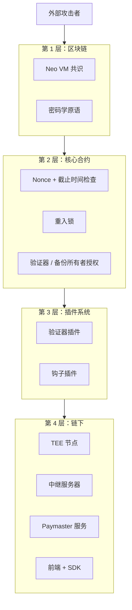
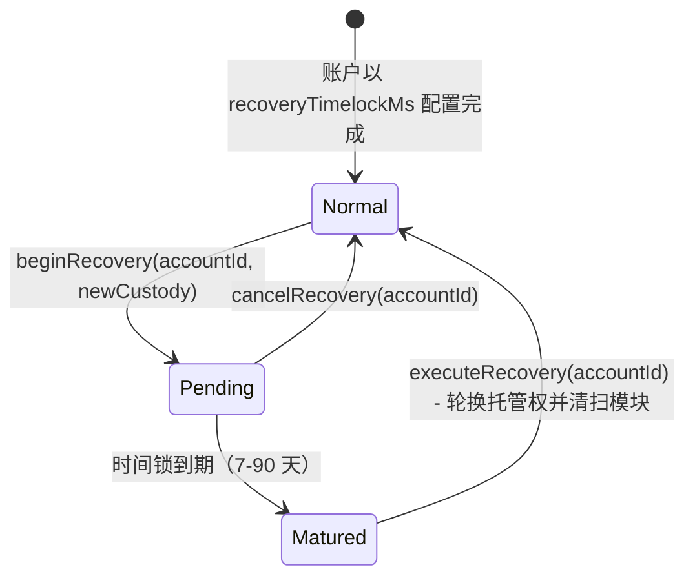

# Neo N3 Smart Account 安全模型

> 中文版本与 `docs/SECURITY_MODEL.md` 同构。若两者冲突，以英文版本为准。

## 运行时与权限版本（2026-10-09 收敛）

custom 已部署 `SmartAccount` 仍来自已测试主分支的 `public` 实现；其独立的 `PLATFORM` 构建保留 10 GAS 的有界验证器回调。两者都不是原生 SmartAccount 合约。原生 ABI 2 使用 1 GAS 验证器预算（位于 1.5 GAS 验证信封之内）、2.5 GAS 钩子 / 维护预算，以及显式的能识别 epoch 的模块打包。

原生恢复现在要求经过检查的权限 epoch 与配置 nonce 推进，在不调用旧模块的情况下摘除旧根 / 依赖，并保持身份、资产地址、执行 nonce 与冻结状态不变。所有模块存储使用 `0xA2 || policyPrefix || accountIdLE20 || authorityEpochLE64 || suffix`。原生四参数执行信封在未签名交易脚本中承诺这两个计数器，覆盖托管回退与原生交易见证；操作签名原像同样绑定它们。上一代密钥或签名无法通过重新安装模块而恢复。这与 `contracts/build/` 下固定版本工件携带的上一代逃生通道不同，后者的旧模块清理仍可能失败关闭。当前源码还提供无需回调的恢复通道 `beginRecovery` / `cancelRecovery` / `executeRecovery`（通过 `getRecoveryStatus` 读回）：到期后轮换托管权、在完全不调用插件的情况下清扫全部模块行，并推进 authority epoch；它不提供原生 epoch 模块的重新安装。规范规则见 `docs/proposals/SMARTACCOUNT-NATIVE-PROFILE-DRAFT.md`。

修订后的原生组合路径使用核心持有的、单操作回执：只有达到阈值的前若干个有效子项获得执行后权限。校验与执行后阶段仍会检查当前策略与所有活跃绑定固定值；Application 回执会重新创建，绝不复用 Verification 或另一个操作的回执。模块要求确切的当前配置指纹与显式的 Boolean 验证器组合标记。已发布的原生 P-256 配置把会话密钥与其标准账户见证映射到同一签名域，防止这两种表示提供彼此独立的投票。该规则并不建立对任意脚本账户的独立控制。

下文的历史回执标识其自身固定的 ABI 1、此前的 ABI 2 或custom 合约快照。它们不为修订后的 ABI 2 源码、SDK 或运行时背书。其三子 / 两批准 / 三域上限需要真实的 VM 预算证据，与有界策略证明分开。

## 执行摘要

Neo N3 Smart Account 系统实现了策略门控、基于插件的账户抽象架构。本文定义系统各层的威胁模型、信任假设、安全属性与纵深防御机制。

已部署合约配置与原生 SmartAccount 并不自动兼容。原生 NeoNativeVerifier、WhitelistHook、SessionKeyVerifier、DailyLimitHook 与 TokenRestrictedHook 的历史 ABI 1 配置，拥有针对真实见证、确切调用授权、延迟配置、回滚与清理的私有链证据。其余模块仍需各自的原生配置适配与验证。汇总证据见 `docs/reports/sa-native-restricted-validation-20261008.json`；详细范围见 `docs/proposals/SMARTACCOUNT-NATIVE-MODULE-PROFILES.md`。这些回执都不建立完整的密码学或编译器精化。

原生 SessionKey 配置使用规范的操作原像、真实的 P-256 签名与已登记的资产代理。其 Verification 时钟必须使用持久化的账本时间：当不存在持久化区块时，`Runtime.Time` 不可用。私有矩阵区分见证准入拒绝与持久化的 Application FAULT，并在受限转账返回 false 时检查真实的 GAS 转账回滚。普通的会话配置 / 撤销仍然是延迟的；即时冻结需要已配置的恢复权限方。这既不是即时撤销会话的承诺，也不是对任意代币语义的证明。轮换会保留已消耗的额度。把正数上限降到已支出金额之下，会阻止包括零金额在内的转账；在恰好等于上限时，零金额转账仍然允许。显式延迟撤销会清除密钥与额度，但保留轮换时间戳；而账户清理会移除所有会话前缀（旧配置中四个，修订后的原生 ABI 2 中六个）。原生前缀 `0x05` 保存规范签名域，与会话配置原子写入，并在发现过程中重新读取；缺失或畸形值会失败关闭，不回退到旧布局。原生前缀 `0x06` 保存规范的 UInt64 最近使用 Integer；元数据读取会把它投影回原始的三字段记录，避免在执行时反复写入描述。无效或缺失的时间戳会失败关闭，包括负数、溢出与非规范字节编码。历史生命周期矩阵覆盖四前缀布局；修订后的 ABI 2 要求针对两个拆分条目重新回放。附加作用域矩阵见 `docs/reports/sa-native-session-scope-validation-20261007.json`。零表示没有会话支出上限，而不是零额度。通配方法仍绑定到一个目标，但可以授权其整个价值流动面；会演练一次全额 GAS 转账。无上限的 Boolean-false HALT 会消耗 nonce 并更新最近使用元数据，而目标 FAULT 会回滚。有上限的 false 转账仍然出错。事件会暴露确切作用域与无上限标记。

历史 ABI 1 的回放表明，在重新授权之后，如果 nonce / 截止时间仍然允许，相同的签名字节会被恢复。ABI 2 关闭了该行为：每一次配置转换都会改变签名域中的 configurationNonce；恢复还会额外推进 authorityEpoch。重新授予同一公钥无法复活转换前的签名。ABI 2 矩阵必须保留旧字节并在重新授权后拒绝它们，然后接受一份新签名的操作。旧的 ABI 1 回执仍是历史证据，不得重新贴标签。

DailyLimitHook 的原生配置证据单独记录在 `docs/reports/sa-native-daily-balance-validation-20261007.json`。其净流出计量使用每个已配置代币的代理余额，而不是从目标返回值推断成功。false 结果不会留下持久化快照。固定窗口锚点不会在后续转账时滑动；滚动历史有显式的活跃记录上限。任意代币仍必须提供诚实的余额，且任意配置下的回调预算充足性仍未获证明。单代币五十记录的容量起初无法达到：重复的历史扫描在第 21 条记录上耗尽了回调预算。单遍求和 / 计数与执行后裁剪在不改变预算的前提下修复了该实测用例。诊断代币的真实余额写入验证了 false 结果的记账与超限回滚；它有意违反 NEP-17 成功语义，不是生产代币。嵌套 GAS 调用不会继承活跃目标的代理见证；该限制经过测试，未被放宽。负数与非 Integer 余额回复、查询出错以及查询 Gas 耗尽，在两条私有链的两个钩子阶段都会被拒绝。钩子后拒绝会回滚诊断代币的真实原始余额 / 模式存储，连同 nonce 与策略状态。通过延迟配置移除故障代币限制，可恢复一次成功的 GAS 操作且不再查询该代币。这是有界的恢复证据，不是即时可用性，也不是任意代币如实报告余额的证明。没有提高任何回调预算。

原生 TokenRestrictedHook 会拒绝与受限代币的直接交互，并拒绝通过其他目标观察到的任何受限代币净流出，独立于目标的返回值。其私有诊断路由器有显式的代币侧委托；它不继承原生代理见证权限。流入与净额为零的流动仍然允许。严格余额类型、查询出错、继承的 Gas 耗尽、原始存储回滚、延迟移除与双前缀清理都经过演练。缺失快照的拒绝有源码守卫与抽象证明；一项独立的、未改动 NEF 的宿主探针现可在已认证回调之间删除真实快照，并验证拒绝与父存储回滚。该诊断注入不是持久化的链上攻击。宿主还在两个阶段覆盖每一种 VM 栈项类型并给出代表性余额回复，并验证陈旧快照清理的隔离性。后阶段的类型拒绝会回滚诊断模式写入、账户 nonce 与临时快照。缺少阶段权限的直接调用以及宿主注入的畸形回调 Array 都会被拒绝。这些诊断注入并不建立畸形回调可通过原生解析器到达的结论。完整 NEF 的实测指令 / 条件边覆盖率为 83.64%/68.13%，低于完成阈值；这不是 C# 源码覆盖率。参见 `docs/reports/sa-native-nef-phases-validation-20261008.json`。任意代币的诚实性、毛额中间流动、大型配置集合与完整的 C#/NEF 分支覆盖，仍在本演示范围之外。

---

## 1. 威胁模型

### 1.1 攻击者

| 攻击者类型 | 能力 | 主要攻击向量 |
| --- | --- | --- |
| **外部攻击者** | 无私钥，可提交交易 | 重放、Gas DoS、抢跑、签名伪造 |
| **被攻陷的验证器** | 控制验证器签名密钥 | 未授权提取、绕过钩子 |
| **被攻陷的中继** | 可向 bundler/relay 提交 | 审查、抢跑、选择性中继 |
| **被攻陷的 TEE 节点** | 可访问 TEE 私钥 | 无限自动化交易 |
| **被攻陷的 Paymaster 赞助方** | 赞助钱包私钥 | 策略操纵、押金提取 |
| **被盗的冷钱包** | 备份所有者私钥 | 逃生通道接管 |
| **智能合约开发者** | 部署插件代码 | 逻辑缺陷、后门、恶意钩子 / 验证器 |

### 1.2 风险资产

| 资产 | 保护机制 | 威胁等级 |
| --- | --- | --- |
| **原生 Neo 代币**（NEO、GAS） | 验证器签名 + 钩子策略 + nonce | 高 |
| **NEP-17 代币** | 验证器签名 + 钩子策略 + nonce | 高 |
| **NFT / SBT** | 验证器签名 + 钩子策略 + nonce | 中 |
| **账户控制权**（验证器、钩子、备份所有者） | 时间锁、权限检查 | 关键 |
| **声誉 / 身份** | NeoDID 绑定 + 凭证钩子 | 中 |

---

## 2. 信任假设

### 2.1 第 1 层：Neo N3 区块链

| 假设 | 理由 | 违反后的风险 |
| --- | --- | --- |
| **NeoVM 是可靠的** | 代码执行是确定性的 | 全局共识失败 |
| **密码学是安全的** | secp256k1/r1 经过长期实战检验 | 通过算法弱点恢复私钥 |
| **共识故障界成立** | 拜占庭验证者保持在已部署共识协议容忍的故障界内 | 超出该界后安全或活性可能失效 |

### 2.2 第 2 层：核心合约

| 假设 | 理由 | 违反后的风险 |
| --- | --- | --- |
| **验证器插件是诚实的** | 签名即授权 | 恶意验证器抽干资金 |
| **钩子插件不审查** | 策略只拒绝，不修改 | 钩子阻断合法操作 |
| **备份所有者是安全的** | L1 逃生机制 | 无恢复路径的账户接管 |

### 2.3 第 3 层：插件生态

| 假设 | 理由 | 违反后的风险 |
| --- | --- | --- |
| **插件部署是经授权的** | 只有备份所有者可安装 | 未授权插件安装 |
| **TEE enclave 是安全的** | 硬件级隔离 | TEE 密钥泄露 |
| **中继是半诚实的** | 多个相互竞争的中继 | 审查或抢跑 |
| **Paymaster 有偿付能力** | 链上押金余额或链下 Gas 赞助 | 押金耗尽导致交易失败 |
| **Paymaster 策略是诚实的** | 赞助方控制策略创建 | 赞助方可随意撤销 / 使策略过期 |

### 2.4 第 4 层：前端与 SDK

| 假设 | 理由 | 违反后的风险 |
| --- | --- | --- |
| **用户设备是安全的** | 私钥存储 | 恶意软件窃取密钥 |
| **RPC 端点是诚实的** | 交易提交 | 交易审查 |
| **Supabase 是安全的** | 草稿 / 协作存储 | 草稿被操纵 |

---

## 3. 各层安全属性

### 3.1 核心合约层

| 属性 | 实现 | 缓解的威胁 |
| --- | --- | --- |
| **完整性** | 状态位于 `SmartAccount` | 无部署者无法修改合约 |
| **机密性** | 账户抽象本身不提供机密性保证 | 交易与已存储合约数据是公开的；不得把机密放上链 |
| **可用性** | 不按账户部署合约 | 单点故障 |
| **不可否认性** | Nonce + Deadline | 发送方无法否认交易 |
| **重放保护** | Nonce + 网络 ID + Deadline | 无法在同链 / 跨链重放 |
| **操作形态** | 目标 / 方法 / 参数 / 序列化 / 签名 / 批次边界 | 在执行之前拒绝畸形与放大资源的输入 |

### 3.2 验证层

| 属性 | 实现 | 缓解的威胁 |
| --- | --- | --- |
| **认证** | 验证器签名校验 | 未授权操作被拒绝 |
| **授权** | 备份所有者 / 验证器分离 | 阻止权限提升 |
| **新鲜性** | 按通道的 nonce 游标与截止时间 | 拒绝重放与乱序操作 |
| **跨链隔离** | 载荷中的 `Runtime.GetNetwork()` | 无法跨网络重放 |

### 3.3 策略 / 钩子层

| 属性 | 实现 | 缓解的威胁 |
| --- | --- | --- |
| **转账限额** | `DailyLimitHook` | 缓解大额盗取 |
| **目标白名单** | `WhitelistHook` | 阻断与欺诈合约的交互 |
| **代币限制** | `TokenRestrictedHook` | 阻断未授权代币转账 |
| **凭证门控** | `NeoDIDCredentialHook` | 阻断未验证用户 |
| **可组合性** | `MultiHook` | 组合策略以 AND 逻辑执行 |

### 3.4 恢复层

| 属性 | 实现 | 缓解的威胁 |
| --- | --- | --- |
| **L1 回退** | 备份所有者原生见证 | 验证器失效恢复 |
| **延迟接管** | 逃生时间锁（7–90 天） | 阻止即时接管 |
| **活跃取消** | 只有带当前备份所有者见证的成功操作才能取消逃生 | 仅验证器操作无法取消恢复 |
| **可审计性** | 记录逃生事件 | 恢复尝试可见 |

---

## 4. 纵深防御架构

### 第 1 层：区块链原语
- **NeoVM：** 确定性执行，有界 Gas
- **密码学：** secp256k1（EVM）、secp256r1（Passkey/TEE）、SHA256、Keccak256

### 第 2 层：核心合约
- **Nonce + 截止时间：** 重放保护
- **执行锁：** 防重入，在已部署核心上以 `isExecutionActive(accountId)` 读取
- **验证上下文：** 把 `CheckWitness(accountId)` 限制在执行上下文内
- **权限分离：** 验证器（谁）vs 钩子（做什么）vs 核心（如何做）

### 第 3 层：插件系统
- **验证器隔离：** 无状态，不直接访问状态
- **钩子门控：** 执行前 / 后策略
- **权限校验：** `getAuthorizedModuleId` 阶段解析加上模块侧的 `ValidatorAuthority` / `HookAuthority` 检查
- **模块生命周期：** 带事件的时间锁更新

核心在两个阶段都向钩子回调传入单一规范操作元组：`[TargetContract, Method, Args, Nonce, Deadline, Signature]`；账户 id 仍是独立的回调参数。这防止钩子校验一种操作表示却计量另一种。执行后回调会收到已认证操作与目标结果的分离副本，因此验证器或钩子无法改写后续用于执行事件或赞助结算的操作。`MultiHook` 还会为每个子钩子重新序列化目标结果，防止某个策略叶子改变下一个叶子观察到的结果。一条真实的 NeoVM 回归向量确认 `WhitelistHook` 接受已签名目标、在派发之前拒绝未列出目标、并在拒绝时回滚 nonce。回调结果必须跨过 Neo StdLib 序列化边界：Null、Boolean、Integer、ByteString、Buffer、Array、Struct 与 Map 等普通 VM 值会被复制，而 InteropInterface 值（包括迭代器与存储上下文）、Pointer 值、环状图与重复容器引用会在执行后回调之前失败关闭。该错误会使外层调用回滚目标写入与 nonce 状态；交易费用仍可被收取。

### 第 4 层：链下基础设施
- **TEE 证明：** 硬件信任根（未来）
- **中继多样性：** 多个相互竞争的中继防止审查
- **Paymaster 策略：** 链下赞助规则
- **前端净化：** 输入校验、错误信息裁剪

---

## 5. 关键安全不变量

### 5.1 必须成立的不变量

1. **Nonce 单调性：** 同一通道内 nonce 绝不减少
2. **确定性地址：** 相同 `accountId` 始终解析为相同地址
3. **重放防护：** 同一操作无法执行两次
4. **上下文隔离：** `CheckWitness(accountId)` 只在 `executeUserOp` 期间有效
5. **逃生原子性：** 要么完整完成，要么完全不发生
6. **市场托管互斥：** 托管期间阻止逃生 / 主动变更

### 5.2 应当成立的不变量

1. **验证器的 Gas 限制：** *（依赖配置）* 私有 `PLATFORM` 核心在匹配的运行时上为每个验证器回调使用 10 GAS 子预算。`public` 使用标准 `System.Contract.Call`，没有子预算；生命周期准入、模拟与交易费用上限都不能建立这一预算。历史私有运行时证据在源码 / 运行时变化之后需要重新验证。
2. **插件状态清理：** *（部分）* 当前结算会清除已知插件标记，并拒绝清单缺少 v4 生命周期 ABI 的模块；对任意未来插件的语义清理 / 精化覆盖仍待完成。每个 validator 与 hook 都必须实现 `onUninstall`：核心从 `confirmConfiguration`、逃生通道与 `settleMarketEscrow` 无回退地调用它，而对缺失方法的嵌套调用会以不可捕获的方式使外层交易出错。`SocialRecoveryService` 源码现已实现它（核心门控，oracle 额度退还给恢复所有者，已消耗的动作 nullifier 保留作为重放保护）。记录为 TestNet 与 MainNet 已部署的恢复验证器工件早于该方法，因此绑定到已部署实例的账户在该实例通过其时间锁 `proposeConfiguration`/`confirmConfiguration` 路径升级之前，无法轮换离开它、完成逃生或被出售。在较新的核心候选上，无需回调的永久仅所有者恢复提供了重新获得账户执行权的替代方案；它不会退还旧插件保留的额度。
3. **会话密钥撤销：** *（已定义）* 撤销在规范的交易执行顺序上生效；后续校验不会再看到活跃密钥，并发出 `SessionKeyRevoked`。没有任何协议组件承诺内存池取消，或对链上更早执行过的操作进行追溯作废。
4. **转账来源计量：** 虚拟账户的资产位于核心推导的代理脚本哈希（`getProxyScriptHash(accountId)`），而不是 `accountId`。固定或计量转账来源的验证器或钩子必须与该代理地址比对；`SubscriptionValidator` 与 `DailyLimitHook` 正是如此，且来源等于 `accountId` 会被直接拒绝。
5. **插件级见证检查需要可达作用域：** 验证器或钩子作为核心的嵌套调用运行，因此其内部的 `Runtime.CheckWitness`（例如 `SubscriptionValidator` 中的商户检查）只能看到作用域可达该插件的签名方。`CalledByEntry` 止步于核心并会被拒绝；私有链验证记录了这一错误，以及使用可达作用域成功的拉取。商户应以 `CustomContracts` 把其签名方限定到验证器，而不是签署 `Global`。

### 5.3 凭据代次通道

三个记录各自携带一个代次，且它们不是同一个计数器。签名绑定其路由所命名的那个记录，因此把它们
归并成一个默认值是安全缺陷、而非便利：

| 路由 | 绑定的代次 | 记录 |
| --- | --- | --- |
| 内置消息签名方（`validatorId` 0） | 账户的 `SubjectRevision` | 0x57 |
| 已安装验证器实例 | 该实例的 `CredentialGeneration` | 0x52 |
| 活跃阈值策略 | 该策略的 `CredentialGeneration` | 0x5B |

- **内置代次不是常量 1。** 每一次提交的安全配置、凭据撤销、冻结／解冻、恢复与 custody 变更都会
  推进 `SubjectRevision`；没有 0x57 主体记录的账户只在第一次此类变更之前才是代次 1。把已移动的
  账户当作 1 的客户端会推导出核心从未产生过的签名域与 nonce 通道，于是内置路由以自身的无效签名
  结果拒绝该消息，而已安装验证器或策略路由以 `SA_CREDENTIAL_STALE` 故障——两者都是被拒绝的操作，
  而不是中继方可以掩盖的可重试 nonce 不匹配。
- **代码与凭据推进不同的计数器。** 重新绑定模块代码推进的是 `moduleRevision`。只有
  `revokeCredentials`（custody 授权、无回调）会废弃已安装实例的凭据代次；只有策略重写会推进阈值
  策略的代次，它携带旧值再自增，因此重塑永不重置为 1。
- **代次由核心解析，不由调用方臆测。** `getNonce` 在内部读取路由的代次并给出核心真正会使用的
  通道；调用方可以把自身的推导与这一答案交叉校验，但不得另外推导替代值。
- **离线构建器必须被告知。** 无链上访问的代次／摘要构建器在构造上无法读取 `SubjectRevision`，
  因此它要求显式传入 `credentialGeneration`，缺失时即报错。默认为 1、默认为 2，或假定
  `getAccount` 会公布修订号，都不成立：每一种都会对账户从未使用的命名空间产生一个格式良好的
  签名。只有在明确记录“该账户从未推进”的已复核新账户 fixture 中，硬编码 1 才可接受。

### 5.4 主体键、主体匹配与 custody 溯源

- **两个 0x57 键，两种宽度。** `0x57 ‖ accountId`（21 字节）是规范的 `MessageSubjectRecord`：
  最多 16 个主体、一个阈值与 `SubjectRevision`。`0x57 ‖ accountId ‖ 0x01`（22 字节）是仅由核心
  写入与删除的内部溯源标记，永远不是第二个主体行。规范键保持 21 字节——加宽到 22 会搬移每个既有
  账户的记录，并静默改变一个已复核的键。
- **主体匹配只接受两种宽度。** 32 字节主体必须精确等于签名方验证脚本的原始 `SHA256`；20 字节
  主体必须精确等于签名方的账户地址（`RIPEMD160(SHA256(script))`，即 N3 脚本哈希）。其他宽度
  一律不匹配。两种形式都对 `messageDigest` 执行同一个 ECDSA 检查，因此混合使用是允许的，且
  两者都不是更弱的身分主张。
- **custody 派生的溯源被记录，而非被推断。** 注册时写入 `Subjects = [custody]`、阈值 1、
  `SubjectRevision` 1 以及那个 22 字节标记。custody 轮换仅在**该标记存在时**重写主体集合并推进
  修订号。缺少标记意味着溯源未知：主体集既可能是通过主体意图显式配置的，也可能是早于该标记的
  历史默认主体状态。运行时对两者都不做推断——它只是不轮换——且即便某个主体恰好等于旧 custody
  地址，也不会被解读为显式委托的证据：地址相等从不用于推断溯源。标记存在但取值异常是完整性
  故障，不是轮换信号。逃生与账户拆除会同时删除这两个键。

### 5.5 已复核工件身份，以及重新 pin 不是什么

2026-11-21 对 custom `public` 工件的已复核重建是 NEF `397f96ab…` 与 manifest `4939cf01…`；
单独的 `PLATFORM` 构建是 `7d5fad65…` / `296a3ad4…`，不是这些 pin 所描述的工件。已刷新的证据
是逐项枚举的，而非整体声明：精化套件的 NEF / manifest / 偏移 pin、golden vectors、gas 回执、
initializer 源码清单、source-lock 与可复现性报告已重新锚定到那些字节，它们暴露出的重编号是
在模型里修正的、而不是在观测里：
槽 58（而非 38）承载 `Prefix_TransactionReimbursement`，编解码 token 是 `deserialize` 2 /
`serialize` 3（而非 3 / 4）。

组合 helper 证书已在 Rocq 9.0.1 上针对当前工件重新签发，依赖它的组合证明也随该次签发重新
生成。回执 `formal/refinement/fixtures/current-method-proof/method-proof.json`（摘要
`a4bd1854…`）绑定 NEF `397f96ab…`、完整 helper `[36586,36867)`（281 字节、116 条指令）、
方法摘要 `9aec81b7…`、证书摘要 `f339b6ec…` 与 `CapMethodVm` 模型 `5ac5fa2c…`。回执记录
`kernelChecked: true`、`referenceRefinementVerified: true` 与
`fullImplementationVerified: false`：`coqc` 与 `coqchk -silent` 干净，111 条闭合假设全部枚举，
六个语义对照均被拒绝，以及组合、上下文、公开纯函数与 gas 泳道套件（`test_composition_proofs.py`、
`test_context_proofs.py`、`test_public_pure_proofs.py`、`test_gas_proofs.py`）28/28 通过。
该结果只认证有界的 helper 及其参考精化，不证明整个实现、ApplicationEngine 组合、原生二进制
编解码或 gas 记账、调用方可达性、81 个公开 ABI 入口点，也不证明 initializer 执行。initializer
的 `CapContext` 仍未覆盖建立 v4 `UInt64Mask` 静态槽所用的 `PUSHINT8`/`SHL`/`SUB` 写入；该泳道
由 Task 26 处理中，尚未闭环。

那次刷新不改变代理转账边界。当前 custom Verification 内核精确接受四种交易形态：两参数的
`executeUserOp`/`executeUserOps` 调用与五参数的 `executeSponsoredUserOp`/`executeSponsoredUserOps`
包装（各自含单条与批量），且运行时套件在真实代理见证下驱动了确切的五参数 sponsored GAS
转账信封，同时拒绝追加调用、为其他账户 / 核心构造的调用以及非代理费用支付方。这是内核接受，
不是 relay 或部署层支持：relay 路由尚未迁移到 v4，历史部署回执描述的是更早的部署、不是本 v4
源码的证明，且没有任何当前源码的链上回执断言一次真实的 sponsored proxy transfer 结算。刷新
哈希永远不会把内核接受或那些历史回执变成已被接受的部署能力。

---

## 6. 攻击面分析

### 6.1 已知漏洞

| ID | 严重性 | 组件 | 描述 | 状态 |
| --- | --- | --- | --- | --- |
| **VULN-001** | 关键 | **验证器 Gas DoS** | `public` 允许生命周期兼容的验证器回调通过标准 `Contract.Call` 执行而没有子预算 | 对公开任意验证器赞助仍然开放；当前私有 `PLATFORM` 工件拥有有界回调的 NeoExpress 证据与 RPC 回读 |
| **VULN-002** | 高 | **逃生通道绕过** | 市场结算会有意清除逃生；所有者取消受时间锁约束 | 源码候选、范围受限的 Coq 治理 / 恢复模型与私有 NeoExpress 逃生 / 市场场景已验证；TestNet/MainNet 部署一致性仍待完成 |
| **VULN-003** | 中 | **会话密钥排序** | 已签名操作可能在后续撤销交易被排序之前执行 | 已定义执行顺序语义；残余的打包前运营风险 |
| **VULN-004** | 中 | **MultiSig 组合边界** | 空、超长、无效阈值、重复、自引用、不完整子项与签名域复用等配置 | 有界 Coq 策略 + 571 项 VM 测试 + 私有 NeoExpress 子清单 / 域预检与重新校验；已发布配置的密码学向量已覆盖，但私钥独立性无法从公钥推断，任意未来插件仍是已声明的信任边界 |
| **VULN-005** | 中 | **插件状态孤立** | 结算清理是有限的，并未对每个插件获得证明 | 核心持有的叶子依赖注册表、清单生命周期预检与失败关闭清理闭合了已发布的 MultiSig/MultiHook 叶子配置；任意未来插件的存储 / 精化覆盖仍然开放 |
| **VULN-006** | 低 | **Nonce 通道边界** | 可执行 nonce 在非负有符号 NeoVM Integer 范围内使用 191 位通道 + 64 位序列 | 当前源码在 `IsNonceAcceptable` 中显式以 `Invalid channel` 拒绝负数与越界通道。重放 / 序列属性与按通道独立性由单元测试（`AAFormalCorrespondenceRuntimeTests.cs`）与 Coq 模型 `NativeIntegerDomain.v` 验证；后者证明了分解、游标隔离与耗尽属性。私有 NeoExpress 证据（15 个场景）未直接演练这些负数 / 不变量检查，但它们由测试套件与形式化模型覆盖；公开 ABI 迁移与已固定公开基础工件的回读仍然开放。 |
| **VULN-007** | 高 | **平台所有者轮换** | 已固定的公开 ABI 允许受信平台注册方立即更改 `BackupOwner` | 已实现延迟提案 / 确认 / 取消，含当前所有者取消与新所有者见证；最终源码构建工件的私有 NeoExpress 状态不变性、事件、持久化与代理地址检查均已通过；公开 ABI 迁移与公开部署回读仍待完成 |

**VULN-001 闭合门禁：** 交易级 Gas 上限或自愿的 `Runtime.GasLeft`/`BurnGas` 计量都不足够。当前私有工件改为使用平台级的 `System.Contract.CallWithGasLimit` 能力。其 1,000,000,000 datoshi（10 GAS）预算在计数器变更之前向子项及其每个祖先计费；普通嵌套调用会继承该预算，费用白名单无法绕过它。匹配的核心通过 9/9 定向向量与 1,435/1,435 全量单元测试。匹配的 SA 工件通过 571/571 合约测试，当前私有 NeoExpress 回执会把燃尽型验证器与钩子回调驱动到有界 Gas 错误，并伴随 nonce / 配置回滚与 25 工件 RPC 回读一致性。参见 `docs/reports/sa-neoexpress-validation-20261031.json`、`docs/reports/sa-private-artifact-provenance-20261031.json`、`docs/reports/sa-platform-gas-cap-20260921.json` 与 `docs/reports/sa-neoexpress-gas-cap-20260921.json`。VULN-001 对该私有集成工件已缓解；公开激活与部署仍待完成。这些带日期的回执描述的是当时测试的私有工件，而不是当前的公开 `contracts/bin/public` 构建。源码锁定把 `VerifierGasBudget.v` 限定到有界 `PLATFORM` 与原生回调；原生 ABI 2 使用独立的 1 GAS 验证器预算与 2.5 GAS 钩子 / 维护预算。形式化运行通过并不能闭合公开 VULN-001。

**公开准入策略：** 链上生命周期 ABI 预检是兼容性检查，不认证模块的可信度、资源使用、升级策略或嵌套依赖。无需许可的账户配置并不迫使中继赞助该配置。公开赞助方必须限制其交易暴露，并且只准入经审阅的验证器 / 钩子配置，包括可变子模块与升级权限；它必须在签名之前重新检查配置与模拟。缺少经审阅的准入策略，意味着任意模块赞助尚未做好生产准备。这些运营控制降低了赞助方暴露，但不宣称拥有只有私有运行时才能提供的不可绕过回调预算。

**组合生命周期：** 只有在同一账户与模块种类处于确切已安装根配置上下文、且全局上下文深度为一时，市场结算才可以在托管仍然活跃时清除依赖。依赖替换与无作用域的根调用仍会被托管阻止。清理故障会回滚更早的叶子清理、卖方付款与所有权变更。PLATFORM 结算使用既有的根维护预算；公开 profile 保留标准合约调用。MultiSig 只准入暴露安全 `supportsComposition` 标记（返回 false）与安全签名域 ABI 的子项。域值在执行期间读取，因此所有者仍可在配置其密钥之前发布叶子名单。缺失能力声明与嵌套 MultiSig 实例都会被拒绝。已存储的不受支持嵌套名单不会由该准入修复迁移；它们保持失败关闭，并需要另行评审的恢复变更。带日期的工件与私有链报告不为其记录的输入快照之后的源码变更背书。

**见证 / 回调证据边界：** 运行时套件现覆盖有界代理脚本形态向量（错误账户、任意 / 非数据指令、诱饵 / 全局签名方与费用支付方情形）以及已发布钩子回调元组，交易脚本形态解析器本身拥有闭合的 Coq 模型（`formal/coq/ProxyWitnessScript.v`），证明被接受的脚本是数据压栈后紧跟唯一预期的核心调用，并绑定账户 id 与核心哈希。有界回调模型（`formal/coq/CallbackPluginTopology.v`）还证明了六字段回调绑定、经由钩子与验证器执行后回调的完整成功顺序、CalledByEntry/Custom 目标绑定，以及失败关闭的清理 / 轮换不变量。这些是实现证据加抽象证明，不是对 NeoVM 见证条件求值、签名方作用域、密码学原语、任意插件或 C# 到 NEF 回调精化的形式化证明。隔离的 NeoExpress 回执现在还以独立有界的验证器与钩子回调，加上一笔手工构造、P-256 签名的交易来驱动具体边界：一个真实的代理验证脚本由作用于 SA 核心与 `NeoDIDRegistry` 的 `WitnessRules` 签名方携带，消耗一张动作票据，并拒绝同 nullifier 重放与 action-id 重定向。该回执部署 25 个工件、运行 15 个场景，并通过 RPC 以逐字节一致的 NEF 脚本、匹配的校验和与语义相等的清单回读每个已部署工件。这只是私有链证据；它不证明任意见证规则、密码学、完整 NeoVM 语义或公开部署一致性。同一回执还包含裸 P-256 WebAuthn/TEE 载荷向量、真实的临时密钥 Web3Auth EIP-712 与直接摘要 secp256k1 路径、委托 ZkLogin 提供方 / nullifier 绑定，以及被禁用的 ZKEmail 失败关闭路径。Web3Auth 结果覆盖已发布的 NeoVM/CryptoLib 验证路径，而不是托管的 OAuth 仪式。形式化 `NeoVmCallSubset.v` 模型只闭合与代理相关的有界指令形态；完整的 NeoVM/ApplicationEngine 语义仍在该模型之外。核心还会在 nonce 消耗或外部派发之前拒绝超长的验证器签名与参数数组。这仅是输入放大缓解；它无法限制一个已经在共享 NeoVM Gas 预算内执行的验证器。对已知规范 TestNet/MainNet SA 核心哈希的一次只读 RPC 比对还发现其 NEF 脚本与当前本地工件不同。这是检测到的部署漂移，不是当前工件的部署证明；未执行任何公开写入。

### 6.2 已缓解的攻击向量

| 攻击 | 缓解措施 | 状态 |
| --- | --- | --- |
| **签名重放** | Nonce + 网络 ID + Deadline | ✓ 已缓解 |
| **重入** | 执行锁 + 上下文隔离 | ✓ 已缓解 |
| **跨链重放** | 所有载荷中的 `Runtime.GetNetwork()` | ✓ 已缓解 |
| **抢跑** | Nonce 防止同一操作复用 | ✓ 已缓解 |
| **钩子审查** | 钩子只拒绝，不修改 | ✓ 已缓解 |
| **验证器绕过** | 所有调用上的权限检查 | ✓ 已缓解 |
| **市场托管审查** | 备份所有者受时间锁约束的 `initiateMarketEscrowCancel` / `forceCancelMarketEscrow`；市场的 `abandonListing` 回调会通过市场清单预检，因此被销毁、已升级掉该方法、缺方法或抛错的市场无法阻断逃生 | ✓ 已缓解（见下方边界） |
| **Paymaster 抢跑** | 链上原子结算；链下决策先于提交 | ✓ 已缓解（链上）/ 部分缓解（链下） |
| **Paymaster 押金抽干** | 单操作限额 + 每日预算 + 总额预算 | ✓ 已缓解 |
| **RPC 审查** | 多个中继 + 客户端侧广播 | ✓ 已缓解 |

**市场托管信任边界：** 进入托管会把结算权限委托给市场合约。`settleMarketEscrow` 与 `cancelMarketEscrow` 完全由 `CallingScriptHash == marketContract` 授权，因此备份所有者曾经列出的恶意市场可以把账户结算到它选择的任意地址；不需要所有者动作。因此所有者逃生能防御被销毁、未带 `abandonListing` 升级、永不结算或抛错的市场。它不能防御在其自身 `abandonListing` 内部中止的市场，也不可能做到：NeoVM 的 `ASSERT`/`ABORT` 错误不可捕获，且不存在调用点守卫。请只在经审计的市场上列出账户；已发布的 `SAAddressMarket` 会白名单它信任的核心，同样的白名单纪律也适用于反方向。

---

## 7. 密码学安全

### 7.1 签名方案

| 方案 | 曲线 | 密钥长度 | 安全级别 | 用途 |
| --- | --- | --- | --- | --- |
| **Neo 原生** | secp256r1 | 256 位 | | 备份所有者 |
| **EVM/EIP-712** | secp256k1 | 256 位 | | Web3Auth |
| **WebAuthn/Passkey** | secp256r1 | 256 位 | | 生物识别 |
| **TEE** | secp256r1 | 256 位 | | 自动化代理 |
| **会话密钥** | secp256r1 | 256 位 | | 临时委托 |

### 7.2 哈希函数

- **SHA256：** 大多数验证器用于载荷哈希
- **Keccak256：** 用于 `Web3AuthValidator` 的 EIP-712 兼容
- **Web3Auth ERC-1271：** 直接 32 字节摘要恢复需要 `HF_Huyao` 或更高版本。Huyao 之前的兼容实现不强制规范的 `r`/`s` 边界，位于经审阅的部署配置之外。
- **Nonce 存储：** 可执行 nonce 使用 191 位通道与 64 位序列。原生配置的键为通道保留 24 字节且最高位清零；游标 `2^64` 是显式的耗尽哨兵。当前custom 源码把有符号 VM 边界应用于通道读取；已固定的公开基础工件在重新发布之前可能保留更宽的旧读取边界。

### 7.3 重放保护机制

1. **Nonce：**
   - 规范二维形式：`channel = nonce >> 64`、`sequence = nonce & (2^64 - 1)`
   - 核心拒绝负数与超宽值；每个通道恰好前进一步

2. **截止时间：**
   - 绝对时间戳（`Runtime.Time`）
   - 执行时必须仍在未来

3. **网络 ID：**
   - `Runtime.GetNetwork()` 纳入载荷哈希
   - 防止跨链重放

---

## 8. 运营安全

### 8.1 中继服务器安全

| 机制 | 目的 |
| --- | --- |
| **速率限制** | 防止请求洪泛型 DoS（10 次 / 分钟） |
| **请求持久性** | 通过去重防止重复提交 |
| **输入校验** | 脚本哈希白名单、原始交易边界 |
| **错误净化** | 从错误响应中剥离敏感信息 |
| **先模拟** | 广播之前校验以节省 Gas |

### 8.2 Paymaster 安全

#### 链上 Paymaster（`SAPaymaster`）

| 机制 | 目的 |
| --- | --- |
| **押金支撑** | 只有在预先存入 GAS 时才可能赞助 |
| **策略执行** | 按账户或全局策略，带目标 / 方法限制 |
| **单操作限额** | `MaxPerOp` 限制已结算的赞助方报销，而不是外层交易费用 |
| **每日预算** | 按已解析策略作用域的滚动 24 小时结算上限；全局策略要求在所有受赞助账户之间共享正数预算 |
| **总额预算** | 按已解析策略作用域的终身结算上限，带溢出保护 |
| **到期时间戳** | 策略在 `ValidUntil` 自动过期 |
| **仅核心结算** | 只有经授权的 SA 核心合约可以调用 `settleReimbursement` |
| **检查-生效-交互** | 在向中继转移 GAS 之前先扣减押金 |
| **原子执行** | 策略检查或 GAS 转账失败时结算回滚 |

#### 链下 Paymaster（Morpheus）

| 机制 | 目的 |
| --- | --- |
| **API Token 认证** | 防止未授权赞助 |
| **链下校验** | 在提交链上之前应用业务规则 |
| **网络隔离** | Testnet/Mainnet 分离 |
| **原因披露** | 向用户解释拒绝原因 |

**报销上限与费用估算：** 对于承载费用的交易，每个核心保留一条有界的 `(交易哈希, 预留金额)` 记录。每个受赞助的单条或批量条目在任何外部调用之前预留 `min(request, max(transaction.SystemFee + transaction.NetworkFee - reserved, 0))`，并拒绝零结果。因此顺序、嵌套与跨账户 / Paymaster 的条目会在该核心内共享一个费用上限。不同的交易哈希会重置该记录；任何应用层错误都会连同余额与 nonce 变更一起回滚预留。独立的已部署核心不共享该账本。Paymaster 的单操作、每日与总额限制会额外适用于已结算金额。

零费用 RPC 估算会在每个请求金额上执行策略与结算两条路径。它有意高估报销，并不是零费用持久化交易规则。费用算术没有估算提前返回，但存储初始化、记录重置与序列化大小仍会影响 Gas。中继必须模拟完整调用并保留费用余量；旧的单操作回执与 VM 夹具都不能证明确切的生产定价。

### 8.3 TEE 安全

| 机制 | 目的 |
| --- | --- |
| **硬件证明** | *（未来）* 验证真实的 TEE 执行 |
| **TEE 内策略执行** | 复杂逻辑在链下，签名在链上 |
| **会话密钥签发** | TEE 绑定的临时委托 |

---

## 9. 恢复与紧急访问

### 9.1 恢复流程

入口都接收账户 id；`beginRecovery` 还接收将要轮换到的托管权，`getRecoveryStatus` 以
`[exists, initiatedAt, matureAt, authorityEpochAtInit, newCustody]` 回读待处理记录
（`contracts/native/SmartAccount/SmartAccount.cs`；`contracts/build/` 下固定版本的工件是较早的双入口形态）。

### 9.2 安全属性

| 属性 | 保证 |
| --- | --- |
| **延迟接管** | 账户创建时固定的 7-90 天最短时间锁 |
| **显式取消** | `cancelRecovery`（托管权或恢复授权方）删除记录；同时只能有一条待处理记录，计时永不重置 |
| **审计轨迹** | `RecoveryInitiated` / `RecoveryCancelled` / `RecoveryExecuted`，以及复用的 `EscapeInitiated` / `EscapeCancelled` / `EscapeFinalized` 镜像 |
| **不可绕过** | *（部分）* 市场结算会删除待处理恢复记录，并保留自己的结算权限 |

执行阶段不调用任何回调：`executeRecovery` 拒绝过期的 `authorityEpochAtInit`，
在不调用任何 validator、hook、Market 或 Oracle 的情况下清扫全部模块实例、阈值策略、hook 顺序、
消息主体、待处理意图、nonce 通道与待处理迁移状态，然后轮换托管权、清空恢复授权方、
重新启用内置授权并推进 authority epoch、configuration nonce 与控制修订号。
因此其活性不依赖任何插件配合。恢复不是退还插件持有资金、撤销外部授权、结算市场托管
或移除独立核心升级管理员的承诺。

---

## 10. 合规与隐私

### 10.1 隐私属性

| 数据 | 在链上 | 公开 | 说明 |
| --- | --- | --- | --- |
| **验证器公钥** | ✓ | ✓ | 签名校验所需 |
| **钩子策略** | ✓ | ✓ | 白名单 / 规则可见 |
| **交易历史** | ✓ | ✓ | 账本透明 |
| **用户身份** | ✗ | 仅链下（DID） | |
| **会话密钥** | ✓（公开） | ✓ | 临时委托可见 |

### 10.2 监管考量

| 要求 | 支持方式 |
| --- | --- |
| **KYC/AML 集成** | 通过 `NeoDIDCredentialHook` |
| **制裁筛查** | 通过 `WhitelistHook` |
| **交易监控** | 通过中继服务器日志 |
| **恢复标准** | L1 时间锁逃生通道 |
| **用户主权** | 备份所有者授权延迟恢复；当前源码提供插件清理成功或永久仅所有者恢复两种路径 |

---

## 11. 未来安全增强

### 11.1 关键优先级

1. **验证器 Gas 限制：** 发布 / 激活匹配的 Neo 核心与 DevPack，然后验证目标节点的 NEF / 清单 / 运行时一致性；不要依赖 ABI 的 Gas 参数或自愿的验证器计量。
2. **私有工件精化：** 当前私有工件具备源码到工件证书、严格的 NEF / 清单结构测试与 NeoExpress RPC 回读；公开部署一致性被有意排除在外。
3. **会话密钥取消的用户体验：** 中继与钱包必须在提交之前重新检查规范密钥状态；取消不是链级回滚原语。

### 11.2 中等优先级

4. **TEE 证明：** 集成远程证明校验
5. ~~**Paymaster 质押：**~~ 已解决——`SAPaymaster` 合约提供链上押金支撑的赞助
6. **插件审计体系：** 经审核的插件市场

### 11.3 低优先级

7. **协议一致性：** 使用兼容有符号 Integer 的 nonce 向量（`0 <= nonce < 2^255`）、UTF-8 方法边界与嵌套参数限制；不要声称无符号 256 位 ABI
8. **按账户限速：** 中继中的按账户限制
9. **形式化验证：** 对完整 NeoVM / 编译器精化边界与第三方插件行为的独立评审仍是可选的外部审计项；有界的私有配置门禁是当前且通过的。

---

## 12. 参考资料

- **ERC-4337:** https://eips.ethereum.org/EIPS/eip-4337
- **ERC-7579:** https://eips.ethereum.org/EIPS/eip-7579
- **Neo 文档:** https://docs.neo.org/
- **协议审计:** `docs/PROTOCOL_COMPLETENESS_AUDIT.md`
- **形式化验证:** `docs/SA-FORMAL-VERIFICATION.md`
