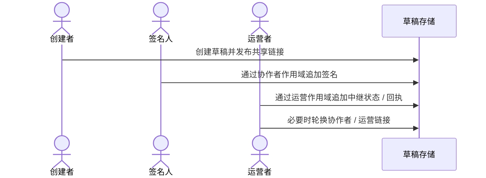
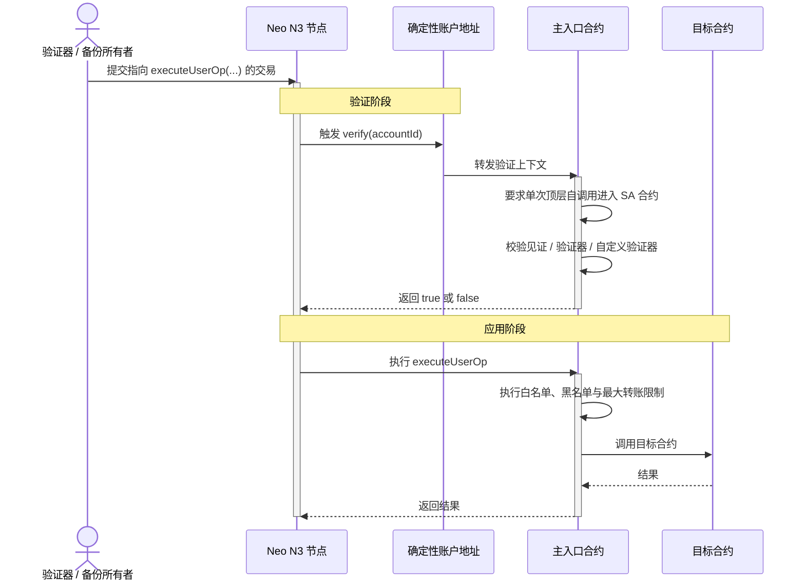
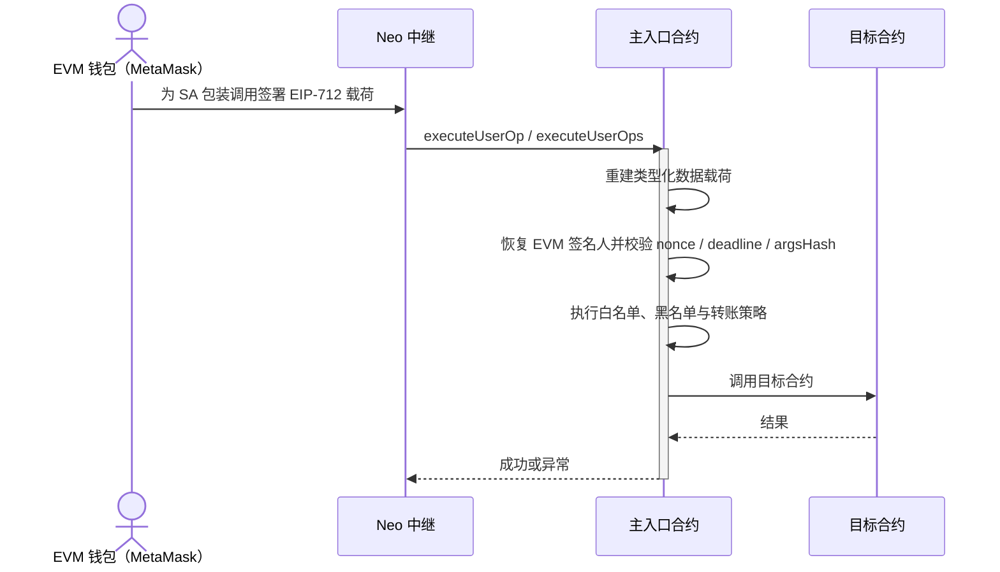

# Smart Account 工作流生命周期

Neo N3 Smart Account 的工作流把用户意图通过主合约转为经过验证的链上执行。2026 年 3 月 6 日加固更新之后，确定性代理见证只对一次顶层自调用回 Smart Account 合约有效。这意味着由代理直接签名的外部代币转账会被拒绝，而 V3 通过 `executeUserOp(accountId, op)`（批量时为 `executeUserOps(accountId, ops)`）执行。V1/V2 的 `executeUnified` 与 `executeUnifiedByAddress` 包装在 V3 重写中已移除，在任何已部署清单与合约源码中都不存在。

> 中文版本与 `docs/WORKFLOWS.md` 同构。若两者冲突，以英文版本为准。

## 首页操作工作台

首页操作工作台是日常使用最快的路径。用户可以载入 Smart Account、暂存 SA 调用、持久化不可变共享草稿、收集 Neo + EVM 混合批准，然后选择最终提交路径。对于客户端 Neo 执行，工作台会针对 SA 合约暂存一个具体的 `executeUserOp` 调用，而不是让钱包直接指向下游目标合约。

当前支持两种广播模式：

- **客户端广播：** 最安全的默认路径；已连接的 Neo 浏览器钱包直接签名并提交调用。
- **中继广播：** 可选路径，适用于已签名的原始交易，或由已收集 EVM 签名组装的可中继 `executeUserOp` 调用。配置了中继签名人后，服务端可以提交这些元调用，用户无需手工重建调用体。

匿名协作草稿可以由 Supabase 承载。公开共享链接只携带不透明读取标识；协作者链接携带收集签名的权限；另一个独立的运营链接携带中继、广播与草稿管理权限。签名链接无法伪造中继或广播时间线条目——这些活动类别仅属于运营作用域。这样普通共享链接保持只读，同时保留低成本的匿名协作流程。任一具备写权限的链接泄露时，工作台可以就地轮换协作者或运营链接，无需重建草稿。

为让共享草稿长期保持轻量，前端在草稿元数据中只保留最近 100 条活动记录与最近 12 条提交回执。该有界保留策略在本地浏览器回退与 Supabase 共享草稿路径上一致执行。

若未配置 Supabase，工作台回退到由 `localStorage` 支持的仅本地草稿存储。这使“编写 → 持久化 → 签名 → 审阅”流程在同一浏览器内可用，但这些共享链接刻意仅限本地，不能替代真实的匿名 Supabase 协作路径。

编排器内置 **通用调用**、**NEP-17 转账** 与 **多签草稿** 等预设，用户无需从零手写每个 JSON 参数即可暂存常见 SA 操作。

若希望界面把已收集的 EVM 元签名视为可直接中继，请同时暴露 `VITE_AA_RELAY_META_ENABLED=1` 与服务端 `AA_RELAY_WIF` 配置。这样工作台在提交前会显示准确的中继就绪状态。当已签名原始交易与可中继元调用同时存在时，界面提供明确的 **最佳可用**、**已签名原始交易**、**元调用** 三个选择，由运营者控制使用哪条中继路径。**检查中继** 操作会在提交前对可中继元调用执行服务端预检模拟，并在不支持已签名原始交易模拟时明确报告。专用的 **中继预检** 面板展示所选载荷模式、模拟的虚拟机状态、Gas 估算、操作、异常细节，以及可展开的 **栈预览** 用于查看返回值。栈项也会针对 `Integer`、`Boolean`、`ByteString` 与嵌套 `Array` 等常见 VM 类型解码。运营者还可以直接从该面板使用 **复制载荷**、**复制栈** 与 **导出 JSON**，用于交接与排障。

## 1. 第一笔交易演练

首次成功交易的推荐顺序：

1. **载入账户** —— 输入 SA 地址，或从预期身份路径推导。
2. **选择操作** —— 从通用调用或 NEP-17 转账等预设开始。
3. **持久化草稿** —— 在收集外部签名前锁定正文。
4. **收集签名** —— 按阈值要求使用 Neo 原生、EVM 类型化数据，或两者兼用。
5. **审阅就绪状态** —— 确认签名进度、中继模式与浏览器设置。
6. **选择提交路径** —— 客户端钱包广播或中继提交。
7. **跟踪回执** —— txid、结果、时间线条目与后续操作。

## 2. 选择提交路径

经验规则：

| 路径 | 适用 | 要求 | 代价 |
| --- | --- | --- | --- |
| 客户端广播 | Neo 原生钱包用户 | 已连接浏览器钱包 | 最简单、最透明 |
| 仅中继预检 | 想在提交前模拟的运营者 | 已配置中继端点 | 增加服务端依赖，但给出 VM / Gas 反馈 |
| 中继原始交易提交 | 已有签名原始交易 | 显式开启原始转发 | 只在你确实需要透传时使用 |
| 中继元调用提交 | EVM 签名收集流程 | 已配置中继签名人 + 元调用模式 | 混合签名流程最灵活 |
| 赞助（Paymaster） | 用户免 Gas 执行 | 已部署 SAPaymaster + 赞助方已有存款与策略 | 用户不付 GAS；中继被原子报销 |

## 3. 协作生命周期

协作生命周期让不同的人以不同权限参与。

## 4. 标准原生调用

Neo 原生执行现在通过 Smart Account 包装方法流转，而不再依赖代理见证直接调用外部合约。

> 加固后，仅由确定性代理签名的原始外部合约调用会被刻意拒绝。

## 5. 元交易工作流

Ethereum 用户仍可在链下签署 EIP-712 载荷，由 Neo 中继支付网络费用并提交包装后的 SA 执行。

## 6. 广播之前

生产提交前，运营者应确认：

- 草稿正文与预期目标、方法一致
- 签名进度满足已配置的阈值
- 所选载荷模式确实是你想发送的
- 若使用中继提交，中继就绪状态为绿色
- 若需要回执链接，浏览器基础 URL 已设置
- 若旧的作用域链接曾泄露，协作者 / 运营链接已轮换

## 7. 出现失败时

按失败类型决定下一步排查方向：

- **钱包连接问题** —— 浏览器钱包集成或缺少 provider
- **签名数不足** —— 草稿协作或阈值不匹配
- **中继就绪告警** —— 运行时配置不匹配，或载荷模式不受支持
- **模拟异常** —— 合约策略或目标调用失败
- **广播失败** —— 网络费用、RPC 或签名方提交问题

## 域名辅助的账户工作流

兼容的 Neo 钱包可以在创建账户时把两次调用批量进一笔交易：

1. 主合约上的 `registerAccount(accountId, verifier, verifierParams, hookId, backupOwner, escapeTimelock)`
2. `.matrix` 合约上的 `register(domain, ownerHash160)`

在本仓库中，`.matrix` 域名注册到签名钱包地址。V3 没有管理员或经理反向索引：该 V1/V2 角色模型已移除，账户状态通过 `getAccountState(accountIdHash)` 逐账户读取。命名了已移除的 `getAccountAddressesByAdmin` / `getAccountAddressesByManager` 读取的 V2 账户发现助手已被删除，前端没有任何路径再指向这些读取。
