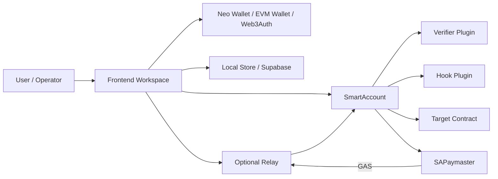
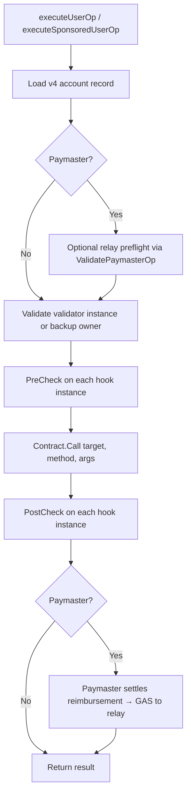

# Neo N3 Smart Account Architecture

The active `main` branch is a **policy-gated** V3 architecture centered on `SmartAccount`.

## 1. Component Map



## 2. Account Model

V3 is `accountId`-first.

- Each account is keyed by a deterministic 20-byte `accountId`.
- The public Neo address is derived locally from `verify(accountId)` plus the master contract hash.
- On-chain state stores:
  - `verifier`
  - `hook`
  - `backupOwner`
  - `escapeTimelock`
  - `escapeTriggeredAt`
  - nonce channels

The core wallet no longer depends on admin/manager/dome state as the main authorization surface.

## 3. Verification Pipeline

```mermaid
flowchart TD
  Start[Tx reaches Neo node] --> Verify[Node triggers verify(accountId)]
  Verify --> Context[Core checks active verification context]
  Context --> Allowed{Expected target?}
  Allowed -- No --> Reject1[Reject unexpected witness use]
  Allowed -- Yes --> Execute[executeUserOp(accountId, op)]
  Execute --> Auth{Verifier plugin passes or backup owner witness passes?}
  Auth -- No --> Reject2[Reject unauthorized operation]
  Auth -- Yes --> Nonce[Consume nonce + deadline]
  Nonce --> Hooks[Run hooks around execution]
  Hooks --> Return[Return result]
```

## 4. Application Execution Pipeline



The v4 core is intentionally small: authorization is delegated to validator module instances, policy to hook instances, and the core owns the nonce channels, configuration intents, threshold policies, `hookOrder`, recovery state and execution context.

## 5. Authorization Modes

- Backup-owner native witness
- Web3Auth / EIP-712 validator
- TeeKey / P256 / SessionKey / DelegatedIdentity / MultiSig validator instances
- Core-owned threshold policies over validator instances
- Hook instances in `hookOrder`, plus the built-in recovery and message paths

## 6. Contract File Map

| File | Responsibility |
| --- | --- |
| `contracts/native/SmartAccount/SmartAccount.cs` | v4 account control record, `verify`, `executeUserOp`, nonce channels, callback-free recovery, module configuration intents |
| `contracts/plugins/validators/Web3AuthValidator.cs` | EIP-712 `UserOperation` verification |
| `contracts/plugins/validators/TeeKeyValidator.cs` | TEE-signed authorization |
| `contracts/plugins/validators/P256Validator.cs` | Passkey / P-256 authorization |
| `contracts/plugins/validators/SessionKeyValidator.cs` | Short-lived delegated keys, one credential set per instance |
| `contracts/plugins/validators/MultiSigValidator.cs` | Threshold member validation; the core owns the policy |
| `contracts/plugins/validators/ZKEmailVerifier.cs` | Disabled email-authorization template; `onInstall` refuses |
| `contracts/plugins/validators/DelegatedIdentityValidator.cs` | Delegated (zkLogin) identity authorization |
| `contracts/plugins/validators/SubscriptionValidator.cs` | Bounded recurring charges; the core nonce is the only sequence |
| `contracts/plugins/hooks/*.cs` | Optional policies such as daily limits, token restrictions, and credential gating |

## 7. Module Lifecycle

Every module change travels the configuration-intent path and emits the generic module events:

- **install**: `proposeConfiguration` -> 24 h -> `confirmConfiguration` installs a validator or hook instance and emits `ModuleInstanceInstalled`
- **configure**: re-configuring an installed instance emits `ModuleInstanceConfigured` through the same intent path
- **remove**: an intent action or a recovery sweep removes the instance and emits `ModuleInstanceRemoved`
- **cancel / expire**: `cancelConfiguration` emits `ConfigurationIntentCancelled`; an intent whose window closes emits `ConfigurationIntentExpired`
- **policy**: `HookOrderSet` and `ThresholdPolicySet` record the ordered hook chain and the core threshold policy

The reused `ModuleInstalled` / `ModuleUpdateInitiated` / `ModuleUpdateConfirmed` / `ModuleRemoved` /
`ModuleUpdateCancelled` feed keeps older indexers working.

## 8. Recovery Model

v4 recovery is explicit and callback-free:

1. `beginRecovery(accountId, newCustody)` records a pending custody rotation that matures after the account's `recoveryTimelockMs` (7-90 days, fixed at creation).
2. `cancelRecovery(accountId)` deletes the pending record; only one can exist and its timer never restarts.
3. `executeRecovery(accountId)` is permissionless after maturity: it sweeps every module row and advances the authority epoch without calling any validator, hook, Market or Oracle.
4. `getRecoveryStatus(accountId)` reads the pending record back as `[exists, initiatedAt, matureAt, authorityEpochAtInit, newCustody]`.

This keeps recovery auditable and removes the old-plugin liveness dependency.

## 9. Paymaster (Sponsored Transactions)

The `SAPaymaster` contract enables trustless gasless execution on Neo N3:

1. **Deposit:** Sponsors send GAS to the Paymaster via NEP-17 transfer.
2. **Policy:** Sponsors call `setPolicy(accountId, targetContract, method, maxPerOp, dailyBudget, totalBudget, validUntil)`. Use `accountId = Zero` for a global policy sponsoring any account.
3. **Execution:** Relay calls `executeSponsoredUserOp(accountId, op, paymaster, sponsor, reimbursementAmount)` on the SA core.
4. **Settlement:** Core validates policy, executes the UserOp, then calls `paymaster.settleReimbursement()` to atomically deduct from the sponsor deposit and transfer GAS to the relay.

For a fee-bearing transaction the settled reimbursement is
`min(reimbursementAmount, transaction.SystemFee + transaction.NetworkFee)`. `maxPerOp`
limits this settlement, not the full transaction fee; a larger fee can still pass if
its requested reimbursement fits the policy. Daily and total budgets count settlements
under the resolved policy scope, including the shared scope of a global policy.
A policy violation faults the complete call. Zero-fee RPC estimation instead uses
the requested reimbursement as its conservative cap, so standard fee estimation
remains available; relays should retain a system-fee margin.

The Paymaster never authorizes execution — it only funds the relay after the verifier and hooks have already approved the operation.

## 10. Security Invariants

1. `verify(accountId)` is only valid inside the expected `executeUserOp` context.
2. Nonces are consumed by the core wallet, not verifier plugins.
3. Verifier plugins do not bypass hook or target-contract policy.
4. Backup-owner recovery is timelocked.
5. New integrations target `executeUserOp`; the V1/V2 wrappers `executeUnified` and `executeUnifiedByAddress` were removed and are absent from every deployed manifest and every contract source, so a transaction naming them fails in its verify phase.
6. Paymaster settlement only succeeds when called by the authorized SA core contract.
7. Paymaster deposit deduction happens before the GAS transfer to the relay (checks-effects-interactions).
