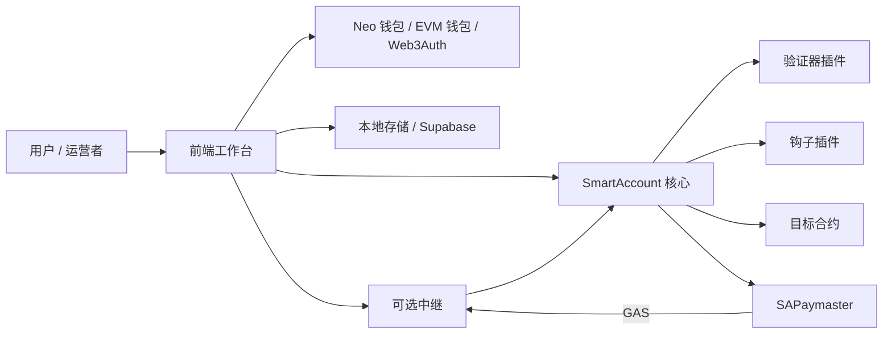
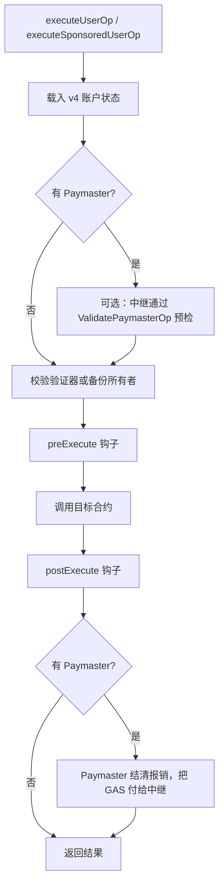

<!-- generated from docs/ARCHITECTURE.zh-CN.md by scripts/sync-frontend-docs.mjs; do not edit this file by hand -->

# Neo N3 Smart Account 架构

当前 `main` 分支是**策略管控**的 v4 架构：一个仅原生（native-only）的最小化 `SmartAccount` 核心，加上通过配置意图安装的验证器与钩子模块实例。

## 1. 组件图



## 2. 账户模型

v4 账户模型以 `accountId` 为第一主键。

- 每个账户由确定性的 20 字节 `accountId` 作为键。
- 对外 Neo 地址由 `verify(accountId)` 脚本加主合约哈希在本地推导。
- 链上状态保存：
  - `verifier`
  - `hook`
  - `backupOwner`
  - `escapeTimelock`
  - `escapeTriggeredAt`
  - nonce 通道

核心钱包不再以管理员 / 经理 / dome 状态作为主要授权面。

## 3. 验证流水线

```mermaid
flowchart TD
  Start[交易到达 Neo 节点] --> Verify[节点触发 verify(accountId)]
  Verify --> Context[核心检查当前验证上下文]
  Context --> Allowed{目标是否符合预期?}
  Allowed -- 否 --> Reject1[拒绝意外的见证使用]
  Allowed -- 是 --> Execute[executeUserOp(accountId, op)]
  Execute --> Auth{验证器插件通过，或备份所有者见证通过?}
  Auth -- 否 --> Reject2[拒绝未授权操作]
  Auth -- 是 --> Nonce[消耗 nonce 并校验 deadline]
  Nonce --> Hooks[执行前后钩子]
  Hooks --> Return[返回结果]
```

## 4. 应用执行流水线



v4 核心刻意保持精简：授权委托给验证器插件，策略委托给钩子插件，核心只负责 nonce 消耗、恢复状态与执行上下文。

## 5. 授权模式

- 备份所有者原生见证
- Web3Auth / EIP-712 验证器
- TEE / WebAuthn / SessionKey / MultiSig / ZKEmail 验证器插件
- 由自定义钩子中介的策略检查

## 6. 合约文件地图

| 文件 | 职责 |
| --- | --- |
| `contracts/native/SmartAccount/SmartAccount.cs` | v4 账户控制记录、`verify`、`executeUserOp`、nonce 通道、无回调恢复、模块配置意图 |
| `contracts/plugins/validators/Web3AuthValidator.cs` | EIP-712 `UserOperation` 验证 |
| `contracts/plugins/validators/TeeKeyValidator.cs` | TEE 签名授权 |
| `contracts/plugins/validators/P256Validator.cs` | Passkey / P-256 授权 |
| `contracts/plugins/validators/SessionKeyValidator.cs` | 短期委托密钥，每个实例一套凭据 |
| `contracts/plugins/validators/MultiSigValidator.cs` | 阈值成员校验；策略由核心持有 |
| `contracts/plugins/validators/ZKEmailVerifier.cs` | 被禁用的邮箱授权模板；`onInstall` 拒绝 |
| `contracts/plugins/validators/DelegatedIdentityValidator.cs` | 委托（zkLogin）身份授权 |
| `contracts/plugins/validators/SubscriptionValidator.cs` | 有界周期性扣款；核心 nonce 是唯一序号 |
| `contracts/plugins/hooks/*.cs` | 可选策略，如每日限额、代币限制、凭证门控 |

## 7. 模块生命周期

每次模块变更都走配置意图路径，并发出通用模块事件：

- **安装**：`proposeConfiguration` -> 24 小时 -> `confirmConfiguration` 安装 validator 或 hook 实例并发出 `ModuleInstanceInstalled`
- **配置**：对已安装实例重新配置，经同一意图路径发出 `ModuleInstanceConfigured`
- **移除**：意图动作、市场结算或恢复清扫移除实例并发出 `ModuleInstanceRemoved`
- **取消 / 过期**：`cancelConfiguration` 发出 `ConfigurationIntentCancelled`；窗口关闭的意图发出 `ConfigurationIntentExpired`
- **策略**：`HookOrderSet` 与 `ThresholdPolicySet` 记录有序 hook 链与核心阈值策略

复用的 `ModuleInstalled` / `ModuleUpdateInitiated` / `ModuleUpdateConfirmed` / `ModuleRemoved` /
`ModuleUpdateCancelled` 事件继续为旧索引器供数。

## 8. 恢复模型

v4 恢复显式且不调用回调：

1. `beginRecovery(accountId, newCustody)` 记录一条待生效的托管权轮换，在账户的 `recoveryTimelockMs`（7-90 天，创建时固定）之后到期。
2. `cancelRecovery(accountId)` 删除待处理记录；同时只能存在一条，计时永不重置。
3. `executeRecovery(accountId)` 到期后无需许可：清扫全部模块行并推进 authority epoch，过程中不调用任何 validator、hook、Market 或 Oracle。
4. `getRecoveryStatus(accountId)` 以 `[exists, initiatedAt, matureAt, authorityEpochAtInit, newCustody]` 回读待处理记录。

这让恢复过程可审计，同时去掉了对旧插件活性的依赖。

## 9. Paymaster（赞助交易）

`SAPaymaster` 合约在 Neo N3 上实现无信任的免 Gas 执行：

1. **存款：** 赞助方通过 NEP-17 转账把 GAS 发给 Paymaster。
2. **策略：** 赞助方调用 `setPolicy(accountId, targetContract, method, maxPerOp, dailyBudget, totalBudget, validUntil)`。用 `accountId` 为零表示赞助任意账户的全局策略。
3. **执行：** 中继在 SA 核心上调用 `executeSponsoredUserOp(accountId, op, paymaster, sponsor, reimbursementAmount)`。
4. **结算：** 核心校验策略、执行用户操作，然后调用 `paymaster.settleReimbursement()`，原子性地从赞助方存款中扣除并把 GAS 转给中继。

对于带费用的交易，实际结算额是
`min(reimbursementAmount, 系统费 + 网络费)`。`maxPerOp` 限制的是这个结算额，而不是完整交易费用；只要请求的报销额符合策略，更大的交易费仍可通过。每日与总额预算按已解析策略作用域统计结算额，包括全局策略的共享作用域。违反策略会使整个调用失败。零费用 RPC 估算则把请求的报销额当作保守上限，因此标准费用估算仍然可用；中继应保留系统费余量。

Paymaster 从不对执行进行授权——它只在验证器与钩子已经批准操作之后为中继出资。

## 10. 安全不变量

1. `verify(accountId)` 只在预期的 `executeUserOp` 上下文中有效。
2. nonce 由核心钱包消耗，而不是验证器插件。
3. 验证器插件不能绕过钩子或目标合约策略。
4. 备份所有者恢复受时间锁约束。
5. 新集成一律面向 `executeUserOp`；V1/V2 的 `executeUnified` 与 `executeUnifiedByAddress` 已被移除，不存在于任何已部署清单与合约源码中，因此命名它们的交易会在验证阶段失败。
6. 只有当调用者是已授权的 SA 核心合约时，Paymaster 结算才会成功。
7. Paymaster 先扣减赞助方存款，再向中继转账 GAS（检查-生效-交互）。
