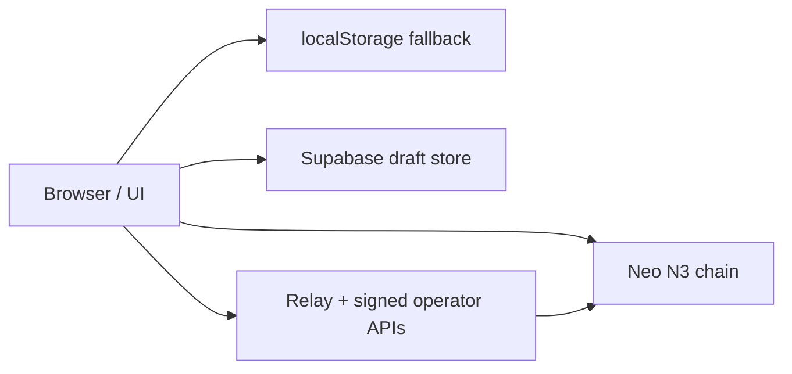
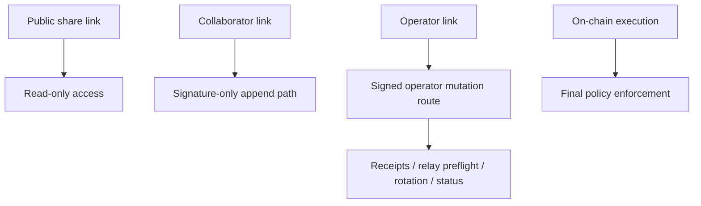
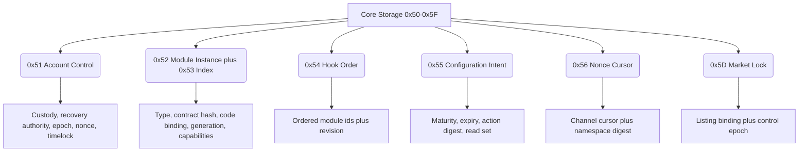
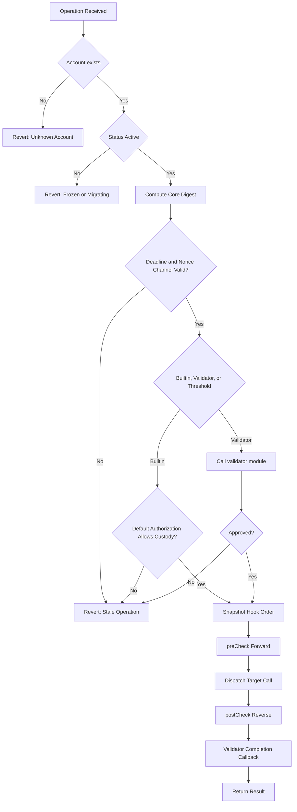
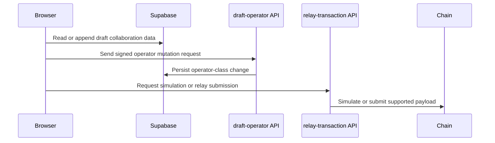

# Contract Data Flow & Storage

The Smart Account model centralizes all on-chain authority inside the **Master Entry Contract**, while using the browser, Supabase, and optional relay services to improve usability and collaboration.

## 1. System Boundaries

The easiest way to understand the system is to separate it into trust boundaries.

Those boundaries do different jobs:

- **Browser** prepares invocations, displays readiness, and holds temporary UI state
- **localStorage** preserves local-only drafts when Supabase is absent
- **Supabase** stores collaborative draft data and scoped links
- **Relay APIs** simulate or submit relay-ready payloads and accept signed operator mutations
- **Neo N3 chain** stores the real account rules and executes the final call

## 2. Data Ownership Matrix

| Boundary | What lives there | Who can mutate it | Why it exists |
| --- | --- | --- | --- |
| On-chain master contract | Control record (status, custody, recovery authority, epoch, configuration nonce), module instances, hook order, threshold policies, pending configuration intents, nonce cursors | Configuration intents and execution | Source of truth for authorization and execution |
| Browser memory | Current workspace state, selected payload mode, active wallet session | Current browser session | Fast UX and staging |
| `localStorage` fallback | Local-only drafts and preferences | Same browser only | Offline / no-Supabase development path |
| Supabase | Draft body, append-only signatures, bounded activity, bounded receipts, scoped slugs | Scope-limited collaboration flows | Shared review and multi-party coordination |
| Relay server | Simulation results in flight, relay signer use, signed operator mutation validation | Server config + signed operator requests | UX helper for relay and operator-only actions |

## 3. Mutation Authority by Boundary

Not every boundary is allowed to mutate the same data.

Practical meaning:

- public viewers can inspect a draft but cannot mutate it
- collaborators can add signatures but cannot append operator-class relay activity
- operators can request higher-sensitivity mutations, but the server still validates signed intent
- the chain remains the final authority for whether the transaction is valid

## 4. Storage Schema On-Chain

Every key is `prefix (1 byte) ‖ accountId (20 bytes) ‖ fixed-width big-endian suffix`, so one account's
state is a contiguous, self-describing region. Both kernels use the same bytes for 0x50–0x5F.

Earlier prefixes are migration input only: the custom kernel's 0x01 rows and the native kernel's
0x10 account array are read once at migration, and the retired authorization prefixes are never
re-interpreted. New state is written only under 0x51 and above.

## 5. Internal Data Flow During Execution

When an execution command enters the Master Contract, it flows through one pipeline: status and epoch,
digest, route, hook sequence, dispatch.

The hook snapshot is bound into the signature, so the set that runs is the set the signer approved. A
frozen account, a matured recovery or a settlement advances the epoch, and every operation signed
against the old epoch fails the deadline-and-nonce step instead of reaching a module.

## 6. Relay and Signed Operator Mutation Flow

The relay and operator helper paths exist to improve usability, not to replace the contract.

## 7. Retention and Practical Limits

The collaborative metadata layer is intentionally bounded:

- latest **100 activity entries** retained
- latest **12 submission receipts** retained
- immutable draft body preserved separately from append-only signature history

This keeps long-lived drafts explainable and reviewable without letting metadata grow without limit.

## 8. Storage Key Prefixes Table

| Prefix | Key suffix | Purpose |
| :--- | :---: | :--- |
| `0x50` | none | Protocol version, layout version and activation state. |
| `0x51` | accountId | Account control record: status, custody, recovery authority, epoch, nonce, timelock, revisions. |
| `0x52` | accountId + moduleId | Module instance record: type, contract hash, code binding, revision, credential generation, capabilities. |
| `0x53` | accountId + type + moduleId | Installed-instance index, scanned per type in ascending module id. |
| `0x54` | accountId | Hook order list plus its revision. |
| `0x55` | accountId + intentId | Configuration intent: maturity, expiry, action digest, read set. |
| `0x56` | accountId + channel | Nonce cursor for one channel. |
| `0x57` | accountId | Built-in message signer subjects and threshold. |
| `0x5B` | accountId + policyId | Threshold member list and policy commitment. |
| `0x5D` | accountId | Market lock bound to the listing and the control epoch. |
| `0x5E` | accountId | Bounded index of pending configuration intents. |

The retired authorization prefixes are reserved and never re-allocated: a migrated account's old
bytes stay readable as evidence but no code derives authorization from them.

## Matrix Domain Resolution Boundary

The `.matrix` contract is an external naming boundary. It does not replace SA authorization state. Instead, the frontend resolves a `.matrix` domain to a controller wallet address and then reads the accounts that wallet controls.
