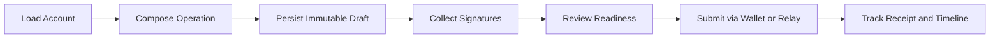
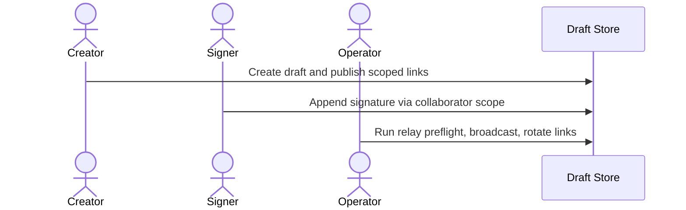
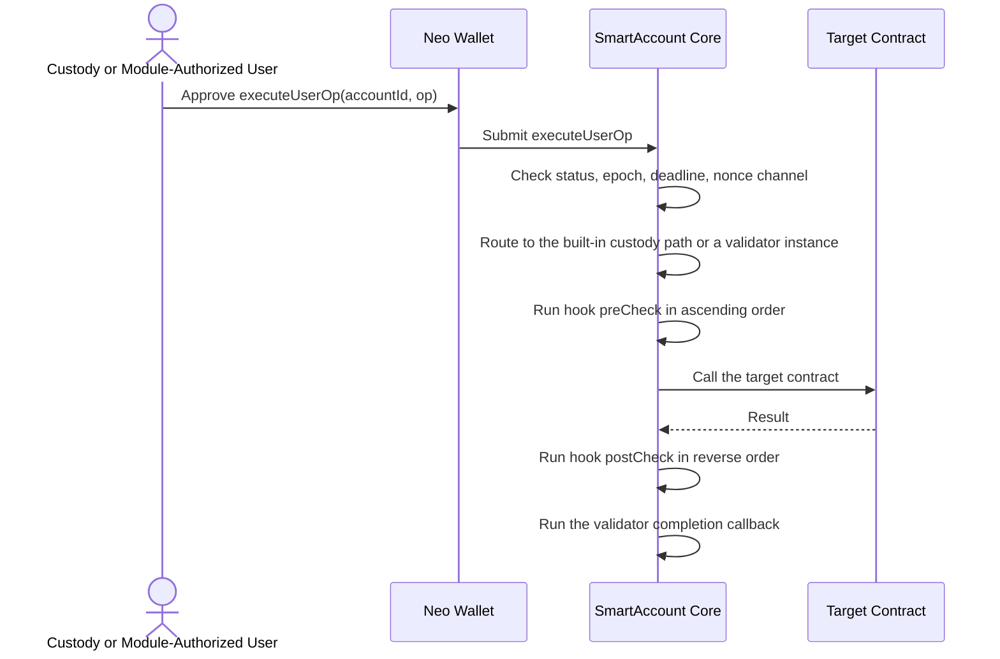
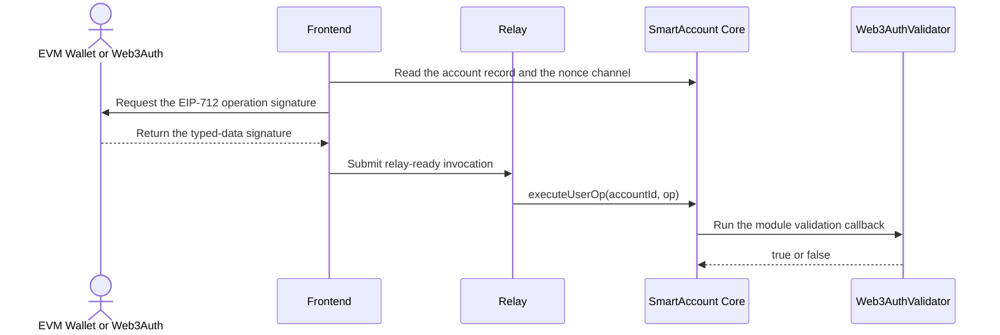

# Smart Account Workflow Lifecycle

This page describes the active v4 workflow built around the `SmartAccount` core and
`executeUserOp(accountId, op)`.

Direct proxy-signed external calls are intentionally rejected: the proxy script embeds the account
identity, and the witness entry it carries only succeeds inside a core execution context. The
supported execution path is the core's `executeUserOp` (or `executeUserOps` for a batch).

## App Workspace

The app workspace is the primary operator surface.

- Load an account from its accountId hash, or create one from a custody script hash and a salt.
- Derive the virtual Neo address locally from the proxy script.
- Stage one canonical 13-field operation, or a batch of up to 32.
- Persist an immutable draft.
- Collect Neo and EVM approvals.
- Choose client-side broadcast or relay broadcast.

The public share link is read-only, the collaborator link can append signatures, and the operator link
can run relay checks, broadcasts, and link rotation. Shared drafts keep only the latest 100 activity entries and 12 submission receipts.

If Supabase is not configured, the same flow falls back to local-only `localStorage` persistence in
the current browser.

## 1. First Transaction Walkthrough

1. **Load the account** from an `accountId` hash, or create it first.
2. **Choose the operation** with Generic Invoke, NEP-17 Transfer, or Multisig Draft.
3. **Stage the operation** as a v4 `executeUserOp` payload: version, target, method, args, nonce
   channel, nonce subkey, deadline, validator id, credential generation, authority epoch,
   configuration nonce, signature and hook proofs.
4. **Persist the draft** before collecting external approvals.
5. **Collect signatures** from Neo, EVM, or both.
6. **Review relay readiness** — the read-only `validateUserOp` preview plus relay simulation — and
   choose the payload mode.
7. **Broadcast** with a Neo wallet or submit via relay.

## 2. Choose the Submission Path

| Path | Best for | Requirements | Tradeoff |
| --- | --- | --- | --- |
| Client-side broadcast | Native Neo wallet users | Browser wallet connected | Simplest and most transparent |
| Relay preflight | Operators who want simulation before submit | Relay endpoint configured | Adds a server dependency, but gives VM and gas feedback |
| Relay raw submission | An already signed raw transaction | Raw forwarding explicitly enabled | Narrow passthrough, opt-in only |
| Relay invocation submission | EVM / mixed-signature flows | Relay signer plus relay invocation mode | Most flexible relay broadcast for mixed-signature workflows |

When both raw and relay-ready invocation payloads exist, the UI exposes **Best Available**,
**Signed Raw Tx**, and **Relay Invocation**.

Relay broadcast never authorizes: the relay packages and pays, while the signature that matters is the
one the account validates on chain.

## 3. Collaboration Lifecycle

## 4. Native Neo Execution

A batch envelope commits wholly or aborts; there is no partial success.

## 5. EVM / Web3Auth Execution

The typed data binds the account, the epoch, the configuration nonce and the hook-proof digest, so a
signature cannot be replayed against a different account state.

## 6. Before You Broadcast

- Verify the `accountId` is the intended one.
- Confirm the target contract, method, args and deadline.
- Check signer progress against the required approvals, and the threshold when a threshold policy
  routes the operation.
- Confirm the authority epoch and configuration nonce the draft was built against — a freeze, a
  recovery, a settlement or a configuration change invalidates it.
- Confirm whether you are sending raw transaction bytes or a relay-ready invocation.
- Run relay preflight before relay submission when possible.
- Rotate scoped links if an older collaborator or operator URL leaked.

## 7. Removed Wrappers

Drafts written against the previous generation may still name removed entrypoints. Nothing in the
current runtime implements them: no manifest and no source defines them, so a transaction naming one
fails in its verify phase. New integrations target `executeUserOp`, `executeUserOps`, or the
configuration intent entries `proposeConfiguration` / `confirmConfiguration`.
